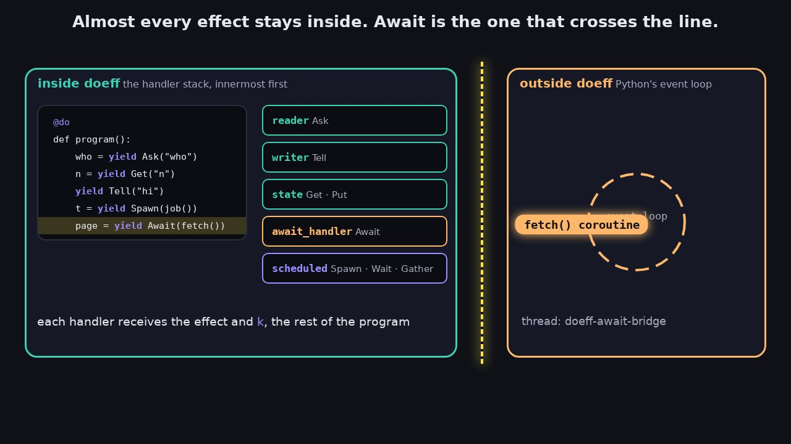

# 17. Effect Boundaries

This chapter explains where doeff handles work internally and where execution intentionally leaves
doeff for Python async integration.

[](assets/videos/effect-boundaries.mp4)

## Table of Contents

- [Boundary Model](#boundary-model)
- [Effects That Stay Inside doeff](#effects-that-stay-inside-doeff)
- [Effect Categorization](#effect-categorization)
- [How `Await` Leaves doeff](#how-await-leaves-doeff)
- [Why `Await` Needs an Event Loop](#why-await-needs-an-event-loop)
- [Scheduler Suspension vs Leaving doeff](#scheduler-suspension-vs-leaving-doeff)
- [Formal Model](#formal-model)
- [VM Parameterization](#vm-parameterization)
- [Custom Handler Rules](#custom-handler-rules)

## Boundary Model

At runtime, doeff has two execution zones:

- **Inside doeff**: effects are interpreted by the handler stack, on the thread that called `run`.
- **Outside doeff**: awaited coroutines run on a Python event loop, on a separate bridge thread.

The boundary matters because scheduler effects and Python async effects have different execution
responsibilities.

## Effects That Stay Inside doeff

Most effects are fully handled by doeff handlers and never leave the VM stepping loop:

- `Ask`, `Local`
- `Get`, `Put`
- `Tell`, `Listen`
- `Try`
- scheduler effects such as `Spawn`, `Wait`, `Gather`, `Race`

Example:

```python
from doeff import Ask, Gather, Spawn, Wait, do

@do
def pipeline():
    worker = yield Ask("worker")
    t1 = yield Spawn(worker("a"))
    t2 = yield Spawn(worker("b"))
    values = yield Gather(t1, t2)
    first = yield Wait(t1)
    return values, first
```

All of those effects are resolved by handlers inside doeff, on one thread, with no event loop
running.

## Effect Categorization

| Category | Effects | Boundary |
| --- | --- | --- |
| Context | `Ask`, `Local` | Inside doeff |
| State / Writer / Result | `Get`, `Put`, `Tell`, `Listen`, `Try` | Inside doeff |
| Scheduler | `Spawn`, `Wait`, `Gather`, `Race` | Inside doeff |
| Promise | `CreatePromise`, `CompletePromise`, `FailPromise` | Inside doeff |
| Async handoff | `Await` via `await_handler()` | Leaves doeff: the coroutine runs on the bridge thread's event loop |

## How `Await` Leaves doeff

`Await(awaitable)` is answered by `await_handler()`, which needs `scheduled` outside it:

```python
run(scheduled(await_handler()(program())))
```

For each `Await`, the handler:

1. creates an `ExternalPromise` with the scheduler (`CreateExternalPromise`);
2. hands the coroutine to one process-wide event loop that runs on a daemon thread named
   `doeff-await-bridge`;
3. performs `Wait` on the promise, so the scheduler holds the awaiting task's continuation `k`
   while other tasks keep running;
4. when the coroutine finishes, the bridge thread completes (or fails) the promise, and the
   scheduler resumes `k` with the value (or throws the error into it).

The scheduler only blocks on the outside world when no task is ready: it then waits for the next
external completion.

## Why `Await` Needs an Event Loop

Python `await` is syntax-level and must run under an event loop. A synchronous stepping loop
cannot abstract that away.

Key points:

- `await` cannot be evaluated inside a normal sync function without handing control to an event
  loop.
- `await_handler()` is the one place that hands work to an event loop; everything else stays in
  the handler stack.
- The bridge is not a general-purpose "leave doeff" mechanism; it is specifically for Python async
  integration.

## Scheduler Suspension vs Leaving doeff

These are different mechanisms:

- **Scheduler suspension (internal)**:
  - `Spawn`/`Wait`/`Gather`/`Race` are coordinated by scheduler handlers.
  - Tasks can be queued/suspended/resumed internally; a `Delay` under `sim_time_handler()` moves
    a virtual clock and takes no real time.
- **Leaving doeff (external)**:
  - `await_handler()` hands the coroutine to the bridge thread's event loop.
  - The awaiting task is suspended on an `ExternalPromise`, like any other wait.
  - Control returns to the task once the coroutine finishes and completes the promise.

## Formal Model

Inside doeff, a run is a sequence of VM steps. Each `yield` of an effect hands the effect and the
continuation `k` to the innermost handler that matches it; the handler resumes, throws into,
passes on or holds `k`. No step needs anything from outside the process.

The one input from outside is the scheduler's queue of external completions:

```text
inside  : step(state) -> state                  -- handlers answer effects
outside : coroutine on the bridge loop -> completion of an ExternalPromise
join    : the scheduler resumes the k waiting on that promise
```

## VM Parameterization

The VM remains a pure step machine and does not require `VM[M]` parameterization.
State, reader, writer, scheduler, and promise operations are interpreted by handlers and
return normal VM outcomes inside doeff.
Only Python `await` syntax forces an external boundary, and it is crossed by a handler, not by the
VM, so doeff keeps one VM and one entry point: `run(doexpr)` which accepts a single program
argument and returns the raw value.

## Custom Handler Rules

When adding handlers, keep the boundary strict:

1. Handle domain effects inside handlers whenever possible.
2. Perform `Await` only for operations that must execute in Python async context, and compose
   `await_handler()` outside the handler that performs it, with `scheduled` outside both.
3. Keep scheduler state transitions internal to scheduler handlers.

Example:

```python
from doeff import do, run
from doeff_core_effects import Ask
from doeff_core_effects.handlers import reader, state, writer
from doeff_core_effects.scheduler import scheduled

@do
def compute():
    value = yield Ask("key")
    return value * 2

result = run(scheduled(state()(writer(reader({"key": 21})(compute())))))
assert result == 42
```

A handler that needs Python async performs `Await` itself:

```python
import asyncio
from dataclasses import dataclass

from doeff import Await, EffectBase, Resume, do, handler, run
from doeff_core_effects.handlers import await_handler
from doeff_core_effects.scheduler import scheduled

@dataclass(frozen=True)
class Fetch(EffectBase):
    url: str

@do
def page(url):
    return (yield Fetch(url))

async def http_get(url):
    await asyncio.sleep(0.05)
    return f"<html>{url}</html>"

@handler
def over_async(effect: Fetch, k):
    body = yield Await(http_get(effect.url))
    return (yield Resume(k, body))

assert run(scheduled(await_handler()(over_async(page("a.dev"))))) == "<html>a.dev</html>"
```

Without `await_handler()`, or with it inside `over_async`, the `Await` finds no handler and the run
raises `UnhandledEffect`.
