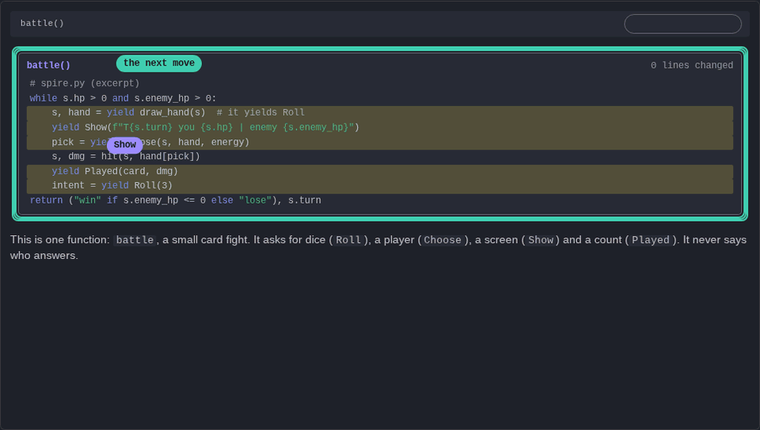
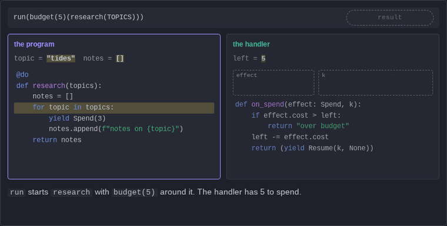
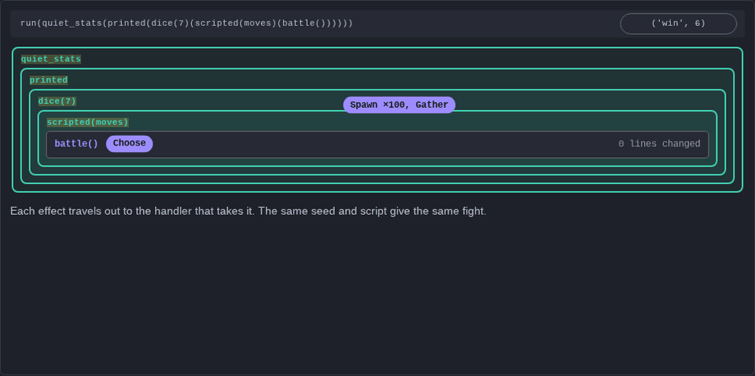
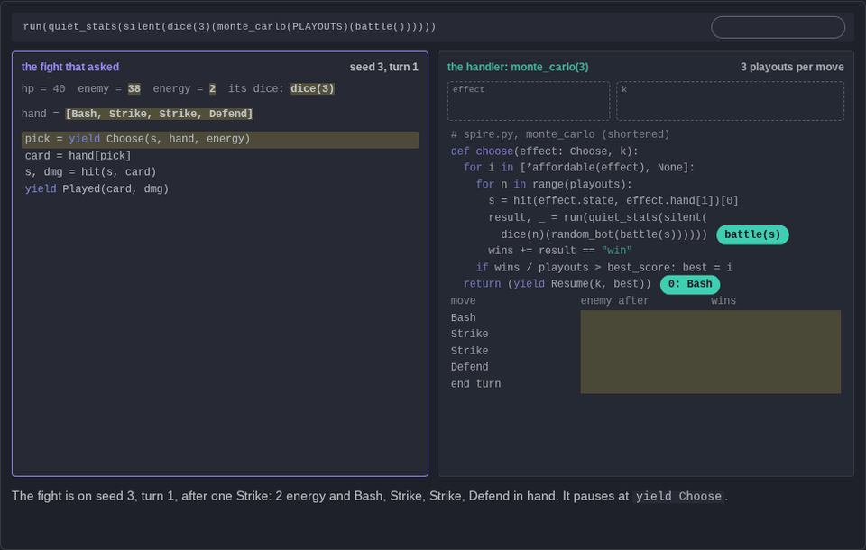
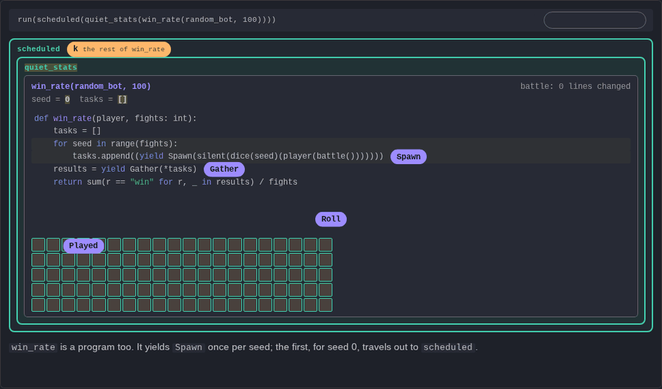
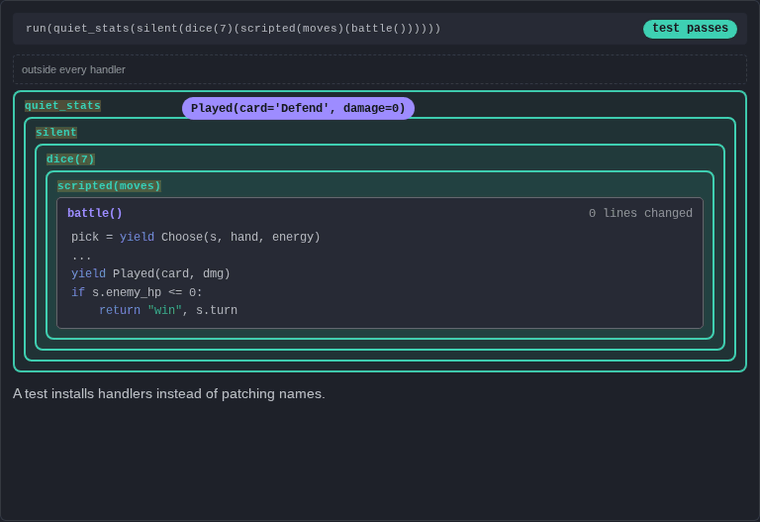

# Algebraic effects for Python: stack handlers around one unchanged program

Algebraic effects in Python, with doeff, an open-source library whose core is written in Rust. A function yields effects, operations it names, and a handler receives each one together with the rest of the function and decides how the function goes on.

This post stacks such handlers around one small program, one layer at a time; if you know what `yield` does, you know most of what you need.

First, the idea of doeff in a minute: a function yields effects, handlers stacked outside it answer them, and each handler gets the rest of the function as `k`.

[The same video as an mp4 file (2:28)](../assets/videos/article-concept.mp4)

Then the card fight this post builds on, as one function with handlers stacked around it:

[The same video as an mp4 file (1:51)](../assets/videos/article-opening.mp4)

## The idea: an exception a handler can resume

Think of an effect as an exception a handler can answer, after which the code carries on from the line that raised it. A **program** is a generator function under `@do`, an **effect** is a plain value it yields, and a **handler** is a function of `(effect, k)`, where `k` is the rest of the function. The caller picks the handlers, so the same function means different things under different handlers.

Resuming and dropping are two of six things a handler can do with `k`:

| The handler | Written as | The program |
|---|---|---|
| answers and runs the rest | `yield Resume(k, value)` | goes on with `value`; when it finishes, the handler gets its result and returns that or another value |
| answers and is done | `yield Transfer(k, value)` | goes on with `value`; the handler does not get control back |
| throws into it | `yield ResumeThrow(k, error)` | sees `error` raised at the `yield`, where its own `try` can catch it |
| passes the effect on | `yield Pass(effect, k)` | gets the answer of the next handler out |
| keeps it for later | stores `k`, then `yield Transfer(k, value)` while handling a later effect | waits until the handler continues it |
| drops it | `return value`, without resuming `k` | stops at the `yield`; `value` is the result of everything under the handler |

spend.py: the smallest version, with a budget that resumes or drops <code>k</code>

~~~python
# spend.py
from dataclasses import dataclass

from doeff import EffectBase, Resume, Transfer, do, handler, run

@dataclass(frozen=True)
class Spend(EffectBase):  # an effect: "the next step costs this much"
    cost: int

@do
def research(topics: list[str]):  # pauses at each yield; knows nothing about money
    notes = []
    for topic in topics:
        yield Spend(3)
        notes.append(f"notes on {topic}")
    return notes

@handler
def free(effect: Spend, k):  # answer, and let the rest of research run
    yield Transfer(k, None)

@handler
def refuse(effect: Spend, k):  # drop k: research stops at its first Spend
    return "refused"

def budget(limit: int):
    left = limit

    @handler
    def on_spend(effect: Spend, k):
        nonlocal left
        if effect.cost > left:
            return "over budget"  # drop k: research never gets past this Spend
        left -= effect.cost
        return (yield Resume(k, None))  # resume k: research goes on

    return on_spend

TOPICS = ["tides", "moons"]

if __name__ == "__main__":
    print(run(free(research(TOPICS))))
    print(run(refuse(research(TOPICS))))
    print(run(budget(10)(research(TOPICS))))
    print(run(budget(5)(research(TOPICS))))
~~~

~~~text
['notes on tides', 'notes on moons']
refused
['notes on tides', 'notes on moons']
over budget
~~~

Follow the run of `budget(5)(research(TOPICS))` below: `k` is a value, and the handler decides what happens to it.

## One program, layer by layer

`battle` is a small deck-building fight in the spirit of the game Slay the Spire. It yields four kinds of effect: `Roll`, `Choose`, `Show` and `Played`. Nothing in it says where the random numbers come from, who picks the cards, whether there is a screen, or whether anyone is counting. In every layer below, `battle` is the same function.

spire.py (excerpt): the four effects and <code>battle</code>

~~~python
# spire.py (excerpt)
import random
import sys
from dataclasses import dataclass, replace

from doeff import EffectBase, Gather, Resume, Spawn, do, handler, run
from doeff_core_effects import scheduled

# ---- Effects: everything the fight needs from the outside world.
@dataclass(frozen=True)
class Roll(EffectBase):  # "give me a random number below n"
    n: int

@dataclass(frozen=True)
class Choose(EffectBase):  # "player: which card, or None to end the turn?"
    state: Fight
    hand: tuple[str, ...]
    energy: int

@dataclass(frozen=True)
class Show(EffectBase):  # "draw this on the screen"
    text: str

@dataclass(frozen=True)
class Played(EffectBase):  # "a card was played" (for statistics)
    card: str
    damage: int

# ---- The game: plain data and one @do program.
CARDS = {"Strike": (1, 6, 0), "Defend": (1, 0, 5), "Bash": (2, 8, 0)}  # cost, damage, block
DECK = ("Strike",) * 5 + ("Defend",) * 4 + ("Bash",)

@dataclass(frozen=True)
class Fight:
    hp: int = 40
    block: int = 0
    enemy_hp: int = 44
    vulnerable: int = 0  # turns the enemy takes +50% damage
    enemy_strength: int = 0
    draw: tuple[str, ...] = DECK
    discard: tuple[str, ...] = ()
    turn: int = 1

@do
def draw_hand(s: Fight, n: int = 5):
    """Draw n cards; the deck is shuffled by asking for a random position (Roll)."""
    hand = []
    for _ in range(n):
        if not s.draw:
            s = replace(s, draw=s.discard, discard=())
        if not s.draw:
            break
        i = yield Roll(len(s.draw))
        hand.append(s.draw[i])
        s = replace(s, draw=s.draw[:i] + s.draw[i + 1 :])
    return s, tuple(hand)

@dataclass(frozen=True)
class Hit:
    state: Fight
    damage: int

def hit(s: Fight, card: str) -> Hit:
    """Play one card on the state: returns the new state and the damage dealt (a pure function)."""
    cost, dmg, blk = CARDS[card]
    dmg = dmg * 3 // 2 if s.vulnerable else dmg
    s = replace(s, enemy_hp=s.enemy_hp - dmg, block=s.block + blk)
    if card == "Bash":
        s = replace(s, vulnerable=2)
    return Hit(s, dmg)

@do
def battle(s: Fight = Fight()):
    """Fight to the end. Returns ("win" | "lose", the turn it ended on)."""
    while s.hp > 0 and s.enemy_hp > 0:
        s = replace(s, block=0)
        s, hand = yield draw_hand(s)
        energy = 3
        while energy > 0 and hand:
            yield Show(f"T{s.turn} you {s.hp} ({s.block} block) | enemy {s.enemy_hp} | {energy} energy | {' '.join(hand)}")
            pick = yield Choose(s, hand, energy)
            if pick is None or CARDS[hand[pick]][0] > energy:
                break
            card = hand[pick]
            hand = hand[:pick] + hand[pick + 1 :]
            energy -= CARDS[card][0]
            dealt = hit(s, card)
            s = replace(dealt.state, discard=dealt.state.discard + (card,))
            yield Played(card, dealt.damage)
            if s.enemy_hp <= 0:
                return "win", s.turn
        s = replace(s, discard=s.discard + hand)
        intent = yield Roll(3)  # the enemy: 0 chomp 11, 1 thrash 7, 2 bellow (+3 strength)
        if intent == 2:
            s = replace(s, enemy_strength=s.enemy_strength + 3)
            yield Show("   enemy bellows")
        else:
            raw = (11 if intent == 0 else 7) + s.enemy_strength
            taken = max(0, raw - s.block)
            s = replace(s, hp=s.hp - taken)
            yield Show(f"   enemy hits for {raw}, you take {taken}")
        s = replace(s, vulnerable=max(0, s.vulnerable - 1), turn=s.turn + 1)
    return ("win" if s.enemy_hp <= 0 else "lose"), s.turn
~~~

Here are the stacks the layers below build, one per step, with `battle` unchanged in the middle:

### Layer 1: a scripted player and a screen

`scripted` answers `Choose` from a list, and `dice(7)` answers `Roll` from a seeded generator. The same seed and script give the same fight on every run, so a bug report becomes a seed and a list of moves.

The handlers of Layer 1, the run and what it prints

~~~python
# spire.py (excerpt)
# ---- Layer 1: a scripted player and a screen.
def dice(seed: int):
    """Answer Roll from a generator seeded with `seed`: the same seed, the same fight."""
    rng = random.Random(seed)

    @handler
    def roll(effect: Roll, k):
        return (yield Resume(k, rng.randrange(effect.n)))

    return roll

def scripted(moves: list):
    """A player who follows a script (a test, or a replayed bug report); None ends the turn."""
    moves = list(moves)

    @handler
    def choose(effect: Choose, k):
        return (yield Resume(k, moves.pop(0) if moves else None))

    return choose

@handler
def printed(effect: Show, k):
    """The screen: print each line."""
    print("   ", effect.text)
    return (yield Resume(k, None))

@handler
def silent(effect: Show, k):
    """No screen: thousands of fights per second."""
    return (yield Resume(k, None))

@handler
def quiet_stats(effect: Played, k):
    """Nobody is counting."""
    return (yield Resume(k, None))
~~~

~~~python
moves = [0, 0, 0, None] * 20
print(run(quiet_stats(printed(dice(7)(scripted(moves)(battle()))))))
~~~

~~~text
    T1 you 40 (0 block) | enemy 44 | 3 energy | Defend Strike Defend Defend Strike
    T1 you 40 (5 block) | enemy 44 | 2 energy | Strike Defend Defend Strike
    T1 you 40 (5 block) | enemy 38 | 1 energy | Defend Defend Strike
       enemy hits for 11, you take 1
    T2 you 39 (0 block) | enemy 38 | 3 energy | Bash Strike Strike Strike Defend
       enemy hits for 11, you take 11
    T3 you 28 (0 block) | enemy 38 | 3 energy | Strike Strike Strike Defend Defend
    T3 you 28 (0 block) | enemy 32 | 2 energy | Strike Strike Defend Defend
    T3 you 28 (0 block) | enemy 26 | 1 energy | Strike Defend Defend
       enemy hits for 11, you take 11
    T4 you 17 (0 block) | enemy 20 | 3 energy | Defend Strike Defend Strike Bash
       enemy bellows
    T5 you 17 (0 block) | enemy 20 | 3 energy | Bash Strike Defend Strike Defend
    T5 you 17 (0 block) | enemy 12 | 1 energy | Strike Defend Strike Defend
       enemy hits for 14, you take 14
    T6 you 3 (0 block) | enemy 3 | 3 energy | Strike Defend Defend Strike Strike
('win', 6)
~~~

### Layer 2: a random bot

`random_bot` takes the place of `scripted`, and `silent` takes the place of `printed`. It yields a `Roll` of its own, which travels out to `dice(3)` like any `Roll` from `battle`.

<code>random_bot</code>, the run and what it prints

~~~python
# spire.py (excerpt)
def affordable(effect: Choose) -> list[int]:
    """Positions in the hand of the cards the player has the energy for."""
    return [i for i, c in enumerate(effect.hand) if CARDS[c][0] <= effect.energy]

@handler
def random_bot(effect: Choose, k):
    """Play a random affordable card, or end the turn (the extra number is "end the turn")."""
    options = affordable(effect)
    i = yield Roll(len(options) + 1)
    return (yield Resume(k, options[i] if i < len(options) else None))
~~~

~~~python
print(run(quiet_stats(silent(dice(3)(random_bot(battle()))))))
~~~

~~~text
('win', 4)
~~~

### Layer 3: record and replay

`record` passes each effect on and keeps the answer, and `replay` answers from the tape. The 32 answers are the whole fight: keep them with a crash report, and the crash happens again, move for move.

<code>record</code> and <code>replay</code>, the runs and what they print

~~~python
# spire.py (excerpt)
def record(tape: list):
    """Keep every Roll and Choose answer on the tape, passing the effect on to the handlers outside."""

    @handler
    def recorder(effect: Roll | Choose, k):
        answer = yield effect
        tape.append(answer)
        return (yield Resume(k, answer))

    return recorder

def replay(tape: list):
    """Answer Roll and Choose from the tape: no dice, no player, the same fight."""
    tape = list(tape)

    @handler
    def replayer(effect: Roll | Choose, k):
        return (yield Resume(k, tape.pop(0)))

    return replayer
~~~

~~~python
tape: list = []
first = run(quiet_stats(silent(dice(3)(random_bot(record(tape)(battle()))))))
again = run(quiet_stats(silent(replay(tape)(battle()))))
print(first, again, "same:", first == again, "tape:", len(tape), "answers")
~~~

~~~text
('win', 4) ('win', 4) same: True tape: 32 answers
~~~

### Layer 4: a Monte Carlo bot

[The same video as an mp4 file (1:11)](../assets/videos/article-monte-carlo.mp4)

To answer `Choose`, `monte_carlo` runs `battle` itself, many times, each time as a new run from the state after a candidate move, while the fight that asked stays paused as `k`. It needs no model of the game: it plays the real `battle`, so when a card changes, the bot plays the changed card. The runs inside the handler have their own stacks, so they do not use up the dice of the paused fight, and none of them runs `k`: the handler resumes `k` once, with the move it picks. The playouts are rough: each starts from the next turn's draw, and three per move is very few. The next layer measures how much better the bot plays anyway.

<code>monte_carlo</code>, the run and what it prints

~~~python
# spire.py (excerpt)
def monte_carlo(playouts: int):
    """Try each move by running a new `battle` from the state after it, `playouts` times.

    The handler runs `battle` itself, under dice and a random bot, and picks the move with the
    most wins. The paused fight's `k` is not run by the playouts: it is resumed once, with that
    move. A playout starts from the next turn's draw, which is a cheap approximation of "the
    rest of this turn".
    """

    @handler
    def choose(effect: Choose, k):
        best, best_score = None, -1.0
        for i in [*affordable(effect), None]:
            wins = 0
            for n in range(playouts):
                s = effect.state if i is None else hit(effect.state, effect.hand[i]).state
                if s.enemy_hp <= 0:
                    wins += 1
                    continue
                result, _ = run(quiet_stats(silent(dice(n)(random_bot(battle(s))))))
                wins += result == "win"
            if wins / playouts > best_score:
                best, best_score = i, wins / playouts
        return (yield Resume(k, best))

    return choose

PLAYOUTS = 3  # per candidate move; the 100 Monte Carlo fights take well under a minute
~~~

~~~python
print(run(quiet_stats(silent(dice(3)(monte_carlo(PLAYOUTS)(battle()))))))
~~~

~~~text
('win', 4)
~~~

### Layer 5: a hundred fights, one task each

[The same video as an mp4 file (1:42)](../assets/videos/article-hundred-fights.mp4)

`win_rate` yields `Spawn` once per seed and then `Gather`, and each task carries its own stack. The tasks take turns on one thread: `scheduled` switches only at an effect it answers itself, such as `Spawn`, so here each fight runs to its end before the next one starts. On the same hundred seeds, the random bot wins 73 fights and the Monte Carlo bot wins all 100.

<code>win_rate</code>, the runs and what they print

~~~python
# spire.py (excerpt)
@do
def win_rate(player, fights: int):
    """The same battle `fights` times, one task per seed; returns the share of wins."""
    tasks = []
    for seed in range(fights):
        tasks.append((yield Spawn(silent(dice(seed)(player(battle()))))))
    results = yield Gather(*tasks)
    return sum(r == "win" for r, _ in results) / fights
~~~

~~~python
print("random bot wins", run(scheduled(quiet_stats(win_rate(random_bot, 100)))))
print("monte carlo wins", run(scheduled(quiet_stats(win_rate(monte_carlo(PLAYOUTS), 100)))))
~~~

~~~text
random bot wins 0.73
monte carlo wins 1.0
~~~

### Layer 6: a damage count per card

`damage_stats` takes the place of `quiet_stats`, outside `win_rate`. An effect a task's own handlers do not take travels out past the `Spawn`, so the `Played` of all hundred fights reach this one handler.

<code>damage_stats</code>, the run and what it prints

~~~python
# spire.py (excerpt)
def damage_stats(totals: dict):
    """Add up the damage each card did into `totals`."""

    @handler
    def count(effect: Played, k):
        totals[effect.card] = totals.get(effect.card, 0) + effect.damage
        return (yield Resume(k, None))

    return count
~~~

~~~python
totals: dict = {}
run(scheduled(damage_stats(totals)(win_rate(random_bot, 100))))
print(totals)
~~~

~~~text
{'Strike': 3663, 'Defend': 0, 'Bash': 632}
~~~

### Production: a person at the terminal

`human` answers `Choose` with `input()`, and the code the bots played is the code the person plays.

<code>human</code> and <code>play</code>

~~~python
# spire.py (excerpt)
@handler
def human(effect: Choose, k):
    """Ask at the terminal which card to play; an empty line (or a bad number) ends the turn."""
    options = affordable(effect)
    menu = "  ".join(f"[{i}] {effect.hand[i]}" for i in options)
    answer = input(f"   play which? {menu}  [enter = end turn] > ").strip()
    pick = int(answer) if answer.isdigit() and int(answer) in options else None
    return (yield Resume(k, pick))

def play() -> None:
    """A fight against the enemy, played by a person; the dice are seeded by the system."""
    seed = random.SystemRandom().randrange(10**6)
    print(f"seed {seed}")
    print("->", run(quiet_stats(printed(dice(seed)(human(battle()))))))
~~~

~~~bash
python spire.py play
~~~

### The stacks side by side

`battle` is the same function in every stack, and some of them replace an input, such as the dice or the player. The others do things an object passed in as an argument cannot: keep the answer, yield an effect of their own, hold the paused fight as `k`.

| Run | Layers around `battle`, from the inside out | What changes |
|---|---|---|
| scripted | `scripted(moves)`, `dice(7)`, `printed`, `quiet_stats` | a fight that is the same on every run, on the screen; a test |
| random bot | `random_bot` in place of `scripted`, `silent` in place of `printed` | the moves come from the same dice as the fight |
| recorded | `record(tape)` added inside `random_bot` | every random number and every move is kept |
| replayed | `replay(tape)` in place of the dice and the player | the same fight with no dice and no player |
| Monte Carlo | `monte_carlo(PLAYOUTS)` in place of `random_bot` | the player's handler runs `battle` to choose each move |
| win rate | each fight a task with its own `dice(seed)`, under `scheduled` | a hundred fights and the share of wins |
| damage count | `damage_stats(totals)` in place of `quiet_stats` | the damage of each card over a hundred fights |
| production | `human` in place of the player, dice seeded by the system | a person plays |

## One mechanism under all of it

Every handler in this post is a function of `(effect, k)`. `Spawn` and `Gather` come from doeff's packages, and `scheduled` is a reference handler for them, written in the same form as `dice`. Nothing makes these effects special: any handler can answer them instead.

| The program yields | Handlers in this post |
|---|---|
| `Roll(n)` | `dice(seed)` answers from a seeded generator, `replay(tape)` from the tape, and `record(tape)` passes it on and keeps the answer |
| `Choose(state, hand, energy)` | `scripted(moves)`, `random_bot`, `monte_carlo(PLAYOUTS)`, `human`, and the same `record(tape)` and `replay(tape)` |
| `Show(text)` | `printed`, `silent` |
| `Played(card, damage)` | `quiet_stats`, `damage_stats(totals)` |
| `Spawn(program)`, `Gather(*tasks)` | `scheduled` |

The other effects that doeff's packages define work the same way, and you can install your own handler instead:

| What | The program yields | A reference handler |
|---|---|---|
| State | `n = yield Get("fights")` and `yield Put("fights", n + 1)` | `state()` keeps a dict and resumes `k` with the value |
| Exceptions | `result = yield Try(battle())` gives `Ok(value)` or `Err(error)` | `try_handler`; any handler can also throw into the program with `ResumeThrow(k, error)` |
| Concurrency | `task = yield Spawn(battle())`, then `yield Gather(*tasks)` | `scheduled` keeps the `k` of each waiting task |
| Observation | `value, log = yield Listen(battle())` | `listen_handler` collects the `Tell` lines of the program |
| I/O | an effect of your own, like `Show` | a handler of your own, like `printed`, or a reference one: files, SQL and processes with `doeff[hy]`, HTTP with `doeff[http]` |

## Tests are one of the stacks

Layer 1 is already a test: with a scripted player and seeded dice, the fight is the same on every run. Many Python test suites have a `mock.patch` that finds its target by a string, so moving an import can make it miss, and the test can still pass while the real thing runs. With effects, a test installs handlers instead, and nothing is patched.

test_spire.py: two tests, nothing patched

~~~python
# test_spire.py
from doeff import Resume, handler, run

from spire import Fight, Played, battle, dice, quiet_stats, scripted, silent

def test_a_strike_finishes_an_enemy_on_6_hit_points():
    # seed 7 deals Defend Strike Defend Defend Strike, and the script plays the Strike
    fight = battle(Fight(enemy_hp=6))
    assert run(quiet_stats(silent(dice(7)(scripted([1])(fight))))) == ("win", 1)

def test_bash_makes_the_next_strikes_hit_harder():
    played = []

    @handler
    def log(effect: Played, k):
        played.append((effect.card, effect.damage))
        return (yield Resume(k, None))

    run(log(silent(dice(7)(scripted([0, 0, 0, None] * 20)(battle())))))
    assert played[-3:] == [("Bash", 8), ("Strike", 9), ("Strike", 9)]
~~~

Leave out a handler and the run stops at the `yield` nobody answered, as below. [examples/testing_without_mocks](https://github.com/proboscis/doeff/tree/main/examples/testing_without_mocks) puts a `mock.patch` test and a handler test side by side.

~~~python
run(silent(dice(7)(scripted(moves)(battle()))))
~~~

~~~text
doeff Traceback (most recent call last):

  battle()  spire.py:104
    yield Played(card, dmg)
    handlers:
      scripted ↗
      dice ↗
      silent ↗

UnhandledEffect: no handler found for effect: Played (Played(card='Defend', damage=0))
  handlers in scope (innermost→outermost): scripted → dice → silent
  skipped by annotation: scripted (effect: Choose), dice (effect: Roll), silent (effect: Show) — a handler only sees the effects its effect parameter is annotated with
  hint: install a handler for Played: run(fn(prog)), where fn is a def (effect: Played, k) marked with @handler that returns (yield Resume(k, value))
~~~

## Where doeff sits

Three tasks much smaller than `battle` were written in each library, and each test left out one replacement at a time. Plain Python is the shortest and the easiest to read, and effectful keeps your functions completely ordinary. doeff costs you `yield` and `@do` in the business code and more names to learn. In return, a handler holds the rest of the program, a missing handler is an error, and handlers stay per task under concurrency.

| | Plain Python | effect | effectful | doeff |
|---|---|---|---|---|
| What a handler receives | — (a callee returns or raises) | the intent | the operation's arguments | the effect and its continuation `k` |
| Lines for all three tasks | 53 | 97 | 70 | 88 |
| An effect nobody handles | Arguments: usually an error. `mock.patch`: the real code runs | Error | Wrong value or silent pass | Error, when handlers are annotated |
| State, log and concurrency built in | No | Concurrency via thread pool | No (use `asyncio`) | Yes |
| Latest release | — | 2019 | 2026 | 2026 |

Outside Python, the closest is OCaml 5, and Koka goes further on both resuming more than once and effects in the types.

| | Resume more than once | Effects in the types |
|---|---|---|
| OCaml 5 | No: a second resume raises `Continuation_already_resumed` | No: an unhandled effect raises `Effect.Unhandled` when it is performed |
| Koka | Yes: `resume` can be called more than once, for backtracking and probabilistic programming | Yes: the compiler infers the effects of every function |
| doeff | No: a second `Resume` raises `RuntimeError` | No: a missing handler is an `UnhandledEffect` when the program runs |

## What it costs

Every effect travels out to a handler and back: about 4.3 µs with doeff, against 0.13 µs for a plain function call. That is noise next to a database query or an HTTP request, and it is not noise inside a tight numeric loop. Keep tight numeric loops in plain Python and yield effects around them, the way `battle` calls the plain function `hit`.

| One effect round trip (median, CPython 3.14.7, a shared Intel i9-7980XE) | µs per effect |
|---|---:|
| Plain Python function call | 0.13 |
| doeff, a `@handler` with `Resume` | 4.3 |
| effect 1.1.0 | 12.7 |
| effectful 0.4.0 | 57.9 |

## Limits

- doeff is 0.x, and the API changed between 0.4 and 0.5.
- Continuations are one-shot, so tricks that resume twice, such as backtracking search, are out, and so is nondeterministic choice.
- Effects are not in the types, so a missing handler shows up as `UnhandledEffect` when the program runs.
- Only the body of a `@do` function can perform an effect, so `@do` spreads to the callers, and `yield` is not allowed inside a list comprehension.
- A handler without an annotation receives every effect, so a fake without one can quietly answer effects meant for another handler.

## Try it

~~~bash
pip install doeff   # CPython 3.11 to 3.14; prebuilt wheels for Linux, macOS and Windows
python -m doeff demo
~~~

Every example in this post runs as shown with doeff 0.8.0 and nothing else, plus pytest for the tests. The battle is [examples/effects_tour/spire.py](https://github.com/proboscis/doeff/blob/main/examples/effects_tour/spire.py), and `python spire.py play` lets you play a fight at the terminal. Where does this break down for you? Issues are open at https://github.com/proboscis/doeff/issues.

The next post, [Yield and async](yield-and-async.md), compares `@do` and `yield` with `async def` and `await`: where a request goes when the code pauses, and who resumes the paused code.
