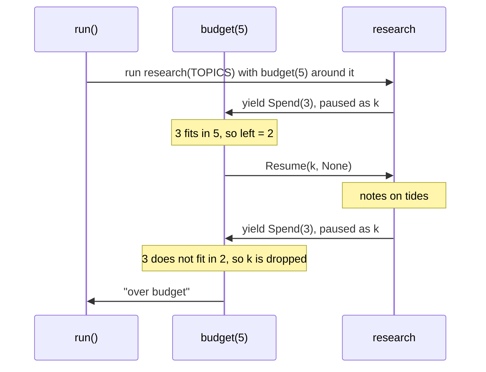

# Algebraic effects for Python: stack handlers around one unchanged program

*Algebraic effects for Python: handlers get the rest of your program, so dice, players, the screen, statistics and concurrency become layers you stack around the same code.*

This post is about algebraic effects in Python, with doeff, an open-source library whose core is written in Rust. A function yields effects, operations it names, and a handler receives each one together with the rest of the function and decides how the function goes on.

Any one of those decisions can be had another way: a mock for tests, a seeded random generator, a player object passed in as an argument, a custom event loop. What effects give you is one mechanism for all of them, so you can stack them around the same code and swap any one of them without touching it. This post builds one small program and adds those layers one at a time.

You don't need any theory. If you know what `yield` does, you know most of what you need.

## The idea: an exception a handler can resume

If you know exceptions, think of an effect as an exception that a handler can answer, after which the code carries on from the line that raised it. That is how OCaml 5 introduces its effect handlers ("resumable exceptions"), and Python generators can already pause and resume, so the library supplies the rest: a VM in Rust that finds the handler for each effect and keeps track of the paused code.

- An **effect** is a plain value that names an operation, such as `Spend(3)`, `Roll(6)` or `Spawn(task)`. It does nothing by itself. You define your own as a class, or use ones that doeff's packages define.
- A **program** is a generator function under `@do`. At each `yield` of an effect it pauses.
- A **handler** is a function of `(effect, k)` marked with `@handler`, which makes it a `@do` function too. It receives the effect together with `k`, the rest of the function, and decides what happens.
- The **caller** picks the handlers, so the same function means different things under different handlers.

| The handler | Written as | The program |
|---|---|---|
| answers and runs the rest | `yield Resume(k, value)` | goes on with `value`; when it finishes, the handler gets its result and returns that or another value |
| answers and is done | `yield Transfer(k, value)` | goes on with `value`; the handler does not get control back |
| throws into it | `yield ResumeThrow(k, error)` | sees `error` raised at the `yield`, where its own `try` can catch it |
| passes the effect on | `yield Pass(effect, k)` | gets the answer of the next handler out |
| keeps it for later | stores `k`, then `yield Transfer(k, value)` while handling a later effect | waits until the handler continues it |
| drops it | `return value`, without resuming `k` | stops at the `yield`; `value` is the result of everything under the handler |

Here is the smallest version. `research` yields one `Spend` per topic and knows nothing about what spending means:

~~~python
# spend.py
from dataclasses import dataclass

from doeff import EffectBase, Resume, Transfer, do, handler, run

@dataclass(frozen=True)
class Spend(EffectBase):  # an effect: "the next step costs this much"
    cost: int

@do
def research(topics: list[str]):  # pauses at each yield; knows nothing about money
    notes = []
    for topic in topics:
        yield Spend(3)
        notes.append(f"notes on {topic}")
    return notes

@handler
def free(effect: Spend, k):  # answer, and let the rest of research run
    yield Transfer(k, None)

@handler
def refuse(effect: Spend, k):  # drop k: research stops at its first Spend
    return "refused"

def budget(limit: int):
    left = limit

    @handler
    def on_spend(effect: Spend, k):
        nonlocal left
        if effect.cost > left:
            return "over budget"  # drop k: research never gets past this Spend
        left -= effect.cost
        return (yield Resume(k, None))  # resume k: research goes on

    return on_spend

TOPICS = ["tides", "moons"]

if __name__ == "__main__":
    print(run(free(research(TOPICS))))
    print(run(refuse(research(TOPICS))))
    print(run(budget(10)(research(TOPICS))))
    print(run(budget(5)(research(TOPICS))))
~~~

~~~text
['notes on tides', 'notes on moons']
refused
['notes on tides', 'notes on moons']
over budget
~~~

`@handler` makes the function under it a `@do` function and a handler, so a handler is always a `@do` function. Like any `@do` function, it hands `Resume(k, None)` to doeff by yielding it, and the `yield` gives back what the rest of `research` returned: `return (yield Resume(k, None))` passes that result on as the handler's own. Called on a program, a handler installs itself around it: `free(research(TOPICS))` is `research(TOPICS)` with `free` installed around it. The annotation `effect: Spend` tells doeff which effects the handler takes.

- `free` answers with `Transfer(k, None)`. `research` runs to the end.
- `refuse` returns without touching `k`. `research` stops at its first `Spend`, and `"refused"` is the result of the whole run.
- `budget(5)` keeps what is left between effects. The first `Spend` costs 3 and the handler resumes `k`. The second finds 2 left, so the handler returns `"over budget"`, and the second topic is never researched.

Here is the run of `budget(5)(research(TOPICS))`, one message at a time:

That is one layer. The rest of this post stacks several around one program.

## One program, layer by layer

`battle` is a small deck-building fight in the spirit of the game Slay the Spire. You have 40 hit points and a deck of ten cards, and the enemy has 44 hit points. Each turn you draw five cards and have 3 energy to spend on them:

| Card | Costs | Does |
|---|---:|---|
| Strike | 1 energy | 6 damage |
| Defend | 1 energy | 5 block: the enemy's next hit is 5 smaller |
| Bash | 2 energy | 8 damage, and the enemy takes 50% more damage for two turns |

When you end your turn, the enemy does one of three things at random: it hits for 11, hits for 7, or bellows, which makes every later hit 3 stronger. The fight goes on until one side has no hit points left.

`battle` yields four kinds of effect: `Roll` for a random number, `Choose` for the player's move, `Show` for a line on the screen, and `Played` for a statistic. Nothing in it says where the random numbers come from, who picks the cards, whether there is a screen, or whether anyone is counting:

~~~python
# spire.py (excerpt)
import random
import sys
from dataclasses import dataclass, replace

from doeff import EffectBase, Gather, Resume, Spawn, do, handler, run
from doeff_core_effects.scheduler import scheduled

# ---- Effects: everything the fight needs from the outside world.
@dataclass(frozen=True)
class Roll(EffectBase):  # "give me a random number below n"
    n: int

@dataclass(frozen=True)
class Choose(EffectBase):  # "player: which card, or None to end the turn?"
    state: Fight
    hand: tuple[str, ...]
    energy: int

@dataclass(frozen=True)
class Show(EffectBase):  # "draw this on the screen"
    text: str

@dataclass(frozen=True)
class Played(EffectBase):  # "a card was played" (for statistics)
    card: str
    damage: int

# ---- The game: plain data and one @do program.
CARDS = {"Strike": (1, 6, 0), "Defend": (1, 0, 5), "Bash": (2, 8, 0)}  # cost, damage, block
DECK = ("Strike",) * 5 + ("Defend",) * 4 + ("Bash",)

@dataclass(frozen=True)
class Fight:
    hp: int = 40
    block: int = 0
    enemy_hp: int = 44
    vulnerable: int = 0  # turns the enemy takes +50% damage
    enemy_strength: int = 0
    draw: tuple[str, ...] = DECK
    discard: tuple[str, ...] = ()
    turn: int = 1

@do
def draw_hand(s: Fight, n: int = 5):
    """Draw n cards; the deck is shuffled by asking for a random position (Roll)."""
    hand = []
    for _ in range(n):
        if not s.draw:
            s = replace(s, draw=s.discard, discard=())
        if not s.draw:
            break
        i = yield Roll(len(s.draw))
        hand.append(s.draw[i])
        s = replace(s, draw=s.draw[:i] + s.draw[i + 1 :])
    return s, tuple(hand)

def hit(s: Fight, card: str) -> tuple[Fight, int]:
    """Play one card on the state: returns the new state and the damage dealt (a pure function)."""
    cost, dmg, blk = CARDS[card]
    dmg = dmg * 3 // 2 if s.vulnerable else dmg
    s = replace(s, enemy_hp=s.enemy_hp - dmg, block=s.block + blk)
    if card == "Bash":
        s = replace(s, vulnerable=2)
    return s, dmg

@do
def battle(s: Fight = Fight()):
    """Fight to the end. Returns ("win" | "lose", the turn it ended on)."""
    while s.hp > 0 and s.enemy_hp > 0:
        s = replace(s, block=0)
        s, hand = yield draw_hand(s)
        energy = 3
        while energy > 0 and hand:
            yield Show(f"T{s.turn} you {s.hp} ({s.block} block) | enemy {s.enemy_hp} | {energy} energy | {' '.join(hand)}")
            pick = yield Choose(s, hand, energy)
            if pick is None or CARDS[hand[pick]][0] > energy:
                break
            card = hand[pick]
            hand = hand[:pick] + hand[pick + 1 :]
            energy -= CARDS[card][0]
            s, dmg = hit(s, card)
            s = replace(s, discard=s.discard + (card,))
            yield Played(card, dmg)
            if s.enemy_hp <= 0:
                return "win", s.turn
        s = replace(s, discard=s.discard + hand)
        intent = yield Roll(3)  # the enemy: 0 chomp 11, 1 thrash 7, 2 bellow (+3 strength)
        if intent == 2:
            s = replace(s, enemy_strength=s.enemy_strength + 3)
            yield Show("   enemy bellows")
        else:
            raw = (11 if intent == 0 else 7) + s.enemy_strength
            taken = max(0, raw - s.block)
            s = replace(s, hp=s.hp - taken)
            yield Show(f"   enemy hits for {raw}, you take {taken}")
        s = replace(s, vulnerable=max(0, s.vulnerable - 1), turn=s.turn + 1)
    return ("win" if s.enemy_hp <= 0 else "lose"), s.turn
~~~

`hit` is a plain function: it works out what one card does to the state of the fight. `draw_hand` and `battle` are `@do` functions, because they yield effects. `battle` runs `draw_hand` by yielding it, and the `yield` gives back what `draw_hand` returned. `Fight` is frozen, so every change makes a new state with `replace`. That matters in Layer 4, where a bot takes the state out of a `Choose` and plays the rest of the fight from it.

Run `battle()` with no handlers, and it stops at its first `Roll` with `UnhandledEffect`: none of these effects has a meaning until a handler gives it one.

### Layer 1: a scripted player and a screen

~~~python
# spire.py (excerpt)
# ---- Layer 1: a scripted player and a screen.
def dice(seed: int):
    """Answer Roll from a generator seeded with `seed`: the same seed, the same fight."""
    rng = random.Random(seed)

    @handler
    def roll(effect: Roll, k):
        return (yield Resume(k, rng.randrange(effect.n)))

    return roll

def scripted(moves: list):
    """A player who follows a script (a test, or a replayed bug report); None ends the turn."""
    moves = list(moves)

    @handler
    def choose(effect: Choose, k):
        return (yield Resume(k, moves.pop(0) if moves else None))

    return choose

@handler
def printed(effect: Show, k):
    """The screen: print each line."""
    print("   ", effect.text)
    return (yield Resume(k, None))

@handler
def silent(effect: Show, k):
    """No screen: thousands of fights per second."""
    return (yield Resume(k, None))

@handler
def quiet_stats(effect: Played, k):
    """Nobody is counting."""
    return (yield Resume(k, None))
~~~

~~~python
moves = [0, 0, 0, None] * 20
print(run(quiet_stats(printed(dice(7)(scripted(moves)(battle()))))))
~~~

~~~text
    T1 you 40 (0 block) | enemy 44 | 3 energy | Defend Strike Defend Defend Strike
    T1 you 40 (5 block) | enemy 44 | 2 energy | Strike Defend Defend Strike
    T1 you 40 (5 block) | enemy 38 | 1 energy | Defend Defend Strike
       enemy hits for 11, you take 1
    T2 you 39 (0 block) | enemy 38 | 3 energy | Bash Strike Strike Strike Defend
       enemy hits for 11, you take 11
    T3 you 28 (0 block) | enemy 38 | 3 energy | Strike Strike Strike Defend Defend
    T3 you 28 (0 block) | enemy 32 | 2 energy | Strike Strike Defend Defend
    T3 you 28 (0 block) | enemy 26 | 1 energy | Strike Defend Defend
       enemy hits for 11, you take 11
    T4 you 17 (0 block) | enemy 20 | 3 energy | Defend Strike Defend Strike Bash
       enemy bellows
    T5 you 17 (0 block) | enemy 20 | 3 energy | Bash Strike Defend Strike Defend
    T5 you 17 (0 block) | enemy 12 | 1 energy | Strike Defend Strike Defend
       enemy hits for 14, you take 14
    T6 you 3 (0 block) | enemy 3 | 3 energy | Strike Defend Defend Strike Strike
('win', 6)
~~~

Read the stack from the inside out. `scripted` answers `Choose` from a list of positions in the hand, `dice(7)` answers `Roll` from a random generator seeded with 7, `printed` answers `Show` by printing the line, and `quiet_stats` answers `Played` by doing nothing. The result is who won and on which turn.

The script plays the first card of the hand three times, then ends the turn. On turn 2 it is out of step and ends the turn without playing a card, which is what a script does. The same seed and the same script give the same fight on every run, so this stack is also a test: a bug report becomes a seed and a list of moves.

### Layer 2: a random bot

~~~python
# spire.py (excerpt)
def affordable(effect: Choose) -> list[int]:
    """Positions in the hand of the cards the player has the energy for."""
    return [i for i, c in enumerate(effect.hand) if CARDS[c][0] <= effect.energy]

@handler
def random_bot(effect: Choose, k):
    """Play a random affordable card, or end the turn (the extra number is "end the turn")."""
    options = affordable(effect)
    i = yield Roll(len(options) + 1)
    return (yield Resume(k, options[i] if i < len(options) else None))
~~~

~~~python
print(run(quiet_stats(silent(dice(3)(random_bot(battle()))))))
~~~

~~~text
('win', 4)
~~~

`random_bot` takes the place of `scripted`. It is a handler for `Choose`, and it yields an effect of its own: a `Roll` for a random position among the cards it has the energy for, where the one extra number means "end the turn". That `Roll` travels out to `dice(3)` like any `Roll` from `battle`. `silent` takes the place of `printed`, so nothing is printed. `battle` has not changed, and it does not know that nobody is at the screen.

### Layer 3: record and replay

~~~python
# spire.py (excerpt)
def record(tape: list):
    """Keep every Roll and Choose answer on the tape, passing the effect on to the handlers outside."""

    @handler
    def recorder(effect: Roll | Choose, k):
        answer = yield effect
        tape.append(answer)
        return (yield Resume(k, answer))

    return recorder

def replay(tape: list):
    """Answer Roll and Choose from the tape: no dice, no player, the same fight."""
    tape = list(tape)

    @handler
    def replayer(effect: Roll | Choose, k):
        return (yield Resume(k, tape.pop(0)))

    return replayer
~~~

~~~python
tape: list = []
first = run(quiet_stats(silent(dice(3)(random_bot(record(tape)(battle()))))))
again = run(quiet_stats(silent(replay(tape)(battle()))))
print(first, again, "same:", first == again, "tape:", len(tape), "answers")
~~~

~~~text
('win', 4) ('win', 4) same: True tape: 32 answers
~~~

`recorder` sits closest to `battle` and takes both `Roll` and `Choose`. Inside a handler, `yield effect` performs the same effect again, so the next handler out answers it: `random_bot` answers `Choose`, and `dice(3)` answers `Roll`. `recorder` writes the answer on the tape and resumes `battle` with it. `random_bot` sits outside `recorder`, so the `Roll` it yields goes straight out to `dice(3)` and never reaches the tape: the tape keeps the bot's moves, not how the bot picked them.

`replayer` answers both effects from the tape. The second run has no dice and no player, and it plays the same fight to the same end. The 32 answers are the whole fight. Keep them with a crash report, and the crash happens again, move for move.

### Layer 4: a Monte Carlo bot

~~~python
# spire.py (excerpt)
def monte_carlo(playouts: int):
    """Try each move by running the rest of the fight `playouts` times, and pick the best.

    The handler runs `battle` itself, under dice and a random bot. A playout starts from the next
    turn's draw, which is a cheap approximation of "the rest of this turn".
    """

    @handler
    def choose(effect: Choose, k):
        best, best_score = None, -1.0
        for i in [*affordable(effect), None]:
            wins = 0
            for n in range(playouts):
                s = effect.state if i is None else hit(effect.state, effect.hand[i])[0]
                if s.enemy_hp <= 0:
                    wins += 1
                    continue
                result, _ = run(quiet_stats(silent(dice(n)(random_bot(battle(s))))))
                wins += result == "win"
            if wins / playouts > best_score:
                best, best_score = i, wins / playouts
        return (yield Resume(k, best))

    return choose

PLAYOUTS = 3  # per candidate move; the 100 Monte Carlo fights take well under a minute
~~~

~~~python
print(run(quiet_stats(silent(dice(3)(monte_carlo(PLAYOUTS)(battle()))))))
~~~

~~~text
('win', 4)
~~~

This is the layer the others lead up to. `monte_carlo` is a handler for `Choose`, and to answer it, it runs `battle` itself. For each card it could play, and for ending the turn, it plays that card on the state with `hit`, then runs the rest of the fight `playouts` times. Each of those runs is a new `run` with a stack of its own: `dice(n)` for the dice, `random_bot` for the player, and `silent` and `quiet_stats` for the screen and the statistics. The handler counts the wins and resumes the paused fight with the move that won most often.

The bot needs no model of the game. It plays the real `battle`, the same function a person plays at the terminal, so when a card changes, the bot plays the changed card. `battle` knows nothing about bots, or about being run inside one of its own handlers. The fight that asked the question stays paused at its `Choose` the whole time, as `k`, and goes on only when the handler resumes it. The runs inside the handler answer their effects with their own handlers, so they do not use up the dice of the paused fight.

The playouts are rough. Each one starts from the next turn's draw, so it leaves out the rest of the current hand, and three playouts per move is very few. The next layer measures how much better the bot plays anyway.

### Layer 5: a hundred fights at once

~~~python
# spire.py (excerpt)
@do
def win_rate(player, fights: int):
    """The same battle `fights` times, one task per seed; returns the share of wins."""
    tasks = []
    for seed in range(fights):
        tasks.append((yield Spawn(silent(dice(seed)(player(battle()))))))
    results = yield Gather(*tasks)
    return sum(r == "win" for r, _ in results) / fights
~~~

~~~python
print("random bot wins", run(scheduled(quiet_stats(win_rate(random_bot, 100)))))
print("monte carlo wins", run(scheduled(quiet_stats(win_rate(monte_carlo(PLAYOUTS), 100)))))
~~~

~~~text
random bot wins 0.73
monte carlo wins 1.0
~~~

`win_rate` is a program too. It yields `Spawn` once per seed, which starts a `battle` as a task, then `Gather`, which waits for every task and gives back their results. `Spawn` and `Gather` are effects from doeff's packages, and `scheduled` is a reference handler for them. The tasks take turns on one thread, and `scheduled` switches between them where they yield.

Each task carries its own stack: `silent`, `dice(seed)` and the player are installed around each `battle()` when the task is made, so the hundred fights do not share a random generator. The player is a parameter, so the same line runs `random_bot` or `monte_carlo(PLAYOUTS)`. On the same hundred seeds, the random bot wins 73 fights and the Monte Carlo bot wins all 100.

### Layer 6: a damage count per card

~~~python
# spire.py (excerpt)
def damage_stats(totals: dict):
    """Add up the damage each card did into `totals`."""

    @handler
    def count(effect: Played, k):
        totals[effect.card] = totals.get(effect.card, 0) + effect.damage
        return (yield Resume(k, None))

    return count
~~~

~~~python
totals: dict = {}
run(scheduled(damage_stats(totals)(win_rate(random_bot, 100))))
print(totals)
~~~

~~~text
{'Strike': 3663, 'Defend': 0, 'Bash': 632}
~~~

`damage_stats(totals)` takes the place of `quiet_stats`, outside `win_rate`. An effect that a task's own handlers do not take travels out to the handlers around the `Spawn` that started the task, so the `Played` of all hundred fights reach this one handler. `battle` has yielded `Played` for every card from the start, and it never had to know whether anyone was counting. Change a card's numbers, run this line again, and you see what the change did.

### Production: a person at the terminal

~~~python
# spire.py (excerpt)
@handler
def human(effect: Choose, k):
    """Ask at the terminal which card to play; an empty line (or a bad number) ends the turn."""
    options = affordable(effect)
    menu = "  ".join(f"[{i}] {effect.hand[i]}" for i in options)
    answer = input(f"   play which? {menu}  [enter = end turn] > ").strip()
    pick = int(answer) if answer.isdigit() and int(answer) in options else None
    return (yield Resume(k, pick))

def play() -> None:
    """A fight against the enemy, played by a person; the dice are seeded by the system."""
    seed = random.SystemRandom().randrange(10**6)
    print(f"seed {seed}")
    print("->", run(quiet_stats(printed(dice(seed)(human(battle()))))))
~~~

~~~bash
python spire.py play
~~~

`human` answers `Choose` by asking at the terminal with `input()`, and `play` seeds the dice from the system's random source. Next to Layer 1, only the player and the seed differ. The code that the bots played, the replay replayed and the statistics counted is the code the person plays.

### The stacks side by side

| Run | Layers around `battle`, from the inside out | What changes |
|---|---|---|
| scripted | `scripted(moves)`, `dice(7)`, `printed`, `quiet_stats` | a fight that is the same on every run, on the screen; a test |
| random bot | `random_bot` in place of `scripted`, `silent` in place of `printed` | the moves come from the same dice as the fight |
| recorded | `record(tape)` added inside `random_bot` | every random number and every move is kept |
| replayed | `replay(tape)` in place of the dice and the player | the same fight with no dice and no player |
| Monte Carlo | `monte_carlo(PLAYOUTS)` in place of `random_bot` | the player's handler runs `battle` to choose each move |
| win rate | each fight a task with its own `dice(seed)`, under `scheduled` | a hundred fights and the share of wins |
| damage count | `damage_stats(totals)` in place of `quiet_stats` | the damage of each card over a hundred fights |
| production | `human` in place of the player, dice seeded by the system | a person plays |

`battle` is the same function in every row. Some rows replace an input, such as the dice or the player. The others do things an object passed in as an argument cannot do. `recorder` passes an effect on and keeps the answer. `random_bot` yields an effect of its own, which the next handler out answers. `monte_carlo` holds the paused fight as `k` while it runs the same program many more times, and resumes it once it has decided. `win_rate` gives every task its own stack, and `damage_stats` hears from all of them. Each of these is a handler a few lines long, and swapping one does not touch the others or `battle`.

## One mechanism under all of it

Every handler in this post is a function of `(effect, k)`, and each one does with `k` one of the things in the first table:

| The program yields | Handlers in this post |
|---|---|
| `Roll(n)` | `dice(seed)` answers from a seeded generator, `replay(tape)` from the tape, and `record(tape)` passes it on and keeps the answer |
| `Choose(state, hand, energy)` | `scripted(moves)`, `random_bot`, `monte_carlo(PLAYOUTS)`, `human`, and the same `record(tape)` and `replay(tape)` |
| `Show(text)` | `printed`, `silent` |
| `Played(card, damage)` | `quiet_stats`, `damage_stats(totals)` |
| `Spawn(program)`, `Gather(*tasks)` | `scheduled` |

`Roll`, `Choose`, `Show` and `Played` are classes in `spire.py`. `Spawn` and `Gather` come from doeff's packages, together with `Wait`, `Race` and `Cancel`, and `scheduled` is a reference handler for them, written in the same `(effect, k)` form as `dice`. It keeps the `k` of each waiting task, as in the "keeps it for later" row of the first table, and transfers to it when the task can go on. Nothing makes these effects special: any handler can answer them instead.

The other effects that doeff's packages define work the same way as `Roll` and `Played`. Each has a reference handler, and you can install your own instead:

| What | The program yields | A reference handler |
|---|---|---|
| State | `n = yield Get("fights")` and `yield Put("fights", n + 1)` | `state()` keeps a dict and resumes `k` with the value |
| Exceptions | `result = yield Try(battle())` gives `Ok(value)` or `Err(error)` | `try_handler`; any handler can also throw into the program with `ResumeThrow(k, error)` |
| Concurrency | `task = yield Spawn(battle())`, then `yield Gather(*tasks)` | `scheduled` keeps the `k` of each waiting task |
| Observation | `value, log = yield Listen(battle())` | `listen_handler` collects the `Tell` lines of the program |
| I/O | an effect of your own, like `Show` | a handler of your own, like `printed`, or a reference one: files, SQL and processes with `doeff[hy]`, HTTP with `doeff[http]` |

This shape suits simulations and backtests. Layer 5 is a simulation: a hundred fights, each with its own dice. A trading strategy can run the same way over recorded market events with paper orders, and live with an exchange, and only the handlers for market data and orders differ. Time can be a handler too, a clock that moves forward only when every task waits; the third post in this series builds that clock around a trading example.

## Tests are one of the stacks

Layer 1 is already a test: with a scripted player and seeded dice, the fight is the same on every run. That is also the use most people meet first. Many Python test suites have a `mock.patch` that nobody wants to touch: it finds its target by a string, so moving an import can make it miss, and when it is missing the test can still pass while the real thing runs. Written without effects, `battle` would call `random` and `input()` itself, and its tests would patch both by name. With effects, a test installs handlers instead:

~~~python
# test_spire.py
from doeff import Resume, handler, run

from spire import Fight, Played, battle, dice, quiet_stats, scripted, silent

def test_a_strike_finishes_an_enemy_on_6_hit_points():
    # seed 7 deals Defend Strike Defend Defend Strike, and the script plays the Strike
    fight = battle(Fight(enemy_hp=6))
    assert run(quiet_stats(silent(dice(7)(scripted([1])(fight))))) == ("win", 1)

def test_bash_makes_the_next_strikes_hit_harder():
    played = []

    @handler
    def log(effect: Played, k):
        played.append((effect.card, effect.damage))
        return (yield Resume(k, None))

    run(log(silent(dice(7)(scripted([0, 0, 0, None] * 20)(battle())))))
    assert played[-3:] == [("Bash", 8), ("Strike", 9), ("Strike", 9)]
~~~

Nothing is patched, and there is no string to keep in sync with your imports. The first test starts from a state made by hand, an enemy on 6 hit points, which is easy because `Fight` is plain data. The second puts a handler of its own, `log`, in place of `quiet_stats`. It writes down every `Played` of the fight from Layer 1, and the test checks that the two Strikes after Bash do 9 damage instead of 6. Now leave out the handler for `Played`:

~~~python
run(silent(dice(7)(scripted(moves)(battle()))))
~~~

~~~text
doeff Traceback (most recent call last):

  battle()  spire.py:103
    yield Played(card, dmg)
    handlers:
      scripted ↗
      dice ↗
      silent ↗

UnhandledEffect: no handler found for effect: Played (Played(card='Defend', damage=0))
  handlers in scope (innermost→outermost): scripted → dice → silent
  skipped by annotation: scripted (effect: Choose), dice (effect: Roll), silent (effect: Show) — a handler only sees the effects its effect parameter is annotated with
  hint: install a handler for Played: run(fn(prog)), where fn is a def (effect: Played, k) marked with @handler that returns (yield Resume(k, value))
~~~

The run stops at the `yield` that nobody answered, and nothing after it runs. Before Python's own traceback, doeff prints that `yield`, the handlers that were in scope, and why each one let the effect pass. A forgotten `mock.patch` fails the other way: the real thing runs. [examples/testing_without_mocks](https://github.com/proboscis/doeff/tree/main/examples/testing_without_mocks) puts a `mock.patch` test and a handler test of the same small function side by side, with the two ways the patch goes wrong.

## Where doeff sits

For a comparison with the other effect libraries for Python, three tasks much smaller than `battle` were written five ways: a welcome email that loads a user and sends a mail, a bank balance with a log, and three concurrent fetches. Lines were counted without blanks, comments or imports, and each test left out one replacement at a time to see what happens.

| | Plain Python | effect | effectful | doeff |
|---|---|---|---|---|
| What a handler receives | — (a callee returns or raises) | the intent | the operation's arguments | the effect and its continuation `k` |
| Lines for all three tasks | 53 | 97 | 70 | 88 |
| An effect nobody handles | Arguments: usually an error. `mock.patch`: the real code runs | Error | Wrong value or silent pass | Error, when handlers are annotated |
| State, log and concurrency built in | No | Concurrency via thread pool | No (use `asyncio`) | Yes |
| Latest release | — | 2019 | 2026 | 2026 |

Plain Python is the shortest and the easiest to read. effectful keeps your functions completely ordinary, which is a real advantage. doeff costs you `yield` and `@do` in the business code and more names to learn. In return, a handler holds the rest of the program, which is what `monte_carlo` and `scheduled` need, a missing handler is an error, one handler can wrap a whole program, and handlers stay per task under concurrency, as each fight's `dice(seed)` does in Layer 5. In one test, two `asyncio` tasks each installed their own effectful handler, waited, and woke up in the order they had started. After the wait, the first task got the second task's answer, and the second got an unevaluated term. The same test with doeff kept them apart. This only matters if you install handlers inside tasks; installed once around `asyncio.run`, effectful behaves.

`returns`, a popular functional library with about 4.4K GitHub stars, gives you typed containers such as `Result`, but no handlers that resume your code, so it does not fit this comparison.

Outside Python, the closest is OCaml 5. Its handlers also receive the continuation, a continuation can be resumed only once, and effects are not in the types. Koka goes further on both:

| | Resume more than once | Effects in the types |
|---|---|---|
| OCaml 5 | No: a second resume raises `Continuation_already_resumed` | No: an unhandled effect raises `Effect.Unhandled` when it is performed |
| Koka | Yes: `resume` can be called more than once, for backtracking and probabilistic programming | Yes: the compiler infers the effects of every function |
| doeff | No: a second `Resume` raises `RuntimeError` | No: a missing handler is an `UnhandledEffect` when the program runs |

## What it costs

Every effect travels out to a handler and back. The benchmark in doeff's README measures the CPU time of one round trip, with 50 samples of each case, on a shared Intel i9-7980XE under Linux with CPython 3.14.7.

| One effect round trip | µs per effect (median) |
|---|---:|
| Plain Python function call | 0.13 |
| doeff, a `@handler` with `Resume` | 4.3 |
| effect 1.1.0 | 12.7 |
| effectful 0.4.0 | 57.9 |

For many small tasks, `scheduled`, which runs in Rust by default since 0.7.0, costs about 17 µs per spawned task, against about 11 µs for `asyncio`.

The Monte Carlo bot of Layer 4 is the heaviest stack in this post. On the same i9-7980XE, with CPython 3.14.7 and doeff 0.8.0, one of its fights runs 144 playouts and takes 0.10 s of CPU time, the median over the hundred seeds of Layer 5, against 1.2 ms for a fight of the random bot.

A few microseconds is noise next to a database query or an HTTP request. It is not noise inside a tight numeric loop. Keep tight numeric loops in plain Python and yield effects around them, the way `battle` calls the plain function `hit`.

The script is `benchmarks/compare_libraries.py` in the repository, and the README's [Performance](https://github.com/proboscis/doeff#performance) section lists every case and how it was measured, if you want numbers from your own machine.

## Limits

- doeff is 0.x. The API changed between 0.4 and 0.5. Since 0.6, `pip install doeff` installs only the core; the Hy language and the handlers written in it come with `pip install "doeff[hy]"`.
- Continuations are one-shot. A handler can resume the paused code once, so tricks that resume twice, such as backtracking search, are out. Nondeterministic choice is out too; run the program again once per choice instead, the way `monte_carlo` runs `battle` again from the state in the `Choose` rather than resuming `k` once per move.
- Effects are not in the types. The type checker does not check that the installed handlers answer every effect a program yields; a missing handler shows up as `UnhandledEffect` when the program runs.
- Only the body of a `@do` function can perform an effect. A plain function it calls cannot, so as with `async`, `@do` spreads to the callers: `hit` stays plain because it yields nothing, and `draw_hand` is a `@do` function because it yields `Roll`.
- `yield` is not allowed inside a list comprehension, so a loop that performs effects becomes a `for` loop, like the one in `draw_hand`.
- A handler without an annotation receives every effect. A fake without one can quietly answer effects that were meant for another handler.

## Try it

~~~bash
pip install doeff   # CPython 3.11 to 3.14; prebuilt wheels for Linux, macOS and Windows
python -m doeff demo
~~~

[What doeff Is](https://github.com/proboscis/doeff/blob/main/docs/positioning/what-doeff-is.md) defines the mechanism, its uses and its limits. Every example in this post runs as shown with doeff 0.8.0 and nothing else, plus pytest for the tests. The battle is [examples/effects_tour/spire.py](https://github.com/proboscis/doeff/blob/main/examples/effects_tour/spire.py): `python spire.py` runs Layers 1 to 6, `python spire.py play` lets you play a fight at the terminal, and `pytest` in the same directory runs the two tests above. The docs chapter [Why Effects?](https://github.com/proboscis/doeff/blob/main/docs/20-why-effects-over-di.md) compares effects with dependency injection and plain `async` at more length.

Where does this break down for you: code where the `yield` style gets in the way, or a case where a plain argument would have been simpler? Issues are open at https://github.com/proboscis/doeff/issues.
