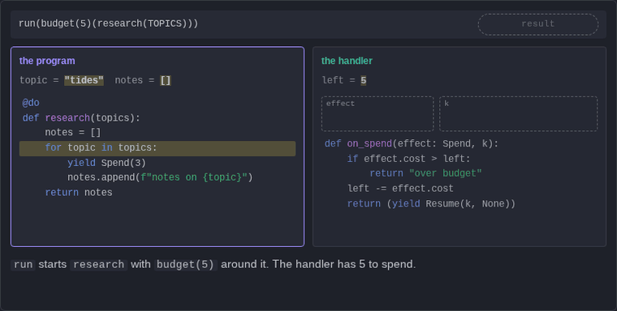

# Prototype: a handler receives k

This page holds one click-through figure, to try the format before the article uses it. It is the run of `budget(5)(research(TOPICS))` from [Algebraic effects for Python](algebraic-effects-in-python.md#the-idea-an-exception-a-handler-can-resume). Click the figure or press Next.

`tools/docs_site/figures_measure/handler_k.py` runs the same program with doeff and prints the same order of events.

The code of this figure

~~~python
@do
def research(topics: list[str]):  # pauses at each yield; knows nothing about money
    notes = []
    for topic in topics:
        yield Spend(3)
        notes.append(f"notes on {topic}")
    return notes
~~~

