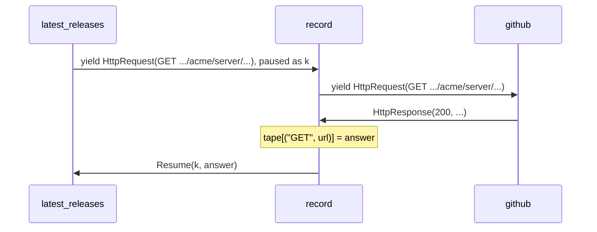

# Record and replay: run a Python program again on the answers it already got

*A handler sees each effect go out and its answer come back, so it can keep both. Run the same program again under a handler that answers from what was kept, and the answers of an HTTP API come back without a request being sent.*

This is the fourth post on algebraic effects in Python with doeff. [The first one](algebraic-effects-in-python.md) showed the mechanism: a function yields an effect, a value that names an operation, and a handler receives it together with `k`, the rest of the function, and decides how the function goes on. [The third one](time-as-an-effect.md) made the clock a handler. This one keeps the answers.

Say a program reaches the world only through the effects it yields. Each one goes out to a handler, and an answer comes back. Write down every request and its answer, and you have the whole exchange. Answer the same requests from what you wrote down, and the program runs again the same way, with nobody on the other end. Durable workflow engines such as Temporal rebuild a workflow after a crash by replaying its event history. Here the same idea fits in a handler a few lines long.

If you write asyncio code, compare it with an `await client.get(url)` deep inside a coroutine. That coroutine sends the request itself, so recording it means reaching into the client. With effects, the request is a value that leaves the program, and the recorder is one more handler on its way out.

## The program asks, and a handler answers

`latest_releases` asks the GitHub API for the latest release of each repository:

~~~python
# releases.py (excerpt)
import json
from collections import Counter

from doeff import Resume, ResumeThrow, do, handler, run
from doeff_core_effects import HttpRequest, HttpResponse

GITHUB = "https://api.github.com"

@do
def latest_releases(repos: list[str], token: str, api: str = GITHUB):  # asks; never sends
    tags = {}
    for repo in repos:
        response = yield HttpRequest(
            "GET",
            f"{api}/repos/{repo}/releases/latest",
            headers={"Authorization": f"Bearer {token}"},
        )
        response.raise_for_status()
        tags[repo] = json.loads(response.text)["tag_name"]
    return tags
~~~

`HttpRequest` is an effect from doeff's packages, and `HttpResponse` is the answer its handlers give. `latest_releases` sends nothing: it yields the request, and the handler of `HttpRequest` decides what happens. In production that is `http_production_handler()`, which sends it with httpx; the last section runs it against a local server. Until then, `github` answers the way the API does, from a dict, and counts every request that reaches it:

~~~python
# releases.py (excerpt)
# Answers the way the GitHub API does, from a dict, so this file runs offline.
# live.py sends the same requests over HTTP.
TAGS = {"acme/server": "v2.4.1", "acme/client": "v1.9.0"}
sent: Counter[str] = Counter()  # how many times each URL was sent

@handler
def github(effect: HttpRequest, k):  # every request that reaches it counts as sent
    sent[effect.url] += 1
    repo = effect.url.removeprefix(f"{GITHUB}/repos/").removesuffix("/releases/latest")
    body = json.dumps({"tag_name": TAGS[repo]})
    return (yield Resume(k, HttpResponse(200, {}, body.encode(), body, effect.url, 0.0)))
~~~

## A recorder performs the effect again

A recorder sits between the program and the handler that answers:

~~~python
# releases.py (excerpt)
def recording(tape: dict):  # perform each request outward and keep its answer
    @handler
    def record(effect: HttpRequest, k):
        answer = yield effect  # the next handler out answers
        tape[(effect.method, effect.url)] = answer
        return (yield Resume(k, answer))

    return record
~~~

Inside a handler, `yield effect` performs the effect it received once more, and the next handler out answers it. So `record` sees the request go out and the answer come back. It keeps the pair, then resumes `k` with the same answer. `latest_releases` gets what it would have got with no recorder in between, and nothing in it says it is being recorded.

The tape keys each request by its method and URL. Two `HttpRequest` values with the same fields are not equal: they compare by identity. So the recorder has to choose what makes two requests the same, and this one leaves the headers out. That choice comes back below, when the token in the header matters.

## A player answers from the tape

~~~python
# releases.py (excerpt)
def replaying(tape: dict):  # answer from the tape and never perform outward
    @handler
    def replay(effect: HttpRequest, k):
        key = (effect.method, effect.url)
        if key not in tape:
            error = LookupError(f"not recorded: {effect.method} {effect.url}")
            return (yield ResumeThrow(k, error))  # raised at the program's yield
        return (yield Resume(k, tape[key]))

    return replay

@do
def reported(program):  # a caller's own try catches what a handler throws in
    try:
        return (yield program)
    except LookupError as error:
        return f"LookupError: {error}"
~~~

`replay` never yields the effect outward. A request on the tape gets its recorded answer. A request that is not on it gets `ResumeThrow(k, error)`: the `LookupError` is raised inside `latest_releases`, at its `yield`, and travels up like any exception, here to the `try` in `reported`.

Record once, then run the same program under the player alone:

~~~python
print(run(github(recording(tape)(latest_releases(REPOS, "secret")))))
print(run(replaying(tape)(latest_releases(REPOS, "secret"))))
~~~

~~~text
{'acme/server': 'v2.4.1', 'acme/client': 'v1.9.0'}
sent: 2
~~~

~~~text
{'acme/server': 'v2.4.1', 'acme/client': 'v1.9.0'}
sent: 0
~~~

The same function, the same answers, and no request on the second run. Nothing outside the player handles `HttpRequest` there, so the replay cannot reach the network by accident: had `replay` passed a request on, doeff would have stopped the run with `UnhandledEffect`. A repository that was never recorded stops at its `yield`:

~~~python
print(run(replaying(tape)(reported(latest_releases(["acme/docs"], "secret")))))
~~~

~~~text
LookupError: not recorded: GET https://api.github.com/repos/acme/docs/releases/latest
~~~

## Keep the tape in a file

The dict lives as long as the process. doeff's packages have the recorder and the player as one handler, `make_memo_rewriter`, with storage behind it:

~~~python
# on_disk.py (excerpt)
def recorded(program, database, network, key=content_address):
    program = make_memo_rewriter(HttpRequest, key_fn=key)(program)  # a hit from storage; a miss performed outward and kept
    program = sqlite_memo_handler(database)(program)  # storage: MemoExists, MemoGet and MemoPut on a SQLite file
    program = network(program)  # only the misses get this far
    return run(scheduled(await_handler()(slog_discard_handler(program))))

@handler
def offline(effect: HttpRequest, k):  # in the network's place: a miss fails, and nothing is sent
    raise LookupError(f"not recorded: {effect.method} {effect.url}")
~~~

From the inside out:

| Handler | What it does |
|---|---|
| `make_memo_rewriter(HttpRequest, key_fn=key)` | computes a key for each `HttpRequest` and yields `MemoExists(key)`. On a hit, it yields `MemoGet(key)` and resumes `k` with the stored answer. On a miss, it performs the request outward like `record`, yields `MemoPut(key, answer)`, and resumes `k` |
| `sqlite_memo_handler(database)` | answers `MemoExists`, `MemoGet` and `MemoPut` from a SQLite file |
| `network` | gets only the misses: `github` here, `http_production_handler()` in production, `offline` in CI |
| `slog_discard_handler`, `await_handler`, `scheduled` | `slog_discard_handler` drops the rewriter's log lines. `await_handler` and `scheduled` run the `Await` that the storage yields to read and write the file on a worker thread |

The storage is effects too. The rewriter knows nothing about SQLite: it yields `MemoGet` and `MemoPut`, and the next handler out decides where they go. Install `in_memory_memo_handler()` in place of `sqlite_memo_handler(database)`, and the same rewriter keeps its tape in memory.

`offline` sits where the network would. A request the file answers never reaches it. Any other request raises `LookupError`, which arrives at the program's `yield` as before, and nothing is sent:

~~~python
print(recorded(latest_releases(REPOS, "secret"), tape, github))
print(recorded(latest_releases(REPOS, "secret"), tape, offline))
~~~

~~~text
{'acme/server': 'v2.4.1', 'acme/client': 'v1.9.0'}
sent: 2
~~~

~~~text
{'acme/server': 'v2.4.1', 'acme/client': 'v1.9.0'}
sent: 0
~~~

The second run builds a new stack with a new storage handler; only the file is the same. A test in another process, or in CI, replays from that file the same way.

## What makes two requests the same

Now replay with another token, as CI would, where the real one is not available:

~~~python
print(recorded(reported(latest_releases(REPOS, "ci-dummy")), tape, offline))
~~~

~~~text
LookupError: not recorded: GET https://api.github.com/repos/acme/server/releases/latest
~~~

The default key, `content_address`, is a hash of the whole request: method, URL, headers, params, body and timeouts. The token is in a header, so a request with another token is another request, and it misses. The hand-written tape above keyed by method and URL; give the rewriter the same key:

~~~python
# on_disk.py (excerpt)
def method_and_url(effect: HttpRequest) -> str:  # a key without the headers, so without the token
    return f"{effect.method} {effect.url}"
~~~

~~~python
recorded(latest_releases(REPOS, "secret"), keyed, github, method_and_url)
print(recorded(latest_releases(REPOS, "ci-dummy"), keyed, offline, method_and_url))
~~~

~~~text
{'acme/server': 'v2.4.1', 'acme/client': 'v1.9.0'}
~~~

Choose the key per API. Whatever the key leaves out is not told apart on replay, so if the answers depend on `params` or on the body, put those in. With either key, the token is not in the file: the keys are `GET https://...` strings or hashes, and the stored answers are the responses. The responses are stored whole, though, and their headers and bodies can carry personal data. Read the file before you commit it.

## I/O: record from a live server, replay with it stopped

So far `github` has answered from a dict. `live.py` starts a local HTTP server that answers like the GitHub API, records with `http_production_handler()`, stops the server, and replays from the file:

~~~python
# live.py (excerpt)
if __name__ == "__main__":
    server = ThreadingHTTPServer(("127.0.0.1", 0), Releases)
    threading.Thread(target=server.serve_forever, daemon=True).start()
    api = f"http://127.0.0.1:{server.server_port}"
    with tempfile.TemporaryDirectory() as directory:
        tape = Path(directory) / "releases.sqlite"
        print("-- live: httpx sends each request, and the file keeps each answer")
        print(recorded(latest_releases(REPOS, "secret", api), tape, http_production_handler()))
        print(f"served: {served.total()}")
        server.shutdown()
        server.server_close()
        print("-- stopped: the server is gone, and the same file answers")
        print(recorded(latest_releases(REPOS, "secret", api), tape, offline))
~~~

~~~text
{'acme/server': 'v2.4.1', 'acme/client': 'v1.9.0'}
served: 2
~~~

~~~text
{'acme/server': 'v2.4.1', 'acme/client': 'v1.9.0'}
~~~

The first run goes over HTTP: `http_production_handler()` sends each `HttpRequest` with an `httpx.AsyncClient`, awaited through `Await`, and the server answers twice. The second run has no server to talk to, and the file answers. `latest_releases` is the same function as before, with `api` pointed at the local server, and it has no `async` anywhere; [the second post](yield-and-async.md) is about why. In your own repository, record once with `http_production_handler()` into a file you commit, and run CI with `offline` in its place and no token at all.

You may know this from VCR.py, which records cassettes by patching HTTP client libraries such as requests and httpx, or from `unittest.mock`, where a test swaps the client for a mock by name. Both work at the client: VCR.py knows the libraries it patches, and a mock knows the name it replaces. The recorder here works on effects. It does not know which client sends the request, and the same handler records any effect a program yields: [examples/testing_without_mocks/record_replay.py](https://github.com/proboscis/doeff/blob/main/examples/testing_without_mocks/record_replay.py) records a language model's answers, and the docs chapter [Why Effects?](https://github.com/proboscis/doeff/blob/main/docs/20-why-effects-over-di.md#6-keep-the-answers-record-once-replay) records `Chat` and `Draw` with one recorder.

## Limits

- The stored answers are pickled. Open only files you trust: loading a pickle can run code.
- The default key hashes the pickled request. Whether it stays the same across doeff or Python versions is not promised. A key of your own, such as `method_and_url`, is a plain string you control.
- With no storage handler installed, the rewriter treats every request as a miss and performs it outward each time, without a word. A replay with `offline` in the network's place catches that: the miss raises.
- The rewriter records by type: every `HttpRequest`, POST included, and a recorded POST is not sent again on replay. That is usually what a test wants. If some requests must always go out, write a recorder like `record` that passes those on with `Pass`.
- A replay shows how your code handles the answers you recorded. It does not show that the API still answers that way. Record again when the API changes.

## Try it

~~~bash
pip install "doeff[http]"   # CPython 3.11 to 3.14; the http extra brings HttpRequest and httpx
python releases.py
python on_disk.py
python live.py
~~~

Every example in this post runs as shown with doeff 0.8.0. The complete files are in [examples/record_and_replay](https://github.com/proboscis/doeff/tree/main/examples/record_and_replay). The docs chapter [Cache System](https://github.com/proboscis/doeff/blob/main/docs/07-cache-system.md) covers `CacheGet` and `CachePut`, which a program yields itself when it caches on purpose; the rewriter here keeps answers from outside, and the program never asks.

The previous post, [Time as an effect](time-as-an-effect.md), made the clock a handler, so hours of waiting run in an instant. The series started with [Algebraic effects for Python](algebraic-effects-in-python.md), which stacks handlers for time, concurrency, retries, budgets and I/O around one program.

Which answers would you want to keep in your own code, and where would the key be hard to choose? Issues are open at https://github.com/proboscis/doeff/issues.
