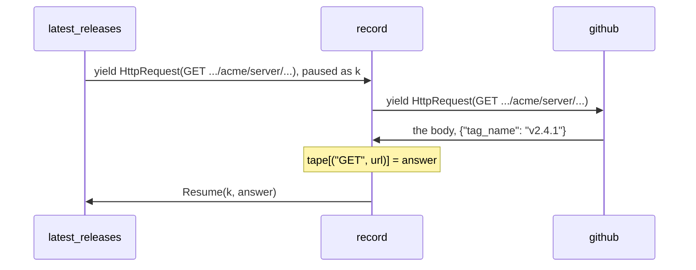

# Record and replay: run a Python program again on the answers it already got

*A handler sees each effect go out and its answer come back, so it can keep both. Run the same program again under a handler that answers from what was kept, and the answers of an HTTP API come back without a request being sent.*

This is the fourth post on algebraic effects in Python with doeff. [The first one](algebraic-effects-in-python.md) showed the mechanism: a function yields an effect, a value that names an operation, and a handler receives it together with `k`, the rest of the function, and decides how the function goes on. [The third one](time-as-an-effect.md) made the clock a handler. This one keeps the answers.

Say a program reaches the world only through the effects it yields. Each one goes out to a handler, and an answer comes back. Write down every request and its answer, and you have the whole exchange. Answer the same requests from what you wrote down, and the program runs again the same way, with nobody on the other end. Durable workflow engines such as Temporal rebuild a workflow after a crash by replaying its event history. Here the same idea fits in a handler a few lines long.

If you write asyncio code, compare it with an `await client.get(url)` deep inside a coroutine. That coroutine sends the request itself, so recording it means reaching into the client. With effects, the request is a value that leaves the program, and the recorder is one more handler on its way out.

## The program asks, and a handler answers

`latest_releases` asks the GitHub API for the latest release of each repository:

~~~python
# releases.py (excerpt)
import json
from collections import Counter
from dataclasses import dataclass, field

from doeff import EffectBase, Resume, ResumeThrow, do, handler, run

GITHUB = "https://api.github.com"

@dataclass(frozen=True)
class HttpRequest(EffectBase):  # "send this request"; its handler answers with the body
    method: str
    url: str
    headers: dict[str, str] = field(default_factory=dict)

@do
def latest_releases(repos: list[str], token: str, api: str = GITHUB):  # asks; never sends
    tags = {}
    for repo in repos:
        body = yield HttpRequest(
            "GET",
            f"{api}/repos/{repo}/releases/latest",
            headers={"Authorization": f"Bearer {token}"},
        )
        tags[repo] = json.loads(body)["tag_name"]
    return tags
~~~

`HttpRequest` is this post's own effect: a frozen dataclass that subclasses `EffectBase`, like the effects of [the first post](algebraic-effects-in-python.md). Its handler answers with the body of the response, as a string. `latest_releases` sends nothing: it yields the request, and the handler of `HttpRequest` decides what happens. The last section writes a handler that sends it over HTTP and runs it against a local server. Until then, `github` answers the way the API does, from a dict, and counts every request that reaches it:

~~~python
# releases.py (excerpt)
# Answers the way the GitHub API does, from a dict, so this file runs offline.
# live.py sends the same requests over HTTP.
TAGS = {"acme/server": "v2.4.1", "acme/client": "v1.9.0"}
sent: Counter[str] = Counter()  # how many times each URL was sent

@handler
def github(effect: HttpRequest, k):  # every request that reaches it counts as sent
    sent[effect.url] += 1
    repo = effect.url.removeprefix(f"{GITHUB}/repos/").removesuffix("/releases/latest")
    return (yield Resume(k, json.dumps({"tag_name": TAGS[repo]})))
~~~

## A recorder performs the effect again

A recorder sits between the program and the handler that answers:

~~~python
# releases.py (excerpt)
def recording(tape: dict):  # perform each request outward and keep its answer
    @handler
    def record(effect: HttpRequest, k):
        answer = yield effect  # the next handler out answers
        tape[(effect.method, effect.url)] = answer
        return (yield Resume(k, answer))

    return record
~~~

Inside a handler, `yield effect` performs the effect it received once more, and the next handler out answers it. So `record` sees the request go out and the answer come back. It keeps the pair, then resumes `k` with the same answer. `latest_releases` gets what it would have got with no recorder in between, and nothing in it says it is being recorded.

The tape keys each request by its method and URL, not by the request itself. The request holds a dict, its headers, so it has no hash and cannot be a dict key, and two requests that differ only in the token are not equal. So the recorder has to choose what makes two requests the same, and this one leaves the headers out. That choice comes back below, when the token in the header matters.

## A player answers from the tape

~~~python
# releases.py (excerpt)
def replaying(tape: dict):  # answer from the tape and never perform outward
    @handler
    def replay(effect: HttpRequest, k):
        key = (effect.method, effect.url)
        if key not in tape:
            error = LookupError(f"not recorded: {effect.method} {effect.url}")
            return (yield ResumeThrow(k, error))  # raised at the program's yield
        return (yield Resume(k, tape[key]))

    return replay

@do
def reported(program):  # a caller's own try catches what a handler throws in
    try:
        return (yield program)
    except LookupError as error:
        return f"LookupError: {error}"
~~~

`replay` never yields the effect outward. A request on the tape gets its recorded answer. A request that is not on it gets `ResumeThrow(k, error)`: the `LookupError` is raised inside `latest_releases`, at its `yield`, and travels up like any exception, here to the `try` in `reported`.

Record once, then run the same program under the player alone:

~~~python
print(run(github(recording(tape)(latest_releases(REPOS, "secret")))))
print(run(replaying(tape)(latest_releases(REPOS, "secret"))))
~~~

~~~text
{'acme/server': 'v2.4.1', 'acme/client': 'v1.9.0'}
sent: 2
~~~

~~~text
{'acme/server': 'v2.4.1', 'acme/client': 'v1.9.0'}
sent: 0
~~~

The same function, the same answers, and no request on the second run. Nothing outside the player handles `HttpRequest` there, so the replay cannot reach the network by accident: had `replay` passed a request on, doeff would have stopped the run with `UnhandledEffect`. A repository that was never recorded stops at its `yield`:

~~~python
print(run(replaying(tape)(reported(latest_releases(["acme/docs"], "secret")))))
~~~

~~~text
LookupError: not recorded: GET https://api.github.com/repos/acme/docs/releases/latest
~~~

## Keep the tape in a file

The dict lives as long as the process. doeff has the recorder and the player as one handler, `make_memo_rewriter`. It keeps its answers through three effects of its own, and a handler of a few lines answers them from a file:

~~~python
# on_disk.py (excerpt)
def json_tape(path: Path):  # storage: MemoExists, MemoGet and MemoPut on a JSON file
    @handler
    def storage(effect: MemoExistsEffect | MemoGetEffect | MemoPutEffect, k):
        tape = json.loads(path.read_text()) if path.exists() else {}
        if isinstance(effect, MemoExistsEffect):
            return (yield Resume(k, effect.key in tape))
        if isinstance(effect, MemoGetEffect):
            return (yield Resume(k, tape[effect.key]))
        tape[effect.key] = effect.value
        path.write_text(json.dumps(tape, indent=2))
        return (yield Resume(k, None))

    return storage

def recorded(program, tape, network, key=content_address):
    program = make_memo_rewriter(HttpRequest, key_fn=key)(program)  # a hit from storage; a miss performed outward and kept
    program = json_tape(tape)(program)  # storage: the answers kept in a JSON file
    program = network(program)  # only the misses get this far
    return run(scheduled(await_handler(slog_discard_handler(program))))

@handler
def offline(effect: HttpRequest, k):  # in the network's place: a miss fails, and nothing is sent
    raise LookupError(f"not recorded: {effect.method} {effect.url}")
~~~

From the inside out:

| Handler | What it does |
|---|---|
| `make_memo_rewriter(HttpRequest, key_fn=key)` | computes a key for each `HttpRequest` and yields `MemoExists(key)`. On a hit, it yields `MemoGet(key)` and resumes `k` with the stored answer. On a miss, it performs the request outward like `record`, yields `MemoPut(key, answer)`, and resumes `k` |
| `json_tape(tape)` | answers `MemoExists`, `MemoGet` and `MemoPut` from a JSON file; their classes are `MemoExistsEffect`, `MemoGetEffect` and `MemoPutEffect` |
| `network` | gets only the misses: `github` here, `send` in the last section, `offline` in CI |
| `slog_discard_handler`, `await_handler`, `scheduled` | `slog_discard_handler` drops the rewriter's log lines. `await_handler` and `scheduled` run the `Await` that `send` yields in the last section, while a worker thread waits on the network |

The storage is effects too. The rewriter knows nothing about files: it yields `MemoExists`, `MemoGet` and `MemoPut`, and the next handler out decides where they go. `json_tape` is all the storage there is. Answer the same three effects from a dict instead, and the same rewriter keeps its tape in memory.

`offline` sits where the network would. A request the file answers never reaches it. Any other request raises `LookupError`, which arrives at the program's `yield` as before, and nothing is sent:

~~~python
print(recorded(latest_releases(REPOS, "secret"), tape, github))
print(recorded(latest_releases(REPOS, "secret"), tape, offline))
~~~

~~~text
{'acme/server': 'v2.4.1', 'acme/client': 'v1.9.0'}
sent: 2
~~~

~~~text
{'acme/server': 'v2.4.1', 'acme/client': 'v1.9.0'}
sent: 0
~~~

The second run builds a new stack with a new storage handler; only the file is the same. A test in another process, or in CI, replays from that file the same way.

## What makes two requests the same

Now replay with another token, as CI would, where the real one is not available:

~~~python
print(recorded(reported(latest_releases(REPOS, "ci-dummy")), tape, offline))
~~~

~~~text
LookupError: not recorded: GET https://api.github.com/repos/acme/server/releases/latest
~~~

The default key, `content_address`, is a hash of the whole request, every field of it: method, URL and headers. The token is in a header, so a request with another token is another request, and it misses. The hand-written tape above keyed by method and URL; give the rewriter the same key:

~~~python
# on_disk.py (excerpt)
def method_and_url(effect: HttpRequest) -> str:  # a key without the headers, so without the token
    return f"{effect.method} {effect.url}"
~~~

~~~python
recorded(latest_releases(REPOS, "secret"), keyed, github, method_and_url)
print(recorded(latest_releases(REPOS, "ci-dummy"), keyed, offline, method_and_url))
~~~

~~~text
{'acme/server': 'v2.4.1', 'acme/client': 'v1.9.0'}
~~~

Choose the key per API. Whatever the key leaves out is not told apart on replay, so if the answers depend on a header, such as `Accept`, put it in. With either key, the token is not in the file: the keys are `GET https://...` strings or hashes, and the stored answers are the response bodies. The bodies are stored whole, though, and they can carry personal data. Read the file before you commit it.

## I/O: record from a live server, replay with it stopped

So far `github` has answered from a dict. `send` sends each request over HTTP with urllib from the standard library. `live.py` starts a local HTTP server that answers like the GitHub API, records with `send`, stops the server, and replays from the file:

~~~python
# live.py (excerpt)
def fetch(request: Request) -> str:  # the blocking part: one request over HTTP, its body as text
    with urlopen(request, timeout=10) as response:
        return response.read().decode()

@handler
def send(effect: HttpRequest, k):  # sends with urllib on a worker thread, awaited through Await
    request = Request(effect.url, method=effect.method, headers=effect.headers)
    body = yield Await(asyncio.to_thread(fetch, request))
    return (yield Resume(k, body))

if __name__ == "__main__":
    server = ThreadingHTTPServer(("127.0.0.1", 0), Releases)
    threading.Thread(target=server.serve_forever, daemon=True).start()
    api = f"http://127.0.0.1:{server.server_port}"
    with tempfile.TemporaryDirectory() as directory:
        tape = Path(directory) / "releases.json"
        print("-- live: urllib sends each request, and the file keeps each answer")
        print(recorded(latest_releases(REPOS, "secret", api), tape, send))
        print(f"served: {served.total()}")
        server.shutdown()
        server.server_close()
        print("-- stopped: the server is gone, and the same file answers")
        print(recorded(latest_releases(REPOS, "secret", api), tape, offline))
~~~

~~~text
{'acme/server': 'v2.4.1', 'acme/client': 'v1.9.0'}
served: 2
~~~

~~~text
{'acme/server': 'v2.4.1', 'acme/client': 'v1.9.0'}
~~~

The first run goes over HTTP, and the server answers twice. `urlopen` blocks, so `send` runs it on a worker thread with `asyncio.to_thread` and waits through `Await`, which `await_handler` answers. The second run has no server to talk to, and the file answers. `latest_releases` is the same function as before, with `api` pointed at the local server, and it has no `async` anywhere; [the second post](yield-and-async.md) is about why. In your own repository, record once with a handler like `send` into a file you commit, and run CI with `offline` in its place and no token at all.

You may know this from VCR.py, which records cassettes by patching HTTP client libraries such as requests and httpx, or from `unittest.mock`, where a test swaps the client for a mock by name. Both work at the client: VCR.py knows the libraries it patches, and a mock knows the name it replaces. The recorder here works on effects. It does not know which client sends the request, and the same handler records any effect a program yields: [examples/testing_without_mocks/record_replay.py](https://github.com/proboscis/doeff/blob/main/examples/testing_without_mocks/record_replay.py) records a language model's answers, and the docs chapter [Why Effects?](https://github.com/proboscis/doeff/blob/main/docs/20-why-effects-over-di.md#6-keep-the-answers-record-once-replay) records `Chat` and `Draw` with one recorder.

## Limits

- `json_tape` keeps what JSON can hold, so the answers here are bodies, as strings. An effect answered with an object, such as a response with a status and headers, needs a storage handler that encodes it. `json_tape` also reads the whole file for every effect and writes it for every new answer: fine for the tape of a test, slow for a large cache.
- The default key hashes the pickled request, and a pickle's bytes change with Python: with doeff installed as below, a key made on Python 3.13 is not found on 3.14, whose pickle writes a newer protocol by default. Across doeff versions it is not promised either. A key of your own, such as `method_and_url`, is a plain string you control.
- With no storage handler installed, the rewriter treats every request as a miss and performs it outward each time; no error says the storage is missing. A replay with `offline` in the network's place catches that: the miss raises.
- The rewriter records by type: every `HttpRequest`, POST included, and a recorded POST is not sent again on replay. That is usually what a test wants. If some requests must always go out, write a recorder like `record` that passes those on with `Pass`.
- A replay shows how your code handles the answers you recorded. It does not show that the API still answers that way. Record again when the API changes.

## Try it

~~~bash
pip install doeff   # CPython 3.11 to 3.14; nothing else is needed
python releases.py
python on_disk.py
python live.py
~~~

Every example in this post runs as shown with `pip install doeff` and nothing else: no extra, no other package. The complete files are in [examples/record_and_replay](https://github.com/proboscis/doeff/tree/main/examples/record_and_replay). The docs chapter [Cache System](https://github.com/proboscis/doeff/blob/main/docs/07-cache-system.md) covers `CacheGet` and `CachePut`, which a program yields itself when it caches on purpose; the rewriter here keeps answers from outside, and the program never asks.

The previous post, [Time as an effect](time-as-an-effect.md), made the clock a handler, so days of waiting run in milliseconds. The series started with [Algebraic effects for Python](algebraic-effects-in-python.md), which stacks handlers for time, concurrency, retries, budgets and I/O around one program.

Which answers would you want to keep in your own code, and where would the key be hard to choose? Issues are open at https://github.com/proboscis/doeff/issues.
