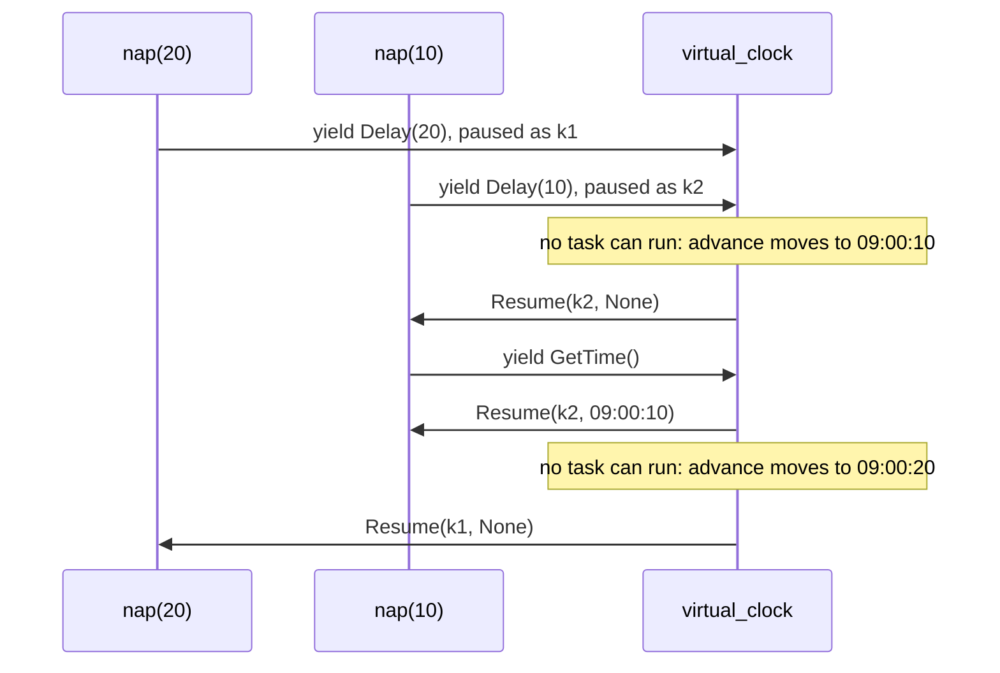

# Time as an effect: days of waiting in milliseconds, the same code on the wall clock

*Code that waits asks a handler for time. The handler holds the rest of the code and decides when it runs, so a test runs days of a schedule in milliseconds and production runs the same code on the wall clock.*

This is part 3 of a series on algebraic effects in Python with doeff. Part 1, [Algebraic effects for Python](algebraic-effects-in-python.md), introduces effects and handlers. The previous part, *Yield and async: who answers when your Python code pauses*, compares `yield` with `await`, and the next one is about recording the answers handlers give and replaying them.

`await asyncio.sleep(1800)` waits half an hour, in production and in your test. Code that waits is hard to check, for three reasons that tend to come together:

- A wait takes as long in a test as it does in production.
- Two waits that run at once must end in the right order, so making each wait return at once is not enough.
- Code that reads the clock, such as "the next weekday at 09:00", gives a different answer depending on when the test runs.

In `asyncio`, the event loop owns the clock: `asyncio.sleep` puts a timer on the loop, and the loop decides when your coroutine goes on. This post moves that decision into a handler. The code asks for time with effects, and the handler that answers them receives the rest of the code, so the handler picks the clock: a virtual one that jumps ahead, or the wall clock through `asyncio`. The code in between does not change.

If you skipped part 1, three words are enough for this post:

- An **effect** is a plain value that a `@do` function yields to ask for something. The function pauses at the `yield`.
- A **handler** is a function of `(effect, k)` marked with `@handler`. `k` is the rest of the paused function, and the handler decides how it goes on: `yield Resume(k, value)` runs the rest with `value` as the result of the `yield`.
- The **caller** installs the handlers: `handler(program)` is `program` with `handler` around it.

## Asking for time

The time effects in this post are our own: three small classes, each a request for time. `nap` asks for time twice and never says which clock:

~~~python
# clock.py (excerpt)
import asyncio
import heapq
from dataclasses import dataclass
from datetime import datetime, timedelta, timezone
from itertools import count

from doeff import Await, EffectBase, Gather, Resume, Spawn, do, handler, run
from doeff_core_effects.handlers import await_handler
from doeff_core_effects.scheduler import (
    PRIORITY_IDLE,
    CompletePromise,
    CreatePromise,
    Wait,
    scheduled,
)

@dataclass(frozen=True)
class Delay(EffectBase):  # "wait this many seconds"
    seconds: float

@dataclass(frozen=True)
class WaitUntil(EffectBase):  # "wait until this time"
    target: datetime

@dataclass(frozen=True)
class GetTime(EffectBase):  # "what time is it?"
    pass

START = datetime(2026, 11, 30, 9, 0, tzinfo=timezone.utc)

@do
def nap(seconds: float):  # asks for time twice, and never says which clock
    yield Delay(seconds)
    return (yield GetTime())
~~~

- `yield Delay(seconds)` asks to wait for `seconds`, and `yield WaitUntil(target)` asks to wait until the `datetime` `target`. The report below uses `WaitUntil`.
- `yield GetTime()` asks what time it is now. The clocks in this post answer with a timezone-aware `datetime`.
- Each effect is a frozen dataclass on `EffectBase` and holds only what the request needs. A handler names these classes in its annotation to say which effects it takes.

Run `nap(20)` with no handler, and it stops at its `Delay` with `UnhandledEffect`: the effect has no meaning until a handler gives it one.

## A clock is a handler that decides when `k` runs

Here is a first clock. It keeps the time in a variable. On `Delay`, it moves the time forward and resumes `k` at once. On `GetTime`, it resumes `k` with the time it keeps:

~~~python
# clock.py (excerpt)
def ticking(start: datetime):  # a clock of our own: resume k at once, move the hands
    now = start

    @handler
    def clock(effect: Delay | GetTime, k):
        nonlocal now
        if isinstance(effect, Delay):
            now += timedelta(seconds=effect.seconds)
            return (yield Resume(k, None))
        return (yield Resume(k, now))

    return clock
~~~

~~~python
print(run(ticking(START)(nap(20))))
~~~

~~~text
2026-11-30 09:00:20+00:00
~~~

Twenty seconds passed on this clock, and none on yours. For one task, that is all a virtual clock has to do. Now two tasks wait at once, one for 20 seconds and one for 10:

~~~python
# clock.py (excerpt)
@do
def two_naps(slow: float = 20, fast: float = 10):  # two tasks wait at once
    start = yield GetTime()
    slow_task = yield Spawn(nap(slow))
    fast_task = yield Spawn(nap(fast))
    woke = yield Gather(slow_task, fast_task)
    return [(at - start).total_seconds() for at in woke]
~~~

`Spawn` starts a program as a task, and `Gather` waits for the tasks and returns their results in the order of its arguments. Both are effects too, and `scheduled` is doeff's reference handler for them. Each result is how long after the start that task woke up:

~~~python
print(run(scheduled(ticking(START)(two_naps()))))
~~~

~~~text
[20.0, 30.0]
~~~

The 10-second nap woke 30 seconds after the start. `ticking` resumed the slow task's `k` at once, so the slow task's 20 seconds were on the clock before the fast task began its wait, and the fast task added 10 more. A clock for several tasks cannot answer each wait as it comes. It has to hold the `k` of every waiting task until no task can run, then move the time to the earliest wake-up and resume that task first.

`virtual_clock` is a clock that does this:

~~~python
# clock.py (excerpt)
def virtual_clock(start: datetime):  # waits take no time, and end in time order
    now = start
    sleepers = []  # (wake-up time, order, promise), earliest first
    order = count()
    advancing = False

    @do
    def advance():  # idle priority: runs while every other task waits
        nonlocal now, advancing
        while sleepers:
            now, _, promise = heapq.heappop(sleepers)
            yield CompletePromise(promise, None)
        advancing = False

    @handler
    def clock(effect: Delay | WaitUntil | GetTime, k):
        nonlocal advancing
        if isinstance(effect, GetTime):
            return (yield Resume(k, now))
        if isinstance(effect, Delay):
            wake_up = now + timedelta(seconds=effect.seconds)
        else:
            wake_up = max(now, effect.target)
        promise = yield CreatePromise()
        heapq.heappush(sleepers, (wake_up, next(order), promise))
        if not advancing:
            advancing = True
            yield Spawn(advance(), priority=PRIORITY_IDLE, daemon=True)
        yield Wait(promise.future)
        return (yield Resume(k, None))

    return clock
~~~

- On `Delay` or `WaitUntil`, `clock` creates a promise, puts it in `sleepers` with the wake-up time, and yields `Wait` on it. The task stops at that `yield`, and the handler holds its `k` until the promise completes.
- `sleepers` is a heap, so the earliest wake-up comes out first, and `order` keeps two waits for the same time in the order they came.
- `advance` is a task of idle priority, which the scheduler runs only while every other task waits. It moves `now` to the earliest wake-up and completes that promise. The woken task runs before `advance` goes on, so the time moves only when no task can run.
- `GetTime` is answered at once with `now`.

~~~python
print(run(scheduled(virtual_clock(START)(two_naps()))))
~~~

~~~text
[20.0, 10.0]
~~~

The slow task woke 20 seconds after the start and the fast one after 10, and the run took no time. Here is that run, one message at a time:

The clock reaches the scheduler only through effects that any program can yield: `CreatePromise`, `Spawn`, `Wait` and `CompletePromise`. The scheduler knows nothing about time, and the docs chapter [Why Effects?](https://github.com/proboscis/doeff/blob/main/docs/20-why-effects-over-di.md#virtual-time-hours-of-waiting-in-an-instant) walks through the same clock with plain seconds.

That is what makes time an effect rather than a function you call. A handler decides what a `yield` returns, and because it holds `k`, it also decides when the rest of the program runs.

## Days of a schedule in milliseconds

Now a program with more time in it. Every weekday at 09:00 it builds a report, and a build gets 10 minutes:

~~~python
# report.py (excerpt)
from doeff import Cancel, Pass, Race, Spawn, TaskCancelledError, Wait, do, handler, run
from doeff_core_effects.scheduler import scheduled

from clock import Delay, GetTime, WaitUntil, virtual_clock

# The program: every weekday at 09:00, build the report; give a build 10 minutes.
def next_weekday_at(now: datetime, hour: int) -> datetime:
    at = now.replace(hour=hour, minute=0, second=0, microsecond=0)
    if at <= now:
        at += timedelta(days=1)
    while at.weekday() >= 5:  # Saturday and Sunday
        at += timedelta(days=1)
    return at

@do
def build(minutes: int):  # a step that takes as long as we say
    yield Delay(minutes * 60)
    return f"built in {minutes} min"

@do
def alarm(seconds: float):  # a task that only waits
    yield Delay(seconds)

@do
def end(task):  # the value of task, or "timed out" if it had to be cancelled
    yield Cancel(task)  # Cancel does nothing to a task that has ended
    try:
        return (yield Wait(task))  # raises once the cancelled task has unwound
    except TaskCancelledError:
        return "timed out"

@do
def within(seconds: float, program):  # the value of program, or "timed out"
    task = yield Spawn(program)
    timer = yield Spawn(alarm(seconds))
    yield Race(task, timer)  # goes on when the first of the two ends
    yield end(timer)
    return (yield end(task))

@do
def report_day(minutes: int):  # wait for the next weekday 09:00, then build
    now = yield GetTime()
    yield WaitUntil(next_weekday_at(now, 9))
    started = yield GetTime()
    result = yield within(10 * 60, build(minutes))
    finished = yield GetTime()
    return f"{started:%a %d %H:%M}-{finished:%H:%M} {result}"

@do
def daily_report(build_minutes: list[int]):  # one line per day
    lines: tuple[str, ...] = ()
    for minutes in build_minutes:
        lines = (*lines, (yield report_day(minutes)))
    return lines
~~~

- `next_weekday_at` is plain Python. It takes `now` as an argument, so it never reads a clock.
- `build` takes as long as we tell it to, so that one build can be too slow.
- `within` is a timeout made of two tasks: `program`, and an `alarm` that only waits for `seconds`. `Race` goes on when the first of them ends, and `end` cancels whichever is still running and waits for it to unwind. If the alarm ended first, the build is the one cancelled: `Wait` raises `TaskCancelledError` at that `yield`, and `end` returns "timed out".
- `report_day` asks for the time with `GetTime` and waits with `WaitUntil`. It reads no clock of its own, so what it does depends on which clock answers, not on when it runs.
- `daily_report` runs one `report_day` per build. Yielding a program from a `@do` function runs it and gives back its result.

Start the virtual clock on a Friday evening:

~~~python
# report.py (excerpt)
FRIDAY_EVENING = datetime(2026, 11, 27, 17, 0, tzinfo=timezone.utc)

def simulated(program):  # virtual time from Friday 17:00
    return scheduled(virtual_clock(FRIDAY_EVENING)(program))
~~~

~~~python
for line in run(simulated(daily_report([3, 12, 5]))):
    print(line)
~~~

~~~text
Mon 30 09:00-09:03 built in 3 min
Tue 01 09:00-09:10 timed out
Wed 02 09:00-09:05 built in 5 min
~~~

The weekend went by, the 12-minute build ran into its 10-minute deadline, and the clock read 09:10 when `within` gave up on it. The run goes from Friday evening to Wednesday morning in virtual time and takes a few milliseconds. It prints the same lines every time, whatever day it is.

### A test that reads the clock afterwards

~~~python
# test_report.py
from datetime import datetime, timezone

from doeff import do, run

from clock import GetTime
from report import daily_report, simulated

@do
def report_and_the_time_after(build_minutes: list[int]):  # the test asks the same clock
    lines = yield daily_report(build_minutes)
    return lines, (yield GetTime())

def test_a_slow_build_times_out_and_the_next_day_still_runs():
    lines, stopped_at = run(simulated(report_and_the_time_after([3, 12, 5])))
    assert lines[1] == "Tue 01 09:00-09:10 timed out"
    assert lines[2] == "Wed 02 09:00-09:05 built in 5 min"
    assert stopped_at == datetime(2026, 12, 2, 9, 5, tzinfo=timezone.utc)
~~~

The test is a program too. `report_and_the_time_after` runs `daily_report` and then asks the clock what time it is, so the test reads where the virtual time stopped: Wednesday 09:05, when the last build finished. The test asserts exact times, because nothing in the run depends on how fast the machine is.

### A layer of your own around any clock

A handler can also sit between the program and the clock. `timeline` prints every wait at the time it starts:

~~~python
# report.py (excerpt)
@handler
def timeline(effect: Delay | WaitUntil, k):  # print every wait as it starts
    now = yield GetTime()
    if isinstance(effect, Delay):
        print(f"{now:%a %H:%M} wait {effect.seconds:g} s")
    else:
        print(f"{now:%a %H:%M} wait until {effect.target:%a %H:%M}")
    return (yield Pass(effect, k))
~~~

~~~python
run(simulated(timeline(daily_report([3, 12]))))
~~~

~~~text
Fri 17:00 wait until Mon 09:00
Mon 09:00 wait 180 s
Mon 09:00 wait 600 s
Mon 09:03 wait until Tue 09:00
Tue 09:00 wait 720 s
Tue 09:00 wait 600 s
~~~

`timeline` yields an effect of its own: its `GetTime` travels out to the clock like any other. Then `Pass(effect, k)` hands the wait and `k` on to the clock, which decides when `k` runs. The `wait 600 s` lines are the alarms of `within`: a task that `daily_report` starts runs under the same handlers, so its waits pass through `timeline` too. `timeline` takes only `Delay` and `WaitUntil`, so the program's `GetTime` goes past it to the clock. With it, you see the whole schedule a run makes, not only its result, and the program has no logging for it. Installed around the wall clock below, the same layer prints the waits as they happen.

## The same code on the wall clock

~~~python
# clock.py (excerpt)
@handler
def wall_clock(effect: Delay | WaitUntil | GetTime, k):  # waits on asyncio
    now = datetime.now(timezone.utc)
    if isinstance(effect, GetTime):
        return (yield Resume(k, now))
    if isinstance(effect, Delay):
        seconds = effect.seconds
    else:
        seconds = (effect.target - now).total_seconds()
    yield Await(asyncio.sleep(max(seconds, 0)))
    return (yield Resume(k, None))

def real(program):  # the wall clock, with asyncio under the scheduler
    return scheduled(await_handler(wall_clock(program)))
~~~

~~~python
print(run(real(two_naps())))
~~~

This run takes 20 seconds and prints numbers a little above `[20.0, 10.0]`, such as `[20.07, 10.13]`, because a timer on the wall clock wakes a little late. `wall_clock` answers `GetTime` with the system clock, and a wait by yielding `Await` with the coroutine `asyncio.sleep(...)`. `await_handler` runs that coroutine on an `asyncio` event loop under the scheduler. In the same way, `run(real(daily_report([3, 12, 5])))` waits until the next weekday at 09:00, and the timeout in `within` cancels a build after 10 real minutes.

Neither `nap` nor `daily_report` is `async def`. The program does not choose `asyncio`; the handler does.

| Run | The clock | What the same `daily_report` does |
|---|---|---|
| test | `virtual_clock(FRIDAY_EVENING)` | Friday evening to Wednesday morning in a few milliseconds, the same lines every run |
| test that reads the clock | the same, and a `GetTime` after the program | the same, and the test reads where the time stopped |
| test of the schedule | `timeline` inside `simulated` | every wait is printed with its virtual time |
| production | `wall_clock` under `await_handler` | waits on `asyncio`; the timeout cancels after 10 real minutes |

## How this compares

Python already has ways to make waits fast in tests. We ran each with two tasks that wait 20 and 10 seconds, on CPython 3.12 with trio 0.34.0, looptime 0.9, freezegun 1.5.5 and time-machine 3.6.0:

| | A wait in a test | Two waits end in time order | The date and time move with the waits | Your code |
|---|---|---|---|---|
| `asyncio.sleep` patched to return at once | returns at once | No: both report 0 seconds, in the order they started | No | unchanged |
| freezegun `freeze_time()` | never returns: the loop's clock is frozen too (with `real_asyncio=True`, it waits for real) | — | No: `datetime.now()` stays where it was frozen | unchanged |
| time-machine `travel(..., tick=False)` | waits for real | Yes, in real time | No | unchanged |
| trio's test clock with `autojump_threshold=0`, or looptime for `asyncio` | returns at once | Yes | Partly: `trio.current_time()` or `loop.time()` moves, `datetime.now()` does not | unchanged; trio's clock needs code written for trio |
| doeff with `virtual_clock` | returns at once | Yes | Yes: `GetTime` and the waits are answered by one handler | written with `yield` and effects of your own |

If your code is already `async` and you only need its waits to be fast, trio's autojump clock and looptime do that without touching the code, and they are the simpler choice. What doeff adds is that the clock is a handler in your own stack rather than part of the event loop. The date comes from the same clock as the waits, so a schedule like "the next weekday at 09:00" runs on virtual time. The clock is a handler you can read and write yourself, as `virtual_clock` above shows, and you can put layers such as `timeline` around it. The price is the one from part 1: `yield` and `@do` in your code.

## Limits

- Virtual time moves only when every task is waiting on an effect. A task that computes in a loop holds the clock still until it yields, and a blocking call such as `time.sleep` or a socket read stops every task, on any clock.
- Only time asked for through effects is virtual. `datetime.now()` and `time.time()`, in your code or in a library it calls, still read the system clock. Pass the time in, as `next_weekday_at` does, or ask for it with `GetTime`.
- `virtual_clock` yields `Spawn`, `CreatePromise` and `Wait`, so it goes inside `scheduled(...)`, and it goes outside every `Spawn` whose tasks wait on it, so that the tasks share one clock.
- The clocks are as small as this post needs. A wait that is cancelled stays in `sleepers` until its time comes, and `advance` then completes a promise that no task waits for.
- A timer on the wall clock wakes a little late, as the run above shows. A test that asserts exact times belongs on the virtual clock.
- doeff is 0.x, so names can still change between versions.

## Try it

~~~bash
pip install doeff pytest   # CPython 3.11 to 3.14
~~~

Every example in this post runs as shown with doeff 0.8.1 and nothing else. The complete files are in [examples/time_as_an_effect](https://github.com/proboscis/doeff/tree/main/examples/time_as_an_effect).

Where does time make your tests slow or flaky today: a retry with backoff, a cron-like schedule, a timeout? Issues are open at https://github.com/proboscis/doeff/issues.

The next part is about record and replay: a handler keeps the answers that the other handlers give, and runs the same program again from them.
