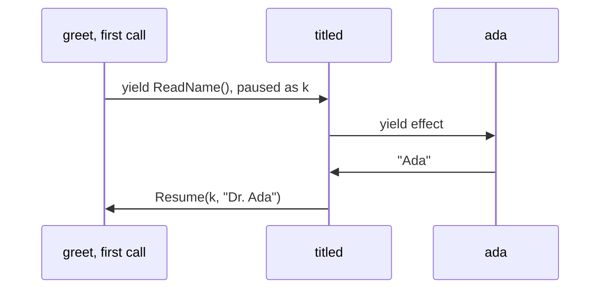

# Yield and async: who answers when your Python code pauses

*`await` and doeff's `yield` both pause a Python coroutine. They differ in where the request goes and in who resumes the paused code: with `await`, the code you called and one event loop at the top; with effects, the nearest handler a caller installed, holding the rest of the function.*

This is the second post on algebraic effects in Python with doeff. [The first one](algebraic-effects-in-python.md) showed the mechanism: a function yields an effect, a value that names an operation, and a handler receives it together with `k`, the rest of the function, and decides how the function goes on.

If you write asyncio code, the first question is why. Python already has syntax for functions that pause and resume: `async def` and `await`. Why write `@do` and `yield`?

Both are coroutines, and they pause the same way. They differ in two things, and algebraic effects has a name for each. One is where the request goes when the code pauses: which handler receives the operation. The other is how the paused code goes on: what the receiver can do with the continuation. This post takes them one at a time, with code you can run.

## The same function, written twice

~~~python
# greet.py (excerpt)
import asyncio
from dataclasses import dataclass

from doeff import EffectBase, Gather, Resume, Spawn, do, handler, run
from doeff_core_effects.scheduler import scheduled


# With async and await: the call names the code that answers.
async def read_name_async() -> str:  # the implementation itself
    await asyncio.sleep(0)
    return "Ada"


async def greet_async() -> str:  # a greeting with whatever name the call returns
    name = await read_name_async()  # runs read_name_async, here and now
    return f"Hello, {name}"


# With @do and yield: the call names an operation, and a handler answers.
@dataclass(frozen=True)
class ReadName(EffectBase):  # an effect: "a name, please"; it says nothing about how
    pass


@do
def greet():  # a greeting with whatever name the handler answers
    name = yield ReadName()  # pauses; the nearest handler of ReadName answers
    return f"Hello, {name}"


@handler
def ada(effect: ReadName, k):  # answer "Ada", and run the rest of greet
    return (yield Resume(k, "Ada"))
~~~

~~~python
print(asyncio.run(greet_async()))
print(run(ada(greet())))
~~~

~~~text
Hello, Ada
Hello, Ada
~~~

The two functions look alike and print the same line. They differ in what each one names where it pauses:

- At `await read_name_async()`, `greet_async` names a function. The import decides which code that is, and that code runs right there, as part of the same chain of calls.
- At `yield ReadName()`, `greet` names an operation and pauses. `ReadName()` is a value: it does not say how to get a name. `ada` answers it, because the caller installed `ada` around `greet()`.

`greet_async` gets the name that `read_name_async` returns, and no other. `greet` gets whatever the handler around it answers. To see why the async version has no other choice, look at what actually crosses an `await`.

## Where an `await` goes

An `async def` function is a coroutine, built on the same machinery as a generator: a paused coroutine goes on when someone calls its `send()` method. asyncio began on generators. Before PEP 492 added `async` and `await` in Python 3.5, its coroutines were generators that used `yield from`, and `await` still works like `yield from`: when the awaited object yields something, it passes straight through every coroutine in between, out to whoever called `send()`.

You can watch this without asyncio. `Ask` is an awaitable that yields itself, and `drive` plays the part of the event loop:

~~~python
# drive.py (excerpt)
import asyncio
from dataclasses import dataclass


@dataclass(frozen=True)
class Ask:  # a request a coroutine hands up through await
    key: str

    def __await__(self):
        return (yield self)  # whoever calls send() gets this object


async def greet_async():  # a greeting with whatever name the driver answers
    name = await Ask("name")
    return f"Hello, {name}"


async def twice_async():  # never sees the Asks that pass through it
    return (await greet_async(), await greet_async())


def drive(coroutine, answers: dict[str, str]):  # the one place every Ask reaches
    value = None
    while True:
        try:
            request = coroutine.send(value)
        except StopIteration as stop:
            return stop.value
        value = answers[request.key]
~~~

~~~python
print(drive(twice_async(), {"name": "Ada"}))
~~~

~~~text
('Hello, Ada', 'Hello, Ada')
~~~

`drive` receives every `Ask`, even the ones `greet_async` makes one call down. `twice_async` cannot see them, answer them or change them: `await` passes them through. Run the same coroutine under asyncio, and the event loop is in `drive`'s place:

~~~python
asyncio.run(twice_async())
~~~

~~~text
RuntimeError: Task got bad yield: Ask(key='name')
~~~

The `Task` that runs a coroutine is the code that calls `send()`, so every request in the program ends up there, and it understands two kinds. At the bottom of each chain of awaits is a `Future`, which yields itself: the Task adds a callback to it, and once the future is done, calls `send(None)`, and the future's `__await__` returns `future.result()`. A bare `yield`, which `asyncio.sleep(0)` uses, means "let the other tasks run first". Anything else is a bad yield. trio works the same way with request objects of its own.

```mermaid
sequenceDiagram
    participant loop as the event loop's Task
    participant twice as twice_async
    participant greet as greet_async
    loop->>twice: send(None)
    twice->>greet: await greet_async(), a plain call
    greet->>loop: yield a request, straight through twice_async
    Note over loop: the only receiver
    loop->>greet: send(None), straight through twice_async
```

In the words of algebraic effects:

- what crosses an `await` is an operation, and a paused coroutine is a one-shot continuation;
- the event loop is a handler: the only one, installed once at the top by `asyncio.run`, for the operations the loop defines;
- `await child()` is a call: the child runs as part of the caller, and the coroutines between the child and the loop take no part in its requests.

You could write a driver of your own that answers some requests and passes the others up: that driver is a handler. doeff is such a driver, run by a VM written in Rust, with handlers that any caller can install around any part of a program, and it drives plain generators, so a program needs no event loop at all.

## Where a `yield` goes

In doeff, an effect goes to the innermost handler around the code that takes it, not to the top. A caller can install a handler around any part of a program, and a handler between can answer an effect by performing it again, out to the next handler:

~~~python
# greet.py (excerpt)
# Handlers that callers install around parts of a program.
@handler
def grace(effect: ReadName, k):  # the same effect, another answer
    return (yield Resume(k, "Grace"))


@handler
def titled(effect: ReadName, k):  # ask the next handler out, then answer
    name = yield effect
    return (yield Resume(k, f"Dr. {name}"))


@do
def twice():  # two greetings, the second under its own handler
    first = yield greet()  # like `await greet_async()`: the child runs here
    second = yield grace(greet())  # this call alone runs with grace around it
    return first, second
~~~

~~~python
print(run(ada(twice())))
print(run(ada(titled(twice()))))
~~~

~~~text
('Hello, Ada', 'Hello, Grace')
('Hello, Dr. Ada', 'Hello, Grace')
~~~

`yield greet()` is the counterpart of `await greet_async()`: the child runs as part of the parent, and its effects travel out through the parent's handlers. `twice` installs `grace` around its second call only, so the `ReadName` of that call stops at `grace`, and the first one goes on out. In the second run, `titled` sits between `twice` and `ada`. Inside a handler, `yield effect` performs the effect again, and the next handler out answers it; `titled` takes the answer and resumes `k` with `Dr. ` in front. The second call never reaches `titled`, because `grace` is closer. `greet` is the same function in every run.

The first `ReadName` of the second run travels like this:



| | `async def` and `await` | `@do` and `yield` |
|---|---|---|
| What crosses a pause | whatever the awaited object yields; for asyncio, a `Future` | an effect: a value that names an operation |
| Who receives it | the code that calls `send()`: the event loop's `Task`, at the top | the innermost handler around the code that takes this effect |
| Code in between | passes it through | a handler between can answer it, or perform it again to the next handler out |
| Who picks the receiver | `asyncio.run`, once for the whole program | each caller, for each part of the program |

asyncio does have a tool for "this call alone": a `contextvars.ContextVar`, set around a call and copied into each task. It scopes a value, which can be a function to call. That function answers and returns. It does not receive the rest of the caller, so it cannot decide whether, when or how the caller goes on. That is the second difference.

## How the paused code goes on

A task that waits on a future goes on when the future is done: the loop calls `send(None)`, and the coroutine reads the result from the future. The loop's only other move is to throw into it: `task.cancel()` raises `CancelledError` at the `await`. A handler holds `k`, so how the code goes on is the handler's decision:

| The paused code | asyncio | A doeff handler |
|---|---|---|
| goes on with a value | the loop calls `send(None)` once the future is done; it gets control back at the next pause | `yield Resume(k, value)`, which returns what the rest of the program returned; or `yield Transfer(k, value)`, when the handler is done |
| sees an exception where it paused | `future.set_exception(error)`, or `task.cancel()` | `yield ResumeThrow(k, error)` |
| goes on later, after other code | the loop's queue of ready tasks | the handler keeps `k`; this is how `scheduled` runs tasks |
| never goes on, and the run ends with another value | no counterpart: a task whose future never completes waits forever | `return value`, without resuming `k` |
| goes on twice | no: a coroutine runs once | no: `k` is one-shot, and a second `Resume` raises `RuntimeError` |

~~~python
# greet.py (excerpt)
# How the paused code goes on is the handler's decision.
@handler
def closed(effect: ReadName, k):  # never resume k: the run ends here
    return "closed today"


@do
def together():  # two tasks, each under the handlers around it
    first = yield Spawn(greet())
    second = yield Spawn(grace(greet()))
    return (yield Gather(first, second))
~~~

~~~python
print(run(closed(twice())))
print(run(scheduled(ada(together()))))
~~~

~~~text
closed today
['Hello, Ada', 'Hello, Grace']
~~~

`closed` answers by not resuming. `twice` stops at its first `yield`, and `"closed today"` is the result of the whole run. asyncio has no move that leaves a task at its `await` and ends the run with another value; cancelling raises inside the task instead.

Holding `k` for later is how concurrency works. `Spawn` and `Gather` are effects, and `scheduled` is the handler for them: it keeps the `k` of each task that waits and transfers to it when the task can go on, the job asyncio's loop does for its tasks. It is installed like `ada`. Both tasks run under the handlers around `together`, and the second task's program is `grace(greet())`, so it greets Grace.

One thing works differently from a coroutine object. A coroutine object is one run, paused; once it has run to the end, it is spent. With `greet_async` and `drive` from `drive.py`:

~~~python
greeting = greet_async()
print(drive(greeting, {"name": "Ada"}))
drive(greeting, {"name": "Ada"})
~~~

~~~text
Hello, Ada
RuntimeError: cannot reuse already awaited coroutine
~~~

Calling a `@do` function builds a program, a value that describes the run. `run()` starts a new generator for it each time, so one program runs under `ada` and then under `grace`:

~~~python
hello = greet()
print(run(ada(hello)))
print(run(grace(hello)))
~~~

~~~text
Hello, Ada
Hello, Grace
~~~

Within one run, the two models agree: `k` is one-shot, as a coroutine is. doeff does not copy paused code. What it changes is who holds it.

## I/O through an async library

Python's I/O libraries are often `async`: HTTP clients, database drivers, the SDKs of model providers. doeff does not ask you to rewrite them. `Await(coroutine)` is one more effect, and `await_handler()` answers it: it runs the coroutine on a background asyncio loop that the whole process shares, and resumes `k` with the result once it is done, while other doeff tasks run. The event loop is still there, but it has moved from above the program to behind one handler.

Where you put the `Await` decides what the handlers see. Here a stream of chunks, of the kind a model's SDK returns, is collected two ways: with the loop as a program and one `Await` per chunk, or with the whole loop in one coroutine and one `Await` around it:

~~~python
# stream.py (excerpt)
import asyncio
from collections.abc import AsyncIterator

from doeff import Await, Listen, do, run
from doeff_core_effects.handlers import await_handler, listen_handler
from doeff_core_effects.scheduler import scheduled


async def tokens() -> AsyncIterator[str]:  # stand-in for the stream of an async SDK
    for chunk in ("Hello", ",", "", " world"):
        await asyncio.sleep(0.01)
        yield chunk


@do
def collect(stream: AsyncIterator[str]):  # the loop is a program: one Await per chunk
    chunks = aiter(stream)
    text = ""
    while True:
        chunk = yield Await(anext(chunks, None))
        if chunk is None:  # None is the end; "" is a chunk
            return text
        text += chunk


async def collect_async(stream: AsyncIterator[str]) -> str:  # the whole loop in one coroutine
    text = ""
    async for chunk in stream:
        text += chunk
    return text


@do
def collect_in_one(stream: AsyncIterator[str]):  # one Await around all of it
    return (yield Await(collect_async(stream)))


@do
def counted(program):  # the result, and every Await that program yielded
    return (yield Listen(program, types=(Await,)))


def bridged(program):  # Await answered on asyncio, Listen inside it
    return scheduled(await_handler()(listen_handler(program)))
~~~

~~~python
text, waits = run(bridged(counted(collect(tokens()))))
print(repr(text), len(waits))
~~~

~~~text
'Hello, world' 5
~~~

~~~python
text, waits = run(bridged(counted(collect_in_one(tokens()))))
print(repr(text), len(waits))
~~~

~~~text
'Hello, world' 1
~~~

`Listen` is an effect too. `listen_handler` answers it by installing a handler around `program` that writes down each `Await` and passes it on to `await_handler`. With one `Await` per chunk, it sees five waits: four chunks and the end. With the loop inside one coroutine, it sees one: the waits inside `collect_async` go to asyncio's loop, where no handler can reach them. So keep the steps in `@do` code and put `Await` at the one operation the library provides. Then whatever you stack around the program sees each step: a log, a clock, a budget, or a recording of the answers that a test replays without calling the outside service again.

`collect` checks `chunk is None`, not `not chunk`: the empty string is a chunk, and `anext(chunks, None)` gives `None` only at the end.

## When `async` and `await` are the better tool

- **One way to run.** If a dependency has one implementation and nothing goes around its calls, a plain `await`, or a function passed as an argument, is shorter. Effects pay off when the same code runs under different handlers, or when you want something around every step.
- **`@do` spreads to the callers, as `async` does.** doeff does not remove the color of functions. It replaces two colors, plain and `async`, with one, and a handler decides whether a step waits on an event loop.
- **asyncio is more than a way to wait.** Sockets, subprocesses, locks, queues and a large set of libraries come with it. doeff reaches them through `Await`, one operation at a time.
- **Inside an asyncio application, `run()` blocks.** Call it in a worker thread: `await asyncio.to_thread(run, program)`.
- **The `Await` bridge has rules of its own.** All the `Await`s of a process run on one background loop, so a coroutine that blocks that loop, with a synchronous call inside async code, stalls every `Await` in the process. Cancelling the doeff task that waits delivers `CancelledError` to the coroutine, but only requests it: the cancel returns without waiting for the coroutine's `finally` blocks to run.
- **A handler takes on the contract of its operation.** What happens on cancellation, on an exception and in which order is now the handler's job, and you test it like any other code.
- **A task costs more.** doeff's Rust scheduler takes about 17 µs of CPU per spawned task, against about 11 µs for asyncio.

## Summary

| | `async def` and `await` | `@do` and `yield` |
|---|---|---|
| A pause hands over | an awaitable; at the bottom, a future for the loop | an effect: a value that names an operation |
| It goes to | the event loop at the top, through every coroutine in between | the innermost handler around the code that takes it |
| The receiver is chosen | once per program, by `asyncio.run` | by each caller, for any part of the program |
| The paused code goes on | when its future is done | when, how and whether the handler decides |
| Calling the function gives | a coroutine object, which runs once | a program, which runs as often as you like |
| Existing async libraries | `await` them | `yield Await(...)` at each operation |

In the vocabulary of algebraic effects, `async` and `await` make an effect system with one handler, fixed at the top, for the operations of the event loop. doeff keeps the coroutine, as a Python generator, and lets every caller install handlers: for your own operations, for concurrency, and for asyncio itself.

## Try it

~~~bash
pip install doeff   # CPython 3.11 to 3.14
python greet.py
python drive.py
python stream.py
~~~

Every example in this post runs as shown with doeff 0.8.0. The complete files are in [examples/yield_and_async](https://github.com/proboscis/doeff/tree/main/examples/yield_and_async). The docs chapter [Async Effects](https://github.com/proboscis/doeff/blob/main/docs/04-async-effects.md) covers `Await`, `Spawn`, `Gather`, `Race` and cancellation, and the FAQ answers [How is it different from asyncio?](https://github.com/proboscis/doeff/blob/main/docs/faq.md#how-is-it-different-from-asyncio).

The previous post, [Algebraic effects for Python](algebraic-effects-in-python.md), stacks handlers for time, concurrency, retries, budgets and I/O around one program. The next one is about time: a clock as a handler, so hours of waiting run in an instant.

Do you have asyncio code where the event loop gets in the way, or a case where a plain `await` is clearly the better tool? Issues are open at https://github.com/proboscis/doeff/issues.
