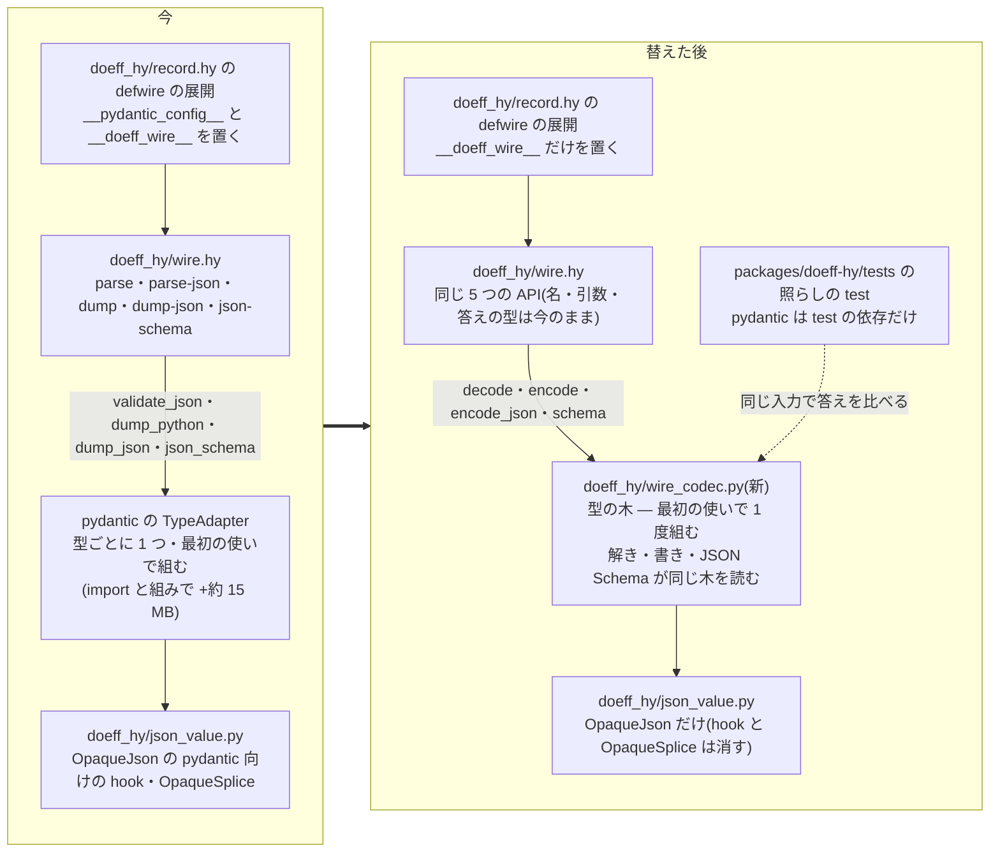

# defwire の自前の解き手 — 責務・型ごとの判じ方・置き場の契約

- 日時: 2026-10-27
- 書いた人: Claude Opus 5.5(card ki-dc9d1af17fb5・作業 branch `wt/defwire-decoder-design-ki-dc9d1af17fb5`)
- 出自: 利用者の決定 2026-10-27(依頼書 lt-SJK77NQZ8NSESDVVZ0P41407XQ の問い decoder の答え lt-D5Q56P2TZ0SG1ST011J4WBTZCG・親 card ki-2e0dce8d1ebb)。
  決まった事: defwire の解き手を doeff の中に自前で持ち、pydantic は test で照らす相手としてだけ残す。
- 守る事(利用者の決定 2026-10-27・card ki-2e0dce8d1ebb): wire の境界の型の check を弱めない。今の strict の判じ方(文字列を数にしない・
  真偽を数にしない・整数は float の欄に入る・配列は tuple の欄・defenum は値の綴り・:names の wire の名だけを受ける・:unknown の reject / ignore・
  :check の落ちは Malformed)をそのまま保つ。
- 測り: artifact `2026-10-27-defwire-base-measurements.html`(pydantic +14.6〜15.2 MB・試作 +7 KB・1 回の解き 試作 22 µs / pydantic 7〜15 µs)。
- 構成のレビュー: 会話 c-QHBJZCQD6NTJ4Z5RPW0NDWE0X8 の報告 lt-DADA8HCKBQA3SFT70C8ABZC7VC の所見 A〜K を全部採った(JSON の読みの差・adapter の直の読み手・範囲・表の行の読みの穴・reason の契約)。
- この記録は子の card(解き手の核・書き手・照らしの test・表の行・直の使いの移し・linter)が作る物の契約です。今の振る舞いは
  pydantic 2.13.4・pydantic_core 2.46.4 で走らせて確かめました(走らせた script は `probes.md`・結果は付録 A)。

## この文書の目的

読み終えた人が、次の 4 つを言えるようにする: 自前の解き手が持つ責務と持たない責務(節 1)・欄の型ごとに何を受け何を断り何を書くか(節 2・3)・
code をどこに置きどの API を保つか(節 4)・census の特例と表の行の読みをどう扱うか(節 5・6)。子の card は節 7 の比べ方で、契約どおりかを確かめる。

範囲:

- この記録が決めるのは defwire の経路(wire.hy の 5 つの API と、それを通る型)と、表の行の読み(節 6)。
- defwire の経路の外の pydantic の使い所は範囲の外で、別の census と card にする。agora-controllers の本体で 20 余りの file が pydantic を直に import する(語彙の型を最上位にした TypeAdapter・ValidationError を捕まえる所・RowType.adapter の直の読み)。これらが残る限り job は pydantic を読み続ける。
- その書き換えを 1 行ずつで済ませるため、doeff は語彙の型そのものを最上位として解く入口 `parse-as` を wire.hy に 1 つ足す(節 4)。

## 全体の図 — 今と替えた後

## 言葉

| 名 | 何か |
|---|---|
| 解き手 | JSON を defwire の型の値へ解いて確かめる部品(今は pydantic の TypeAdapter) |
| 書き手 | defwire の型の値を JSON へ書く部品(今は TypeAdapter の dump) |
| 型の木 | defwire の型 1 つについて、欄ごとの判じ方を最初の使いで 1 度組んだ関数の木。解き・書き・JSON Schema の 3 つが同じ木を読む |
| 語彙 | defwire の欄に書いてよい型の閉じた集まり(節 2)。語彙の外の型は木を組む時に断る |
| 何でも受ける腕 | union の腕のうち、どの JSON も受ける型(OpaqueJson・object) |
| 照らしの test | 同じ入力を自前の解き手と pydantic に通し、答えが一致する事を示す test(pydantic を test の依存として残す訳) |
| reason の種類 | Malformed の reason の末尾の `[…]`(今は pydantic の誤りの種類 — `missing`・`int_type` など) |

## 1. 責務の表

親の依頼書の節「解き手が今 pydantic に任せている責務」の 13 行。持ち主の module は節 4、card の番号は親の依頼書の節「合意した後の子の card」の順です。

| 責務 | 要るか | 訳 | 持ち主 |
|---|---|---|---|
| JSON の文字列を Python の値へ読む | 要る | 外との境目そのもの。標準の `json.loads` は pydantic より広く受ける所が在る(孤立した surrogate の escape・UTF-8 でない bytes・深い入れ子)ので、節 3「JSON の読み」の前処理と断りを足して、今と同じ物だけを受ける | 標準の `json` module と前処理(`wire_codec.py`)・card 1 |
| 欄ごとに型を strict に確かめる | 要る | 境界の型の check を弱めない決定。判じ方は節 2 の表のとおりで、今の pydantic の strict と同じ物を受け、同じ物を断る | `wire_codec.py` の型の木・card 1 |
| wire の欄の名と Python の欄の名を対応させる | 要る | 2,276 型が :names で宣言している。読みは wire の名だけを受け(Python の欄の名で来た欄は知らない欄)、書きは wire の名で書く | 型の木(names は今の `WireShape.names` をそのまま読む)・card 1 |
| 知らない欄を断る・読み捨てる | 要る | :unknown の宣言どおり。入れ子の型はそれぞれ自分の :unknown に従う(親の :unknown を継がない — 今と同じ) | 型の木・card 1 |
| 値を作る時の :check の落ちを Malformed にする | 要る | 業務の失敗として返す約束。:check は今のまま defrecord の `__post_init__` が走らせ、解き手は ValueError と AssertionError だけを Malformed へ写す(他の例外は投げたまま — 今と同じ) | defrecord の :check(今のまま)と型の木・card 1 |
| 合わない欄の場所と訳を返す | 要る | Malformed の欄。場所と reason の綴りは節 3 の規則で今と同じにする(画面の誤りの文と test が reason の文を読む — 例 `payload-invalid: passDefinition: Field required [missing]`) | 型の木・card 1 |
| 値を JSON へ書く(既定値の欄は書かない) | 要る | 送る側と読む側の往復の約束。既定値と等しい欄は書かない(入れ子も)。float の綴りは今の bytes と同じにする(節 2 の「float の綴り」)。往復で JSON は同じでも、何でも受ける腕の在る union は値の腕が変わる事が在る(`(\| str OpaqueJson None)` の欄の OpaqueJson `"s"` は、書いて読み直すと str の `s`) | `wire_codec.py` の書き手・card 2 |
| OpaqueJson の中身を読み直さずに埋める | 要る | 大きな JSON を 2 度読まないための作り。自前の書き手は持っている文字列を出力へそのまま書けるので、今の `OpaqueSplice`(印を置いて後で替える仕掛け)は要らなくなる | 書き手・card 2(`OpaqueSplice` と `__get_pydantic_core_schema__` は、wire.hy の dump-json が自前の書き手へ替わる card 3 の commit で消す — それまでは pydantic の道が使う) |
| JSON Schema を出す | 要る | 契約の file と照らす test が使う(読むのは properties・required・type・items・anyOf・enum・$defs・$ref・additionalProperties・title・default — 節 3b)。description は出さない(今の pydantic も出していない) | 型の木・card 2 |
| 解き手を最初の使いまで組まない | 要る | 使わない型まで組むと起動が遅い(前の測りで 547 個・1.84 秒)。型の木は最初の parse・dump・json-schema で 1 度組み、型に覚える。free-threading の Python なので、組むのは lock の中で 1 度にする | `WireShape` の codec の欄(遅れて組む入れ物)・card 1 |
| 表の行を緩く読む(文字列の数を数にする等) | 決めていない — 節 6 の確かめ方で決める | 表の行は今 `validate_python`(pydantic の lax・Python の読み方)で読む。行は自分の書き手が JSON の値で書くので strict でも通る見込み。通らない行が在れば、緩い読みを残さず、行を書き直してから strict に揃える | card 4 |
| 解く前に値を作り替える(BeforeValidator の 1 か所) | 形を替えて要る | `LooseText`・`LooseInteger`(agora-controllers の custody_body/protocol/identity.hy)。節 3 の union の規則(何でも受ける腕は最後)で `(\| str OpaqueJson None)`・`(\| int OpaqueJson None)` と書ける | defwire の union の欄・card 6 |
| 数の範囲の制約(Field(ge=0) の 1 か所) | 形を替えて要る | agora-controllers の screen/intent/board_rows.hy の `resumes-at`。型を `int` にし、`:check [(>= resumes-at 0)]` を defwire の頭に置く。reason は `greater_than_equal` から `value_error` に変わり、JSON Schema の `minimum` が消える(card 6 で契約の file と照らす) | defrecord の :check・card 6 |

## 2. 語彙の型ごとの判じ方

- 受ける JSON の形は「JSON を `json.loads` で読んだ Python の値」で書く。「断る形」の reason は `<msg> [<種類>]` の綴り(節 3)。
- どの型も、受ける形の外は全部断る。表の「断る形」は代表で、漏れの無い一覧ではない。
- null は、型が None の腕を持つ時だけ受ける(表の `(| T None)` の行)。None の腕の無い欄に null は、その型の誤り(例 `Input should be a valid string [string_type]`)。

| 欄の型 | 受ける JSON(得る値) | 断る形(reason) | 書き出し |
|---|---|---|---|
| `str` | 文字列(孤立した surrogate を含まない物) | 数・真偽・null・配列・object(`Input should be a valid string [string_type]`)。孤立した surrogate の escape `"\ud800"` は JSON の読みの時に `json_invalid`(今と同じ — 節 3「JSON の読み」) | 文字列 |
| `int` | 整数(Python の int で bool でない物) | 文字列 `"1"`・真偽・小数 `1.0` と `1e3`(`Input should be a valid integer [int_type]`) | 整数 |
| `float` | 小数と整数(整数は float に直す — `1` は `1.0`)。NaN・Infinity・桁あふれの `1e400`(inf)も受ける(今と同じ) | 文字列・真偽(`Input should be a valid number [float_type]`) | 小数。綴りは今の bytes と同じ(下の「float の綴り」)。dump-json の inf・nan は `null`、dump(JSON の値)は float のまま |
| `bool` | `true`・`false` | 数・文字列(`Input should be a valid boolean [bool_type]`) | 真偽 |
| defenum(`StrEnum`) | member の値の綴りの文字列(member の名では受けない) | 外の綴り(`Input should be 'a', 'b' or 'c' [enum]` — 値を `'…'` で包み、最後の 2 つを ` or `・前を `, ` でつなぐ) | 値の綴り |
| 文字列の Literal(`(get Literal "x")`・`(get Literal #("x" …))`・`(get Literal 名)` — 値は木を組む時に解けた文字列) | 並べた文字列のどれか(文字列の Literal だけを語彙に入れる — 今の所は全部文字列) | 外の値(`Input should be 'x' or 'y' [literal_error]`) | その文字列 |
| `(get tuple #(T ...))` | 配列(各要素を T で判じ、tuple にする) | 配列でない(`Input should be a valid array [tuple_type]`)・要素の誤りは場所 `<欄>.<位置>` | 配列 |
| `(get tuple #(T1 T2 …))` | 長さちょうどの配列 | 短い(足りない位置ごとに `<欄>.<位置>` `Field required [missing]`)・長い(`Tuple should have at most N items after validation, not M [too_long]`) | 配列 |
| `(get list T)` | 配列(list にする) | 配列でない(`Input should be a valid array [list_type]`) | 配列 |
| `(get frozenset T)` | 配列(重なりは 1 つにまとめる・T は str か int) | 配列でない(`Input should be a valid array [frozen_set_type]`) | 配列(今と同じく set の回りの順) |
| `(get dict #(str T))` | object(値を T で判じる・key は文字列だけ) | object でない(`Input should be an object [dict_type]`)・値の誤りは場所 `<欄>.<key>` | object |
| 素の `dict` | object(値は読まずに `json.loads` の値のまま) | object でない(`[dict_type]`) | object(値が JSON の値でなければ TypeError) |
| `object` | どの JSON も(`json.loads` の値のまま — 型の checkは無い。今と同じ) | 無し | 値をそのまま(JSON の値でなければ TypeError) |
| `OpaqueJson` | どの JSON も(中を読まず、最小の直列化の文字列で包む — `OpaqueJson.of`) | 無し | dump は `json.loads(text)`・dump-json は text をそのまま埋める(NaN・Infinity を含む text だけは読み直して `null` にする — 今と同じ) |
| 入れ子の defwire の型 | object(その型の :names・:unknown・:check で判じる) | object でない(`Input should be an object [dataclass_type]`)・中の誤りは場所 `<欄>.<中の wire の名>` | object(その型の書き出し — 既定値の欄を書かない) |
| `(\| T None)`(腕が None と 1 つ) | null は None、他は T で判じる | T の断り(場所に腕の名を付けない — `oi` `Input should be a valid integer [int_type]`) | null か T |
| `(\| T1 T2 …)`(None でない腕が 2 つ以上) | 節 3 の「union の腕の選び方」 | どの腕も受けない時は、腕ごとに場所 `<欄>.<腕の名>` で誤りを並べる(腕の名は付録 B) | 選んだ腕の書き出し |

- 欄の既定値: 欄が無ければ既定値(defrecord の `(setv #^ T x 既定値)`)で埋める。既定値の無い欄が無ければ `Field required [missing]`。
  `(| T None)` でも既定値が無ければ欄は要る(null を書かねばならない — 今と同じ)。
- 型の名を `val` で置いた別名(`(val Delivery (| DeliveryAccepted …))`・`(val SCALAR (| str int float bool None))`)は、木を組む時に中身の型として読む。
- float の綴り(dump-json): 今の pydantic(Rust の serde_json と ryu)と同じ綴りにする。Python の `repr` と違うのは 2 つだけ —
  指数の頭の 0 を書かない(`1e-07` でなく `1e-7`)・10 の -5 乗の桁は小数で書く(`1e-05` でなく `0.00001`)。
  `1e+16`・`1000000000000000.0`・`5e-324` は同じ。照らしの test(card 2)は乱数の float で pydantic と同じ綴りが出る事を確かめる。
- 文字列の書き出しは `ensure_ascii` 無し・区切りの空白無し(`{"a":1}`)で、今と同じ bytes(U+2028 と DEL もそのまま)。

### 語彙の外 — 木を組む時に断る

- 語彙の外の型: `datetime`・`bytes`・`Annotated`(Field の制約と BeforeValidator)・文字列でない Literal・素の defrecord(defwire でない dataclass)・pydantic の BaseModel・`Any`・key が文字列でない dict・自分を参照する型。
- 木を組む時(最初の使い)に TypeError で断り、どの型のどの欄のどの綴りかを示す。
- 照らしの test(card 3)は全型の木を組み、語彙の外が 0 である事を確かめる。
- 今の 2 か所の `Annotated` は、card 6 が union と :check へ書き直し終えてから、wire.hy を自前の解き手へ替える。

- 素の defrecord を入れ子の欄に置くと、今の pydantic の解き手は親の :names の対応を子の欄にも当てて `KeyError` で落ちる(付録 A の走り)。
  だから今の本体に、解ける形で使われている所は無い。断っても今の振る舞いを弱めない。

## 3. 共通の規則

### JSON の読み

`json.loads` と今の pydantic の読みの差(レビュー c-QHBJZCQD6NTJ4Z5RPW0NDWE0X8 が走らせて確かめた)と、自前の解き手の扱い:

| 入力 | json.loads | 今の pydantic | 自前の扱い |
|---|---|---|---|
| bytes | UTF-16 なども符号化を判じて受ける | UTF-8 だけ | `decode("utf-8")` を先に通し、失敗は `json_invalid` |
| 孤立した surrogate の escape `"\ud800"` | 受ける(後の dump-json で UnicodeEncodeError) | `json_invalid` | 読んだ値の文字列を 1 度走査し、在れば `json_invalid` |
| 4300 桁を越える整数 | ValueError(JSONDecodeError でない) | 受ける | ValueError を `json_invalid` に写す(受け入れは狭まるが、型の check は弱めない — 照らしの test は差として示す) |
| 深い入れ子(2000 階層) | 受ける・もっと深いと RecursionError | recursion limit で断る | RecursionError を `json_invalid` に写す |
| NaN・Infinity・同じ key が 2 つ | 受ける・後の値 | 同じ | 同じ |

- `json_invalid` に写すのは、`json.loads` の ValueError(JSONDecodeError を含む)・RecursionError・UTF-8 の decode の失敗・孤立した surrogate の 4 つ。

### Malformed の欄の場所(field)

- 値の全体は空の文字列 `""`。入れ子の欄は wire の名を `.` でつなぐ(`holders.0.expiresAt`)。配列は位置・dict は key・union の腕は腕の名を挟む(`u.int`)。
- :check の落ちは、その値の場所(全体なら `""`・入れ子なら `k`)。
- JSON として読めない入力(上の「JSON の読み」の 4 つ)は場所 `""`・reason `Invalid JSON: <誤りの文> [json_invalid]`(文は Python の例外の文で、pydantic の文とは違う)。

### reason の綴り

- 形は `<msg> [<種類>]`。
- 契約は場所と種類(閉じた語彙 — 下の表の左の列)。読み手は種類だけを読む(画面の誤りの文 `malformed-text` も種類を出すだけ)。
- msg の初期値は pydantic 2.13.4 の綴り(下の表の右の列)。msg を等しさで読むのは agora-controllers の test 1 file の 2 文字列だけで、契約には入れない。

| 種類 | msg |
|---|---|
| `missing` | `Field required` |
| `string_type` | `Input should be a valid string` |
| `int_type` | `Input should be a valid integer` |
| `float_type` | `Input should be a valid number` |
| `bool_type` | `Input should be a valid boolean` |
| `enum` | `Input should be 'a', 'b' or 'c'` |
| `literal_error` | `Input should be 'x' or 'y'` |
| `tuple_type`・`list_type`・`frozen_set_type` | `Input should be a valid array` |
| `too_long` | `Tuple should have at most N items after validation, not M` |
| `dict_type`・`dataclass_type` | `Input should be an object` |
| `unexpected_keyword_argument` | `Unexpected keyword argument` |
| `value_error` | `Value error, <:check の ValueError の文>` |
| `assertion_error` | `Assertion failed, <AssertionError の文>` |
| `json_invalid` | `Invalid JSON: <文>` |

### 誤りの順と数

- 1 つの object では、欄を宣言の順に判じ、誤りを全部集める(最初の 1 つで止めない)。その後に知らない欄を入力の順に並べる(:unknown :reject の時)。
- :check は欄が全部通った時だけ走る(欄の誤りが 1 つでも在れば :check の誤りは出ない)。
- union の誤りは腕の宣言の順。

### union の腕の選び方

1. null は None の腕が受ける(None の腕が無ければ、各腕の誤り)。
2. 文字列・数・真偽は、JSON の種類が合う腕だけが受ける。JSON の整数は `int` の腕が在ればそこへ(`(| float int)` でも `1` は int のまま)、無ければ `float` の腕が float にして受ける。小数は `float` の腕だけ。
3. object を受ける腕が 2 つ以上(入れ子の defwire の腕)なら全部で解き、受けた腕が 1 つならそれ、2 つ以上なら入力から埋めた欄の多い腕、同じ数なら宣言の先の腕(今の pydantic の smart の union と同じ — 付録 A)。
4. 何でも受ける腕(OpaqueJson・object)は、他のどの腕も受けない時だけ受ける。

規則 4 について:

- 今の pydantic と違う。pydantic は OpaqueJson の腕を書いた所に依らず先に選び、`(| str OpaqueJson)` に文字列を入れても OpaqueJson に包む(付録 A)。
- 今の defwire の欄に、何でも受ける腕と None 以外の腕が混ざった union は見つからなかった(grep で見た混ざった union 3 つは、どれも defrecord と effect の欄で、解き手を通らない)。
- だから規則 4 で今の型の振る舞いは変わらない見込みで、照らしの test(card 3)が、混ざった union を持つ defwire の欄が 0 である事を全型の木で確かめる。
- 採る訳: BeforeValidator の 1 か所を `(| str OpaqueJson None)` と書けるようにし、腕の書いた所が意味を持つようにするため。
- 型の check は弱めない: 何でも受ける腕を持つ union は腕の順に依らず全部の JSON を受けるので、受ける・断るの集合は pydantic と同じで、変わるのは選ばれる腕だけ。
- 規則 4 は pydantic と違う答えを正とするので、照らしの test では確かめられない。doeff-hy の単体の test が、規則 1〜4 を腕の組み合わせ(None・str・int・float・入れ子の defwire・OpaqueJson・object)で確かめる(card 1)。
- 注意: :unknown :ignore で欄が全部既定値を持つ入れ子の defwire の腕は、どの object も受けるので、同じ union の OpaqueJson の腕に object は届かない。

### parse の入力(JSON の値から解く)

- 今: `parse` は JSON の値を文字列へ書き直して `parse-json` に渡す。
- 替えた後: 自前の解き手は値を直に木へ通す(書き直さない)。答えは文字列を経た時と同じにする。
- 読み方: FrozenMap は object・tuple は配列・OpaqueJson は `json.loads(text)`・str の派生(StrEnum)は str・int の派生は int(bool は真偽)。
- JSON の値でない物(set・任意の object)は TypeError(今の `json.dumps` と同じ)。

## 3b. 書き出しと JSON Schema(card 2 — ki-f6551d717654)

書き手(`Codec.encode`・`Codec.encode_json`)と JSON Schema(`Codec.schema`)は、解き手と同じ型の木の判じ手が持つ。今の pydantic の
dump・dump-json・json-schema を pydantic 2.13.4 で走らせて測った形に揃えた(照らしは `packages/doeff-hy/tests/test_wire_codec_write.py`)。

書き出しの規則:

- 欄は宣言の順に wire の名で書く。値が既定値(作り手の欄は作り手の作る値)と `==` で等しい欄は書かない(入れ子の型の欄も)。NaN は NaN と等しくないので書く。既定値の無い欄は None でも null を書く。
- union の腕は、宣言の順に型ちょうどの腕(strict)、無ければ宣言の順に書き直せる腕(lax — float の腕は整数と真偽も・int の腕は真偽も)、どれも合わなければ値の型から書く(pydantic と同じ)。`(| float int)` の `1` は `1`・`True` は `1.0`。
- 欄の型に合わない値(構築子は型を確かめないので入りうる)は、pydantic と同じく直すか値の型から書く: float の欄の整数と真偽は float・int の欄の真偽は整数・他は値の型から。
- 値の型から書く時(object・素の dict の欄の中身と、合わない値)は、NaN と inf は null・tuple と set は配列・defenum は値の綴り・object の key は文字列の派生と defenum は値の綴り・真偽は `true` / `false`・None は `None`・数は数の綴り。JSON に書けない値は TypeError。
- 型のある float の欄の NaN と inf は、dump(JSON の値)では float のまま・dump-json では null。
- OpaqueJson: dump-json は持っている文字列を読み直さずに出力へ埋める(区切りの空白も綴りもそのまま)。`NaN`・`Infinity` の綴りを含む文字列と dump は読み直して値の型から書く(今と同じ)。
- 文字列の書き出しは `"` と `\` と制御文字だけを escape し、孤立した surrogate を含む文字列は dump-json が ValueError で断る(pydantic も断る)。dump はそのまま。
- float の綴りは節 2 の「float の綴り」。乱数の float 約 6,500 個で pydantic と同じ綴りを確かめた。

JSON Schema の規則(pydantic と同じ形・鍵の順):

- defwire の型と defenum は `$defs` に置き(名は型の名・同じ名の違う型が在れば module と qualname — `wire_codec_types__Note`)、欄からは `$ref`。最上位の型は形をそのまま置く。
- 欄の schema に、既定値の在る欄は `default`(作り手の欄は書かない)、`title`(wire の名を `str.title()` して `_` を空白に — 入れ子の defwire・defenum とその `(| T None)` には付けない)を足す。
- `title` は出す。設計の初めは「出さない」としたが、agora-controllers の `agent-env/cli/tests/test_health.hy`(reader-mismatches)が `title` と `default` を読み、`scripts/project_health_contract.hy` が JSON Schema の全体を契約の file へ書いて bytes で照らすため。`description` は出さない(今の pydantic も、defwire の型の `__doc__` が dataclass の綴りなので出していない)。
- 型の形: str `string`・int `integer`・float `number`・bool `boolean`・None `null`・Literal は 1 つなら `const`・2 つ以上は `enum`・tuple と list は `items`・frozenset は `uniqueItems`・長さちょうどの tuple は `prefixItems`・`minItems`・`maxItems`・`(get dict #(str T))` は `additionalProperties` T・素の dict は `additionalProperties` true・object と OpaqueJson は `{}`。
- union は `anyOf`(None の腕は最後の `{"type": "null"}`・同じ形の腕は 1 つに・1 つになれば anyOf で包まない)。
- 鍵の順は pydantic の sort と同じ(properties と default の直下は宣言の順・他は鍵の文字の順)。

pydantic と違う所(どれも pydantic の出力が読み手の受けない形だった所 — 照らしの test は違いとして示す):

| 所 | 今の pydantic | 自前 |
|---|---|---|
| 入れ子の defwire の既定値(JSON Schema の default) | 欄の Python の名で全部の欄(`{"leaf_name": "a", "n": 0}` — 読み手は断る) | 書き手の書く形(`{"leafName": "a"}`) |
| OpaqueJson の既定値(JSON Schema の default) | `{"text": "<文字列>"}` | 中の JSON の値 |
| object・素の dict の欄の中の defwire の値・OpaqueJson・FrozenMap | 欄の Python の名・`{"text": …}`・書けずに PydanticSerializationError | その型の書き出し(wire の名・中の JSON の値・object) |

## 4. 置き場と API

| 物 | 置き場 | 中身 |
|---|---|---|
| 公開の API | `packages/doeff-hy/src/doeff_hy/wire.hy`(今のまま) | `parse`・`parse-json`・`dump`・`dump-json`・`json-schema`・`Malformed`・`MalformedField`・`WireValue`・`WireShape`。名・引数・答えの型は変えない。`malformed-of` は自前の誤りの列を Malformed へ写す形に替え、`wire-config` は消す(`wire.pyi` も揃える) |
| 足す API | wire.hy の `parse-as` | `(parse-as 型 text-or-value)` — defwire でない語彙の型(`str`・`(get dict #(str OpaqueJson))`・`(get list OpaqueJson)` など)を最上位として解き、値か Malformed を返す。defwire の外で TypeAdapter を組む所の書き換え先(範囲の外の card が使う)。木は同じ `codec_of` で組み、型ごとに覚える |
| adapter の直の読み手 | doeff-cluster の `coordinator/protocol/worker_notices.hy`(本番の code・3 か所)・doeff-hy の `tests/test_wire_static_types.py`・agora-controllers の `custody_body/tests/test_custody_contract.hy` | worker_notices.hy は parse-json・dump-json へ書き直し、wire.hy を替える同じ commit に入れる(同じ repo)。test の 2 か所は照らしの test の道具へ寄せる |
| 型の木 | `packages/doeff-hy/src/doeff_hy/wire_codec.py`(新しい・Python) | `codec_of(wire_type)`(最初の使いで組んで覚える)・`decode(value)`(値か誤りの列)・`encode(value)`(JSON の値)・`encode_json(value)`(文字列)・`schema()`。標準の `json`・`dataclasses`・`typing` と `doeff_hy.json_value` だけを読む |
| 型の wire の形 | `WireShape`(wire.hy) | `names`・`unknown`(今のまま — agora-controllers の 3 file が読む)・`codec`(遅れて組む入れ物。今の `adapter` の代わり) |
| defwire の展開 | `packages/doeff-hy/src/doeff_hy/record.hy` | `__pydantic_config__` の setattr を消す。`wire-shape` の呼びは今のまま |
| OpaqueJson | `packages/doeff-hy/src/doeff_hy/json_value.py` | `__get_pydantic_core_schema__`・`OpaqueSplice`・`_opaque_of`・`_opaque_value` を消す(書き手が文字列を直に埋める) |
| 照らしの test の道具 | `packages/doeff-hy/tests/`(pydantic は test の依存) | 今の `wire-config` の pydantic の設定を test の側へ移し、同じ型から TypeAdapter を組んで比べる。agora-controllers の型にも使えるよう、型の一覧を引数に取る |

- 型の木を Python に置く訳: 1 回の解きで関数の呼びが多い所を、Hy の defk(Program)を通さず素の関数の木で回すため。`json_value.py` と同じく
  pyright が読める。wire.hy の公開の API は今のまま defk で、木を呼ぶ 1 か所だけが素の関数を呼ぶ。
- 欄の型は `dataclasses.fields(型)` の `type` を読む(Python 3.14 の注記は class を作る時に解ける物は解けている)。文字列や前方参照で残った型は、
  最初の使いで型の module の名の空間で解き、解けなければ型と欄を示して断る。
- 入れ子の defwire の欄は子の codec を参照する(子の木は子の WireShape に 1 度だけ組む — 親ごとに組み直さない)。
- 組む途中の型の集合で輪を確かめ、A → B → A の間接の輪も自分を参照する型と同じく TypeError で断る。
- wire.hy を自前の解き手へ替えるのは 1 つの commit(card 3 の照らしが不一致 0 になった後)で、戻すのはその commit の revert。card 1・2 は
  `wire_codec.py` を pydantic の道の隣に作り、wire.hy はまだ替えない。

## 5. census の特例の扱い

census(agora exec x20261027020405-8aa9497b・agora-controllers の本体の欄 6,354)の特例ごとの扱い。

| 特例 | 調べた事 | 扱い |
|---|---|---|
| 素の defrecord の入れ子 2(agora-controllers の screen/intent/slice_types.hy:255 Delivery) | `Delivery` は defrecord でなく、defwire 6 つの union の別名 `(val Delivery (\| DeliveryAccepted … DeliveryWithdrawn))`(同じ file の 191 行)。census が別名を型として数えた | 特例でない。union の別名として読む(節 3 の規則 3)。本当の素の defrecord の入れ子は語彙の外で断る(今も KeyError で落ちる形) |
| object 23・素の dict 3(doeff-cluster の coordinator/intent/request_bodies.hy) | 要求の本文の中身を道の群ごとに型へ移すまでの仮の形と、file の頭に書いてある(#2445 の子) | 今と同じく受ける(object = 型の check 無し・素の dict = object である事だけ)。語彙に残すが、新しく書く欄は OpaqueJson か型にする(linter の決まりは card 7 で考える) |
| LooseText・LooseInteger(agora-controllers の custody_body/protocol/identity.hy の BeforeValidator) | 型の合わない値を UnfitJson に包み、本文全体を断らない読み | `(\| str OpaqueJson None)`・`(\| int OpaqueJson None)` へ書き直す(節 3 の規則 4)。UnfitJson は型ごと消す(kind を読む所は無い)。読み手 `text-of` などは str の時だけ値を読み、OpaqueJson は無いと読む(card 6) |
| SCALAR の別名(agora-controllers の custody_body/protocol/usage.hy の `(val SCALAR (\| str int float bool None))`) | union の別名 | 特例でない。union として読む(整数は int のまま — 規則 2) |

## 6. 表の行を緩く読むか — 確かめ方(card 4 が決める)

- 今: doeff-records の `typed.hy` は表の行を `TypeAdapter(行の型).validate_python(写像)` で読む。
- これは pydantic の lax の Python の読み方で、文字列の数を数にし、配列を tuple にし、無い欄を None で埋めて渡す。
- 行の型は 78 種(BaseModel か dataclass)。

確かめ方:

1. 型の木を組めるか: 78 種の行の型を defwire の語彙で書けるかを数える。
   - 行の型は defwire にし、:names は表の欄の名そのまま(明示の辞書か :snake)・:unknown は :ignore(欄を足した新しい書き手の行を古い読み手が断らないため — 今の pydantic の dataclass の既定と同じ)。
   - BaseModel の行に alias・validator・default_factory が在れば、移せない欄として示し、その表の持ち主の card で型を直す。
   - 既定値が None でない欄を数え、値の違いの候補として 2・3 で別に見る。
2. test の中の行: doeff-records と agora-controllers の記録の test を、読みの所で今の lax の読みと自前の strict の読みの両方に通して走らせ、
   答えの違う行(lax が値を作り替えた行・strict が断った行・両方受けて値か値の型が違う行)を表・欄・reason の種類ごとに数える。
3. 本番の行: 78 表の行を読むだけで 1 周し(記録の API の ListRows)、lax と strict の両方に通して、2 と同じ物差し(断った行と、両方受けた行の値の `==` と型の比べ)で数える。書かない・直さない。
4. 書き手の census: 表ごとに、doeff の code の外の書き手(TypeScript の webapp・record の service の移行・手で書いた行)を数える。行の snapshot は今の行しか見ないので、書き手が別の repo なら後の行で壊れうる。
5. 読む経路: typed.hy の外で `RowType.adapter` の `.validate-python` を直に呼ぶ所(agora-controllers の records_turns.hy・message_rows.hy・delivery_rows.hy・screen/protocol/row_facts.hy)も 2・3 の比べに入れ、card 4 で typed.hy の読みへ寄せる。
6. 断りの契約: typed.hy の読みは、行の型に合わない行を Malformed の値で返す(wire の parse と同じ形 — pydantic の ValidationError を投げる今の契約を替える)。`(except [ValidationError] …)` で行を読み飛ばす呼び手 7 file(scheduling/protocol の records_turns・turn_derived_fold、messaging/protocol の message_rows・record_reads、custody_body/protocol の installation_poll・credential_plain・nested_fields)は Malformed を読む形へ書き直し、card 4 の範囲に入れる。
7. 決め方: 2 と 3 の違いが 0 なら strict に揃える。違いが在れば、緩い読みを残さず、その表の書き手が行を書き直してから strict に揃える
   (緩い読みは型の check を弱めるので、読みの形として持たない)。無い欄を None で埋める今の読み方は、既定値が None の欄でだけ欄の既定値と同じになる — 既定値が None でない欄は 1 の数え上げの所で、値の違いを見て決める。

## 7. 照らしの test が比べる物(card 3 の契約)

- 入力: 全 2,276 型の木を組み、型ごとに正しい入力を 1 つ作って、欄ごとに崩した入力(JSON の種類の違う値・null・欄の欠け・知らない欄・
  Python の欄の名・定義の外の綴り・配列の長さの ±1・入れ子の 2 階層まで)を作る。test の中の JSON の例(契約の file の例)も通す。
- 文字列そのものの崩し: 孤立した surrogate・BOM・深い入れ子・桁の多い整数・制御文字・末尾のごみ・UTF-8 でない bytes(節 3「JSON の読み」)。4300 桁を越える整数だけは差として示して比べから外す。
- 受けた入力: 値が `==` で等しく、欄の値の型も等しい(`1` と `1.0` を見分ける)。
- 断った入力: Malformed の fields の (場所・種類) の列が等しい。msg は missing・enum・value_error の頭の綴りだけを比べる。test の依存の pydantic の版は固定する。
- 何でも受ける腕と None 以外の腕が混ざった union の欄は照らしから外し、そういう欄の数を出す(規則 4 は節 3 の単体の test が確かめる)。
- 書き出し: dump は等しく、dump-json は bytes が等しい(frozenset の欄は集合として比べる)。
- JSON Schema: 鍵の順まで等しい(`json.dumps` が等しい)。違うのは節 3b の表の既定値の 2 つだけで、その欄は書き手の形と照らす。
- 不一致 0 で wire.hy を替える。

## 付録 A. 今の振る舞いを確かめた走り

`probes.md` の script を doeff の環境で走らせた結果(2026-10-27・pydantic 2.13.4)。

| 入力 | 今の答え |
|---|---|
| str の欄に `1` | `string_type` |
| int の欄に `"1"`・`true`・`1.0`・`1.5`・`1e3` | どれも `int_type` |
| float の欄に `1` | 受けて `1.0` |
| float の欄に `"1"`・`true` | `float_type` |
| float の欄に `1e400`・`NaN` | 受けて inf・nan |
| bool の欄に `1`・`"true"` | `bool_type` |
| `(\| int None)` で既定値の無い欄が無い | `missing` |
| tuple の欄に object・文字列 | `tuple_type` |
| `(get tuple #(int str))` に `[1]` / `[1,"a",2]` | `tf.1` `missing` / `too_long` |
| defenum の欄に member の名 `"RED"` | `enum`(値の綴りだけを受ける) |
| 入れ子の型に Python の欄の名 `n_val` | `inner.nVal` `missing` と `inner.n_val` `unexpected_keyword_argument` |
| 入れ子の型(:reject)に知らない欄 | `inner.zz` `unexpected_keyword_argument` |
| `(\| int str)` に `1.5` | `u.int` `int_type` と `u.str` `string_type` |
| `object` の欄に `[1]` / 素の `dict` に `[1]` | 受ける / `dict_type` |
| frozenset の欄に `["a","a"]` | 受けて `frozenset({'a'})` |
| JSON でない文字列 | 場所 `""` `json_invalid` |
| 最上位が配列・null | 場所 `""` `Input should be an object [dataclass_type]` |
| 同じ key が 2 つ | 後の値 |
| :check の落ち(最上位 / 入れ子) | 場所 `""` / `k`・`Value error, K の欄 n が検め (> n 0) で落ちた: n=0 [value_error]` |
| 欄の誤りの順 | 宣言の順の後に知らない欄(`n`・`oi`・`u.int`・`u.str`・`s`・`zz`) |
| `(\| A B)`(:ignore の 2 型・B は既定値の欄 y を持つ)に `{"x":1}` / `{"x":1,"y":2}` | A / B(埋めた欄の多い腕) |
| `(\| float int)` に `1` / `1.0` | `1`(int) / `1.0` |
| `(\| str OpaqueJson)` に `"s"` | OpaqueJson(`"s"`)— 何でも受ける腕が先に選ばれる |
| `(\| OpaqueJson D)` に D の形の object | OpaqueJson |
| `(get Literal #(1 2))` に `true` | 受ける(文字列でない Literal は語彙に入れないので自前では起きない) |
| 入れ子の欄に素の defrecord | 解き・書きとも `KeyError`(親の :names の対応を子の欄に当てる) |
| dump で既定値と同じ欄 | 書かない(`{'a': 1}`) |
| dump-json の float `1e-05`・`1e-07`・inf・nan | `0.00001`・`1e-7`・`null`・`null`(Python の json は `1e-05`・`1e-07`・`Infinity`・`NaN`) |

## 付録 B. union の誤りの場所に挟む腕の名

| 腕 | 名 |
|---|---|
| `int`・`float`・`bool`・`str` | `int`・`float`・`bool`・`str` |
| defenum `Color` | `str-enum[Color]` |
| `(get Literal #("x"))` | `literal['x']` |
| `(get tuple #(int ...))`・`(get tuple #(int str))` | `tuple[int, ...]`・`tuple[int, str]` |
| `(get list str)`・`(get frozenset str)` | `list[str]`・`frozenset[str]` |
| `(get dict #(str int))` | `dict[str,int]`(`,` の後に空白なし) |
| 入れ子の defwire `D` | `D` |
