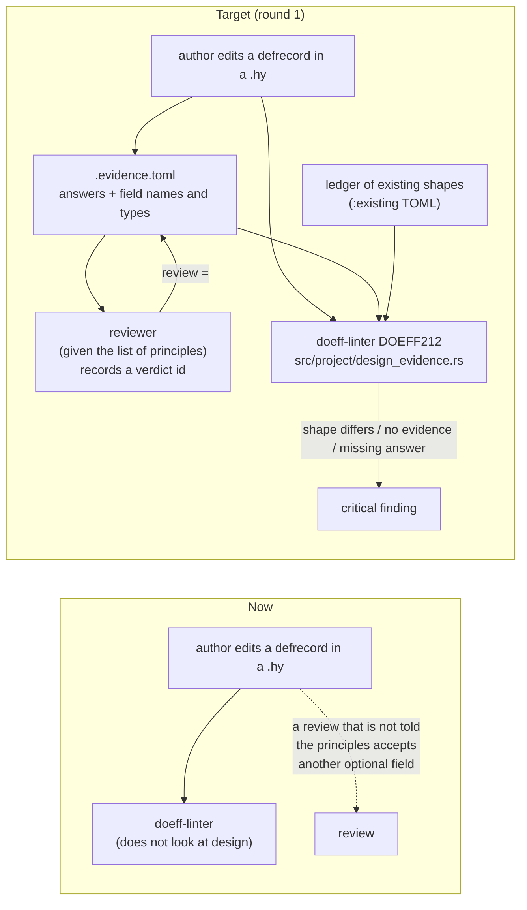
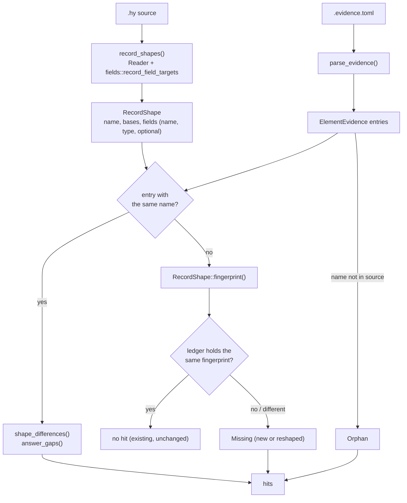

# Design evidence — the model, the file, and doeff-linter's DOEFF212 (round 1)

Version v1 (2026-11-17). Status: on a work branch for a first trial; not on main.

## Purpose of this document

After reading it, a contributor can (1) write the design evidence of a Hy `defrecord`,
(2) turn DOEFF212 on in a repo, and (3) extend the same model to Rust types, functions,
interfaces, and modules without re-deciding the shape of the evidence.

## What was decided

- The evidence of a code element (round 1: a Hy `defrecord`) is the set of answers to the
  required design questions for that element. It lives next to the module in
  `<stem>.evidence.toml`. No language runtime reads it.
- doeff-linter's new rule **DOEFF212** (`DesignEvidence`, critical, not lowered by a registry)
  reads the current shape of each top-level `defrecord` (field names and types in order, bases)
  and compares it with the evidence:

| Case | Result |
|---|---|
| The type has evidence and its shape differs from the evidence | error (`<Name>:shape`) |
| The type has evidence with a missing answer | error (`<Name>:answers`) |
| The type has no evidence and is not in the ledger of existing shapes (a new type) | error (`<Name>`) |
| The type has no evidence and its fingerprint differs from the ledger (a reshaped existing type) | error (`<Name>`) |
| The type has no evidence and the ledger holds its current fingerprint (an existing, unchanged type) | no error |
| An evidence entry names no `defrecord` of the module | error (`<Name>:orphan`) |
| The evidence file is not TOML of schema 1 | error |

- A one-file judgment of DOEFF212 costs about 0.19 s on a tree with 12,297 records, almost all of
  it reading the ledger (measurements in `evidence.md`). It is fast enough for an authoring-time hook.

## Figure 1 — structure (now ⇒ target)



## Figure 2 — judging one module (a pure computation)



## 1. The evidence model (one model for every language)

The evidence of one element (`ElementEvidence`) states one fact: "element X of this module was
designed at this shape, with these answers". Its key is (module file, element name). Every item
is a fact about that key and nothing else (normalization).

| Item | Type | Meaning | What round 1 of the linter checks |
|---|---|---|---|
| `name` | string | the element's name, spelled as in its language (Hy: `foo-bar`) | matched against the source |
| `kind` | `record` / `function` / `interface` / `module` | the element's kind | round 1 judges `record` only; other kinds are read and not judged |
| `concern` | string | the one responsibility, in one sentence | not empty |
| `key` | list of strings | the fields that decide identity (`[]` = a value with no identity) | present; every entry names a field |
| `field` | list of tables | one row per field: `name`, `type`, `fact`, `absent_when` | (name, type) in order equals the source; `fact` not empty; a field whose type admits None has `absent_when` |
| `bases` | list of strings | base classes | equal to the source |
| `parts` | list of strings | names of the elements this type was split into | not checked in round 1 |
| `rejected` | list of `{shape, why}` | shapes considered and not chosen, and why (including "add the field to an existing type") | at least one; neither item empty |
| `fan_out` | integer | how many files a change of this shape touches (an estimate) | present |
| `review` | string | the id of the reviewer's verdict | present; matches `:review-pattern` if declared (spelling only — §6) |

Changes from the starting proposal, and why:

1. **No `:shape` string in the evidence.** The field rows already hold the names and types; the
   shape follows from them. Holding the same fact in a `:shape` string and in `:fields` lets one be
   fixed without the other (a normalization violation). The linter compares the field rows and the
   bases with the source, and its message lists the differences.
2. **The fingerprint (a hash) lives only in the ledger of existing shapes.** The evidence is written
   in a readable form a reviewer can judge. The ledger holds thousands of types, one line each, so it
   uses a short fingerprint.
3. **`:fields` became an ordered list of rows instead of a map.** Field order is the order of
   positional arguments and is part of the shape; a map loses it. Each row also states which fact the
   field belongs to (`fact`) and when it is absent (`absent_when`). The case that started this work
   (adding fields that no one fills) has to stop at `absent_when`.
4. **TOML instead of an s-expression.** The same file must describe Rust types, so it must not
   depend on either language's reader. doeff-linter already reads TOML (the `toml` crate).
5. **`bases` was added.** Inheritance is part of the shape and is what "composition over
   inheritance" looks at.

## 2. Required design questions per element kind

### Types (round 1 — enforced)

| # | Question | Evidence item |
|---|---|---|
| T1 | Does the type have one responsibility (can it be said in one sentence)? | `concern` |
| T2 | What is its identity (key)? Is every field a fact about the key, the whole key, and nothing but the key? | `key`, `field.fact` |
| T3 | Why may a field be absent? Is a field with no owner really a separate part or an append-only row? | `field.absent_when` |
| T4 | Is this a field piled onto an existing type? Was a part type considered instead? | `parts`, `rejected` |
| T5 | If it inherits, why not composition? | `bases`, `rejected` |
| T6 | Which shapes were considered and not chosen (at least one), and why? | `rejected` |
| T7 | How many files does a change of this shape touch (coupling)? | `fan_out` |
| T8 | What did a reviewer, told the principles below, decide? | `review` |

### Functions (proposed items)

F1 one responsibility (its name is one verb) · F2 argument count and flag arguments (two jobs in
one) · F3 side effects go through effects (is it pure?) · F4 failure types · F5 callers (fan-in) and
fan-out of a change · F6 rejected shapes.

### Interfaces — protocols, sets of effects (proposed items)

I1 who uses it and what it hides · I2 number of operations (does one interface mix operations of
different users? — interface segregation) · I3 failures and invariants · I4 number of
implementations and when they are swapped · I5 rejected shapes.

### Modules (proposed items)

M1 the decision it hides (which change makes this module change — volatility) · M2 dependency
direction (layers) · M3 number of public elements · M4 cohesion of its elements · M5 rejected
splits.

### Principles given to the reviewer

A review looks at design only when it is told which principles to look at: without them, reviews
accepted an extra optional field; with them, the same change was judged a composition and
single-responsibility violation and a part type was proposed. A request to a reviewer always lists:

1. normalization — is every field a fact about the key, the whole key, and nothing but the key?
   Is the same fact held in two places?
2. composition over inheritance — instead of piling fields or inheriting, can the type hold a part type?
3. single responsibility — can the type's (function's) responsibility be said in one sentence?
4. coupling and fan-out — how many files does a change of this shape touch, and is there a shape that touches fewer?
5. fields that may be absent — is a field with no owner really a separate type or an append-only row?
6. piling onto an existing type — how many fields were added to this type recently, and does each one widen its responsibility?

The reviewer records the verdict where the project keeps review records, and its id goes into `review`.

## 3. Where the evidence lives and how it is written

- File: next to the module, `<stem>.evidence.toml` (`foo.hy` → `foo.evidence.toml`; a Rust
  `foo.rs` → `foo.evidence.toml`). A directory does not hold a `.hy` and a `.rs` with the same stem.
- Form (the same for Hy and Rust; `type` is spelled as in the language, and runs of whitespace are
  collapsed before comparing):

```toml
schema = 1

[[element]]
name = "DoneCore"
kind = "record"
concern = "The facts every finished card has"
key = ["card"]
bases = []
parts = ["DoneLinks"]
fan_out = 3
review = "<verdict id>"

[[element.field]]
name = "card"
type = "str"
fact = "the card that finished"

[[element.field]]
name = "merged-at"
type = "(| str None)"
fact = "when the work reached main"
absent_when = "a card whose work is not merged (an investigation)"

[[element.rejected]]
shape = "add merged-at to the shared material type"
why = "that type already has many fields with no owner; one more widens its responsibility"
```

- Declaration (architecture.hy):
  `:design-evidence {:files ["<glob>" …] :except ["<glob>" …] :existing "<ledger path>" :review-pattern r"<regex>"}`.
  `:files` is required. Without `:existing`, no type is grandfathered. Without `:review-pattern`,
  any non-empty `review` passes the spelling check.
- Ledger of existing shapes (`:existing`): the fingerprints of the types that existed when the rule
  was turned on, written once with `doeff-linter --print-existing-shapes > <ledger path>`:

```toml
[shapes]
"pkg/mod.hy::DoneMaterial" = "92b80efdef9ea5fd"
```

  Once a type changes shape and gains evidence, its ledger line is no longer used (leaving it is harmless).
- Fingerprint: the first 16 hex digits of the sha256 of `defrecord\n`, then `bases: a, b\n` if
  there are bases, then one `name: type\n` line per field (`name\n` for an untyped field), with
  whitespace in types collapsed. Docstrings and `:check` invariants are not part of the shape.

## 4. DOEFF212 in doeff-linter

| Aspect | Decision |
|---|---|
| Declaration | `:design-evidence` in architecture.hy (§3) |
| Severity | critical; not lowered by the registry (`lowered_by_registry` = false) — the ledger is the only way an existing type passes without evidence |
| Needs the whole repo | yes (`needs_whole_repo` = true): a finding on F also depends on F's sibling evidence file and on the ledger, so the gate and the commit hook compare it over the whole repo, like DOEFF145 |
| Judged on one file | yes (`judged_on_one_file` = true). A `.hy` from stdin is judged with the sibling evidence from disk; an `.evidence.toml` from stdin is judged against the sibling `.hy` from disk, and the findings are reported at the `.hy` |
| Finding key | `<rel>::DOEFF212::<Name>`, `<Name>:shape`, `<Name>:answers`, `<Name>:orphan` (a type can have a shape finding and an answers finding at once) |
| Named paths | `--modified` and named paths add the sibling `.hy` of a named `.evidence.toml` (`with_sibling_modules`) |
| Ledger tool | `--print-existing-shapes` prints the ledger of the whole population |

## 5. The same questions applied to what this change adds

| Element | Responsibility (T1) | Piled onto an existing type? (T4) | Fan-out (T7) |
|---|---|---|---|
| `design_evidence::RecordShape` | the shape of one type as read from source (name, bases, fields) | new type; a Rust reader returns the same type | 1 |
| `design_evidence::FieldShape` | one field's name, type, and whether it admits None | new type | 1 |
| `EvidenceFile`, `ElementEvidence`, `FieldEvidence`, `RejectedShape` | one evidence file, one element, one field row, one rejected shape | new types at the TOML boundary; no field added elsewhere | 1 |
| `ExistingShapes` | the ledger: (file, type name) → fingerprint | new type; the map stays private and is read through `fingerprint_of` | 1 |
| `Hit`, `Problem` | one finding of one type and its kind | new types | 2 (`design_evidence.rs`, `mod.rs`) |
| `Judging` | the per-run settings (ledger read once, compiled review pattern) | new type | 2 |
| `architecture::DesignEvidenceDecl` | the `:design-evidence` declaration | new type holding `FileSelection` as a part (no field added to `FileSelection`) | 3 |
| `ProjectRule::DesignEvidence` | the rule's identity | a variant on the existing enum — the enum is one variant per rule by design, and its exhaustive matches make the compiler stop a forgotten arm | 4 (`rule.rs`, `main.rs`, `mod.rs`, `explain.rs`) |
| `Explain::DesignEvidence`, `Decl::DesignEvidence` | explanation material; the declaration item | variants on existing enums, one per rule / declaration key by design | 2 |

**Fields added to existing types or shared tables:**

- `architecture::Architecture` gained `design_evidence: Option<DesignEvidenceDecl>`. The fact it
  belongs to: "how this repo's architecture.hy declares DOEFF212's population". `Architecture` is a
  composition of the per-rule declarations (`typed_values`, `record_stubs`, …), each held as a part;
  every field is a fact about the same key — the repo's architecture.hy — so the new field is a fact
  about that key too. Not a separate table: every declaration is read in one place, and
  `declaration_items` tracks changes per declaration key on top of this type (a change of the
  declaration moves the rule to the whole-repo comparison). It is not an append-only fact (it is the
  declaration at one point in time).
- `Args` (the CLI arguments) gained `print_existing_shapes: bool`. The fact: "what this invocation
  does". It is one of the CLI's modes next to `list_rules` and `split_rules`; clap's one struct is
  the definition of the CLI, so there is no separate table to hold it.
- `DesignEvidenceDecl` itself holds `review_pattern: Option<String>` (a fact of the same
  declaration). The review id's format is the project's choice, so the public linter does not hard-code one.

## 6. Where the existence of the reviewer's verdict is checked (proposal)

Round 1 checks only the spelling of `review`. The linter reads no network and knows no review
store (to stay fast and deterministic), so existence is checked outside the linter. Options:

- **A (recommended): a verdict bound to the shape.** The reviewer's verdict states the judged type
  and its **fingerprint** (`judged: pkg/mod.hy::DoneCore 92b80efdef9ea5fd accept`). A check at the
  entry of the merge queue reads the verdict named by `review` and checks that (1) it exists,
  (2) it came from a reviewer, not from the author, and (3) it accepts the same type at its current
  fingerprint. A verdict given before a later shape change fails (3).
- B: the commit hook asks the review store. Its speed depends on the network, and it stops offline.
- C: a signed stamp in the evidence. Key management is too heavy for round 1.

## 7. Known gaps (candidates for the next round)

- **Adding lines to the ledger.** A new line in the ledger lets a type pass without evidence.
  Round 1 relies on the line being visible in the diff. Proposal: the commit hook checks that the
  staged ledger is a subset of HEAD's ledger (only removals are allowed).
- **Existence of `parts` and the accuracy of `fan_out`.** Proposal: in a whole run, count the
  references to the name from the index and warn when `fan_out` is far off.
- **Readers for functions, interfaces, and modules** (items proposed in §2), and the Rust reader
  for `struct` / `enum` (it returns `RecordShape`; the comparison does not change).
- **Ledger read time.** Reading a 12,297-line ledger takes about 0.18 s per one-file run (the
  `toml` crate). If that grows, split the ledger per directory or keep a binary cache next to it.

## Application of the six methods

| Method | Status | Result |
|---|---|---|
| DDD | not applicable | a technical component; no business domain model drives the decision. Terms are fixed in the table of §1 |
| Change Cases | performed | (1) read Rust `struct`s with the same model: add a reader returning `RecordShape`, the comparison does not change; (2) add functions as elements: add a `kind` and its question list; (3) check that verdicts exist: outside the linter (§6) |
| Volatility-based decomposition | performed | the language-specific reading (Hy reader), the language-neutral comparison, and the required answers (question list) are separate functions |
| ADD | performed | the quality requirement is "callable from an authoring-time hook"; the design reads three files (module, evidence, ledger) and no whole-repo index (§4, `evidence.md`) |
| SAAM | performed | the three change cases above each touch one place |
| C4 | performed | Figure 1 (structure) and Figure 2 (flow) |
