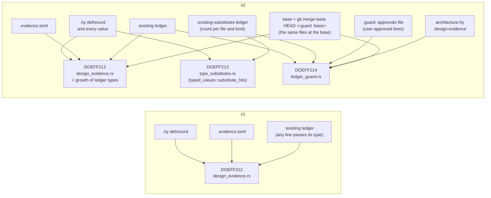

# Design evidence v2 — closing the ways around it (DOEFF213, DOEFF214, growth in DOEFF212)

Version v2 (2026-11-20). Status: on a work branch; not on main (the user's decision of 2026-11-17:
not on main yet). Builds on v1 (`../v1/design.md`): §1–§7 of v1 stand; this version adds §8–§14.

本番で通した単純な形: none in production — the rules are not on main by the user's decision of
2026-11-17. The simplest form actually run: the release linter of this branch on a copy of a
downstream project's 7,902 tracked `.hy` files (`evidence.md` §2), with the results below.

## Purpose of this document

v1 made a type's shape change only together with its design evidence. A trial on a downstream
tree (12 implementations of one task by AI authors) and the user's decisions of 2026-11-17 found
that the evidence can be avoided without breaking the rule. After reading this document a
contributor knows which ways around the evidence are closed, by which rule, why the others are
left open, and what was measured.

## Figure 1 — structure (v1 ⇒ v2)

## Standards checked (照らした標準)

| Standard | What it does | Taken | Not taken, why |
|---|---|---|---|
| ESLint bulk suppressions (`eslint-suppressions.json`, ESLint 9.24) | counts of existing violations per file and rule; above the count is an error; `--prune-suppressions` only lowers | the count per file and kind (§9), the ledger that only shrinks | ESLint lets anyone rerun `--suppress-all`, which is the hole §8 closes |
| PHPStan / detekt baselines | a generated list of existing findings | the ledger written once by a tool (`--print-existing-*`) | regenerating the baseline is unguarded |
| Spotless `ratchetFrom origin/main` | judges only what changed against a git ref | the base = merge-base of HEAD and a declared ref | — |
| GitHub CODEOWNERS + required review | a path changes only with an owner's approval | the approval is a named, separate fact, landed before the change | the merge queue of the projects using this rule does not run GitHub reviews; the approval must be checkable by the linter, offline |
| The downstream project's hook `shape-column-guard` and its list of reviewed column changes | an existing row type gains a field only if an entry with the id of a request the user approved is already on main | the whole decision: approvals count only at the base, an entry added on the branch does not | it reads Edit tool calls and commits of one project; v2 moves the decision into the linter, which reads the tree, so it does not depend on how a file was written |
| doeff-linter's DOEFF144, DOEFF171, DOEFF172 | typed annotations, mappings in the type-only layer, a smell count of all mappings | DOEFF172's Hy tree and helpers (§9.2) | each misses part of the user's line (§9.2) |

## 8. The ledgers only shrink — DOEFF214

### 8.1 The way around

v1's ledger lets every type it lists pass without evidence, and v1 §7 relied on the added line being
visible in a diff. The user's decision (2026-11-17): updating the ledger is forbidden in principle and
needs a request the user approved. The same holds for DOEFF213's ledger (§9).

### 8.2 The rule

Declaration: `:design-evidence {… :guard {:base "origin/main" :approvals "<path>" :approval-pattern r"…"}}`.
DOEFF214 reads the base with git (`git merge-base HEAD <base>`, then `git show <commit>:<path>`; when the
linter runs on a tree placed outside the checkout — the commit hook's snapshot trees — the checkout is
named by `DOEFF_LINTER_GIT_ROOT`, which the commit hook sets).

| Change against the base | Result |
|---|---|
| A line of `:existing` (shapes) is new, or its fingerprint changed | error `shapes:<key>` |
| A line of `:existing-substitutes` is new, or its count rose | error `substitutes:<key>` |
| A line is removed, or a count lowered | passes (a type was removed or gained evidence; a value was replaced by a type) |
| The `:design-evidence` declaration is spelled differently (layout and comments ignored) | error `declaration:design-evidence` — narrowing `:files`, widening `:except`, moving a ledger, or removing `:guard` are ways around too |
| An approval entry added on the branch lacks a `review` of `:approval-pattern`, or a `why` | error `approval:<ledger>:<key>:<value>` |
| Any of the errors above, with an approval at the base for the same (ledger, key, value) | passes |
| The base cannot be read | not judged; the reason goes to the report's errors |

The approvals file (TOML, `[[approval]]` with `ledger` = `shapes` / `substitutes` / `fields` /
`declaration`, `key`, `value`, `review`, `why`). Only the version at the base counts, so an approval lands
alone first, as in the downstream hook. The linter checks the spelling of `review` only; whether the
request exists and was approved is checked where the merge queue admits a change (v1 §6, option A).

Changed from the owner's proposal: the owner proposed "the exceptions list also needs a request id when
an entry is added". v2 adds one more condition from the downstream hook: an entry counts only once it is
at the base. Without it, the same commit could add a ledger line and its approval together, and the
linter could not tell a real approval from one written by the author.

### 8.3 Existing types do not grow with evidence alone (trial finding 1 — stopped)

In the trial, 2 of the 4 implementations that were given DOEFF212 and a reviewer added fields to an
existing 26-field type and passed: they wrote evidence, and the reviewer, given the six principles,
accepted. The user (2026-11-17): adding attributes is already a violation at the second one; updating
the ledger needs an approved request. So the evidence of a pre-existing type is not a reason to let it
grow.

DOEFF212 now reports `Grew` (`<Name>:grew`) for a type that is in the **base's** shapes ledger, whose
current fingerprint differs from it, and which has a field its version at the base did not have, unless
an approval `ledger = "fields", key = "<rel>::<Type>", value = "<field>"` is at the base. A retyped field
is a reshape (evidence answers it), not growth. The base `.hy` is read only for a file whose ledger type
changed. Types born with evidence are not covered: their shape changes with evidence and a verdict bound
to the fingerprint (v1 §6).

## 9. Values that stand in for a type — DOEFF213

### 9.1 The way around

A fact carried without a type needs no evidence. The user's decisions (2026-11-17): a dict is allowed
only as a mapping from an id to data; a dict holding static elements is not; a key is an id, not a
title or a name; reading an outside value goes directly into a type where it is read (the boundary is
not an exception).

### 9.2 What is already in the linter, and why a new rule

| Rule | What it stops | Why it does not close this |
|---|---|---|
| DOEFF144 (typed values) | bare mappings and tuples in **type annotations** of the public surface; tuple answers of public top-level functions | does not read values; private and nested functions are not counted |
| DOEFF171 | mappings in contracts and fields of the type-only layer | one layer only |
| DOEFF172 (a smell, counting only) | every mapping built outside a handler | counts id maps too (not the user's line), skips handlers and boundary definitions, warning only |

DOEFF213 reuses DOEFF172's Hy tree and helpers (`typed_values.rs`), narrows to the user's line, and
widens the place to every definition (handlers, boundary definitions, methods, nested functions,
top-level constants).

### 9.3 The rule

| Kind (key word) | Counted | Not counted |
|---|---|---|
| `static-key-dict` | `{…}` with a key written in the source (keyword, string, number, constant); `(dict :k …)`; `dfor` with a literal key | `#{…}` sets, contract dicts, the option dicts of definition forms, `MODULE-TAGS`, match type positions, `defmacro` and quoted code |
| `attribute-keyed-dict` | a mapping whose key is an attribute naming a property: last segment title, label, text, body, summary, subject, heading, caption, description | `(dfor r rows r.id r)` and any other key |
| `answer-tuple` (found, counted, **not stopped**) | a function (top-level, method, nested `defn`/`fn`, private) answering a tuple literal of 2+ items | a `:key` lambda, a function named as a sort key or SQL params |
| `zero-or-one` | a defrecord `:check` with `(<= (len field) 1)` of a bare field, `(< (len x) 2)`, the mirrored forms, or `(in (len x) #(0 1))` | a sequence field without such a check |

Existing values: `:existing-substitutes` holds the count per `<rel>::<kind>` (written once with
`--print-existing-substitutes`). Above the count, every value of that kind in the file is an error (the
count, not the place, is grandfathered — moving code makes no error, adding a value does). DOEFF214 keeps
the ledger shrinking. A definition that spells or reads an outside shape (`:spells`/`:reads` in `:tags`,
or a mapping `:post`) is counted the same; its values are named "in a definition that spells or reads
an outside shape" so that the uses an outside library asks for are counted apart (§9.4).

Changed from the owner's proposal: a positional tuple answered by a function is found and counted but not stopped — measured, almost all are sort or identity keys (§9.4). "A dict passed to an outside API right after it is built" is not
exempted, by the user's later decision (2026-11-17); the count of such uses is reported instead.

### 9.4 Measurement on a downstream tree

Object: the 7,902 tracked `.hy` files of a downstream project at one commit, copied into a scratch
directory (population `controllers/**/*.hy` and `services/**/*.hy`, except `**/tests/**` and
`**/adr/**`). Release linter of this branch, run on a spot machine. The numbers are those of the
last run, after the exclusions below were added.

| Kind | Values | Files | In a boundary definition | Sample judged (fixed seed) | Stopped |
|---|---|---|---|---|---|
| `static-key-dict` | 2,428 | 351 | 1,315 | 15: 11 spell an outside shape (JSON bodies, process environments), 3 are constant lookup tables keyed by a literal id (`PLACEMENT-LAWS`, `CONTRACT-GAPS`, `SUFFIXES`), 1 holds static elements keyed by display labels | yes |
| `attribute-keyed-dict` | 5 | 3 | 1 | 5: 3 keyed by a body or a commit subject (true), 2 keyed by a parameter's spelling (false) | yes |
| `zero-or-one` | 8 | 5 | 0 | 8: every one bounds a field (`stop`, `release`, `seen`, `fresh`, `events` …) to 0 or 1 items (true) | yes |
| `answer-tuple` | 45 | 29 | 0 | 15 (earlier run): 14 sort or identity keys | no (counted only) |

The ledger of existing values has 360 lines (`<rel>::<kind>`); the ledger of existing shapes 10,670.

False stops removed after earlier runs, with the count each removed:

| Shape counted wrongly | Count | Change |
|---|---|---|
| `(val MODULE-TAGS {:context … :role …})` — the linter's own module tag declaration | 3,982 | not a value (like a contract's `:tags`) |
| the options dict of a definition form (`defeffect {:fields … :tags …}`, `defsystem …`) | 3,250 + 165 | an option of the form |
| a `:key (fn [row] #(row.at row.id))` sort key | about 677 | not counted |
| a mapping keyed by `name` (an environment variable's, header's, or parameter's name) | about 91 | `name` removed from the attribute words (11 of 12 sampled were an outside namespace's identifier) |
| `(<= (len (lfor one parts :if …)) 1)` — at most one of a kind in a filtered subset | 6 | only `(len <field>)` counts |

Measured false-stop rate of what is stopped, from the samples: `static-key-dict` 3 of 15 (constant
tables keyed by literal ids — the user's line allows an id-to-data mapping; the linter cannot tell a
literal id from a literal field name), `attribute-keyed-dict` 2 of 5, `zero-or-one` 0 of 8. Existing
values are in the ledger, so these rates apply only to new values.

Uses an outside library or service asks for: 1,315 of the 2,428 static-key dicts are in definitions
that declare they spell or read an outside shape, and 10 of the other 15 sampled spell an outside shape
without declaring it. The user's decision removes the boundary exception; whether a typed writer
(a `defrecord` and one spelling function per outside shape) replaces them, or an approval per writer,
is left to the owner of the initiative (sent as a note).

Cost:

| Run | Wall |
|---|---|
| whole run, no ledgers (the linter's per-root fact cache cold) | 54 s |
| whole run, with ledgers — 0 findings of DOEFF212–214 | 7.5 s |
| `--print-existing-shapes` / `--print-existing-substitutes` | 0.45 s / 0.46 s |
| one-file run of a 1,200-line module, warm (3 runs) | 0.14–0.22 s; of which the ledger read 0.063 s, DOEFF212 0.001 s, DOEFF213 0.001 s |

Runs that change the copy and show what stops (one-file and whole runs; exit code and findings):

| Change | Result |
|---|---|
| a static-key dict added to a module | exit 1, DOEFF213 at the added dict |
| an id map `(dfor r rows r.id r)` added | exit 0 |
| a private pair, a record with `(<= (len links) 1)`, a title-keyed map added | exit 1: DOEFF212 (the new record), DOEFF213 `zero-or-one` and `attribute-keyed-dict`; the pair is not stopped |
| a ledger type gains a field with complete evidence | exit 1, DOEFF212 `Grew` |
| the same with a `fields` approval at the base | exit 0 |
| a shapes line added, one rewritten, one removed, a substitutes count raised | exit 1, 3 findings (the removal passes) |
| an approval for the added line on the branch, and one with review "ok by me" | exit 1, 4 findings (the branch approval does not count; the bad review is a finding) |
| the approval for the added line landed at the base alone | exit 1, 2 findings (the added line passes) |
| `:except` gains a dir | exit 1, DOEFF214 at architecture.hy |

## 10. Function arguments that grow (counted, not stopped)

The trial's reviewers found facts carried through added keyword arguments with a default `None`
("not declared" and "the caller forgot" are the same value). Counted over the last 1,000 non-merge
commits of the downstream project's main (single-line `defk`/`defn`/`deff` headers whose name appears
both removed and added in one commit — `measure-ac/arg_growth.py`, not committed):

| | count |
|---|---|
| commits touching `.hy` | 765 |
| header changes | 443 |
| argument list grew | 276 (production code 211, in 107 commits; tests 65) |
| of the production growth: an optional argument added | 85 |
| of those: with default `None` | 45 |

Decision: **not stopped** in v2. Growing an argument list is the ordinary way a pure function gets a
new input; an error on it would stop about one commit in seven of those touching `.hy` (107 / 765), and
in a sample of 20 most added inputs (`now`, `touches`, `placed`, `tips`, `seconds`), not facts that
belong to a value. The narrower shape — an added optional argument with default `None` — is the one
the reviewers named (45 in 1,000 commits, 7 of the 20 sampled). Proposal for the next round: report it
as a warning against the base (DOEFF214 already reads the base) and decide stopping after a reviewer
judges a sample of them.

## 11. The trial's three findings

| Finding | Decision | Why | Where |
|---|---|---|---|
| Evidence lets a field be added to an existing type | **stopped** | the user's line: the second attribute is already a violation, ledger updates need an approved request | §8.3, `Grew` |
| An optional field rewritten as a sequence of 0 or 1 items (4 implementations) | **stopped when the bound is written** (`:check (<= (len x) 1)`) | the check states the absence the type hides; the honest form is `(| T None)` with `absent_when` | §9.3 `zero-or-one` |
| | not stopped without a check | a sequence without a bound is indistinguishable from a real sequence by its shape | residual; the reviewer's principle 5 |
| Numbers written in the evidence were wrong (9 places in 4 implementations: fields added recently, files touched) | **not stopped** | the wrong numbers were in prose (`rejected.why`) and counted things the type name does not reveal (files reading a field, fields added over 3 weeks of history); a lower bound from name references would be wrong both ways | proposal: the linter states the counts it can compute (field count, files naming the type) in its message, and `fan_out` becomes the linter's number instead of an authored one |

## 12. The Rust side (proposal only)

The same three ideas apply to the Rust reader of `struct`/`enum` (another branch): (1) DOEFF214 needs no
change — the ledgers are language-neutral; (2) `Grew` applies to Rust types once the reader returns
`RecordShape` for them; (3) the Rust form of a type substitute is a `HashMap` or `json!({…})` literal
with literal keys, a tuple return type `-> (A, B)`, and an `Option` written as `Vec<T>` with `len() <= 1`.

## 13. The rules applied to the linter's own types

| Type (this change) | Change | Fact it belongs to | Why not a separate table or an append-only row |
|---|---|---|---|
| `architecture::DesignEvidenceDecl` | +2 fields: `existing_substitutes`, `guard` (5 in total) | the `:design-evidence` declaration of one repo | the same declaration, read in one place; `guard` is a part type (`LedgerGuardDecl`, 3 fields) instead of 3 more fields |
| `design_evidence::Problem` | +1 variant `Grew` | one finding's kind | an enum is one variant per kind by design |
| `design_evidence::Judging` | +1 field `growth: Option<Growth>` | the per-run settings | `Growth` is a part type; absent when no guard is declared |
| `main::Args` | +1 field `print_existing_substitutes` | the CLI mode | clap's one struct is the CLI's definition (v1 §5) |
| `ProjectRule` | +2 variants | rule identity | one variant per rule by design |

The Rust reader's branch adds `kind_tag: String` (3 values) to `RecordShape`. Judged by the same rules:
it is a field added to an existing type, and a string standing for a closed set. Its fact is "which kind
of source declaration this shape was read from"; it enters the fingerprint, so it is a fact of the
shape (a struct that becomes an enum must change the fingerprint) and belongs on `RecordShape`, not in a
separate table. The shape to take instead of the string: an enum `ShapeKind { Defrecord, Struct, Enum }`.

## 14. Known gaps

- A commit made with `--no-verify` puts the finding into HEAD, and later commit-hook runs compare with
  HEAD and pass. The merge queue runs no lint; the check where a change enters the queue (v1 §6 A) must
  run DOEFF212–214 against the base.
- A one-file run of a ledger reads the ledger from disk, not from stdin.
- The existence of the approved request named by `review` is not checked by the linter.
- Removing the whole `:design-evidence` declaration disables the rules; DOEFF214 cannot see it (the rule
  is not running). The same entry check must require the declaration where it existed at the base.

## Application of the six methods

| Method | Status | Result |
|---|---|---|
| DDD | not applicable | a technical component; terms are fixed in §8.2 and §9.3 |
| Change Cases | performed | (1) a new ledger (Rust shapes): DOEFF214 reads it by declaring its path; (2) a new substitute kind: one arm in `substitute_hits` and one word; (3) checking approvals exist: outside the linter |
| Volatility-based decomposition | performed | reading the base (git), the approvals, the per-ledger comparison, and the substitute detection are separate functions; the detection is pure |
| ADD | performed | quality requirement: callable from the authoring-time hook; one-file costs in §9.4 |
| SAAM | performed | the three change cases each touch one place |
| C4 | performed | Figure 1 |
