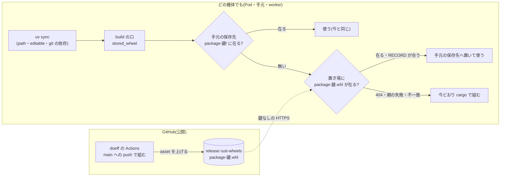

# doeff の Rust の wheel を機体の外の置き場から取る — 置き場・鍵・取り方の決め(v1)

card acp:kanban-issue:ki-5c400979c88d(#4321 の子 1)・2026-10-11・書き手 c-7NKW50HFWP8XPE0SPRVWHTBQ1A(claude-opus-5-5)。
調べた版 = doeff origin/main 66c83d4bc(記録 snapshot-82aabfa8f7b3)。

## 決め(要約)

| 決めること | 決め | 利用者の判断 |
|---|---|---|
| 置き場 | doeff の GitHub の release 1 本(タグ `rust-wheels`)の asset。書くのは doeff の GitHub Actions だけ(main への push で、Rust の source の鍵が変わった package を組んで上げる) | **要る** — 公開の場所に組んだ物を置く(公開)。依頼書で問う。答えが「公開しない」なら次点の cluster の MinIO へ替える |
| 鍵 | rev ではなく、今の build の口の鍵(`_wheel_slot` = source の中身の hash・maturin の版・機体・Python の ABI・組みを変える env・build の設定)に、**libc の名と版**を足した物。置き場の名 = `<package>-<鍵 32 桁>.whl` | 要らない(ADR-DOE-BUILD-001 R4 の追補で子 2 が入れる) |
| uv の取り方 | uv は変えない。uv は path・editable・git の依存の build の口(PEP 517)を今どおり呼び、**口が手元の保存先に無い時、組む前に置き場から取る**。find-links・index は使わない | 要らない |
| 読み手の資格 | 要らない(公開の URL を鍵なしの HTTPS で読む)。cluster に新しい Secret・Pod・Deployment を足さない | — |
| 取れない時 | 404・網の失敗・時間切れ(既定 20 秒)・RECORD の hash の不一致は、名指しの 1 行を出して今どおり手元で組む | — |

## 今の責務(誰が組み・誰が置き・誰が読むか)

| # | 場所 | 組む条件 | 置き場 | 鍵 | 機体をまたぐか |
|---|---|---|---|---|---|
| 1 | build の口 `tools/doeff_cargo_backend.py`(stored_wheel :179・_wheel_slot :303) | 保存先に壊れていない wheel が無い時だけ | `DOEFF_WHEEL_CACHE`、無ければ `$XDG_CACHE_HOME/doeff-cargo-wheels` | K1 `_wheel_slot` | またがない |
| 2 | doeff-cluster の worker の実行環境の準備(env_translation.hy:375 → `uv build --wheel`) | 準備の stage-native | `/work/state/wheels`(hostPath・7 日使われない dir を掃除) | K1 | Pod の作り直しには残る・機体はまたがない |
| 3 | doeff-cluster の起動の script(boot.sh:176 → boot_wheel.py) | root の準備が要る時 | 同上(boot.sh:79 が DOEFF_WHEEL_CACHE を据える) | K1 | 同上 |
| 4 | agora の agent worker の準備(worker-prepare.sh:201・:271) | agentcli と doeff の区画の `uv sync` | **DOEFF_WHEEL_CACHE が無い** → `~/.cache` = `/work/toolset/cache/doeff-cargo-wheels`(8 GiB 超で丸ごと消える) | K1 | 同じ機体に 2 つ目の置き場 |
| 5 | 会話の担当・日次の検証・着地の窓(merge-queue)の `uv sync` | 作業木の同期 | worker から継いだ `/work/state/wheels` か XDG の既定 | K1 | またがない |
| 6 | dotfiles の agentcli(doeff-linter を git の rev で依存)・merge-queue の ledger(doeff-vm を git の rev) | `uv sync` | XDG の既定 | K1 | またがない |
| 7 | agora-controllers の cloud-run-tests の image | `RUST_SUM` が変わった時 | BuildKit の cache と Artifact Registry の image | **K3 = git の tree の sha(別の鍵)** | image としてまたぐ |
| 8 | doeff の linter の snapshot(binary) | sha ごと | `~/.cache/doeff-linter-snapshots/<sha>` | **K4(別の鍵・ADR の PENDING-ENTRIES)** | またがない |
| 9 | doeff の GitHub Actions(build-vm.yml ほか) | タグ `doeff-vm-v*`・手動 | Actions の artifact・タグの時だけ PyPI | backend を通らない | 誰も読んでいない |

旧 clean-boot の Job(agora `docs/adr/agent_worker_clean_boot.hy`・Ready の上限 1500 秒)は agora e088888e4 で消えている。空の機体の同期で Rust を組む事は、新しい機体・新しい hostPath・#4 の 8 GiB の掃除の後に、今も起きる。

## 構成と流れ

書き手は CI の 1 つだけ。読み手は置き場に書かない(手元で組んだ wheel は手元の保存先にだけ置く)。

## 契約

### 置き場(release `rust-wheels`)

| 項目 | 内容 |
|---|---|
| 持ち主 | doeff の GitHub Actions(新しい workflow 1 本・書く権限は GITHUB_TOKEN の contents: write だけ) |
| 名 | `<project の名>-<鍵 32 桁>.whl`(1 asset = 1 wheel)。wheel の本当の file 名は、取った側が wheel の中の `*.dist-info/WHEEL` と名・版から作り直す |
| 読む | `https://github.com/proboscis/doeff/releases/download/rust-wheels/<名>`。API を使わない(鍵なしの API は 1 時間 60 回の上限) |
| 不変条件 | 同じ名の asset は上書きしない(在れば上げない)。中身は CI が build の口を通して組んだ物だけ |
| 掃除 | release の asset は 1000 個が上限。CI が上げる時に、古い順に 800 個を越えた分を消す |
| 大きさ | doeff-vm 約 0.6 MB・doeff-linter 約 6.2 MB(2026-10-11 の /work/state/wheels) |

### build の口(読み手の足す 1 段)

| 項目 | 内容 |
|---|---|
| 操作 | stored_wheel: 手元の保存先 → 無ければ置き場 → 無ければ組む。置き場から取った wheel は `_wheel_problem`(RECORD の hash)で確かめてから手元の保存先へ置く |
| 設定 | 置き場の URL の頭は口の定数。env `DOEFF_WHEEL_REMOTE` で替えられる(模擬の検で手元の HTTP の口へ向ける)。空の値なら置き場を引かない |
| 失敗 | 取れない時はどれも名指しの 1 行(何を・どこから・なぜ)を stderr に出して組む。黙って組まない・黙って壊れた物を使わない |
| 報告 | `DOEFF_WHEEL_REPORT` の行に `"source": "local" | "remote" | "built"` を足す(今の `built` を置き換える) |
| 鍵 | `_wheel_slot` の材料に `platform.libc_ver()` を足す。CI の glibc(ubuntu-24.04 = 2.39)で組んだ物を、それより古い glibc の image が取らない(取れば import で落ちる) |

## 比べた候補

| 候補 | 要否(空の機体で組まなくなるか) | 費え | 戻し方 | 判定 |
|---|---|---|---|---|
| **A. GitHub の release(CI が書く)** | なる(main に入った版の Linux x86_64・Python 3.14t。main に入って CI が終わるまでの数分と、手元の Mac は今どおり組む) | 新しい workflow 1 本・Actions の時間(公開の repo なので無料)・cluster の側は口の 1 段だけ。新しい Secret・Pod は無し | 口の 1 段を revert(手元で組む今の形に戻る)。release は消すだけ | **推す**(公開の可が要る) |
| B. cluster の MinIO(今在る `doeff-worker-lab/effect-minio` など)に、組んだ機体が書く | なる(cluster の中だけ) | 組む機体すべてに書く資格を配る(新しい Secret・worker の env の変更 → worker の Pod の作り直し)。Mac と CI からは Tailscale 越し | 口の 1 段を revert・bucket を消す | 次点(公開しない時) |
| C. agora の artifact-store | なる | 人に見せる成果物の置き場(PostgreSQL の行・条 A1〜A5)の役目を変える。HTTP の新しい契約が要る | — | 採らない(持ち主が違う) |
| D. find-links の index・registry の index | **ならない**(uv は path・editable・git を明示した依存に find-links も index も使わない) | 依存を全部 registry に替え、鍵ごとに版を振る。宣言で doeff の commit を選ぶ今の形(agora-controllers の D15)と合わない | — | 採らない |
| E. 今のまま(機体ごとの保存先) | ならない | 0 | — | 採らない |

鍵の候補:

| 鍵 | 良い所 | 悪い所 | 判定 |
|---|---|---|---|
| doeff の rev | 分かりやすい | Rust に差の無い commit(大半)で外れる・同じ中身の wheel が rev の数だけ増える・未 commit の作業木で使えない | 採らない |
| **K1 + libc** | 手元の保存先と同じ鍵(ADR-DOE-BUILD-001 の正本 1 つ)・中身が同じなら当たる | 鍵が変わる 1 度だけ、どの機体も 1 回組み直す | **採る** |

## 変更への備え

| 変更 | 守る契約 | 変わる所 | 確かめ |
|---|---|---|---|
| Python の版・ABI を替える(3.14t → 3.15t) | 鍵が ABI を含むので古い wheel を取らない | CI の組む Python | 子 2 の検: ABI の違う鍵で 404 → 組む |
| 置き場を A から B へ替える | 口の操作と失敗の形 | URL の頭の定数と書き手 | 口の検は手元の HTTP の口で行うので置き場に依らない |
| maturin・Rust の source を上げる | 鍵が変わる → CI が新しい鍵を上げる | 無し | CI の上げの log |
| 新しい機体の image の glibc が古い | 鍵の libc で外れて組む | 無し | 子 2 の検: libc の違う鍵 |

## 引き継ぎ

- 決めた事(子 2・子 3 が変えない): 置き場の名の形・鍵 = K1 + libc・書き手は CI だけ・読み手は口の 1 段・取れない時は名指しの 1 行で組む・find-links を使わない。
- 子 2 ki-5fab1f97d98b に任せる事: workflow の書き方(どの package を組むか・Python 3.14t の入れ方・掃除の数)・口の中の HTTP の書き方(標準 library の urllib)・wheel の file 名の作り直し方。失敗ケース先: 「置き場に在る鍵の wheel を、cargo の無い環境で取って入れる」が今は赤(組もうとして落ちる)である事を先に見る。ADR-DOE-BUILD-001 に R5 の追補(置き場の 2 段)と R4 の追補(libc)を同じ変更で書く。
- 子 3 ki-c4dbd8771633: 空の機体の同期で cargo が 1 度も走らない事を測る(題に合わせて範囲を確かめる)。
- 別に拾う事(この card の外): #4 の agent worker の準備に DOEFF_WHEEL_CACHE が無く、同じ機体に置き場が 2 つある。doeff-cluster の `runtime_env_model.hy:120` と agora-controllers の `agent_task/entry/system.hy:95` の註が古い鍵を書いている。cloud-run-tests の鍵 K3 は K1 と別。

## まだ分かっていない事

- 利用者が公開の置き場(A)を許すか(依頼書で問う)。
- CI の上で組んだ鍵が cluster の Pod の鍵と同じになるか(maturin の版・Python の版の綴り・env)— 机上の読みだけ。子 2 の最初の検で測る。
- 読み手の image の glibc の一覧(agent worker・doeff-cluster の worker・Mac 以外の手元)— 鍵に libc を入れるので外れても安全側。
