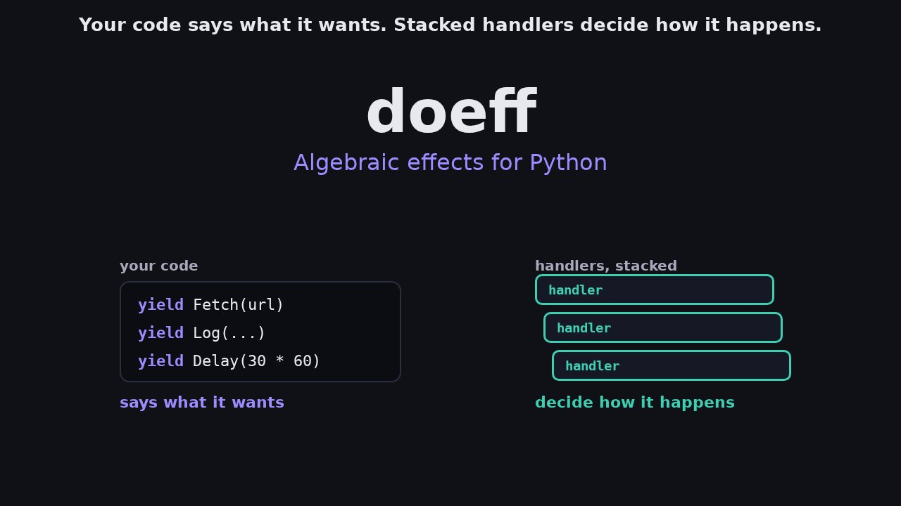

# doeff

**Algebraic effects for Python.** Your code yields effects; handlers decide what they mean.

A handler receives each effect together with `k`, the rest of your function from that `yield` on.
It can resume `k`, throw an error into it, pass it on, hold it while other tasks run, or drop it and
end the computation with a value of its own. State, exceptions, concurrency, observation, budgets
and I/O are all effects of this kind: one program, one mechanism.

```bash
pip install doeff        # Python 3.11+
python -m doeff demo     # one program, four handlers, four meanings
```

[Get started](01-getting-started.md) · [What doeff is](positioning/what-doeff-is.md) · [GitHub](https://github.com/proboscis/doeff)

[](assets/videos/home.mp4)

## 30 seconds

`research` yields one `Spend` per topic and knows nothing about budgets. The handler decides:

```python
from dataclasses import dataclass
from doeff import EffectBase, Resume, do, handler, run

@dataclass(frozen=True)
class Spend(EffectBase):
    cost: int

@do
def research(topics):
    notes = []
    for topic in topics:
        yield Spend(3)  # pause: a handler decides what happens next
        notes.append(f"notes on {topic}")
    return notes

def budget(limit):
    left = limit

    @handler
    def on_spend(effect: Spend, k):  # k = the rest of research
        nonlocal left
        if effect.cost > left:
            return "over budget"  # drop k: research stops here
        left -= effect.cost
        return (yield Resume(k, None))  # resume k: research goes on

    return on_spend

short = research(["tides", "moons"])
long = research(["tides", "moons", "comets", "stars"])
print(run(budget(10)(short)))  # ['notes on tides', 'notes on moons']
print(run(budget(10)(long)))   # over budget
```

`research` has no check of its own. Swap the handler and `Spend` means something else:
count the cost, trace it, or fail at that line with `ResumeThrow(k, error)`.

## One mechanism, many effects

| What | Your program yields | The handler |
|---|---|---|
| State | `Get("n")`, `Put("n", 1)` | `state()` |
| Exceptions | `Try(program)` → `Ok` / `Err` | `try_handler`, or `ResumeThrow(k, e)` from any handler |
| Concurrency | `Spawn(task)`, `Gather(*tasks)`, `Race(...)` | `scheduled()`: the scheduler is a handler |
| Observation | `Listen(program)`, `Tell("line")` | `listen_handler`, or one handler that sees every effect |
| Budgets and limits | `Spend(3)` | your own, like `budget` above |
| I/O | your own `Fetch(url)`; files, SQL, processes, HTTP | real handlers in production, fakes in tests: nothing is patched |

Continuations are one-shot, as in OCaml 5: a handler resumes each `k` at most once, so
backtracking and nondeterministic choice cannot be written as handlers.
[What doeff Is](positioning/what-doeff-is.md) says where doeff stops.

## Install

On Python 3.11 or later:

```bash
pip install doeff          # the core: doeff, doeff-vm, doeff-core-effects
pip install "doeff[hy]"    # + Hy handlers: files, SQL, processes, cache, …
pip install "doeff[http]"  # + HTTP client handlers (Hy and httpx)
pip install "doeff[all]"   # both
```

## Read next

- [Getting Started](01-getting-started.md): install and a first program
- [What doeff Is](positioning/what-doeff-is.md): the mechanism, what it covers and where it stops
- [FAQ](faq.md): dependency injection, asyncio, speed, types, debugging, Hy, production use
- [Why Effects?](20-why-effects-over-di.md): what a handler does with the rest of the program, example by example, and when dependency injection is simpler
- Examples: an [LLM agent](../examples/llm_agent.py) and a [GitHub API client](../examples/github_repo/README.md), whose tests answer the model and HTTP effects with handlers, without the network
- [API Reference](13-api-reference.md) and the [built-in effects and handlers](../packages/doeff-core-effects/README.md)
- [GitHub](https://github.com/proboscis/doeff): the source and the issue tracker

Every guide is listed in the [Table of Contents](#table-of-contents) below.

## Table of Contents

The pages in this table need only the five core packages (`doeff`, `doeff-vm`,
`doeff-core-effects`, `doeff-hy`, `doeff-hy-pytest`). `pip install doeff` installs the first three;
add the extra `hy` (`pip install "doeff[hy]"`) for the pages that use Hy, the handlers written in
Hy or the cache, or `all` (`pip install "doeff[all]"`) for every page. The few examples
that also need `doeff-time` are named below and say so where they appear. Pages that need other
components are listed separately under
[Pages That Need Other Components](#pages-that-need-other-components).

### Getting Started

1. **[Getting Started](01-getting-started.md)** - Installation, first program, basic concepts
2. **[What doeff Is](positioning/what-doeff-is.md)** - Algebraic effects: what a handler does with the continuation, what one mechanism covers, where it stops (one-shot continuations), and how to describe doeff
3. **[FAQ](faq.md)** - Short answers to the first questions: dependency injection, asyncio, speed, types, debugging, Hy, production use
4. **[Why Effects?](20-why-effects-over-di.md)** - What a handler does with the continuation (drop it, pass it on, retry, route, record, hold it for the scheduler), compared with dependency injection and plain `async`, in examples that run as written
5. **[Core Concepts](02-core-concepts.md)** - Program, Effect, execution model, type system

### Effect Types

6. **[Basic Effects](03-basic-effects.md)** - Reader, State, Writer effects
7. **[Async Effects](04-async-effects.md)** - Gather, Spawn, Await for async operations
8. **[Error Handling](05-error-handling.md)** - Result, Try for error handling
9. **[Cache System](07-cache-system.md)** - Cache effects with policies and handlers
10. **[Advanced Effects](09-advanced-effects.md)** - Gather, concurrency patterns (the time effects need `doeff-time`)
11. **[Semaphore Effects](21-semaphore-effects.md)** - Create, acquire, and release permits with FIFO fairness

### Examples

- **[LLM agent](../examples/llm_agent.py)** - The model call as your own effect `Complete(prompt)`: an OpenAI-compatible client answers it in production, canned answers in [its pytest tests](../examples/test_llm_agent.py). It needs only `pip install doeff`, and its tests pytest besides
- **[GitHub API client](../examples/github_repo/README.md)** - Calls the GitHub REST API through the HTTP handler of `doeff[http]`; its tests answer the HTTP effects with a handler of their own, without the network. Run them with `pip install "doeff[http]" pytest`, then `pytest examples/github_repo`

### Integration & Advanced Topics

12. **[Kleisli Arrows](11-kleisli-arrows.md)** - Composition and automatic unwrapping
13. **[Patterns](12-patterns.md)** - Best practices and common patterns (five examples need `doeff-time`)
14. **[API Reference](13-api-reference.md)** - Complete API documentation

### CLI Tools

15. **[CLI Script Execution](15-cli-script-execution.md)** - Execute Python scripts with program execution results
16. **[Effect Boundaries](17-effect-boundaries.md)** - Effect vs escape architecture and runner boundaries
17. **[Effect Combinations](18-effect-combinations.md)** - Composition laws and interaction guarantees across effects

### Specialized Topics

- **[Program Architecture](program-architecture-overview.md)** - Runtime internals overview (partly out of date: the VM internals predate 0.5.0)
- **[Removed IO API](06-io-effects.md)** - Historical note for the removed `IO(...)` effect
- **[Removed run_program API](16-run-program-api.md)** - Historical note for the removed Python `run_program()` entrypoint

### Design Notes

- **[Static Typing](23-static-typing.md)** - Typed effects (`EffectBase[T]`), typed `@do` programs, typed handler answers, and runtime readers of the same types
- **[Rust Scheduler](25-rust-scheduler.md)** - The scheduler implemented in Rust (default since 0.7.0) and in Python (opt-in): switching, why Rust is the default and when to choose Python, downstream extension points, measurements
- **[Capability Classes](22-capability-classes.md)** - A four-class taxonomy predicting where effects pay off, retry under one-shot continuations, and adoption anti-patterns
- **[CLI Architecture](cli-run-command-architecture.md)** - Run command pipeline design

## Pages That Need Other Components

These pages use components that `pip install doeff` does not install. Each page says at its top
which components it needs and how to install them.

`doeff-indexer` is on PyPI. `doeff-agents` is on PyPI only as an old 0.1.1 build that does not
import with doeff 0.5 or later. The other components are not on PyPI: install them from a checkout of
this repository, passing pip the path of every component the page names. pip takes everything
else from PyPI.

```bash
git clone --depth 1 https://github.com/proboscis/doeff.git
pip install doeff ./doeff/packages/doeff-time   # the paths the page names
```

### CLI auto-discovery and IDE plugins — `doeff-indexer`

- **[CLI Auto-Discovery](14-cli-auto-discovery.md)** - Automatic interpreter and environment discovery for `doeff run`
- **[MARKERS.md](MARKERS.md)** - Marker comments that `doeff-indexer` and the IDE plugins read
- **[IDE Plugins](ide-plugins.md)** - PyCharm and VS Code extensions (they also need the `doeff-indexer` command, built from the checkout)

### Coding-agent sessions — `doeff-agents`

- **[Agent Tutorial](19-agent-tutorial.md)** - Building an automated code review system
- **[MCP Tools](12-mcp-tools.md)** - Exposing `defk` functions as MCP tools to agents
- **[doeff-agents / session host](../packages/doeff-agents/README.md)** - Agent session management, the `doeff-sessionhost` host, and joining an agent control plane

### LLM and image providers — `doeff-llm`, `doeff-gemini`, `doeff-openai`, `doeff-openrouter`, `doeff-seedream`

These packages ship ready-made LLM effects and provider handlers. To call a model with only
`pip install doeff`, define the call as your own effect, as the [LLM agent example](../examples/llm_agent.py) does.

- **[Unified LLM Effects](llm_unified_effects.md)** - Provider-agnostic LLM effects and handler stacking
- **[Gemini Setup](gemini_client_setup.md)** - API key and ADC configuration
- **[Gemini Cost Hook](gemini_cost_hook.md)** - Custom cost calculation
- **[seedream.md](seedream.md)** - SeeDream integration

## Learning Path

### For Beginners

1. Start with **[Getting Started](01-getting-started.md)** for installation and basics
2. Read **[Core Concepts](02-core-concepts.md)** to understand algebraic effects, handlers, and the execution model
3. Learn **[Basic Effects](03-basic-effects.md)** for Reader, State, Writer
4. Explore **[Error Handling](05-error-handling.md)** for robust programs

### For Intermediate Users

1. **[Async Effects](04-async-effects.md)** for concurrent operations
2. **[Cache System](07-cache-system.md)** for performance optimization
3. **[Kleisli Arrows](11-kleisli-arrows.md)** for elegant composition
4. **[Patterns](12-patterns.md)** for best practices

### For Advanced Users

1. **[Advanced Effects](09-advanced-effects.md)** for Gather, concurrency
2. **[Semaphore Effects](21-semaphore-effects.md)** for concurrency control
3. **[Effect Boundaries](17-effect-boundaries.md)** for architecture design
4. **[API Reference](13-api-reference.md)** for complete API details

## Links

- **[GitHub Repository](https://github.com/proboscis/doeff)**
- **[PyPI Package](https://pypi.org/project/doeff/)**
- **[Issue Tracker](https://github.com/proboscis/doeff/issues)**

## Contributing

- Ask a question, report a bug or propose a feature: [open an issue](https://github.com/proboscis/doeff/issues/new/choose)
- Find a small task to start with: [good first issues](https://github.com/proboscis/doeff/issues?q=is%3Aissue+is%3Aopen+label%3A%22good+first+issue%22)
- Set up the development environment, run the tests and send a pull request: [CONTRIBUTING.md](https://github.com/proboscis/doeff/blob/main/CONTRIBUTING.md)

## License

MIT License - see [LICENSE](https://github.com/proboscis/doeff/blob/main/LICENSE) for details.

## Author

Proboscis (3684241+proboscis@users.noreply.github.com)

This project evolved from earlier internal prototypes.
