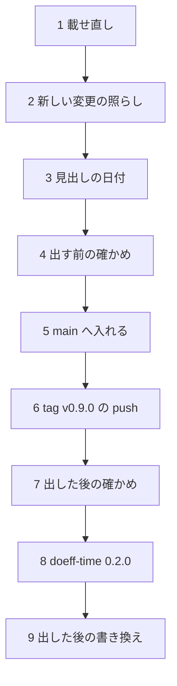

# doeff 0.9.0 を出す日の手順

## この文書の目的

この文書を読んだ保守者(maintainer)が、次の事をできるようにする。

- branch `wt/release-0.9.0-prep` を使い、核の 5 個の 0.9.0 と `doeff-time` 0.2.0 を、決まった順で PyPI へ出せる。
- 各段で、どの命令か workflow を走らせ、何が通れば次の段へ進むかが分かる。
- 出した後に repo の中で書き換える物と、出した後に落ちうる確かめを知っている。

公開の一般の手順(出す部品の分類・PyPI の資格・落ちた時の扱い)は [公開の手順書](release-publish-runbook.md) に在る。この文書は
0.9.0 に固有の事だけを書く。

## 前提と用語

| 語 | 意味 |
| --- | --- |
| 準備の branch | `wt/release-0.9.0-prep`。main の `a2e13c527` から切り、版の番号・`CHANGELOG.md`・この文書を変えた。main には入っていない |
| 核の 5 個 | `doeff`・`doeff-vm`・`doeff-core-effects`・`doeff-hy`・`doeff-hy-pytest`(公開の手順書の「前提と用語」と同じ) |
| root の tag | `v0.9.0`。push すると公開の workflow `Publish doeff` が核の 5 個を出す |
| 単独で出す部品 | root の tag では出さず、部品ごとの tag と手元の upload で出す部品(ここでは `doeff-time`) |
| 載せ直し | 準備の branch を、出す日の main の先端の上へ rebase する事 |

## この版で出す物

| 部品 | 版 | 出し方 | 核の部品への依存 |
| --- | --- | --- | --- |
| 核の 5 個 | 0.9.0 | root の tag `v0.9.0` → workflow `Publish doeff` | 互いに `>=0.9.0,<0.10` |
| `doeff-time` | 0.2.0 | 部品の tag `doeff-time/v0.2.0` → 手元の `uv publish`(公開の手順書「単独で出す部品の手順」) | `doeff>=0.9.0,<0.10`・`doeff-core-effects>=0.9.0,<0.10` |
| `doeff-indexer` | 0.2.0(出さない) | この版では出さない。依存を `doeff>=0.9.0,<0.10` に変えたのは、workspace の `uv lock` を解くため | `doeff>=0.9.0,<0.10` |

## 版を 0.8.1 でなく 0.9.0 にした訳

| 事実 | 確かめる所 |
| --- | --- |
| 0.8.0 の使い方で書いた code が動かなくなる変更が、核の部品に在る(`writer_log` の削除、`on_raise`・`absent_as` の引数、`doeff_hy` の submodule の削除、`doeff_vm.vm_live_counts` などの削除) | `CHANGELOG.md` の 0.9.0 の節の **Breaking** の項 |
| 公開の手順書は、使い方が変わった版で 2 桁目を上げると決めている | 公開の手順書の節「版と tag」 |
| 核の部品どうしの依存は `>=X.Y.0,<X.(Y+1)` に限る | `tests/test_core_packages_version.py` |
| `doeff` の `doeff-vm` への依存の下限は、`doeff-vm` の版以上 | `tests/test_doeff_vm_release_contract.py` |

下の 2 つの test を両方通す版は X.Y.0 だけである。0.8.1 にするなら、依存の下限 0.8.0 が `doeff-vm` の 0.8.1 を下回り、2 本目の
test が落ちる。0.8.1 で出すには、先にどちらかの test の決まりを変える必要がある。

## 手順の流れ

箱は段、矢印は「左の段が通ってから右の段へ進む」を表す。



## 各段でする事

### 1. 載せ直し

準備の branch の作業木で、持ち主の job が取り寄せた `origin/main` の上へ rebase する(会話は `git fetch` をしない)。

```bash
git rebase origin/main
```

| 衝突しうる file | 直し方 |
| --- | --- |
| `CHANGELOG.md` | main が `## Unreleased` に足した項を、0.9.0 の節の Added・Changed・Fixed へ移す。`## Unreleased` は空で残す |
| `uv.lock` | 衝突を main の側で解いてから `uv lock` を走らせ直す |
| 版を書く 8 か所と依存の範囲 | main の側が版の番号を変えていなければ、準備の branch の側を取る |

### 2. 新しい変更の照らし

`a2e13c527` より後に main へ入った変更のうち、核の部品と `doeff-time` に触れた物を読み、利用者に見える変更が 0.9.0 の節に在る事を
確かめる。

```bash
git log --oneline a2e13c527..HEAD -- doeff packages/doeff-vm packages/doeff-vm-core \
  packages/doeff-core-effects packages/doeff-hy packages/doeff-hy-pytest packages/doeff-time pyproject.toml
grep -rn '<0\.9"' --include=pyproject.toml .   # 0 行(main が 0.8 の系の依存を足していない)
```

### 3. 見出しの日付

`CHANGELOG.md` の見出し `## 0.9.0 — unreleased` の `unreleased` を、出す日の日付(`YYYY-MM-DD`)に替える。

### 4. 出す前の確かめ

公開の手順書の「出す前の確かめ」の表の 1〜6 を、準備の branch の先端で走らせる。同じ版の check は `doeff-time` も入れて
6 個に当てる。

| 順 | する事 | 通る条件 |
| --- | --- | --- |
| 1 | `uv run pytest` | 全て緑 |
| 2 | `uv run --no-project python tools/check_pypi_unpublished.py packages/doeff-vm packages/doeff-hy-pytest packages/doeff-hy packages/doeff-core-effects . packages/doeff-time` | 6 行とも `[OK] … is not on PyPI yet`・終了コード 0 |
| 3 | 公開の手順書の命令 2(核の 4 個の build と metadata の確かめ) | どの部品も build でき、`verify_dist_metadata.py` が通る |
| 4 | `uv run --no-project python tools/verify_release_install.py` | 終了コード 0 |
| 5 | GitHub Actions の `Publish doeff` を、準備の branch の上で `publish=false` で手で起こす | `check-versions-unpublished` と `build-python-release-dists` が緑。upload の job は走らない |
| 6 | GitHub Actions の `Build doeff-vm` を、準備の branch の上で `publish=false` で手で起こす | Linux(manylinux と musllinux)・macOS・Windows の wheel と sdist の job が全て緑 |
| 7 | 記事の 1 本目の例を、準備の branch の wheel で走らせる(下の「記事の 1 本目の例の確かめ」) | 英語の版の test が全て緑・Zenn の版の確かめが終了コード 0 |

### 5. main へ入れる

```bash
agora land request --repo doeff --branch wt/release-0.9.0-prep --title "Release 0.9.0 of the core packages and doeff-time 0.2.0"
```

main へ直に push しない。入った後の main の先端の commit を控える。

### 6. tag v0.9.0 の push

段 5 で控えた commit に tag を打つ。push が PyPI への公開を起こすので、持ち主の許しを得てから打つ。

```bash
git tag v0.9.0 <段 5 の main の先端の commit>
git push origin v0.9.0
```

`Publish doeff` の全ての job が緑になるまで、GitHub Actions の画面で読む。

### 7. 出した後の確かめ

| する事 | 通る条件 |
| --- | --- |
| `uv run --no-project python tools/verify_release_install.py --pypi 0.9.0` | 終了コード 0(2 なら数分おいて走らせ直す — 公開の手順書の表) |
| `Core install from PyPI` を手で起こす(毎日も走る) | 3 つの OS と Python 3.11〜3.15 の job が全て緑 |
| `Article code from PyPI`(`Publish doeff` の後に自ら走る)の結末を読む | 全ての回が緑 |

`Article code from PyPI` は、PyPI の最新の `doeff`(0.9.0)と、確かめの頭が名指す部品を入れて記事の例を走らせる。
`reviews/agents-check.py` などは、`doeff-time`・`doeff-agents` を git の commit で固定して入れる。その commit の部品が
0.9.0 で消えた path(`doeff_hy` の submodule など)を読むと、その回が落ちる。落ちた回は、記事が名指す commit を新しい物へ
替える card に切る。

### 8. doeff-time 0.2.0

公開の手順書の「単独で出す部品の手順」を、`package=doeff-time`・版 `0.2.0` で行う。核の 0.9.0 が PyPI に載った後に出す。
0.2.0 が載るまで、`pip install doeff-time` は 0.1.0 と `doeff` 0.8.0 を選ぶ(0.1.0 の依存が `<0.9` のため)。

出した後、新しい venv に `doeff-time==0.2.0` を入れ、`import doeff_time` と `from doeff_time import sim_time_handler` が通る事を
確かめる。

### 9. 出した後の書き換え

| 書き換える所 | 訳 |
| --- | --- |
| `examples/testing_without_mocks` と `publications/zenn-use-cases-v0` の `await_handler()` などの前の工場の呼び(`tools/former_factory_call_rewrite.py` の `census` で数え、`rewrite` で書き換える) | 毎日 PyPI の版で走らせるので、0.9.0 が載るまで前の形を残した(`CHANGELOG.md` の `await_handler` の項) |
| `publications/zenn-use-cases-v0` の `doeff-composition.md`・`doeff-agents.md`・`examples/composition.py`・`examples/agents_workflow.py` の `from doeff_time.handlers.… import …` | `doeff-time` 0.2.0 で `doeff_time.handlers` が消える。`from doeff_time import …` へ替える |
| 記事の 1 本目(branch `wt/week1-core-only`)の英語の版の「runs as shown with doeff 0.8.0」 | 例が `await_handler` を工場でなく handler として使うので、0.9.0 が要る |
| `docs/releases/v0.9.0.md`(GitHub の Release の本文) | `docs/releases/v0.8.0.md` と同じ形で、tag の上の CI の数を書く(`tests/test_release_notes_match_changelog.py` が見出しの日付と照らす) |

## 記事の 1 本目の例の確かめ

準備の branch で組んだ wheel を、repo の外の新しい venv に入れ、branch `wt/week1-core-only` の英語の版と Zenn の版の例を走らせる。
英語の版は repo の test、Zenn の版は単独の確かめの script で見る。

1. 準備の branch で、核の 5 個の wheel を組み、新しい venv に入れて README の例を走らせる。`--keep` で wheel と venv を残す。

   ```bash
   uv run --no-project python tools/verify_release_install.py --python 3.12 --work-dir <repo の外の空の dir> --keep
   ```

2. 残った venv に pytest の依存を足し、`wt/week1-core-only` の作業木で走らせる。子の interpreter は例の dir で起きるので、
   `doeff` は venv の wheel から読まれる。

   ```bash
   <venv>/bin/python -m pytest -q -p no:cacheprovider tests/test_docs_article_algebraic_effects.py
   <venv>/bin/python -I publications/zenn-use-cases-v0/reviews/main-check.py
   ```

| 確かめ | 通る条件 |
| --- | --- |
| 英語の版の test | 全て緑 |
| Zenn の版の確かめ | 終了コード 0 と、最後の行「main: 枠…個が英語の版と同じ、…を確認」 |
| 読んだ `doeff` の出所 | 例の dir で起こした venv の Python の `doeff.__file__` が venv の `site-packages` に在り、`doeff.__version__` が `0.9.0` |

## 根拠

| 事柄 | 確かめる所 |
| --- | --- |
| 0.8.0 から main の `a2e13c527` までの変更 | `CHANGELOG.md` の 0.9.0 の節 |
| 版を書く 8 か所と、依存の範囲の決まり | `tests/test_core_packages_version.py`・公開の手順書の節「版と tag」 |
| 公開の workflow の順と、同じ版の check | `.github/workflows/publish.yml`・`tests/test_release_publish_contract.py` |
| `Article code from PyPI` が `Publish doeff` の後に走る事 | `.github/workflows/article-code-from-pypi.yml` の `workflow_run` |
