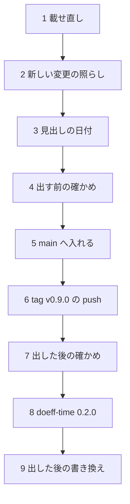

# doeff 0.9.0 を出す日の手順

## この文書の目的

この文書を読んだ保守者(maintainer)が、次の事をできるようにする。

- branch `wt/release-0.9.0-prep` を使い、核の 5 個の 0.9.0 と `doeff-time` 0.2.0 を、決まった順で PyPI へ出せる。
- 各段で、どの命令か workflow を走らせ、何が通れば次の段へ進むかが分かる。
- 出した後に repo の中で書き換える物と、出した後に落ちうる確かめを知っている。

公開の一般の手順(出す部品の分類・PyPI の資格・落ちた時の扱い)は [公開の手順書](release-publish-runbook.md) に在る。この文書は
0.9.0 に固有の事だけを書く。

## 前提と用語

| 語 | 意味 |
| --- | --- |
| 準備の branch | `wt/release-0.9.0-prep`。版の番号・`CHANGELOG.md`・この文書・`doeff-time` の license を変えた。main の `a2e13c527` から切り、`938e14d3f` の上へ載せ直した。main には入っていない |
| 載せ直しの基 | 準備の branch が今載っている main の commit(`938e14d3f`)。`CHANGELOG.md` の 0.9.0 の節は、この commit までの変更を書いている |
| 核の 5 個 | `doeff`・`doeff-vm`・`doeff-core-effects`・`doeff-hy`・`doeff-hy-pytest`(公開の手順書の「前提と用語」と同じ) |
| root の tag | `v0.9.0`。push すると公開の workflow `Publish doeff` が核の 5 個を出す |
| 単独で出す部品 | root の tag では出さず、部品ごとの tag と手元の upload で出す部品(ここでは `doeff-time`) |
| 載せ直し | 準備の branch を、出す日の main の先端の上へ rebase する事 |

## この版で出す物

| 部品 | 版 | 出し方 | 核の部品への依存 |
| --- | --- | --- | --- |
| 核の 5 個 | 0.9.0 | root の tag `v0.9.0` → workflow `Publish doeff` | 互いに `>=0.9.0,<0.10` |
| `doeff-time` | 0.2.0 | 部品の tag `doeff-time/v0.2.0` → 手元の `uv publish`(公開の手順書「単独で出す部品の手順」) | `doeff>=0.9.0,<0.10`・`doeff-core-effects>=0.9.0,<0.10` |
| `doeff-indexer` | 0.2.0(出さない) | この版では出さない。依存を `doeff>=0.9.0,<0.10` に変えたのは、workspace の `uv lock` を解くため | `doeff>=0.9.0,<0.10` |

## 版を 0.8.1 でなく 0.9.0 にした訳

| 事実 | 確かめる所 |
| --- | --- |
| 0.8.0 の使い方で書いた code が動かなくなる変更が、核の部品に在る(`writer_log` の削除、`on_raise`・`absent_as` の引数、`doeff_hy` の submodule の削除、`doeff_vm.vm_live_counts` などの削除、`PRIORITY_IDLE` などの定数から `TaskPriority` への置き換え) | `CHANGELOG.md` の 0.9.0 の節の **Breaking** の項 |
| 公開の手順書は、使い方が変わった版で 2 桁目を上げると決めている | 公開の手順書の節「版と tag」 |
| 核の部品どうしの依存は `>=X.Y.0,<X.(Y+1)` に限る | `tests/test_core_packages_version.py` |
| `doeff` の `doeff-vm` への依存の下限は、`doeff-vm` の版以上 | `tests/test_doeff_vm_release_contract.py` |

下の 2 つの test を両方通す版は X.Y.0 だけである。0.8.1 にするなら、依存の下限 0.8.0 が `doeff-vm` の 0.8.1 を下回り、2 本目の
test が落ちる。0.8.1 で出すには、先にどちらかの test の決まりを変える必要がある。

## 手順の流れ

箱は段、矢印は「左の段が通ってから右の段へ進む」を表す。



## 各段でする事

### 1. 載せ直し

準備の branch の作業木で、持ち主の job が取り寄せた `origin/main` の上へ rebase する(会話は `git fetch` をしない)。

```bash
git rebase origin/main
```

| 衝突しうる file | 直し方 |
| --- | --- |
| `CHANGELOG.md` | main が `## Unreleased` に足した項を、0.9.0 の節の Added・Changed・Fixed へ移す。`## Unreleased` は空で残す。0.9.0 の節は 0.8.0 との差を書くので、0.8.0 と比べて何も変わらない項(公開の API の目録が名を許した物として数え直しただけの項・0.8.0 の import root に無かった名の削除)は移さない |
| `uv.lock` | 衝突を main の側で解いてから `uv lock` を走らせ直す |
| 版を書く 8 か所と依存の範囲 | main の側が版の番号を変えていなければ、準備の branch の側を取る |

### 2. 新しい変更の照らし

載せ直しの基(`938e14d3f`)より後に main へ入った変更を読み、利用者に見える変更が 0.9.0 の節に在る事を確かめる。0.9.0 の節は
核の部品だけでなく、repo の他の部品(`doeff-records`・`doeff-conductor` など)の変更も書くので、範囲は repo の全体にする。
import root から名を消した変更は、その名が 0.8.0 の import root に在ったかを見て、在った時だけ **Breaking** の項にする。

```bash
git log --oneline 938e14d3f..HEAD
git show v0.8.0:<部品の dir>/<module>/__init__.py | grep -n '<消した名>'   # 在れば 0.8.0 との差
grep -rn '<0\.9"' --include=pyproject.toml .   # 0 行(main が 0.8 の系の依存を足していない)
```

照らした後、表「前提と用語」の載せ直しの基を、載せ直した main の commit に書き換える。

### 3. 見出しの日付

`CHANGELOG.md` の見出し `## 0.9.0 — unreleased` の `unreleased` を、出す日の日付(`YYYY-MM-DD`)に替える。

### 4. 出す前の確かめ

公開の手順書の「出す前の確かめ」の表の 1〜6 を、準備の branch の先端で走らせる。同じ版の check は `doeff-time` も入れて
6 個に当てる。

| 順 | する事 | 通る条件 |
| --- | --- | --- |
| 1 | `uv run pytest` | 全て緑 |
| 2 | `uv run --no-project python tools/check_pypi_unpublished.py packages/doeff-vm packages/doeff-hy-pytest packages/doeff-hy packages/doeff-core-effects . packages/doeff-time` | 6 行とも `[OK] … is not on PyPI yet`・終了コード 0 |
| 3 | 公開の手順書の命令 2(核の 4 個の build と metadata の確かめ) | どの部品も build でき、`verify_dist_metadata.py` が通る |
| 4 | `uv run --no-project python tools/verify_release_install.py` | 終了コード 0 |
| 5 | GitHub Actions の `Publish doeff` を、準備の branch の上で `publish=false` で手で起こす | `check-versions-unpublished` と `build-python-release-dists` が緑。upload の job は走らない |
| 6 | GitHub Actions の `Build doeff-vm` を、準備の branch の上で `publish=false` で手で起こす | Linux(manylinux と musllinux)・macOS・Windows の wheel と sdist の job が全て緑 |
| 7 | 記事の 1〜4 本目の例を、準備の branch の wheel で走らせる(下の「記事の 1〜4 本目の例の確かめ」) | 英語の版の test 4 本が全て緑・Zenn の版の確かめ 4 本が終了コード 0 |
| 8 | doeff 本体の test を、準備の branch の wheel で走らせる(下の「doeff 本体の test を wheel で走らせる」) | 全て緑 |

### 5. main へ入れる

```bash
agora land request --repo doeff --branch wt/release-0.9.0-prep --title "Release 0.9.0 of the core packages and doeff-time 0.2.0"
```

main へ直に push しない。入った後の main の先端の commit を控える。

### 6. tag v0.9.0 の push

段 5 で控えた commit に tag を打つ。push が PyPI への公開を起こすので、持ち主の許しを得てから打つ。

```bash
git tag v0.9.0 <段 5 の main の先端の commit>
git push origin v0.9.0
```

`Publish doeff` の全ての job が緑になるまで、GitHub Actions の画面で読む。

### 7. 出した後の確かめ

| する事 | 通る条件 |
| --- | --- |
| `uv run --no-project python tools/verify_release_install.py --pypi 0.9.0` | 終了コード 0(2 なら数分おいて走らせ直す — 公開の手順書の表) |
| `Core install from PyPI` を手で起こす(毎日も走る) | 3 つの OS と Python 3.11〜3.15 の job が全て緑 |
| `Article code from PyPI`(`Publish doeff` の後に自ら走る)の結末を読む | 全ての回が緑 |

`Article code from PyPI` は、PyPI の最新の `doeff`(0.9.0)と、確かめの頭が名指す部品を入れて記事の例を走らせる。
`reviews/agents-check.py` などは、`doeff-time`・`doeff-agents` を git の commit で固定して入れる。その commit の部品が
0.9.0 で消えた path(`doeff_hy` の submodule など)を読むと、その回が落ちる。落ちた回は、記事が名指す commit を新しい物へ
替える card に切る。

### 8. doeff-time 0.2.0

公開の手順書の「単独で出す部品の手順」を、`package=doeff-time`・版 `0.2.0` で行う。核の 0.9.0 が PyPI に載った後に出す。
0.2.0 が載るまで、`pip install doeff-time` は 0.1.0 と `doeff` 0.8.0 を選ぶ(0.1.0 の依存が `<0.9` のため)。

出した後、新しい venv に `doeff-time==0.2.0` を入れ、`import doeff_time` と `from doeff_time import sim_time_handler` が通る事を
確かめる。

### 9. 出した後の書き換え

| 書き換える所 | 訳 |
| --- | --- |
| `examples/testing_without_mocks` と `publications/zenn-use-cases-v0` の `await_handler()` などの前の工場の呼び(`tools/former_factory_call_rewrite.py` の `census` で数え、`rewrite` で書き換える) | 毎日 PyPI の版で走らせるので、0.9.0 が載るまで前の形を残した(`CHANGELOG.md` の `await_handler` の項) |
| `publications/zenn-use-cases-v0` の `doeff-composition.md`・`doeff-agents.md`・`examples/composition.py`・`examples/agents_workflow.py` の `from doeff_time.handlers.… import …` | `doeff-time` 0.2.0 で `doeff_time.handlers` が消える。`from doeff_time import …` へ替える |
| `publications/zenn-use-cases-v0/examples/scheduling.py` の `PRIORITY_IDLE` | 0.9.0 で定数が消える。`TaskPriority.IDLE` へ替える(毎日 PyPI の版で走らせるので、0.9.0 が載るまで前の形を残した) |
| 記事の 1 本目(branch `wt/week1-core-only`)の英語の版の「runs as shown with doeff 0.8.0」と、`publications/launch-week-1/show-hn-facts.md` の「doeff 0.8.0 only」 | 例が `await_handler` を工場でなく handler として使い、`TaskPriority` で Spawn するので、0.9.0 が要る |
| `docs/releases/v0.9.0.md`(GitHub の Release の本文) | `docs/releases/v0.8.0.md` と同じ形で、tag の上の CI の数を書く(`tests/test_release_notes_match_changelog.py` が見出しの日付と照らす) |

## 記事の 1〜4 本目の例の確かめ

準備の branch で組んだ wheel を repo の外の新しい venv に入れ、記事の 1〜4 本目の英語の版と Zenn の版の例(8 本)を走らせる。
英語の版は repo の test、Zenn の版は単独の確かめの script で見る。

### 走らせる記事の branch

| 記事 | 英語の版の branch と test | Zenn の版の branch と確かめの script |
| --- | --- | --- |
| 1 本目 | `wt/week1-core-only-on-0.9.0`・`tests/test_docs_article_algebraic_effects.py` | 同じ branch・`publications/zenn-use-cases-v0/reviews/main-check.py` |
| 2 本目 | `wt/article-2-yield-and-async`・`tests/test_docs_article_yield_and_async.py` | `wt/zenn-article-2-ja-on-en`・`reviews/coroutines-check.py` |
| 3 本目 | `wt/article-3-time-on-0.9.0`・`tests/test_docs_article_time.py` | `wt/zenn-article-3-ja-on-en-on-0.9.0`・`reviews/time-check.py` |
| 4 本目 | `wt/article-4-record-and-replay`・`tests/test_docs_article_record_and_replay.py` | `wt/zenn-article-4-ja-on-en`・`reviews/replay-check.py` |

名が `-on-0.9.0` で終わる branch は、記事の branch(`wt/week1-core-only`・`wt/article-3-time`・`wt/zenn-article-3-ja-on-en`)の
先端に、0.9.0 に合わせる commit を足した物である。

| 足した commit | 訳 |
| --- | --- |
| 例の仮想の時計が `PRIORITY_IDLE` でなく `TaskPriority.IDLE` で Spawn する(例の file・英語の本文・Zenn の本文) | 0.9.0 で `PRIORITY_IDLE` が消えた。元の branch のままでは、英語と Zenn の 1 本目と 3 本目が `ImportError: cannot import name 'PRIORITY_IDLE'` で落ちる |
| 1 本目の Zenn の確かめが、別の連載への link を待たない | 記事の branch が本文から別の連載への段落を消した時に、確かめの script の期待を直し忘れていた。doeff の版に依らず、目次の照らしで落ちる |

記事を出す前に、`-on-0.9.0` の commit を元の branch へ入れる。

### 手順

1. 準備の branch の作業木で、核の 5 個と `doeff-time` の wheel と sdist を組み、metadata を確かめる。

   ```bash
   for p in doeff doeff-vm doeff-core-effects doeff-hy doeff-hy-pytest doeff-time; do
     uv build --package $p --python 3.12 --out-dir <dist>
   done
   uv run --no-project --with twine twine check --strict <dist>/*
   ```

2. repo の外に新しい venv を作り、組んだ wheel と test の道具を入れる。PyPI に 0.9.0 は無いので、6 個は必ず `<dist>` から入る。

   ```bash
   uv venv --python 3.12 <venv>
   uv pip install --python <venv>/bin/python --find-links <dist> doeff==0.9.0 doeff-vm==0.9.0 \
     doeff-core-effects==0.9.0 doeff-hy==0.9.0 doeff-hy-pytest==0.9.0 doeff-time==0.2.0 pytest-timeout pytest-asyncio
   ```

3. 記事ごとに、準備の branch の木に記事の branch が変えた file を重ねた木を、repo の外に作る。記事の branch は古い main の上に
   在り、その test の補助(`tests/cli/cli_child.py`)は 0.9.0 の wheel で import できない。重ねた木では、test の補助は準備の
   branch の側、記事の file は記事の branch の側になる。`pyproject.toml` は重ねない。この木は確かめだけに使う。

   ```bash
   git archive wt/release-0.9.0-prep | tar -x -C <木>
   git archive <記事の branch> $(git diff --name-only --diff-filter=AMR \
     "$(git merge-base <記事の branch> wt/release-0.9.0-prep)" <記事の branch> | grep -v '^pyproject.toml$') | tar -x -C <木>
   ```

4. 重ねた木の根で走らせる。

   | 確かめ | 命令 | 例を走らせる Python |
   | --- | --- | --- |
   | 英語の 1 本目 | `uv run --no-project --python <venv>/bin/python python -m pytest -q -p no:cacheprovider tests/test_docs_article_algebraic_effects.py` | test を走らせる Python(venv の物) |
   | 英語の 2〜4 本目 | `DOEFF_ARTICLE_PYTHON=<venv>/bin/python uv run --project <準備の branch の作業木> --no-sync pytest -q -p no:cacheprovider tests/<test>.py` | `DOEFF_ARTICLE_PYTHON`(test そのものは `make sync` した作業木の環境で走る) |
   | Zenn の 4 本 | `uv run --no-project --python <venv>/bin/python python -I publications/zenn-use-cases-v0/reviews/<名>-check.py` | `-I` で起こした venv の Python |

| 確かめ | 通る条件 |
| --- | --- |
| 英語の版の test 4 本 | 全て緑 |
| Zenn の版の確かめ 4 本 | 終了コード 0 と、最後の行の要約(例: 「main: 枠…個が英語の版と同じ、…を確認」) |
| 読んだ `doeff` の出所 | 例の dir で起こした venv の Python の `doeff.__file__` が venv の `site-packages` に在り、`doeff.__version__` が `0.9.0` |
| 0.8.0 との比べ | 同じ確かめを PyPI の `doeff==0.8.0` で走らせると、`await_handler(…)` の行で `TypeError: await_handler() takes 0 positional arguments but 1 was given` になる(記事の例が 0.9.0 を要る事の確かめ) |

## doeff 本体の test を wheel で走らせる

doeff の test のうち、入れた wheel を import して動きを見る物を、手順 2 の venv で走らせる。repo の source の file を読む test は、
wheel の venv では読む file が無いので、準備の branch の作業木で走らせる。

1. 核の 5 個の README の例を、新しい venv に入れた wheel で走らせる。

   ```bash
   uv run --no-project python tools/verify_release_install.py --wheels <dist> --python 3.12
   ```

2. 手順 2 の venv に、test が使う extra を足す。

   ```bash
   uv pip install --python <venv>/bin/python --find-links <dist> "doeff[all]==0.9.0" "doeff-core-effects[http,http-server]==0.9.0"
   ```

3. repo の外の dir に、準備の branch の `tests`・`conftest.py`・`pyproject.toml` だけを置き、そこで `tests/core` と `tests/effects`
   を走らせる。dir に `doeff/` の source が無いので、`import doeff` は venv の wheel を読む。`tests/effects/test_traverse.py` は
   核の外の `doeff-traverse` を読むので外す。

   ```bash
   git archive wt/release-0.9.0-prep tests conftest.py pyproject.toml | tar -x -C <dir>
   uv run --no-project --python <venv>/bin/python python -m pytest -q -p no:cacheprovider \
     tests/core tests/effects --ignore=tests/effects/test_traverse.py
   ```

4. 手順 3 で repo の source の file が無くて(`packages/doeff-vm-core` の Rust の source・`doeff/program.py`・`README.md` を読む test)
   落ちた test を、準備の branch の作業木で走らせる。

   ```bash
   uv run --no-sync pytest -q -p no:cacheprovider <手順 3 で落ちた test の id>
   ```

| 確かめ | 通る条件 |
| --- | --- |
| README の例 | 最後の行が「全部通った」・依存の食い違いが無し |
| wheel を import する test | 手順 3 の失敗が全て source の file の無い事(`FileNotFoundError` か、file の在る事の assert)で、ほかは緑 |
| source を読む test | 手順 4 で全て緑 |

## 根拠

| 事柄 | 確かめる所 |
| --- | --- |
| 0.8.0 から main の `938e14d3f` までの変更 | `CHANGELOG.md` の 0.9.0 の節 |
| 版を書く 8 か所と、依存の範囲の決まり | `tests/test_core_packages_version.py`・公開の手順書の節「版と tag」 |
| 公開の workflow の順と、同じ版の check | `.github/workflows/publish.yml`・`tests/test_release_publish_contract.py` |
| `Article code from PyPI` が `Publish doeff` の後に走る事 | `.github/workflows/article-code-from-pypi.yml` の `workflow_run` |
