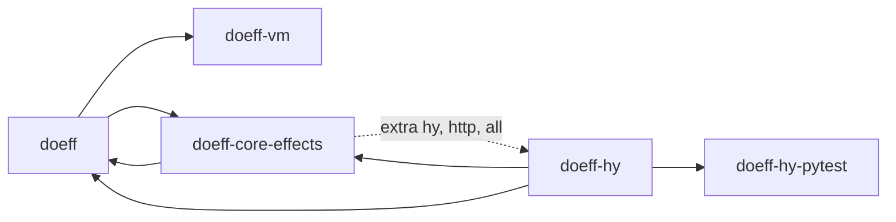
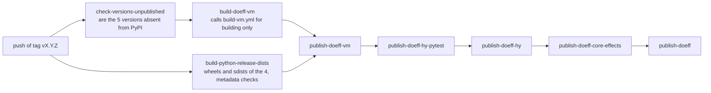

# doeff release runbook (publishing to PyPI)

## Purpose of this document

After reading this document, a maintainer can:

- Explain that the packages a root tag (`vX.Y.Z`) publishes to PyPI are **only the core five**, and why.
- Release a new version of the core five (next is 0.5.0) in the order "pre-publish checks → push the tag → post-publish checks".
- Decide, when publishing fails midway, whether to resume or to bump the version and publish again.
- Know the procedure and order for releasing packages outside the core separately from the root tag.

## Prerequisites and terms

| Term | Meaning |
| --- | --- |
| PyPI | The public index that distributes Python packages. `pip install doeff` fetches from here |
| The core five | `doeff`, `doeff-vm`, `doeff-core-effects`, `doeff-hy`, `doeff-hy-pytest`. Packages released together under one version. `pip install doeff` installs the first three, and the `hy` extra (`pip install "doeff[hy]"`) adds the last two (dependency directions under "Release order" below) |
| Root tag | The version tag `vX.Y.Z` placed at the repo root. Pushing it triggers the publish workflow |
| Publish workflow | `.github/workflows/publish.yml` (GitHub Actions name `Publish doeff`). `doeff-vm` is built by calling `.github/workflows/build-vm.yml` for building only, and uploaded from publish.yml's own job |
| Native package | A package containing Rust, whose wheels are built per platform and Python version (`doeff-vm`, `doeff-indexer`) |
| Same-version check | `tools/check_pypi_unpublished.py`. Fails if the name and version in a package's `pyproject.toml` already exist on PyPI |
| skip-existing | An upload setting. It skips files already on PyPI and reports success. Kept so that an upload stopped midway can be resumed |
| Independently released package | A package not released by the root tag, but by its own per-package tag and release note |

Scope decision: on 2026-10-16 the release scope was set to the core five only, with the current names, supporting
Python 3.11–3.14. `doeff-time`, `doeff-indexer` and the package that launches agents (it has since left this repository), previously released by the root tag, were removed from the root tag by this decision.
On 2026-10-26, Python 3.15 was added to the supported versions (doeff-vm was moved to PyO3 0.29, which can build for 3.15).

## Classification of packages

Every workspace package appears in exactly one row of exactly one of the three tables below. A package whose `packages/*/README.md`
gives a `pip install` or `uv add` install line must be in the root tag table or the independent table (a package that documents how
to install it needs a maintainer who publishes it). These two rules, and that the publish workflow publishes only the packages in the
root tag table, are checked by `tests/test_release_publish_contract.py`.

### Packages released by the root tag

| Package | Kind | Build and upload jobs | Release order |
| --- | --- | --- | --- |
| `doeff-vm` | Native package (the Rust VM) | `build-doeff-vm` (calls `build-vm.yml` for building only; wheels for every platform and the sdist) → `publish-doeff-vm` | 1 |
| `doeff-hy-pytest` | pytest plugin (test fixtures for `doeff-hy`) | `build-python-release-dists` → `publish-doeff-hy-pytest` | 2 |
| `doeff-hy` | Hy macros and runtime helpers | `build-python-release-dists` → `publish-doeff-hy` | 3 |
| `doeff-core-effects` | The effects and handlers the root runtime needs | `build-python-release-dists` → `publish-doeff-core-effects` | 4 |
| `doeff` | The root package | `build-python-release-dists` → `publish-doeff` | 5 |

### Packages released independently

Not released by the root tag. To release one, use a per-package tag `<package>/vX.Y.Z` and a release note (procedure under
"Procedure for independently released packages"). The "Release first" column lists the packages that must already be on PyPI before
that package.

| Package | Kind | Release first |
| --- | --- | --- |
| `doeff-time` | Time effects. 0.1.0 is on PyPI (2026-10-27, tag `doeff-time/v0.1.0`, for the doeff 0.8 line) | `doeff`, `doeff-core-effects` |
| `doeff-llm` | Provider-independent LLM effects | `doeff` |
| `doeff-image` | Provider-independent image effects | `doeff` |
| `doeff-secret` | Provider-independent secret value effects | `doeff` |
| `doeff-events` | Event effects | `doeff` |
| `doeff-traverse` | Sequence traversal effects | `doeff-core-effects`, `doeff-time` |
| `doeff-notify` | Notification effects | `doeff` |
| `doeff-git` | Git effects | `doeff` |
| `doeff-flow` | Workflow trace package | `doeff` |
| `doeff-adr` | Executable ADR contract package | `doeff-hy` |
| `doeff-openai` | LLM provider package | `doeff-llm` |
| `doeff-openrouter` | LLM provider package | `doeff-llm` |
| `doeff-gemini` | LLM and image provider package | `doeff-llm`, `doeff-image` |
| `doeff-seedream` | Image provider package | `doeff-image` |
| `doeff-google-secret-manager` | Secret value provider package | `doeff-secret` |
| `doeff-indexer` | Native tool (the index used by the IDE plugins). 0.1.3 is on PyPI | None. `build-indexer.yml` releases it on tag `doeff-indexer-vX.Y.Z` |

### Packages not published

Released neither by the root tag nor independently. If you decide to publish one of them, add its README install line, a row in one
of the tables above, and the build and metadata checks in the same change.

| Package | Kind | Reason it is not published |
| --- | --- | --- |
| `doeff-cluster` | Cluster execution package (coordinator, worker, lease, rollout) | Created 2026-09-25 (eae6a774). No public install path yet |
| `doeff-records` | Record storage effect package (versioned rows, change and append logs) | Created 2026-09-26 (12f92505). No public install path yet |
| `doeff-stream` | Runtime package for merging and folding input sources (runs step effects as tasks and feeds their completion back as input) | Created 2026-11-02. No public install path yet |
| `doeff-docker` | Experimental execution adapter | No public install path yet |
| `doeff-validation` | Package bundling independent checks | Created 2026-09-26 (96b5de54). No public install path yet |
| `doeff-jev` | Judgment provider package (the TypeSafe Jev handler for `doeff-system-one`) | Created 2026-09-22 (e190a8c6). No public install path yet |
| `doeff-system-one` | Judgment effect package | Created 2026-09-22 (e190a8c6). No public install path yet |
| `doeff-domain` | Domain package for vocabulary cohesion | The E1 package of ADR-DOE-DOMAIN-001 (status proposed). No public install path yet |
| `doeff-ml-nexus` | Experimental execution adapter | No public install path yet |
| `doeff-effect-analyzer` | Native analysis tool | A development tool, not part of PyPI's user surface |
| `doeff-linter` | Native analysis tool | Installed through Cargo tooling. Not released on PyPI |
| `doeff-vm-core` | Internal native crate | The implementation inside `doeff-vm` |

## Versions and tags

- The core five share one version. The tag is that version prefixed with `v` (version 0.5.0 → tag `v0.5.0`).
- Their mutual dependencies are limited to the same line (for 0.5.0, `>=0.5.0,<0.6`). A single version number tells you which
  combination fits.
- Why the next version is 0.5.0: usage changed since 0.4.1 on PyPI, so the second digit goes up to signal "not compatible with the
  previous version". It is not 1.0 because usage is still moving.

Versions are written in the places below. Missing even one bump makes the same-version check fail for that package (if it is still
at the version on PyPI).

| Package | Where the version is written |
| --- | --- |
| `doeff` | `version` in `pyproject.toml`, `__version__` in `doeff/__init__.py` |
| `doeff-vm` | `packages/doeff-vm/pyproject.toml`, `packages/doeff-vm/Cargo.toml` |
| `doeff-core-effects` | `packages/doeff-core-effects/pyproject.toml` |
| `doeff-hy` | `packages/doeff-hy/pyproject.toml` |
| `doeff-hy-pytest` | `packages/doeff-hy-pytest/pyproject.toml` |

## Release order

Dependency directions (an arrow means "the left package needs the right package"; dotted lines are extra dependencies):



- `doeff-vm` and `doeff-hy-pytest` need no other core package, so they go first.
- `doeff`, `doeff-core-effects` and `doeff-hy` need each other (`doeff-hy` through extras — `doeff`'s extras pull in the extras of
  the same name in `doeff-core-effects`), so none installs until all three are up. `doeff` goes last — `pip install doeff` picks the
  previous version until the new `doeff` is on PyPI, so a new `doeff` never installs before the other four are up.

Job order of the publish workflow (an arrow means "the right job runs after the left job succeeds" = GitHub Actions `needs`):



- `build-doeff-vm` and every `publish-*` job wait for `check-versions-unpublished` (the diagram draws only the edge to
  `build-doeff-vm`). If even one version bump is missing, the whole release stops before the first upload.
- Every `publish-*` job also waits for `build-python-release-dists` (the diagram draws only the edge to `publish-doeff-vm`). If the
  build of any of the 4 Python packages fails, `doeff-vm` is not uploaded either.
- `doeff-vm` is uploaded from a publish.yml job rather than inside `build-vm.yml` because PyPI does not accept Trusted Publishing from
  inside a reusable workflow ("PyPI credentials").

## Pre-publish checks

Run these at the repo root with the commit to be tagged (the tip of main) checked out.

| Step | Action | Pass condition |
| --- | --- | --- |
| 1 | `uv run pytest` | All green |
| 2 | Confirm the core five's versions were bumped, with the same-version check (command 1 below) | All 5 lines `[OK] … is not on PyPI yet`, exit code 0 |
| 3 | Build the core's 4 Python packages and check their metadata (command 2 below) | Every package builds and `verify_dist_metadata.py` passes |
| 4 | Install the core five built from this checkout into a fresh environment and run the README examples (command 3 below) | Exit code 0 (meaning as in the table of "Checks after publishing") |
| 5 | Trigger `Publish doeff` manually in GitHub Actions with `publish=false` | `check-versions-unpublished` and `build-python-release-dists` are green. Upload jobs do not run |
| 6 | Trigger `Build doeff-vm` manually in GitHub Actions with `publish=false` | All Linux, macOS and Windows wheel and sdist jobs are green. `publish=false` on `Publish doeff` does not build `doeff-vm`, so check it here |

Command 1 (same-version check):

```bash
uv run --no-project python tools/check_pypi_unpublished.py \
  packages/doeff-vm packages/doeff-hy-pytest packages/doeff-hy packages/doeff-core-effects .
```

Command 2 (build and metadata check):

```bash
for package in doeff-hy-pytest doeff-hy doeff-core-effects doeff; do
  rm -rf "/tmp/${package}-dist"
  uv build --package "${package}" --wheel --sdist --out-dir "/tmp/${package}-dist"
  uv run python tools/verify_dist_metadata.py \
    "/tmp/${package}-dist"/*.whl \
    "/tmp/${package}-dist"/*.tar.gz
done
```

Command 3 (check the built five in a fresh environment — the same tool as the post-publish check, used with this checkout's wheels
instead of PyPI):

```bash
uv run --no-project python tools/verify_release_install.py
```

## Publishing

Tag the tip commit of main and push the tag. For version 0.5.0:

```bash
git tag v0.5.0 <tip commit of main>
git push origin v0.5.0
```

- The push triggers `Publish doeff`, which releases the core five in the "job order of the publish workflow" above. Wait until every
  job is green.
- Uploads go out with an API token or Trusted Publishing ("PyPI credentials").
- Triggering `Publish doeff` manually from the GitHub Actions UI with `publish=true` also publishes, just like the tag.

## Checks after publishing

Reinstall the core five from PyPI into a fresh environment outside the repo and confirm that the 5 README examples behave as written.
For version 0.5.0, at the repo root:

```bash
uv run --no-project python tools/verify_release_install.py --pypi 0.5.0
```

For each Python version (default 3.11 and 3.14 — the non-free-threading builds), `tools/verify_release_install.py` does the following.

| Stage | What it checks |
| --- | --- |
| 1 | Creates a fresh venv in a temporary dir outside the repo |
| 2 | Installs the core five from PyPI with `==<version>` (re-reading the local cache's index for the 5), and checks with `uv pip check` that dependencies do not conflict |
| 3 | Prints the installed versions of the 5 |
| 4 | Runs the examples in the installed 5 READMEs (the body of the wheel metadata = what the PyPI page shows) and compares them with the annotations on the print lines |

| Exit code | Meaning | Action |
| --- | --- | --- |
| 0 | Everything passed | Done |
| 1 | A README example or a dependency conflict failed | A defect in the released version. Fix it, bump the version and release again |
| 2 | venv creation or install failed | Right after an upload, PyPI's CDN may not yet serve the new version. Wait a few minutes and rerun the same command |

After publishing, the same-version check (command 1 of "Pre-publish checks") reports `[FAIL] … is already on PyPI` on all 5 lines.
The same version can no longer be released.

Daily after a release, the workflow `Core install from PyPI` (`.github/workflows/core-install-from-pypi.yml`) runs
`uv run --no-project python tools/verify_core_install.py --pypi latest` on Linux, macOS and Windows with Python 3.11–3.15; like a
user, it installs `doeff` from PyPI without extras into a fresh venv and checks the Python examples in the installed version's
README. It does not install Rust tooling, and doeff-vm is accepted only as a wheel, so if PyPI has no wheel matching the platform and
Python, it fails at the install stage.

## When it fails

| Where it failed | What happened | Action |
| --- | --- | --- |
| `check-versions-unpublished` | A package's version bump is missing. No upload has run | Bump the version, merge into main, and tag the new version |
| `build-python-release-dists` or `build-doeff-vm` (the build job of `build-vm.yml`) | A build failed. No upload has run | Fix it and merge into main, delete the tag (`git push --delete origin vX.Y.Z`) and re-tag the fixed commit. Nothing is on PyPI yet, so the version can stay the same |
| Midway through a `publish-*` job | Only some files are on PyPI | Resume with "Re-run failed jobs" in GitHub Actions (note 1 below) |

Notes:

1. "Re-run failed jobs" does not rerun jobs that already passed. Uploads use skip-existing, so a package stopped midway skips the
   files already present and uploads the rest. If the rerun runs the same-version check again, it fails because part of the version
   is on PyPI. In that case, upload the missing files locally from that run's artifacts ("Publishing from a local machine" below), or
   bump the version and release again.
2. Even if you delete a version's file on PyPI, a file with the same name can never be uploaded again (a PyPI rule). Bump the version
   to release again.
3. PyPI refuses to add files to a release more than 14 days after it was published (since 2026-07-22). Finish a stopped upload within
   14 days, or bump the version.

### Publishing from a local machine

Use this only when the CI upload stopped midway and a rerun cannot publish either. This procedure adds the rest of a partially
published version, so do not run the same-version check (it always fails because part of it is on PyPI). Instead,
`uv publish --check-url` skips files already on PyPI and uploads only the rest. `uv publish` uses the token in the environment variable
`UV_PUBLISH_TOKEN`.

- Building `doeff-vm` locally produces only the wheel for the local platform and Python version. Download the CI run's artifacts
  (`doeff-vm-*`) and upload those files.
- The 4 Python packages may be rebuilt locally from the tagged commit. Upload them in release order (`doeff-hy-pytest` → `doeff-hy` →
  `doeff-core-effects` → `doeff`).

```bash
for package in doeff-hy-pytest doeff-hy doeff-core-effects doeff; do
  rm -rf "/tmp/${package}-dist"
  uv build --package "${package}" --wheel --sdist --out-dir "/tmp/${package}-dist"
  uv run python tools/verify_dist_metadata.py \
    "/tmp/${package}-dist"/*.whl \
    "/tmp/${package}-dist"/*.tar.gz
  uv publish --check-url https://pypi.org/simple "/tmp/${package}-dist"/*
done
```

## Procedure for independently released packages

Use this only for the packages in the "Packages released independently" table. The tag name is a record of the release; the root
`Publish doeff` is not triggered by this tag.

```bash
package=<package>
git tag "${package}/vX.Y.Z"
git push origin "${package}/vX.Y.Z"

uv run --no-project python tools/check_pypi_unpublished.py "packages/${package}"
rm -rf "/tmp/${package}-dist"
uv build --package <package> --wheel --sdist --out-dir "/tmp/${package}-dist"
uv run python tools/verify_dist_metadata.py \
  "/tmp/${package}-dist"/*.whl \
  "/tmp/${package}-dist"/*.tar.gz
uv publish "/tmp/${package}-dist"/*
```

- Release the packages in the "Release first" column first. Release provider-independent effect packages before provider packages
  (e.g. `doeff-llm` before `doeff-openai`, `doeff-openrouter` and `doeff-gemini`; `doeff-image` before `doeff-seedream`;
  `doeff-secret` before `doeff-google-secret-manager`).
- `doeff-indexer` alone is not released locally: push the tag `doeff-indexer-vX.Y.Z` and let `build-indexer.yml` build wheels for
  every platform and release them. This workflow also runs the same-version check before uploading. In addition, the job
  `verify-wheels` uses `tools/verify_indexer_wheel.py` to check the location of the binary inside every wheel, and the behaviour of
  the command (`doeff-indexer --help`, `find-interpreters`) after installing the Linux x86_64 wheel into a fresh venv.
  In 0.1.3 on PyPI, every platform's wheel carried the binary in `python/doeff_indexer/bin/` instead of where the command looks
  (`doeff_indexer/bin/`), and the command did not work after `pip install` (maturin 1.12's layout — pinned to 1.13 or later, guarded by
  `tests/test_indexer_wheel_layout.py`).
- After releasing, install the package by name from PyPI into a fresh environment and confirm it can be imported.

## PyPI credentials

Every CI upload runs from a job that belongs to the GitHub environment `pypi` and has `id-token: write`, passing
`password: ${{ secrets.PYPI_API_TOKEN }}` to `pypa/gh-action-pypi-publish`. Which credential is used depends on whether the repo
secret `PYPI_API_TOKEN` exists.

| Repo secret `PYPI_API_TOKEN` | Credential the upload uses |
| --- | --- |
| Present | That API token |
| Absent (after deletion) | Trusted Publishing. The password is empty, and the action exchanges the job's GitHub OIDC token for a PyPI token that expires in minutes. No long-lived secret is stored anywhere |

The job `check-versions-unpublished` in `publish.yml` emits a notice saying which credential the run publishes with. A local
`uv publish` uses the API token in the shell environment variable `UV_PUBLISH_TOKEN`. Never copy the token's value into a commit, a
card, or a log.

### Trusted Publishing (the target)

The owner of the PyPI project registers one GitHub publisher per package. Field names are written as shown in PyPI's UI.

| Field | Value |
| --- | --- |
| Owner | `proboscis` |
| Repository name | `doeff` |
| Workflow name | `publish.yml` |
| Environment name | `pypi` |

1. Packages already on PyPI (`doeff`, `doeff-vm`, `doeff-core-effects`): at https://pypi.org/manage/projects/ → Manage → Publishing,
   add a GitHub publisher with the fields above.
2. Packages not yet on PyPI (`doeff-hy`, `doeff-hy-pytest`): at https://pypi.org/manage/account/publishing/, add a pending publisher
   with the fields above and the PyPI project name. The first upload creates the project. Until then the name is not reserved, and if
   someone else registers it first the pending publisher becomes invalid.
3. Register all 5 packages in the root tag table. If `doeff-vm` is released independently from tag `doeff-vm-v*`, or `doeff-indexer`
   from tag `doeff-indexer-v*`, also add a publisher with workflow name `build-vm.yml` / `build-indexer.yml` to that project (one
   project can have several publishers).
4. Delete the repo secret `PYPI_API_TOKEN` (GitHub repo Settings → Secrets and variables → Actions) and revoke the token under API
   tokens at https://pypi.org/manage/account/. From the next release, publishing uses Trusted Publishing.

PyPI does not accept Trusted Publishing from inside a reusable workflow. So `publish.yml` calls `build-vm.yml` with `publish: false`
for building only (job `build-doeff-vm`) and uploads the built wheels from its own job `publish-doeff-vm`.

### API token (until the move)

1. Create an account-scoped PyPI API token at https://pypi.org/manage/account/token/. A token limited to one project cannot create
   packages not yet on PyPI (`doeff-hy`, `doeff-hy-pytest`).
2. For CI: store it as `PYPI_API_TOKEN` under GitHub repo Settings → Secrets and variables → Actions.
3. For local use: put it in the shell environment variable `UV_PUBLISH_TOKEN`.

## Evidence

| Matter | Where it is checked |
| --- | --- |
| The classification tables; that the publish workflow releases only the core five; the release order; that every upload waits for the same-version check; that the upload jobs are in a shape that can also publish with Trusted Publishing | `tests/test_release_publish_contract.py` |
| The version of `doeff-vm` and the lower bound of the root `doeff`'s dependency on it | `tests/test_doeff_vm_release_contract.py` |
| Behaviour of the same-version check | `tools/check_pypi_unpublished.py`, `tests/test_check_pypi_unpublished.py` |
| The tool that installs the core five into a fresh environment and runs the README examples, and the conventions of those READMEs | `tools/verify_release_install.py`, `tools/readme_examples.py`, `tests/test_readme_examples.py` |
| That `pip install doeff` installs only 4 of the core, that the README's Python examples pass in that environment, and that the Hy and HTTP usage names the extra to add | `tools/verify_core_install.py` (checks in a fresh venv per Python version; main's CI job `core-only-install` runs it per Python version), `tests/test_verify_core_install.py`, `tests/test_core_install_extras.py` |
| That PyPI's `doeff` installed without extras into a fresh venv on Linux, macOS and Windows passes the Python examples in the installed version's README (daily) | The workflow `Core install from PyPI` (`.github/workflows/core-install-from-pypi.yml`) runs `tools/verify_core_install.py --pypi latest` (doeff-vm accepted only as a wheel) on 3 OSes and Python 3.11–3.15; `tests/test_verify_core_install.py` |
| That in an environment with only 4 of the core, users' type checks (pyright, mypy) behave as the type-report probes expect (fixed gaps do not come back), and that the README's Python examples raise no errors at the default strictness | `tools/verify_type_probes.py` (runs the type probes `tests/type_probes/` and the README examples through the uv.lock versions of pyright and mypy; main's CI workflow `Type probes` runs it on 3.11 and 3.14), `tests/test_verify_type_probes.py` |
| Versions on PyPI (read via PyPI's JSON API on 2026-10-16) | `doeff` 0.4.1, `doeff-vm` 0.2.0, `doeff-core-effects` 0.1.0, `doeff-indexer` 0.1.3. `doeff-hy`, `doeff-hy-pytest` and `doeff-time` are absent |
