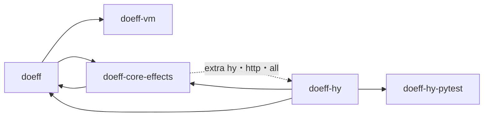
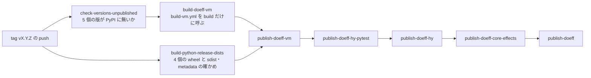

# doeff の公開の手順書(PyPI へ出す)

## この文書の目的

この文書を読んだ保守者(maintainer)が、次の事をできるようにする。

- root の tag(`vX.Y.Z`)で PyPI へ出る部品が**核の 5 個だけ**である事と、その訳を説明できる。
- 核の 5 個の新しい版(次は 0.5.0)を、「出す前の確かめ → tag の push → 出した後の確かめ」の順で出せる。
- 公開の途中で落ちた時に、続きから出すか、版を上げて出し直すかを判断できる。
- 核の外の部品を、root の tag とは別に出す時の手順と順を知る。

## 前提と用語

| 語 | 意味 |
| --- | --- |
| PyPI | Python の部品を配る公の場。`pip install doeff` はここから取る |
| 核の 5 個 | `doeff`・`doeff-vm`・`doeff-core-effects`・`doeff-hy`・`doeff-hy-pytest`。1 つの版で一緒に出す部品。`pip install doeff` は前の 3 個を入れ、extra `hy`(`pip install "doeff[hy]"`)が後の 2 個を足す(依存の向きは下の「出す順」) |
| root の tag | repo の根に打つ版の tag `vX.Y.Z`。push すると公開の workflow が起きる |
| 公開の workflow | `.github/workflows/publish.yml`(GitHub Actions の名は `Publish doeff`)。`doeff-vm` は `.github/workflows/build-vm.yml` を build だけに呼んで組み、upload は publish.yml の自前の job から行う |
| native の部品 | Rust を含み、機体と Python の版ごとに wheel を組む部品(`doeff-vm`・`doeff-indexer`) |
| 同じ版の check | `tools/check_pypi_unpublished.py`。部品の `pyproject.toml` の名と版が PyPI に既に在れば失敗にする |
| skip-existing | upload の設定。PyPI に既に在る file を飛ばして成功と出す。途中で止まった upload を続きから出すために残している |
| 単独で出す部品 | root の tag では出さず、部品ごとの tag と release note で出す部品 |

範囲の決定: 利用者が依頼書 lt-8D749ZHBM6VF2HQEDE2SDMNASF(2026-10-16)で、出す範囲を核の 5 個だけ・名は今のまま・支える Python を
3.11〜3.14 と決めた。それまで root の tag で出していた `doeff-agents`・`doeff-time`・`doeff-indexer` は、この決定で root の tag から外した。
2026-10-26 に利用者の頼み(card ki-72048868aedb)で、支える Python に 3.15 を足した(doeff-vm は 3.15 を組める PyO3 0.29 へ上げた)。

## 出す部品の分類

workspace の部品は、全て下の 3 つの表のどれか 1 つに 1 行で載せる。`packages/*/README.md` に `pip install` か `uv add` の入れ方が
書かれた部品は、root の tag の表か単独の表に載せる(入れ方を書いた部品には、出す持ち主が要る)。この 2 つの決まりと、公開の
workflow が root の tag の表の部品だけを出す事は、`tests/test_release_publish_contract.py` が確かめる。

### root の tag で出す部品

| 部品 | 種類 | build と upload をする job | 出す順 |
| --- | --- | --- | --- |
| `doeff-vm` | native の部品(Rust の VM) | `build-doeff-vm`(`build-vm.yml` を build だけに呼ぶ・全ての機体の wheel と sdist)→ `publish-doeff-vm` | 1 |
| `doeff-hy-pytest` | pytest の plugin(`doeff-hy` の test の当て物) | `build-python-release-dists` → `publish-doeff-hy-pytest` | 2 |
| `doeff-hy` | Hy の macro と実行の補助 | `build-python-release-dists` → `publish-doeff-hy` | 3 |
| `doeff-core-effects` | 根の実行が要る effect と handler | `build-python-release-dists` → `publish-doeff-core-effects` | 4 |
| `doeff` | 根の部品 | `build-python-release-dists` → `publish-doeff` | 5 |

### 単独で出す部品

root の tag では出さない。出す時は、部品ごとの tag `<package>/vX.Y.Z` と release note で出す(手順は「単独で出す部品の手順」)。
「先に出す部品」の列は、その部品より先に PyPI に在る必要がある部品を言う。

| 部品 | 種類 | 先に出す部品 |
| --- | --- | --- |
| `doeff-time` | 時間の effect。PyPI に 0.1.0 が在る(2026-10-27・tag `doeff-time/v0.1.0`・doeff 0.8 の系向け) | `doeff`・`doeff-core-effects` |
| `doeff-llm` | provider に依らない LLM の effect | `doeff` |
| `doeff-image` | provider に依らない画像の effect | `doeff` |
| `doeff-secret` | provider に依らない秘密の値の effect | `doeff` |
| `doeff-events` | 出来事の effect | `doeff` |
| `doeff-traverse` | 列を辿る effect | `doeff-core-effects`・`doeff-time` |
| `doeff-notify` | 知らせの effect | `doeff` |
| `doeff-git` | Git の effect(取りまとめの部品が使う) | `doeff` |
| `doeff-flow` | workflow の跡の部品 | `doeff` |
| `doeff-adr` | 実行できる ADR の契約の部品 | `doeff-hy` |
| `doeff-agents` | agent を起こす部品。PyPI に 0.1.1 と 0.1.2 が在り、どちらも doeff 0.4 向けで doeff 0.5 では動かない。0.1.2(2026-10-17・tag `doeff-agents/v0.1.2`)は 0.1.1 と同じ code に `doeff<0.5` を宣言した版で、版を指定しない install を doeff 0.4 の組に解く(README の注記)。repo の版は今は出さない | `doeff-time`・`doeff-hy`。依存の `doeff-claude-code`・`doeff-codex` が公開しない部品なので、それらを出すまで新しい版は出せない |
| `doeff-agentic` | workflow と session の部品 | `doeff-flow`・`doeff-agents` |
| `doeff-conductor` | 取りまとめ(orchestration)の部品 | `doeff-git`・`doeff-agentic`・`doeff-flow` |
| `doeff-openai` | LLM の provider の部品 | `doeff-llm` |
| `doeff-openrouter` | LLM の provider の部品 | `doeff-llm` |
| `doeff-gemini` | LLM と画像の provider の部品 | `doeff-llm`・`doeff-image` |
| `doeff-seedream` | 画像の provider の部品 | `doeff-image` |
| `doeff-google-secret-manager` | 秘密の値の provider の部品 | `doeff-secret` |
| `doeff-indexer` | native の道具(IDE の plugin が使う索引)。PyPI に 0.1.3 が在る | なし。`build-indexer.yml` が tag `doeff-indexer-vX.Y.Z` で出す |

### 公開しない部品

root の tag でも単独でも出さない。どれかを公開すると決めたら、README の入れ方・上の表のどちらかの行・build と metadata の
確かめを、同じ変更で足す。

| 部品 | 種類 | 出さない訳 |
| --- | --- | --- |
| `doeff-claude-code` | agent の backend の effect の部品(`claude -p` の process の寿命を持つ) | 2026-09-25 に新設(d25172ad)。公開の入れ方がまだ無い |
| `doeff-codex` | agent の backend の部品(`codex app-server` の process の寿命を持ち、その stdout の行を読む) | 2026-10-10 に新設(3c7c9b87)。公開の入れ方がまだ無い |
| `doeff-cluster` | cluster の実行の部品(coordinator・worker・lease・rollout) | 2026-09-25 に新設(eae6a774)。公開の入れ方がまだ無い |
| `doeff-records` | 記録の保存の effect の部品(版つきの行・変更と追記の log) | 2026-09-26 に新設(12f92505)。公開の入れ方がまだ無い |
| `doeff-docker` | 試しの実行の adapter | 公開の入れ方がまだ無い |
| `doeff-validation` | 独立した確かめを束ねる部品 | 2026-09-26 に新設(96b5de54)。公開の入れ方がまだ無い |
| `doeff-jev` | 判断の provider の部品(`doeff-system-one` の TypeSafe Jev の handler) | 2026-09-22 に新設(e190a8c6)。公開の入れ方がまだ無い |
| `doeff-system-one` | 判断の effect の部品 | 2026-09-22 に新設(e190a8c6)。公開の入れ方がまだ無い |
| `doeff-claude-judge` | 判断の provider の部品(`doeff-system-one` の Judge を Claude Code の CLI の 1 回の実行で答える) | 公開の入れ方がまだ無い |
| `doeff-domain` | 語彙の凝集の domain の部品 | ADR-DOE-DOMAIN-001(status proposed)の E1 の部品。公開の入れ方がまだ無い |
| `doeff-ml-nexus` | 試しの実行の adapter | 公開の入れ方がまだ無い |
| `doeff-effect-analyzer` | native の解析の道具 | 開発の道具で、PyPI の利用者の面ではない |
| `doeff-linter` | native の解析の道具 | Cargo の道具で入れる。PyPI では出さない |
| `doeff-vm-core` | 内部の native の crate | `doeff-vm` の実装の中身 |

## 版と tag

- 核の 5 個は 1 つの版を共有する。tag はその版に `v` を付けた名にする(版 0.5.0 なら tag `v0.5.0`)。
- 互いの依存は同じ系に限る(0.5.0 なら `>=0.5.0,<0.6`)。1 つの版の番号で、合う組み合わせが分かる。
- 次の版を 0.5.0 にする訳: PyPI の 0.4.1 から使い方が変わったので、2 桁目を上げて「前の版と合わない」と示す。1.0 にしないのは、
  使い方がまだ動いているから。

版を書く所は次の通り。1 か所でも上げ忘れると、同じ版の check がその部品で失敗する(PyPI に在る版のままなら)。

| 部品 | 版を書く所 |
| --- | --- |
| `doeff` | `pyproject.toml` の `version`・`doeff/__init__.py` の `__version__` |
| `doeff-vm` | `packages/doeff-vm/pyproject.toml`・`packages/doeff-vm/Cargo.toml` |
| `doeff-core-effects` | `packages/doeff-core-effects/pyproject.toml` |
| `doeff-hy` | `packages/doeff-hy/pyproject.toml` |
| `doeff-hy-pytest` | `packages/doeff-hy-pytest/pyproject.toml` |

## 出す順

依存の向き(矢印は「左の部品が右の部品を要る」・点線は extra の依存):



- `doeff-vm` と `doeff-hy-pytest` は他の核の部品を要らないので、先に出す。
- `doeff`・`doeff-core-effects`・`doeff-hy` は互いを要る(`doeff-hy` へは extra を通して — `doeff` の extra は `doeff-core-effects` の同じ名の
  extra を引く)ので、3 つが揃うまでどれも入らない。`doeff` を最後に出す — `pip install doeff` は、`doeff` の新しい版が PyPI に載るまで
  前の版を選ぶので、他の 4 個が揃う前に新しい `doeff` が入る事は無い。

公開の workflow の job の順(矢印は「左の job が成功してから右の job が走る」= GitHub Actions の `needs`):



- `build-doeff-vm` と全ての `publish-*` の job は `check-versions-unpublished` を待つ(図では `build-doeff-vm` への 1 本だけを
  描いた)。版の上げ忘れが 1 個でも在れば、最初の upload の前に release 全体が止まる。
- 全ての `publish-*` の job は `build-python-release-dists` も待つ(図では `publish-doeff-vm` の 1 本だけを描いた)。Python の
  4 個のどれかの build が落ちれば、`doeff-vm` も上げない。
- `doeff-vm` の upload を `build-vm.yml` の中ではなく publish.yml の job から出すのは、PyPI が reusable workflow の中からの
  Trusted Publishing を受けないため(「PyPI の資格」)。

## 出す前の確かめ

repo の根で、tag を打つ commit(main の先端)を checkout して走らせる。

| 順 | する事 | 通る条件 |
| --- | --- | --- |
| 1 | `uv run pytest` | 全て緑 |
| 2 | 核の 5 個の版を上げた事を、同じ版の check で確かめる(下の命令 1) | 5 行とも `[OK] … is not on PyPI yet`・終了コード 0 |
| 3 | 核の 4 個の Python の部品を build し、metadata を確かめる(下の命令 2) | どの部品も build でき、`verify_dist_metadata.py` が通る |
| 4 | この checkout から組んだ核の 5 個を新しい環境に入れ、README の例を走らせる(下の命令 3) | 終了コード 0(意味は「出した後の確かめ」の表と同じ) |
| 5 | GitHub Actions で `Publish doeff` を `publish=false` で手で起こす | `check-versions-unpublished` と `build-python-release-dists` が緑。upload の job は走らない |
| 6 | GitHub Actions で `Build doeff-vm` を `publish=false` で手で起こす | Linux・macOS・Windows の wheel と sdist の job が全て緑。`Publish doeff` の `publish=false` は `doeff-vm` を組まないので、ここで確かめる |

命令 1(同じ版の check):

```bash
uv run --no-project python tools/check_pypi_unpublished.py \
  packages/doeff-vm packages/doeff-hy-pytest packages/doeff-hy packages/doeff-core-effects .
```

命令 2(build と metadata の確かめ):

```bash
for package in doeff-hy-pytest doeff-hy doeff-core-effects doeff; do
  rm -rf "/tmp/${package}-dist"
  uv build --package "${package}" --wheel --sdist --out-dir "/tmp/${package}-dist"
  uv run python tools/verify_dist_metadata.py \
    "/tmp/${package}-dist"/*.whl \
    "/tmp/${package}-dist"/*.tar.gz
done
```

命令 3(組んだ 5 個を新しい環境で確かめる — 出した後の確かめと同じ道具を、PyPI ではなくこの checkout の wheel で使う):

```bash
uv run --no-project python tools/verify_release_install.py
```

## 出す

main の先端の commit に tag を打って push する。版 0.5.0 なら:

```bash
git tag v0.5.0 <main の先端の commit>
git push origin v0.5.0
```

- push で `Publish doeff` が起き、上の「公開の workflow の job の順」で核の 5 個を出す。全ての job が緑になるまで待つ。
- upload は API token か Trusted Publishing で出る(「PyPI の資格」)。
- GitHub Actions の画面から `Publish doeff` を `publish=true` で手で起こしても、tag と同じく出る。

## 出した後の確かめ

PyPI から repo の外の新しい環境へ核の 5 個を入れ直し、5 個の README の例が書いてある通りに動く事を確かめる。版 0.5.0 なら、
repo の根で:

```bash
uv run --no-project python tools/verify_release_install.py --pypi 0.5.0
```

`tools/verify_release_install.py` は、Python の版ごと(既定 3.11 と 3.14 — free-threading ではない方)に次をする。

| 段 | 確かめる事 |
| --- | --- |
| 1 | repo の外の一時の dir に新しい venv を作る |
| 2 | 核の 5 個を PyPI から `==<版>` で入れ(手元の cache の 5 個の索引は読み直す)、`uv pip check` で依存に食い違いが無い事を見る |
| 3 | 入った 5 個の版を印字する |
| 4 | 入った 5 個の README(wheel の metadata の本文 = PyPI の頁が見せる物)の例を走らせ、print の行の注記と比べる |

| 終了コード | 意味 | する事 |
| --- | --- | --- |
| 0 | 全て通った | 終わり |
| 1 | README の例か依存の食い違いが落ちた | 出した版の不具合。直して版を上げて出し直す |
| 2 | venv・install が落ちた | upload の直後は、PyPI の配信が新しい版をまだ返さない事がある。数分待って同じ命令を走らせ直す |

出した後は、同じ版の check(「出す前の確かめ」の命令 1)が 5 行とも `[FAIL] … is already on PyPI` になる。同じ版はもう出せない。

出した後の毎日は、workflow `Core install from PyPI`(`.github/workflows/core-install-from-pypi.yml`)が Linux・macOS・Windows と
Python 3.11〜3.15 で `uv run --no-project python tools/verify_core_install.py --pypi latest` を走らせ、利用者と同じく PyPI の
`doeff` を extra 無しで入れた新しい venv で、入った版の README の Python の例を確かめる。Rust の道具を入れず、doeff-vm は wheel
だけを受けるので、機体と Python に合う wheel が PyPI に無ければ install の段で落ちる(card ki-e7b4a1b9e9f4)。

## 落ちた時

| 落ちた所 | 起きた事 | する事 |
| --- | --- | --- |
| `check-versions-unpublished` | 版を上げ忘れた部品が在る。upload は 1 つも走っていない | 版を上げて main に入れ、新しい版の tag を打ち直す |
| `build-python-release-dists` か `build-doeff-vm`(`build-vm.yml` の build の job) | build が落ちた。upload は 1 つも走っていない | 直して main に入れ、tag を消して(`git push --delete origin vX.Y.Z`)直した commit に打ち直す。PyPI にはまだ何も無いので、版は同じでよい |
| `publish-*` の job の途中 | 一部の file だけが PyPI に在る | GitHub Actions の "Re-run failed jobs" で続きを出す(下の注 1) |

注:

1. "Re-run failed jobs" は、既に通った job を走らせ直さない。upload は skip-existing なので、途中で止まった部品は既に在る file を
   飛ばして残りを出す。走らせ直しで同じ版の check がもう一度走ると、版の一部が PyPI に在るので失敗する。その時は、その run の
   artifact から足りない file を手元で upload する(下の「手元から出す」)か、版を上げて出し直す。
2. 同じ版の file を PyPI で消しても、同じ名の file はもう上げられない(PyPI の決まり)。出し直す時は版を上げる。
3. PyPI は、出してから 14 日を過ぎた release に file を足す事を断る(2026-07-22 から)。止まった upload は 14 日の内に終えるか、
   版を上げる。

### 手元から出す

CI の upload が途中で止まり、走らせ直しでも出せない時だけ使う。途中まで出た版の残りを足すための手順なので、同じ版の check は
走らせない(一部が PyPI に在るので必ず失敗する)。代わりに `uv publish --check-url` で、PyPI に既に在る file を飛ばして残りだけを
上げる。`uv publish` は環境変数 `UV_PUBLISH_TOKEN` の token を使う。

- `doeff-vm` は手元で組むと、手元の機体と Python の版の wheel しかできない。CI の run の artifact(`doeff-vm-*`)を落として、
  その file を上げる。
- Python の 4 個は、tag の commit から手元で組み直してよい。出す順(`doeff-hy-pytest` → `doeff-hy` → `doeff-core-effects` →
  `doeff`)で上げる。

```bash
for package in doeff-hy-pytest doeff-hy doeff-core-effects doeff; do
  rm -rf "/tmp/${package}-dist"
  uv build --package "${package}" --wheel --sdist --out-dir "/tmp/${package}-dist"
  uv run python tools/verify_dist_metadata.py \
    "/tmp/${package}-dist"/*.whl \
    "/tmp/${package}-dist"/*.tar.gz
  uv publish --check-url https://pypi.org/simple "/tmp/${package}-dist"/*
done
```

## 単独で出す部品の手順

「単独で出す部品」の表の部品だけに使う。tag の名は出した記録のためで、root の `Publish doeff` はこの tag では起きない。

```bash
package=<package>
git tag "${package}/vX.Y.Z"
git push origin "${package}/vX.Y.Z"

uv run --no-project python tools/check_pypi_unpublished.py "packages/${package}"
rm -rf "/tmp/${package}-dist"
uv build --package <package> --wheel --sdist --out-dir "/tmp/${package}-dist"
uv run python tools/verify_dist_metadata.py \
  "/tmp/${package}-dist"/*.whl \
  "/tmp/${package}-dist"/*.tar.gz
uv publish "/tmp/${package}-dist"/*
```

- 「先に出す部品」の列の部品を、先に出す。provider の部品より、provider に依らない effect の部品を先に出す(例: `doeff-openai`・
  `doeff-openrouter`・`doeff-gemini` の前に `doeff-llm`、`doeff-seedream` の前に `doeff-image`、`doeff-google-secret-manager` の前に
  `doeff-secret`)。
- `doeff-indexer` だけは手元で出さず、tag `doeff-indexer-vX.Y.Z` を push して `build-indexer.yml` に全ての機体の wheel を組ませて出す。
  この workflow も、upload の前に同じ版の check を走らせる。さらに job `verify-wheels` が、全部の wheel の中の binary の位置と、Linux x86_64 の
  wheel を新しい venv に入れた命令の動き(`doeff-indexer --help`・`find-interpreters`)を `tools/verify_indexer_wheel.py` で見る。
  PyPI の 0.1.3 は全部の機体の wheel が binary を命令の探す所(`doeff_indexer/bin/`)でなく `python/doeff_indexer/bin/` に持ち、`pip install` の後の
  命令が動かなかった(maturin 1.12 の配置 — 1.13 以上に固定し、`tests/test_indexer_wheel_layout.py` が守る)。
- 出した後は、新しい環境にその部品の名を PyPI から入れ、import できる事を確かめる。

## PyPI の資格

CI の全ての upload は、GitHub の environment `pypi` に属し `id-token: write` を持つ job から、`pypa/gh-action-pypi-publish` に
`password: ${{ secrets.PYPI_API_TOKEN }}` を渡して走る。どの資格で出すかは、repo の秘密の値 `PYPI_API_TOKEN` が在るかで決まる。

| repo の秘密の値 `PYPI_API_TOKEN` | upload が使う資格 |
| --- | --- |
| 在る | その API token |
| 無い(消した後) | Trusted Publishing。password が空になり、action が job の GitHub の OIDC の token を、数分で切れる PyPI の token に替えて出す。長く使える秘密の値をどこにも置かない |

`publish.yml` の job `check-versions-unpublished` が、その run がどちらの資格で出すかを notice で出す。手元の `uv publish` は、
shell の環境変数 `UV_PUBLISH_TOKEN` の API token を使う。token の値を commit・card・log に写さない。

### Trusted Publishing(移る先)

PyPI の project の持ち主が、部品ごとに GitHub の publisher を 1 つ登録する。欄の名は PyPI の画面の表記のまま書く。

| Field | Value |
| --- | --- |
| Owner | `proboscis` |
| Repository name | `doeff` |
| Workflow name | `publish.yml` |
| Environment name | `pypi` |

1. PyPI に既に在る部品(`doeff`・`doeff-vm`・`doeff-core-effects`): https://pypi.org/manage/projects/ → Manage → Publishing で、
   上の欄の GitHub publisher を足す。
2. PyPI にまだ無い部品(`doeff-hy`・`doeff-hy-pytest`): https://pypi.org/manage/account/publishing/ で、上の欄と PyPI の project の
   名を書いた pending publisher を足す。最初の upload が project を作る。それまで名は取られておらず、他の人が先にその名を
   登録すると pending publisher は無効になる。
3. root の tag の表の 5 個を全て登録する。`doeff-vm` を tag `doeff-vm-v*` から、`doeff-indexer` を tag `doeff-indexer-v*` から
   単独で出すなら、workflow の名を `build-vm.yml`・`build-indexer.yml` にした publisher もその project に足す(1 つの project に
   publisher を複数置ける)。
4. repo の秘密の値 `PYPI_API_TOKEN` を消し(GitHub の repo の Settings → Secrets and variables → Actions)、
   https://pypi.org/manage/account/ の API tokens で token を取り消す。次の release から Trusted Publishing で出る。

PyPI は reusable workflow の中からの Trusted Publishing を受けない。だから `publish.yml` は `build-vm.yml` を `publish: false` で
build だけに呼び(job `build-doeff-vm`)、組んだ wheel を自分の job `publish-doeff-vm` から上げる。

### API token(移るまで)

1. PyPI の account の範囲の API token を https://pypi.org/manage/account/token/ で作る。1 つの project に限った token は、PyPI に
   まだ無い部品(`doeff-hy`・`doeff-hy-pytest`)を作れない。
2. CI 用: GitHub の repo の Settings → Secrets and variables → Actions に `PYPI_API_TOKEN` として置く。
3. 手元用: shell の環境変数 `UV_PUBLISH_TOKEN` に置く。

## 根拠

| 事柄 | 確かめる所 |
| --- | --- |
| 分類の表・公開の workflow が核の 5 個だけを出す事・出す順・同じ版の check を全ての upload が待つ事・upload の job が Trusted Publishing でも出せる形である事 | `tests/test_release_publish_contract.py` |
| `doeff-agents` 0.1.1 が doeff 0.5 で動かない事・0.1.2 が `doeff<0.5` を宣言した事 | README の注記・card ki-f913ac101994・card ki-f9af0dd30c37(0.1.2 は branch `wt/doeff-agents-0.1.2` の一回きりの publish.yml から出した) |
| `doeff-vm` の版と根の `doeff` の依存の下限 | `tests/test_doeff_vm_release_contract.py` |
| 同じ版の check の振る舞い | `tools/check_pypi_unpublished.py`・`tests/test_check_pypi_unpublished.py` |
| 核の 5 個を新しい環境に入れて README の例を走らせる道具と、その README の約束 | `tools/verify_release_install.py`・`tools/readme_examples.py`・`tests/test_readme_examples.py`(card ki-7746480f388d) |
| `pip install doeff` が核の 4 個だけを入れ、その環境で README の Python の例が通り、Hy と HTTP の使い方が足す extra の名を言う事 | `tools/verify_core_install.py`(Python の版ごとに新しい venv で確かめる。main の CI の job `core-only-install` が Python の版ごとに走らせる)・`tests/test_verify_core_install.py`・`tests/test_core_install_extras.py`(card ki-d6b421afac60) |
| PyPI の `doeff` を Linux・macOS・Windows の新しい venv に extra 無しで入れ、入った版の README の Python の例が通る事(毎日) | `tools/verify_core_install.py --pypi latest`(doeff-vm は wheel だけを受ける)を workflow `Core install from PyPI`(`.github/workflows/core-install-from-pypi.yml`)が 3 つの OS と Python 3.11〜3.15 で走らせる・`tests/test_verify_core_install.py`(card ki-e7b4a1b9e9f4) |
| 核の 4 個だけの環境で、使う人の型の check(pyright・mypy)が型の報告の probe の通りに効き(直した抜けが戻らない)、README の Python の例が既定の強さで誤りを出さない事 | `tools/verify_type_probes.py`(型の probe `tests/type_probes/` と README の例を、uv.lock の版の pyright と mypy にかける。main の CI の workflow `Type probes` が 3.11 と 3.14 で走らせる)・`tests/test_verify_type_probes.py`(card ki-d2c901bc9a2d) |
| 範囲を核の 5 個にした決定 | 依頼書 lt-8D749ZHBM6VF2HQEDE2SDMNASF(2026-10-16)・取り組み doeff-publish の区切り ms-680daa3cc6a7 |
| PyPI に在る版(2026-10-16 に PyPI の JSON の API で読んだ) | `doeff` 0.4.1・`doeff-vm` 0.2.0・`doeff-core-effects` 0.1.0・`doeff-agents` 0.1.1・`doeff-indexer` 0.1.3。`doeff-hy`・`doeff-hy-pytest`・`doeff-time` は無い |
