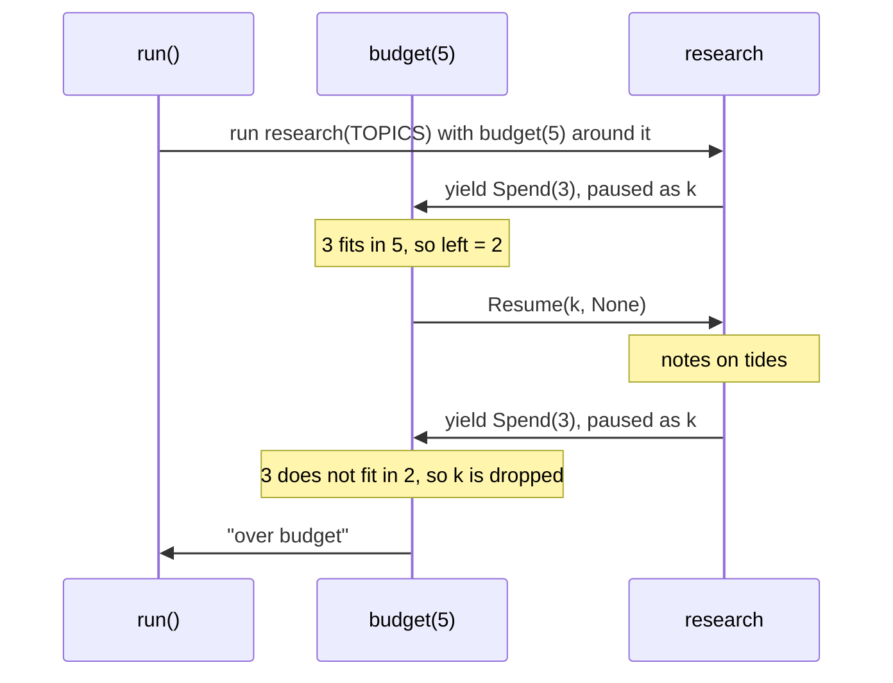
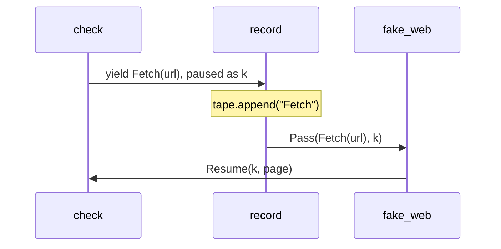
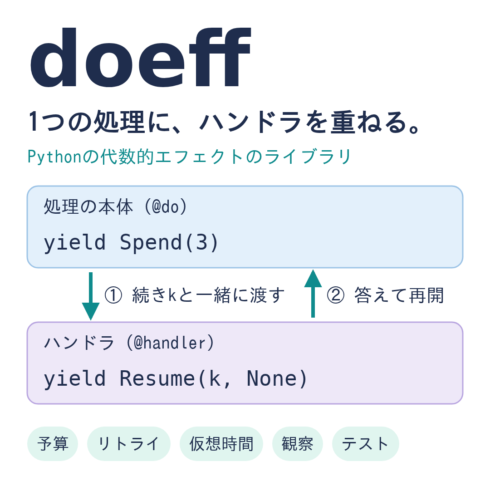
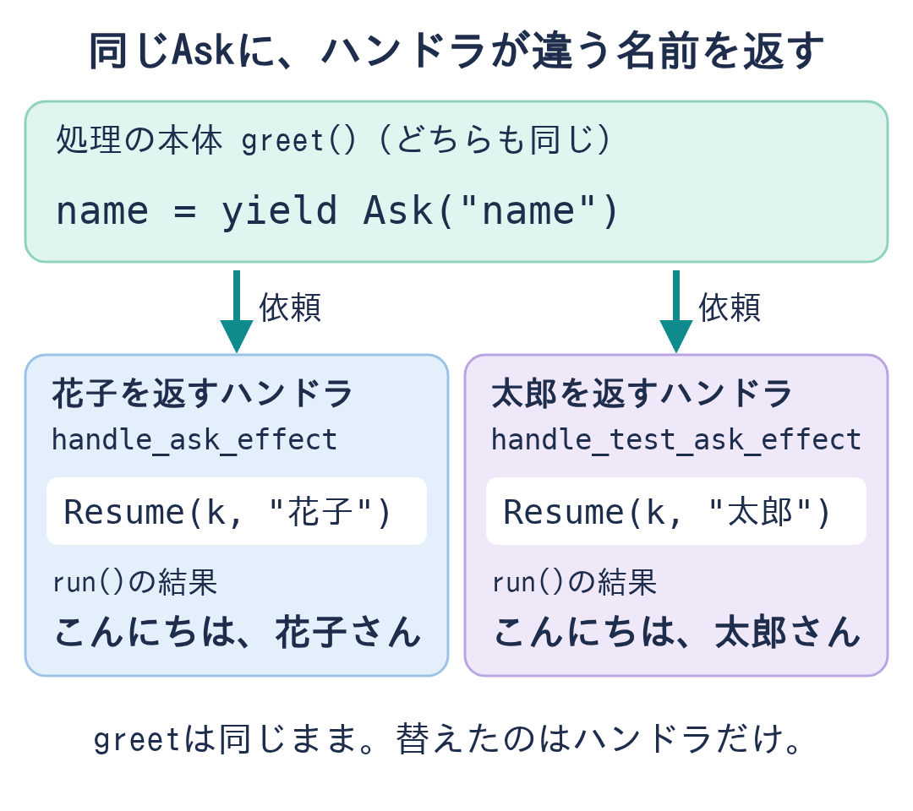
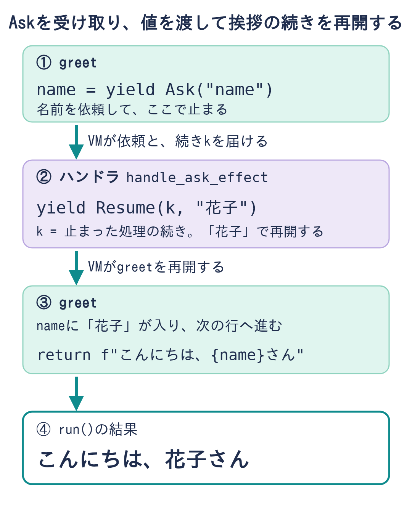
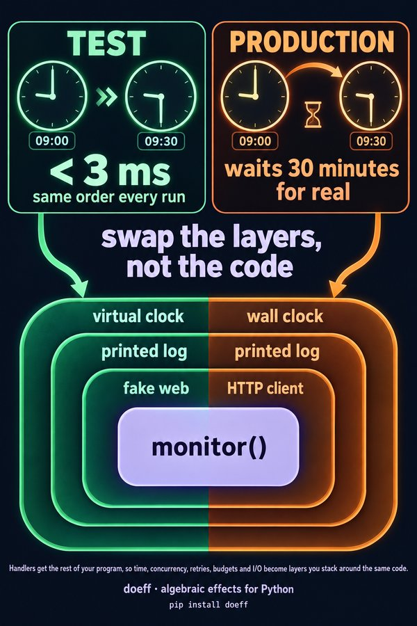

ui: no
# 11 月 2 日の週に出す物 6 つを、最後の版の全文で読んで中身を決める

決めてほしい事: 文ごとに、この最後の版の中身でよいか。推す案は無い。

## 何がどう問題か

- doeff の連載の 1 本目の記事と、それに添える文が、合わせて 6 つあります。
- この書が問うのは、6 つの文の中身だけです。
- 10 月 22 日に、あなたは「どう投稿するか」の書を書ごと返しました。
  - 返した訳:「まだはやい。内容が先。これを持ってくるときには、内容に合意している証拠を依頼書に含めて」[[1]](#参考文献-1)
  - 同じ時の言葉:「まだ、記事が承認できてない。あと、記事内にAIで書いたと書くのは禁止」[[2]](#参考文献-2)
- 10 月 20 日の「この版でよい」は下書きへの答えでした。今の最後の版への答えではありません。
- だから今は、6 つの中身に合意した証拠がありません。
- 証拠が無いと、次の「どう投稿するか」の書を作れません。
- この書の答えが、文ごとの「中身に合意した証拠」になります。答えの後に、証拠の表を作ります。
- 確かめた事:
  - 載せた code は、新しい環境に入れた doeff 0.8.0 と doeff-time 0.1.0 で、本文のとおりに動きます。
  - 6 つのどれにも、AI が書いたと名乗る行はありません。確かめの script が 0 件と出します。
- まだ確かめていない事: 英語を母語とする人は、英語の文を読んでいません。

## 言葉の意味

| 名 | 何か |
|---|---|
| doeff | あなたの Python の library。Python で algebraic effects(関数が頼みを外へ渡し、外の handler が答える仕組み)を使える |
| handler | doeff で、関数が渡した頼みに答える関数。重ねて使う |
| doeff-time | 時刻の頼みと、それに答える handler を集めた doeff の package |
| 「PyPI」 | `pip install` が package を取ってくる所 |
| 「Zenn」 | 日本語の技術記事のサイト。訳はこのサイトの記事の形で書いた |
| 「PyCoder's Weekly」 | Python の話題を毎週届ける英語の newsletter。読み手が記事の link を推薦できる |
| 「r/Python」 | 掲示板のサイト「Reddit」の Python の場。文は月 1 回の showcase の thread の形で書いた |
| 「Show HN」 | 掲示板のサイト「Hacker News」の、作った物を見せる場。題と本文はあなたが書く |
| X | 短い文の SNS(旧 Twitter) |
| branch・commit | git の作業の枝と、その上の 1 つの版。commit は 9 字の印(例 ebfa32f04)で指す |
| wt/week1-final-versions | 文 6 つの最後の版を全部置いた doeff の branch の名 |
| doeff-vm | doeff の頼みを配る Rust の中核の package |
| doeff-core-effects | doeff の基本の頼みと、それに答える参考の handler の package |
| doeff-hy | doeff を Lisp に似た言語 Hy で書くための package |
| 審査する文書 | この書の中で全文を読んでもらう文。画面は見出しと表と code を描いた形で出す |

## 文 6 つと、前の答えからの違い

最後の版は、全部が doeff の branch `wt/week1-final-versions` の commit ebfa32f04 に在ります。

| 文 | 前の答え | この版で変えた事 | 問い |
|---|---|---|---|
| 英語の 1 本目の記事 | 10 月 20 日に ok(下書き) | 頭と結びの、AI が書いたと名乗る 2 行を外した。ほかの行は 10 月 20 日の下書きと同じ | article |
| 「Zenn」の訳 | まだ無い(初めて見せる) | 英語の 1 本目の訳を新しく書いた。AI が書いたと名乗る 2 行を外した | zenn |
| 「PyCoder's Weekly」の推薦の文 | 10 月 20 日に ok | 変えていない | pycoders |
| 「r/Python」の文 | 10 月 20 日に ok | 頭の「Written by an AI agent …」の 1 行を外した | rpython |
| 「X」の 1 本目と返信 | 10 月 25 日に「この組でよい」 | 変えていない | 問わない(前の答えを証拠にする) |
| 「Show HN」の事実の一覧 | 10 月 20 日に ok | 版と数を今の値に直した(下の表)。問いの 1 行の言い方を直した | facts |

- 「X」の組は 10 月 25 日の答えの版と、文も動画も絵も同じです。だから問い直しません。直したい所があれば、どの問いの補足に書いてもかまいません。

## 1. 英語の 1 本目の記事

- 置き場: doeff の docs の page として置く記事です。repo の main にはまだ入れていません。
- 10 月 20 日の下書きと比べて、違う行は 2 行だけです。どちらも AI が書いたと名乗る行で、外しました。
  - 頭の行:「Written by an AI agent that works on doeff for its maintainer …」
  - 結びの行:「An AI agent wrote this post, and every example was run with doeff 0.8.0 …」
- 例の code は「PyPI」の doeff 0.8.0 と doeff-time 0.1.0 で、Python 3.11・3.12・3.14 の全部で本文のとおりに動きました。

<!-- 審査する文書: 英語の 1 本目の記事 -->
# Algebraic effects for Python: stack handlers around one unchanged program

*Algebraic effects for Python: handlers get the rest of your program, so time, concurrency, retries, budgets and I/O become layers you stack around the same code.*

This post is about algebraic effects in Python, with doeff, an open-source library whose core is written in Rust. A function yields effects, operations it names, and a handler receives each one together with the rest of the function and decides how the function goes on.

Any one of those decisions can be had another way: a mock for tests, a fake clock, a retry decorator, a custom event loop. What effects give you is one mechanism for all of them, so you can stack them around the same code and swap any one of them without touching it. This post builds one small program and adds those layers one at a time.

You don't need any theory. If you know what `yield` does, you know most of what you need.

## The idea: an exception a handler can resume

If you know exceptions, think of an effect as an exception that a handler can answer, after which the code carries on from the line that raised it. That is how OCaml 5 introduces its effect handlers ("resumable exceptions"), and Python generators can already pause and resume, so the library supplies the rest: a VM in Rust that finds the handler for each effect and keeps track of the paused code.

- An **effect** is a plain value that names an operation, such as `Spend(3)`, `Fetch(url)` or `Spawn(task)`. It does nothing by itself. You define your own as a class, or use ones that doeff's packages define.
- A **program** is a generator function under `@do`. At each `yield` of an effect it pauses.
- A **handler** is a function of `(effect, k)` marked with `@handler`, which makes it a `@do` function too. It receives the effect together with `k`, the rest of the function, and decides what happens.
- The **caller** picks the handlers, so the same function means different things under different handlers.

| The handler | Written as | The program |
|---|---|---|
| answers and runs the rest | `yield Resume(k, value)` | goes on with `value`; when it finishes, the handler gets its result and returns that or another value |
| answers and is done | `yield Transfer(k, value)` | goes on with `value`; the handler does not get control back |
| throws into it | `yield ResumeThrow(k, error)` | sees `error` raised at the `yield`, where its own `try` can catch it |
| passes the effect on | `yield Pass(effect, k)` | gets the answer of the next handler out |
| keeps it for later | stores `k`, then `yield Transfer(k, value)` while handling a later effect | waits until the handler continues it |
| drops it | `return value`, without resuming `k` | stops at the `yield`; `value` is the result of everything under the handler |

Here is the smallest version. `research` yields one `Spend` per topic and knows nothing about what spending means:

~~~python
# spend.py
from dataclasses import dataclass

from doeff import EffectBase, Resume, Transfer, do, handler, run


@dataclass(frozen=True)
class Spend(EffectBase):  # an effect: "the next step costs this much"
    cost: int


@do
def research(topics: list[str]):  # pauses at each yield; knows nothing about money
    notes = []
    for topic in topics:
        yield Spend(3)
        notes.append(f"notes on {topic}")
    return notes


@handler
def free(effect: Spend, k):  # answer, and let the rest of research run
    yield Transfer(k, None)


@handler
def refuse(effect: Spend, k):  # drop k: research stops at its first Spend
    return "refused"


def budget(limit: int):
    left = limit

    @handler
    def on_spend(effect: Spend, k):
        nonlocal left
        if effect.cost > left:
            return "over budget"  # drop k: research never gets past this Spend
        left -= effect.cost
        return (yield Resume(k, None))  # resume k: research goes on

    return on_spend


TOPICS = ["tides", "moons"]

if __name__ == "__main__":
    print(run(free(research(TOPICS))))
    print(run(refuse(research(TOPICS))))
    print(run(budget(10)(research(TOPICS))))
    print(run(budget(5)(research(TOPICS))))
~~~

~~~text
['notes on tides', 'notes on moons']
refused
['notes on tides', 'notes on moons']
over budget
~~~

`@handler` makes the function under it a `@do` function and a handler, so a handler is always a `@do` function. Like any `@do` function, it hands `Resume(k, None)` to doeff by yielding it, and the `yield` gives back what the rest of `research` returned: `return (yield Resume(k, None))` passes that result on as the handler's own. Called on a program, a handler installs itself around it: `free(research(TOPICS))` is `research(TOPICS)` with `free` installed around it. The annotation `effect: Spend` tells doeff which effects the handler takes.

- `free` answers with `Transfer(k, None)`. `research` runs to the end.
- `refuse` returns without touching `k`. `research` stops at its first `Spend`, and `"refused"` is the result of the whole run.
- `budget(5)` keeps what is left between effects. The first `Spend` costs 3 and the handler resumes `k`. The second finds 2 left, so the handler returns `"over budget"`, and the second topic is never researched.

Here is the run of `budget(5)(research(TOPICS))`, one message at a time:



That is one layer. The rest of this post stacks several around one program.

## One program, layer by layer

`monitor` checks two pages every half hour, one task per page. It yields five kinds of effect: its own `Fetch`, `Spend` and `Log`, `Spawn` and `Gather` from doeff's packages, and `Delay` and `GetTime` from [doeff-time](https://github.com/proboscis/doeff/tree/main/packages/doeff-time), a package of time effects and their handlers. Nothing in it says where a page comes from, what spending means, how long half an hour takes, or where a log line goes:

~~~python
# monitor.py (excerpt)
import asyncio
from dataclasses import dataclass
from datetime import datetime, timezone

from doeff import Await, EffectBase, Gather, Pass, Resume, Spawn, Transfer, do, handler, run
from doeff_core_effects.handlers import await_handler
from doeff_core_effects.scheduler import scheduled
from doeff_time import Delay, GetTime, async_time_handler, sim_time_handler


# The program: two tasks check a page every 30 minutes.
@dataclass(frozen=True)
class Fetch(EffectBase):  # "get this page"
    url: str


@dataclass(frozen=True)
class Spend(EffectBase):  # "the next step costs this much"
    cost: int


@dataclass(frozen=True)
class Log(EffectBase):  # "write this line"
    line: str


@do
def check(url: str, rounds: int):
    sizes = []
    for round_ in range(rounds):
        if round_:
            yield Delay(30 * 60)  # wait half an hour between checks
        yield Spend(1)
        page = yield Fetch(url)
        now = yield GetTime()
        yield Log(f"{now:%H:%M} {url} {len(page)} bytes")
        sizes.append(len(page))
    return sizes


@do
def monitor(urls: list[str], rounds: int):
    tasks = []
    for url in urls:
        tasks.append((yield Spawn(check(url, rounds))))
    return (yield Gather(*tasks))
~~~

Install only `scheduled`, a reference handler for `Spawn` and `Gather`, and it stops at its first `Spend` with `UnhandledEffect`: none of these effects has a meaning until a handler gives it one.

### Layer 1: answers for a test run

~~~python
# monitor.py (excerpt)
# Layers: each one gives one effect its meaning.
PAGES = {"a.example": "<p>up</p>", "b.example": "<p>all good</p>"}


@handler
def fake_web(effect: Fetch, k):  # I/O answered from a dict
    return (yield Resume(k, PAGES[effect.url]))


@handler
def printed(effect: Log, k):  # log lines go to stdout
    print(effect.line)
    return (yield Resume(k, None))


@handler
def free(effect: Spend, k):  # spending costs nothing
    yield Transfer(k, None)


START = datetime(2026, 11, 2, 9, 0, tzinfo=timezone.utc)
URLS = ["a.example", "b.example"]


def simulated(program):  # a virtual clock: 30-minute waits take no time
    return scheduled(sim_time_handler(start_time=START)(program))
~~~

~~~python
print(run(simulated(printed(free(fake_web(monitor(URLS, 2)))))))
~~~

~~~text
09:00 a.example 9 bytes
09:00 b.example 15 bytes
09:30 a.example 9 bytes
09:30 b.example 15 bytes
[[9, 9], [15, 15]]
~~~

Read the stack from the inside out. `fake_web` answers `Fetch` from a dict, `free` answers `Spend`, `printed` answers `Log`, and `simulated` installs two more handlers: `scheduled` for `Spawn` and `Gather`, and doeff-time's `sim_time_handler` for `Delay` and `GetTime`. The half hour between checks takes no time, and the lines of the two tasks come out in time order, the same order on every run.

### Layer 2: a budget

Swap `free` for a budget of three checks:

~~~python
# monitor.py (excerpt)
def budget(limit: int):  # a task that finds the budget spent stops there
    left = limit

    @handler
    def on_spend(effect: Spend, k):
        nonlocal left
        if effect.cost > left:
            return "over budget"
        left -= effect.cost
        return (yield Resume(k, None))

    return on_spend
~~~

~~~python
print(run(simulated(printed(budget(3)(fake_web(monitor(URLS, 2)))))))
~~~

~~~text
09:00 a.example 9 bytes
09:00 b.example 15 bytes
09:30 a.example 9 bytes
[[9, 9], 'over budget']
~~~

Both tasks run under the same `budget(3)`, so it counts their checks together. The fourth `Spend`, the second check of `b.example`, finds nothing left. The handler returns `"over budget"` without resuming `k`, so that task stops there and its result is `"over budget"`, while the other task finishes. `check` has no `if` for any of this.

### Layer 3: failures and retries

Now the first two fetches fail, and a retry layer sits between the program and the web:

~~~python
# monitor.py (excerpt)
class Flaky(Exception):
    pass


def flaky_web(failures: int):  # the first few fetches fail
    left = failures

    @handler
    def on_fetch(effect: Fetch, k):
        nonlocal left
        if left > 0:
            left -= 1
            raise Flaky(f"503 from {effect.url}")
        return (yield Resume(k, PAGES[effect.url]))

    return on_fetch


def retrying(times: int):  # ask the next handler out again on Flaky
    @handler
    def retry(effect: Fetch, k):
        for attempt in range(1, times + 1):
            try:
                page = yield effect
                break
            except Flaky as error:
                if attempt == times:
                    raise
                yield Log(f"retry {attempt}: {error}")
        return (yield Resume(k, page))

    return retry
~~~

~~~python
print(run(simulated(printed(free(flaky_web(2)(retrying(3)(monitor(URLS, 2))))))))
~~~

~~~text
retry 1: 503 from a.example
retry 2: 503 from a.example
09:00 a.example 9 bytes
09:00 b.example 15 bytes
09:30 a.example 9 bytes
09:30 b.example 15 bytes
[[9, 9], [15, 15]]
~~~

Inside a handler, `yield effect` performs the same effect again, and the next handler out answers it. A handler can yield other effects too: `retry` reports each failure with `Log`, which travels out to `printed` like any log line from `check`. An injected object answers a call and returns; a handler also holds `k`, so it decides whether the rest of the function runs, when, and with what.

### Layer 4: watch every effect

~~~python
# monitor.py (excerpt)
def recording(tape: list[str]):  # keep every effect the program yields
    @handler
    def record(effect, k):
        tape.append(type(effect).__name__)
        return (yield Pass(effect, k))

    return record
~~~

~~~python
tape: list[str] = []
run(simulated(printed(free(fake_web(recording(tape)(monitor(URLS, 1)))))))
print(tape)
~~~

~~~text
09:00 a.example 9 bytes
09:00 b.example 15 bytes
['Spawn', 'Spend', 'Fetch', 'GetTimeEffect', 'Log', 'Spawn', 'Spend', 'Fetch', 'GetTimeEffect', 'Log', 'Gather']
~~~

`record` has no annotation, so it receives every effect that reaches it, writes down its type, and passes it out with `Pass`. The first `Fetch` travels like this:



A handler only sees the effects that reach it: if a handler closer to the program answers an effect first, the outer one never sees it. The same shape records answers instead of names: `examples/testing_without_mocks/record_replay.py` records a language model's answers once and replays them in tests, with no model call at all.

### Layer 5: the wall clock and real I/O

~~~python
# monitor.py (excerpt)
async def slow_get(url: str) -> str:  # stand-in for an async HTTP client
    await asyncio.sleep(0.01)
    return PAGES[url]


@handler
def http_web(effect: Fetch, k):  # I/O over an async client
    page = yield Await(slow_get(effect.url))
    return (yield Resume(k, page))


def real(program):  # the wall clock, waiting on asyncio
    return scheduled(await_handler()(async_time_handler()(program)))
~~~

~~~python
run(real(printed(free(http_web(retrying(3)(monitor(URLS, 2)))))))
~~~

This is the same `monitor` on the wall clock, so this run really takes half an hour. doeff-time's `async_time_handler` waits on `asyncio`, and `http_web` yields `Await` with the coroutine of an async client, which `await_handler` answers. Only `slow_get` is `async`, so `async` does not spread up into `check` or `monitor`.

### The stacks side by side

| Run | Layers around `monitor`, from the inside out | What changes |
|---|---|---|
| test | `fake_web`, `free`, `printed`, `simulated` | pages from a dict, half an hour in no time, the same order every run |
| budgeted | `budget(3)` in place of `free` | the task that finds the budget spent stops there |
| flaky | `retrying(3)` and `flaky_web(2)` in place of `fake_web` | failures are retried and logged |
| watched | `recording(tape)` added inside `fake_web` | every effect is kept, in order |
| production | `retrying(3)` and `http_web` in place of `fake_web`, `real` in place of `simulated` | the wall clock and an async client |

`monitor` is the same function in every row. A mock, a fake clock or a custom event loop gives you one of these rows. Here each row is a stack of handlers a few lines long, and swapping one layer does not touch the others.

## One mechanism under all of it

doeff's packages define `Spawn`, `Gather`, `Wait`, `Race` and `Cancel` as effects, and `scheduled` is a reference handler for them, written like `budget`. It keeps the `k` of each waiting task, as in the table above, and transfers to it when the task can go on. Any handler can answer these effects instead. That is why the clock can be a handler: `sim_time_handler` moves its clock only when every task is waiting, jumps to the earliest wake-up and resumes that task. It reaches the scheduler only through effects any program can yield, and the docs chapter [Why Effects?](https://github.com/proboscis/doeff/blob/main/docs/20-why-effects-over-di.md#virtual-time-hours-of-waiting-in-an-instant) builds a clock like it in about 30 lines.

The effects that doeff's packages define work the same way as `Fetch` and `Spend`. Each has a reference handler, and you can install your own instead:

| What | The program yields | A reference handler |
|---|---|---|
| State | `n = yield Get("fetched")` and `yield Put("fetched", n + 1)` | `state()` keeps a dict and resumes `k` with the value |
| Exceptions | `result = yield Try(size(url))` gives `Ok(value)` or `Err(error)` | `try_handler`; any handler can also throw into the program with `ResumeThrow(k, error)` |
| Concurrency | `task = yield Spawn(check(url))`, then `yield Gather(*tasks)` | `scheduled()` keeps the `k` of each waiting task |
| Observation | `value, log = yield Listen(program)` | `listen_handler` collects the `Tell` lines of `program` |
| I/O | `page = yield Fetch(url)` | a handler of your own, or a reference one: files, SQL and processes with `doeff[hy]`, HTTP with `doeff[http]` |

This shape suits trading programs, simulations and backtests: the same program can run over recorded market events, with a simulated clock and paper orders, and live, with the wall clock and an exchange. Only the handlers for time, market data and orders differ.

## Tests are one of the stacks

Layer 1 above is a test. It is also the use most people meet first. Many Python test suites have a `mock.patch` that nobody wants to touch: it finds its target by a string, so moving an import can make it miss, and when it is missing the test can still pass while the real thing runs. With effects, a test installs handlers instead:

~~~python
# welcome.py
from dataclasses import dataclass

from doeff import EffectBase, do


@dataclass(frozen=True)
class LoadUser(EffectBase):
    user_id: int


@dataclass(frozen=True)
class SendMail(EffectBase):
    to: str
    body: str


@do
def welcome(user_id: int):
    user = yield LoadUser(user_id)
    body = f"Welcome, {user.name}!"
    yield SendMail(user.email, body)
    return body
~~~

~~~python
# test_welcome.py
from doeff import Resume, handler, run

from infra import User
from welcome import LoadUser, SendMail, welcome


@handler
def fake_load_user(effect: LoadUser, k):
    return (yield Resume(k, User("Ada", "ada@example.com")))


def test_welcome():
    sent = []

    @handler
    def fake_send_mail(effect: SendMail, k):
        sent.append((effect.to, effect.body))
        return (yield Resume(k, None))

    assert run(fake_send_mail(fake_load_user(welcome(1)))) == "Welcome, Ada!"
    assert sent == [("ada@example.com", "Welcome, Ada!")]
~~~

Nothing is patched, and there is no string to keep in sync with your imports. The fakes are handlers like the layers above, with `@handler` on each, stacked around `welcome(1)` the same way. Now forget one of them:

~~~python
run(fake_load_user(welcome(1)))
~~~

~~~text
doeff Traceback (most recent call last):

  welcome()  welcome.py:22
    yield SendMail(user.email, body)
    handlers:
      fake_load_user ↗

UnhandledEffect: no handler found for effect: SendMail (SendMail(to='ada@example.com', body='Welcome, Ada!'))
  handlers in scope (innermost→outermost): fake_load_user
  skipped by annotation: fake_load_user (effect: LoadUser) — a handler only sees the effects its effect parameter is annotated with
  hint: install a handler for SendMail: run(fn(prog)), where fn is a def (effect: SendMail, k) marked with @handler that returns (yield Resume(k, value))
~~~

The run stops at the `yield` that nobody answered, and nothing real was called. Before Python's own traceback, doeff prints that `yield`, the handlers that were in scope, and why each one let the effect pass. The complete files, with the `mock.patch` version and its two failure modes side by side, are in [examples/testing_without_mocks](https://github.com/proboscis/doeff/tree/main/examples/testing_without_mocks).

## Where doeff sits

For a comparison, the same three small tasks were written five ways: the welcome email, a bank balance with a log, and three concurrent fetches. Lines were counted without blanks, comments or imports, and each test left out one replacement at a time to see what happens.

| | Plain Python | effect | effectful | doeff |
|---|---|---|---|---|
| What a handler receives | — (a callee returns or raises) | the intent | the operation's arguments | the effect and its continuation `k` |
| Lines for all three tasks | 53 | 97 | 70 | 88 |
| An effect nobody handles | Arguments: usually an error. `mock.patch`: the real code runs | Error | Wrong value or silent pass | Error, when handlers are annotated |
| State, log and concurrency built in | No | Concurrency via thread pool | No (use `asyncio`) | Yes |
| Latest release | — | 2019 | 2026 | 2026 |

Plain Python is the shortest and the easiest to read. effectful keeps your functions completely ordinary, which is a real advantage. doeff costs you `yield` and `@do` in the business code and more names to learn. In return, a handler holds the rest of the program, a missing handler is an error, one handler can wrap a whole program, and handlers stay per task under concurrency. In one test, two `asyncio` tasks each installed their own effectful handler, waited, and woke up in the order they had started. After the wait, the first task got the second task's answer, and the second got an unevaluated term. The same test with doeff kept them apart. This only matters if you install handlers inside tasks; installed once around `asyncio.run`, effectful behaves.

`returns`, a popular functional library with about 4.4K GitHub stars, gives you typed containers such as `Result`, but no handlers that resume your code, so it does not fit this comparison.

Outside Python, the closest is OCaml 5. Its handlers also receive the continuation, a continuation can be resumed only once, and effects are not in the types. Koka goes further on both:

| | Resume more than once | Effects in the types |
|---|---|---|
| OCaml 5 | No: a second resume raises `Continuation_already_resumed` | No: an unhandled effect raises `Effect.Unhandled` when it is performed |
| Koka | Yes: `resume` can be called more than once, for backtracking and probabilistic programming | Yes: the compiler infers the effects of every function |
| doeff | No: a second `Resume` raises `RuntimeError` | No: a missing handler is an `UnhandledEffect` when the program runs |

## What it costs

Every effect travels out to a handler and back. The benchmark in doeff's README measures the CPU time of one round trip, with 50 samples of each case, on a shared Intel i9-7980XE under Linux with CPython 3.14.7.

| One effect round trip | µs per effect (median) |
|---|---:|
| Plain Python function call | 0.13 |
| doeff, a `@handler` with `Resume` | 4.3 |
| effect 1.1.0 | 12.7 |
| effectful 0.4.0 | 57.9 |

For many small tasks, `scheduled`, which runs in Rust by default since 0.7.0, costs about 17 µs per spawned task, against about 11 µs for `asyncio`.

A few microseconds is noise next to a database query or an HTTP request. It is not noise inside a tight numeric loop. Keep tight numeric loops in plain Python and yield effects around them.

The script is `benchmarks/compare_libraries.py` in the repository, and the README's [Performance](https://github.com/proboscis/doeff#performance) section lists every case and how it was measured, if you want numbers from your own machine.

## Limits

- doeff is 0.x. The API changed between 0.4 and 0.5. Since 0.6, `pip install doeff` installs only the core; the Hy language and the handlers written in it come with `pip install "doeff[hy]"`.
- Continuations are one-shot. A handler can resume the paused code once, so tricks that resume twice, such as backtracking search, are out. Nondeterministic choice is out too; run the whole program again once per choice instead.
- Effects are not in the types. The type checker does not check that the installed handlers answer every effect a program yields; a missing handler shows up as `UnhandledEffect` when the program runs.
- Only the body of a `@do` function can perform an effect. A plain function it calls cannot, so as with `async`, `@do` spreads to the callers.
- `yield` is not allowed inside a list comprehension, so a loop that performs effects becomes a `for` loop.
- A handler without an annotation receives every effect. A fake without one can quietly answer effects that were meant for another handler.

## Try it

~~~bash
pip install doeff doeff-time   # CPython 3.11 to 3.14; prebuilt wheels for Linux, macOS and Windows
python -m doeff demo
~~~

[What doeff Is](https://github.com/proboscis/doeff/blob/main/docs/positioning/what-doeff-is.md) defines the mechanism, its uses and its limits. Every example in this post runs as shown with doeff 0.8.0 and doeff-time. The complete files are in [examples/effects_tour](https://github.com/proboscis/doeff/tree/main/examples/effects_tour) and, for the tests, [examples/testing_without_mocks](https://github.com/proboscis/doeff/tree/main/examples/testing_without_mocks). The docs chapter [Why Effects?](https://github.com/proboscis/doeff/blob/main/docs/20-why-effects-over-di.md) compares effects with dependency injection and plain `async` at more length.

Where does this break down for you: code where the `yield` style gets in the way, or a case where a plain argument would have been simpler? Issues are open at https://github.com/proboscis/doeff/issues.
<!-- 審査する文書: 終わり -->

| 案 | 選ぶと起きる事 | 戻し方 |
|---|---|---|
| ok | この版を記事の中身として決める | 次の版で直せる |
| fix | 注釈か補足に書いた所を直し、次の版で見せる | 次の版で直せる |

```選択肢 article
問い: 英語の 1 本目の記事は、この版の中身でよいか
- ok: この版でよい
- fix: 直す所がある(注釈か補足に書いてください)
補足: あり
```

## 2.「Zenn」の訳(日本語の 1 本目)

- 英語の 1 本目を日本語に訳した記事です。あなたに見せるのは初めてです。
- 英語と同じ軸・事実・例を持ちます。code の行には全部、日本語の註を付けました。連載の決まりです。
- 「Zenn」の記事だけが持つ部分を残しました。困りごとから選ぶ入口の表・連載 10 本の一覧・次の回への link です。
- 英語の版から外した 2 行と同じ、AI が書いたと名乗る 2 行を外しました。
- 確かめた事:
  - code の囲み 22 個は、註を除くと英語の版と同じです。
  - 実行の印字 8 個は本文のとおりです。
  -「PyPI」の doeff 0.8.0 で、Python 3.11・3.12・3.14 の全部で動きました。
- 「Zenn」には、まだ置いていません。
- 絵 3 枚は記事に入る物です。字の正確さは測っていません。

<!-- 審査する文書: Zenn の訳 -->
Zenn の記事の頭の欄(front matter):

| 欄 | 値 |
|---|---|
| title | "Pythonの代数的エフェクトで、変えない処理にハンドラを重ねる" |
| emoji | "🔁" |
| type | "tech" |
| topics | ["python", "doeff", "algebraiceffects", "設計"] |
| published | false |



## doeffとは？

Pythonの代数的エフェクト(algebraic effects)を、[doeff](https://github.com/proboscis/doeff)で紹介します。doeffは、中核をRustで書いたオープンソースのライブラリです。関数はエフェクト、つまり名前を付けた操作を`yield`します。ハンドラは、そのエフェクトを関数の残りの部分と一緒に受け取り、関数をどう進めるかを決めます。

その決めごとの1つ1つは、別の方法でも手に入ります。テストのモック、偽の時計、リトライのデコレータ、自作のイベントループです。エフェクトは、そのすべてを1つの仕組みで扱えるようにします。だから同じコードの周りにいくつも重ねられ、コードに触れずにどれか1つを入れ替えられます。ここでは小さなプログラムを1つ作り、その周りに層を1つずつ足していきます。

理論は要りません。`yield`が何をするかを知っていれば、必要なことの大半はもう分かっています。

## 考え方:ハンドラが再開できる例外

例外を知っているなら、エフェクトは「ハンドラが答えられる例外」だと考えてください。答えた後、コードは例外を投げた行から続きます。OCaml 5も、エフェクトハンドラを「再開できる例外」として紹介しています。Pythonのジェネレータは元から止まったり再開したりできるので、残りはライブラリが補います。エフェクトごとにハンドラを探し、止まったコードを覚えておくRustのVMです。

- **エフェクト**は、`Spend(3)`・`Fetch(url)`・`Spawn(task)`のように、操作に名前を付けたただの値です。それ自体は何もしません。自分でクラスとして定義することも、doeffのパッケージが定義した物を使うこともできます。
- **プログラム**は、`@do`を付けたジェネレータ関数です。エフェクトを`yield`するたびに止まります。
- **ハンドラ**は、`@handler`を付けた`(effect, k)`の関数です。`@handler`で、ハンドラは`@do`の関数にもなります。エフェクトと、関数の残り(継続)である`k`を一緒に受け取り、何が起きるかを決めます。
- どのハンドラを付けるかは、**呼び出す側**が選びます。だから同じ関数が、ハンドラごとに違う意味になります。

| ハンドラが | 書き方 | プログラムは |
|---|---|---|
| 答えて、残りを走らせる | `yield Resume(k, value)` | `value`を受け取って進み、終わるとハンドラがその結果を受け取って、そのままか別の値を返す |
| 答えて、手を離す | `yield Transfer(k, value)` | `value`を受け取って進み、ハンドラに制御は戻らない |
| 例外を投げ込む | `yield ResumeThrow(k, error)` | `yield`の所で`error`が起き、自分の`try`で捕まえられる |
| エフェクトを外へ渡す | `yield Pass(effect, k)` | 1つ外のハンドラの答えを受け取る |
| 後のために取っておく | `k`をしまい、後のエフェクトを扱う時に`yield Transfer(k, value)` | ハンドラが続きを走らせるまで待つ |
| 捨てる | `k`を再開せずに`return value` | `yield`で止まったままで、`value`がそのハンドラの下の全体の結果になる |

いちばん小さな形です。`research`は話題ごとに`Spend`を1つ`yield`し、お金を使うとはどういうことかを何も知りません。

```python
# spend.py
from dataclasses import dataclass  # エフェクトを、値を持つクラスとして書く。

from doeff import EffectBase, Resume, Transfer, do, handler, run  # エフェクトの基底・再開・手放し・定義・実行を使う。


@dataclass(frozen=True)  # 変わらない値にする。
class Spend(EffectBase):  # エフェクト:「次の一歩にこれだけかかる」。
    cost: int  # かかる額。


@do  # researchを、yieldのたびに止まるプログラムにする。
def research(topics: list[str]):  # yieldのたびに止まる。お金のことは何も知らない。
    notes = []  # 調べたメモをためる。
    for topic in topics:  # 話題を1つずつ調べる。
        yield Spend(3)  # 1つの話題に3かかると告げ、ハンドラの答えを待つ。
        notes.append(f"notes on {topic}")  # 再開されたら、その話題のメモを足す。
    return notes  # 全部の話題を調べたら、メモの一覧を返す。


@handler  # Spendを受けるハンドラにする。
def free(effect: Spend, k):  # 答えて、researchの残りを走らせる。
    yield Transfer(k, None)  # 続きkへ制御を渡し、ハンドラには戻らない。


@handler  # Spendを受けるハンドラにする。
def refuse(effect: Spend, k):  # kを捨てる。researchは最初のSpendで止まる。
    return "refused"  # kを再開せず、この値を全体の結果にする。


def budget(limit: int):  # 上限limitの予算のハンドラを作る。
    left = limit  # 残りの額を、エフェクトの間で覚えておく。

    @handler  # Spendを受けるハンドラにする。
    def on_spend(effect: Spend, k):  # Spendが届くたびに呼ばれる。
        nonlocal left  # 外側の残りの額を書き換える。
        if effect.cost > left:  # 残りで足りなければ、
            return "over budget"  # kを捨てる。researchはこのSpendから先へ進まない。
        left -= effect.cost  # 足りれば、残りから引く。
        return (yield Resume(k, None))  # kを再開する。researchが進み、その結果をそのまま返す。

    return on_spend  # 作ったハンドラを返す。


TOPICS = ["tides", "moons"]  # 調べる話題は2つ。

if __name__ == "__main__":  # ファイルとして走らせた時に、4通りの結果を表示する。
    print(run(free(research(TOPICS))))  # 2つとも調べ終える。
    print(run(refuse(research(TOPICS))))  # 最初のSpendで止まり、refusedになる。
    print(run(budget(10)(research(TOPICS))))  # 予算10なら、2つとも調べ終える。
    print(run(budget(5)(research(TOPICS))))  # 予算5なら、2つ目の話題でover budgetになる。
```

```text
['notes on tides', 'notes on moons']
refused
['notes on tides', 'notes on moons']
over budget
```

`@handler`は、その下の関数を`@do`の関数にし、ハンドラにもします。だからハンドラは、いつも`@do`の関数です。ほかの`@do`の関数と同じく、ハンドラは`Resume(k, None)`を`yield`してdoeffへ渡します。その`yield`は、`research`の残りが返した値を返します。`return (yield Resume(k, None))`は、その結果をハンドラ自身の結果として渡す書き方です。ハンドラをプログラムに対して呼ぶと、ハンドラはそのプログラムの周りに付きます。`free(research(TOPICS))`は、周りに`free`を付けた`research(TOPICS)`です。注釈`effect: Spend`は、ハンドラがどのエフェクトを受けるかをdoeffに伝えます。

- `free`は`Transfer(k, None)`で答えます。`research`は最後まで走ります。
- `refuse`は`k`に触れずに返ります。`research`は最初の`Spend`で止まり、`"refused"`が実行全体の結果になります。
- `budget(5)`は、残りの額をエフェクトの間で覚えています。1回目の`Spend`は3かかり、ハンドラは`k`を再開します。2回目は残りが2なので、ハンドラは`"over budget"`を返し、2つ目の話題は調べられません。

`budget(5)(research(TOPICS))`の実行を、やりとり1つずつ追うと次のようになります。



1回目の`Spend(3)`は、残りの5に収まります。`budget`は`Resume`で`research`を再開し、tidesのメモができます。2回目の`Spend(3)`は、残りの2に収まりません。`budget`は続きの`k`を捨て、`"over budget"`が`run()`の結果になります。

これで層が1枚です。この先は、1つのプログラムの周りに層を何枚も重ねます。

## 1つのプログラムに、層を1枚ずつ

`monitor`は、2つのページを30分ごとに確かめます。ページ1つに、タスクが1つです。`yield`するエフェクトは7種類あります。自分で定義したのは`Fetch`・`Spend`・`Log`です。`Spawn`と`Gather`はdoeffのパッケージの物です。`Delay`と`GetTime`は[doeff-time](https://github.com/proboscis/doeff/tree/main/packages/doeff-time)の物です。doeff-timeは、時間のエフェクトとそのハンドラを集めたパッケージです。ページをどこから取るのか、お金を使うとは何かは、どこにも書いていません。30分にどれだけかかるのか、ログの行がどこへ行くのかも書いていません。

```python
# monitor.py(抜粋)
import asyncio  # 実時間の層で、非同期のHTTPの代わりに使う。
from dataclasses import dataclass  # エフェクトを、値を持つクラスとして書く。
from datetime import datetime, timezone  # 仮想の時計の始まりの刻を作る。

from doeff import Await, EffectBase, Gather, Pass, Resume, Spawn, Transfer, do, handler, run  # doeffの中核の名前を使う。
from doeff_core_effects.handlers import await_handler  # Awaitに答える参考のハンドラ。
from doeff_core_effects.scheduler import scheduled  # SpawnとGatherに答える参考のハンドラ。
from doeff_time import Delay, GetTime, async_time_handler, sim_time_handler  # 時間のエフェクトと、実時間・仮想時間のハンドラ。


# プログラム:2つのタスクが、30分ごとにページを1つ確かめる。
@dataclass(frozen=True)  # 変わらない値にする。
class Fetch(EffectBase):  # 「このページを取って」。
    url: str  # 取るページ。


@dataclass(frozen=True)  # 変わらない値にする。
class Spend(EffectBase):  # 「次の一歩にこれだけかかる」。
    cost: int  # かかる額。


@dataclass(frozen=True)  # 変わらない値にする。
class Log(EffectBase):  # 「この行を書いて」。
    line: str  # 書く行。


@do  # checkを、yieldのたびに止まるプログラムにする。
def check(url: str, rounds: int):  # 1つのページを、rounds回確かめる。
    sizes = []  # 取ったページの大きさをためる。
    for round_ in range(rounds):  # 1回ずつ確かめる。
        if round_:  # 2回目からは、
            yield Delay(30 * 60)  # 確かめる間に30分待つ。
        yield Spend(1)  # 1回の確かめに1かかると告げる。
        page = yield Fetch(url)  # ページを取ってもらう。
        now = yield GetTime()  # 今の刻を聞く。
        yield Log(f"{now:%H:%M} {url} {len(page)} bytes")  # 刻・ページ・大きさの行を書いてもらう。
        sizes.append(len(page))  # 大きさを覚える。
    return sizes  # 確かめた回の大きさの一覧を返す。


@do  # monitorを、yieldのたびに止まるプログラムにする。
def monitor(urls: list[str], rounds: int):  # ページごとにタスクを1つ起こし、全部を待つ。
    tasks = []  # 起こしたタスクをためる。
    for url in urls:  # ページごとに、
        tasks.append((yield Spawn(check(url, rounds))))  # checkをタスクとして起こす。
    return (yield Gather(*tasks))  # 全部のタスクの結果を、起こした順に待つ。
```

`scheduled`は、`Spawn`と`Gather`に答える参考のハンドラです。これだけを付けると、最初の`Spend`で`UnhandledEffect`になって止まります。どのエフェクトも、ハンドラが意味を与えるまでは意味を持ちません。

### 1枚目:テストの実行のための答え

```python
# monitor.py(抜粋)
# 層:1枚ごとに、1つのエフェクトに意味を与える。
PAGES = {"a.example": "<p>up</p>", "b.example": "<p>all good</p>"}  # テストで返すページ。


@handler  # Fetchを受けるハンドラにする。
def fake_web(effect: Fetch, k):  # I/Oに、辞書から答える。
    return (yield Resume(k, PAGES[effect.url]))  # 辞書のページを渡して再開する。


@handler  # Logを受けるハンドラにする。
def printed(effect: Log, k):  # ログの行を標準出力へ出す。
    print(effect.line)  # 行を表示する。
    return (yield Resume(k, None))  # 再開する。


@handler  # Spendを受けるハンドラにする。
def free(effect: Spend, k):  # お金はかからない。
    yield Transfer(k, None)  # 続きkへ制御を渡し、ハンドラには戻らない。


START = datetime(2026, 11, 2, 9, 0, tzinfo=timezone.utc)  # 仮想の時計の始まりは9:00。
URLS = ["a.example", "b.example"]  # 確かめるページは2つ。


def simulated(program):  # 仮想の時計。30分の待ちに時間がかからない。
    return scheduled(sim_time_handler(start_time=START)(program))  # 仮想時間とタスクのハンドラを付ける。
```

```python
print(run(simulated(printed(free(fake_web(monitor(URLS, 2)))))))  # テストの層を重ね、2回ずつ確かめる。
```

```text
09:00 a.example 9 bytes
09:00 b.example 15 bytes
09:30 a.example 9 bytes
09:30 b.example 15 bytes
[[9, 9], [15, 15]]
```

重ねたハンドラは、内側から読みます。`fake_web`が`Fetch`に辞書から答え、`free`が`Spend`に、`printed`が`Log`に答えます。`simulated`はハンドラを2つ付けます。1つは`Spawn`と`Gather`に答える`scheduled`です。もう1つは、`Delay`と`GetTime`に答えるdoeff-timeの`sim_time_handler`です。確かめる間の30分には時間がかからず、2つのタスクの行は刻の順に出ます。何度走らせても同じ順です。

### 2枚目:予算

`free`を、3回分の予算に入れ替えます。

```python
# monitor.py(抜粋)
def budget(limit: int):  # 予算を使い切ったタスクは、そこで止まる。
    left = limit  # 残りの額を、エフェクトの間で覚えておく。

    @handler  # Spendを受けるハンドラにする。
    def on_spend(effect: Spend, k):  # Spendが届くたびに呼ばれる。
        nonlocal left  # 外側の残りの額を書き換える。
        if effect.cost > left:  # 残りで足りなければ、
            return "over budget"  # kを捨て、そのタスクの結果にする。
        left -= effect.cost  # 足りれば、残りから引く。
        return (yield Resume(k, None))  # 再開する。

    return on_spend  # 作ったハンドラを返す。
```

```python
print(run(simulated(printed(budget(3)(fake_web(monitor(URLS, 2)))))))  # freeを3回分の予算に替える。
```

```text
09:00 a.example 9 bytes
09:00 b.example 15 bytes
09:30 a.example 9 bytes
[[9, 9], 'over budget']
```

2つのタスクは同じ`budget(3)`の下で走るので、予算は2つの確かめを合わせて数えます。4回目の`Spend`、つまり`b.example`の2回目の確かめで、残りが無くなります。ハンドラは`k`を再開せずに`"over budget"`を返します。だからそのタスクはそこで止まり、結果が`"over budget"`になります。もう1つのタスクは最後まで走ります。`check`には、このための`if`が1つもありません。

### 3枚目:失敗とリトライ

今度は最初の2回の取得が失敗します。プログラムとWebの間に、リトライの層を挟みます。

```python
# monitor.py(抜粋)
class Flaky(Exception):  # 一時的な失敗。
    pass  # 中身は要らない。


def flaky_web(failures: int):  # 最初の何回かの取得が失敗する。
    left = failures  # 残りの失敗の回数を覚えておく。

    @handler  # Fetchを受けるハンドラにする。
    def on_fetch(effect: Fetch, k):  # Fetchが届くたびに呼ばれる。
        nonlocal left  # 外側の回数を書き換える。
        if left > 0:  # 失敗の回数が残っていれば、
            left -= 1  # 1回減らし、
            raise Flaky(f"503 from {effect.url}")  # 503で失敗する。
        return (yield Resume(k, PAGES[effect.url]))  # 残っていなければ、ページを渡して再開する。

    return on_fetch  # 作ったハンドラを返す。


def retrying(times: int):  # Flakyなら、1つ外のハンドラにもう一度頼む。
    @handler  # Fetchを受けるハンドラにする。
    def retry(effect: Fetch, k):  # Fetchが届くたびに呼ばれる。
        for attempt in range(1, times + 1):  # 最大times回試す。
            try:  # 失敗を捕まえる。
                page = yield effect  # 同じFetchを、1つ外のハンドラに頼む。
                break  # 取れたら抜ける。
            except Flaky as error:  # 一時的な失敗なら、
                if attempt == times:  # 最後の回なら、
                    raise  # 失敗をそのまま外へ出す。
                yield Log(f"retry {attempt}: {error}")  # 失敗をLogで知らせ、もう一度試す。
        return (yield Resume(k, page))  # 取れたページを渡して再開する。

    return retry  # 作ったハンドラを返す。
```

```python
print(run(simulated(printed(free(flaky_web(2)(retrying(3)(monitor(URLS, 2))))))))  # 失敗するWebとリトライを重ねる。
```

```text
retry 1: 503 from a.example
retry 2: 503 from a.example
09:00 a.example 9 bytes
09:00 b.example 15 bytes
09:30 a.example 9 bytes
09:30 b.example 15 bytes
[[9, 9], [15, 15]]
```

ハンドラの中で`yield effect`と書くと、同じエフェクトをもう一度起こし、1つ外のハンドラがそれに答えます。ハンドラはほかのエフェクトも`yield`できます。`retry`は失敗のたびに`Log`で知らせ、その行は`check`のログの行と同じく外の`printed`まで届きます。注入したオブジェクトは、呼ばれたら答えて返るだけです。ハンドラはそれに加えて`k`を持つので、関数の残りを走らせるか、いつ走らせるか、何を渡すかを決められます。

### 4枚目:すべてのエフェクトを見る

```python
# monitor.py(抜粋)
def recording(tape: list[str]):  # プログラムがyieldしたエフェクトを全部残す。
    @handler  # 注釈が無いので、届いたエフェクトを全部受ける。
    def record(effect, k):  # エフェクトが届くたびに呼ばれる。
        tape.append(type(effect).__name__)  # エフェクトの型の名を書き留める。
        return (yield Pass(effect, k))  # 答えずに、外のハンドラへ渡す。

    return record  # 作ったハンドラを返す。
```

```python
tape: list[str] = []  # 書き留める先。
run(simulated(printed(free(fake_web(recording(tape)(monitor(URLS, 1)))))))  # fake_webの内側にrecordingを足し、1回ずつ確かめる。
print(tape)  # 書き留めたエフェクトの名を、順に表示する。
```

```text
09:00 a.example 9 bytes
09:00 b.example 15 bytes
['Spawn', 'Spend', 'Fetch', 'GetTimeEffect', 'Log', 'Spawn', 'Spend', 'Fetch', 'GetTimeEffect', 'Log', 'Gather']
```

`record`には注釈が無いので、届いたエフェクトを全部受け取ります。型の名を書き留め、`Pass`で外へ渡します。最初の`Fetch`は、次のように進みます。



`check`が`Fetch(url)`を`yield`して止まると、まず内側の`record`に届きます。`record`は名を書き留めて`Pass`で外へ渡し、`fake_web`がページを渡して`check`を再開します。

ハンドラに見えるのは、そこまで届いたエフェクトだけです。プログラムに近いハンドラが先に答えると、外のハンドラには届きません。同じ形で、エフェクトの名の代わりに答えを記録することもできます。例は`examples/testing_without_mocks/record_replay.py`です。言語モデルの答えを一度だけ記録し、テストではそれを再生します。テストではモデルを一度も呼びません。

### 5枚目:実時間と本物のI/O

```python
# monitor.py(抜粋)
async def slow_get(url: str) -> str:  # 非同期のHTTPクライアントの代わり。
    await asyncio.sleep(0.01)  # 通信の待ちの代わりに、少し眠る。
    return PAGES[url]  # ページを返す。


@handler  # Fetchを受けるハンドラにする。
def http_web(effect: Fetch, k):  # I/Oを、非同期のクライアントで行う。
    page = yield Await(slow_get(effect.url))  # クライアントのcoroutineを、Awaitで待ってもらう。
    return (yield Resume(k, page))  # 取れたページを渡して再開する。


def real(program):  # 実時間の時計。asyncioで待つ。
    return scheduled(await_handler()(async_time_handler()(program)))  # 実時間・Await・タスクのハンドラを付ける。
```

```python
run(real(printed(free(http_web(retrying(3)(monitor(URLS, 2)))))))  # 本番の層を重ねる。実際に30分かかる。
```

実時間の時計で動く、同じ`monitor`です。だからこの実行には本当に30分かかります。doeff-timeの`async_time_handler`は`asyncio`で待ちます。`http_web`は、非同期のクライアントのcoroutineを`Await`で`yield`します。それに答えるのは`await_handler`です。`async`なのは`slow_get`だけなので、`async`が`check`や`monitor`へ広がりません。

### 重ねた層を並べる

| 実行 | `monitor`の周りの層(内側から) | 何が変わるか |
|---|---|---|
| テスト | `fake_web`・`free`・`printed`・`simulated` | ページは辞書から、30分は一瞬で、毎回同じ順 |
| 予算つき | `free`の代わりに`budget(3)` | 予算を使い切ったタスクは、そこで止まる |
| 不安定 | `fake_web`の代わりに`retrying(3)`と`flaky_web(2)` | 失敗はリトライされ、ログに残る |
| 観察 | `fake_web`の内側に`recording(tape)`を足す | すべてのエフェクトが、順に残る |
| 本番 | `fake_web`の代わりに`retrying(3)`と`http_web`、`simulated`の代わりに`real` | 実時間の時計と、非同期のクライアント |

どの行でも、`monitor`は同じ関数です。モック、偽の時計、自作のイベントループは、このうちの1行をくれます。ここでは、どの行も数行のハンドラを重ねた物で、1枚を入れ替えてもほかの層には触れません。

## すべての下にある1つの仕組み

doeffのパッケージは、`Spawn`・`Gather`・`Wait`・`Race`・`Cancel`をエフェクトとして定義しています。`scheduled`はそれらに答える参考のハンドラで、`budget`と同じように書かれています。上の表のとおり、待っているタスクごとに`k`を取っておき、タスクが進めるようになったら、その`k`へ`Transfer`します。どのハンドラも、`scheduled`の代わりにこれらのエフェクトに答えられます。時計をハンドラにできるのは、このためです。`sim_time_handler`は、すべてのタスクが待っている時だけ時計を進めます。いちばん早く起きる刻へ飛び、そのタスクを再開します。スケジューラには、どのプログラムでも`yield`できるエフェクトを通してしか触れません。docsの章[Why Effects?](https://github.com/proboscis/doeff/blob/main/docs/20-why-effects-over-di.md#virtual-time-hours-of-waiting-in-an-instant)では、同じような時計を約30行で作っています。

doeffのパッケージが定義するエフェクトも、`Fetch`や`Spend`と同じように動きます。どれにも参考のハンドラがあり、代わりに自分のハンドラを付けられます。

| 何を | プログラムがyieldする物 | 参考のハンドラ |
|---|---|---|
| 状態 | `n = yield Get("fetched")`と`yield Put("fetched", n + 1)` | `state()`が辞書を持ち、値を渡して`k`を再開する |
| 例外 | `result = yield Try(size(url))`は`Ok(value)`か`Err(error)`を返す | `try_handler`(どのハンドラも`ResumeThrow(k, error)`でプログラムに例外を投げ込める) |
| 並行処理 | `task = yield Spawn(check(url))`の後に`yield Gather(*tasks)` | `scheduled()`が、待っているタスクごとに`k`を取っておく |
| 観察 | `value, log = yield Listen(program)` | `listen_handler`が、`program`の`Tell`の行を集める |
| I/O | `page = yield Fetch(url)` | 自分のハンドラか参考のハンドラ(ファイル・SQL・プロセスは`doeff[hy]`、HTTPは`doeff[http]`) |

この形は、トレードのプログラム、シミュレーション、バックテストに合います。同じプログラムを、記録した市場のイベントの上で、仮想の時計と紙の注文で走らせられます。本番では、実時間の時計と取引所で走らせます。違うのは、時間・市場のデータ・注文のハンドラだけです。

## テストも、重ねた層の1つ

上の1枚目はテストです。多くの人が最初に出会う使い方でもあります。Pythonのテストには、誰も触りたがらない`mock.patch`がよくあります。対象を文字列で探すので、importを動かすと外れることがあり、外れてもテストが通ったまま本物が動くことがあります。エフェクトなら、テストはパッチの代わりにハンドラを付けます。

```python
# welcome.py
from dataclasses import dataclass  # エフェクトを、値を持つクラスとして書く。

from doeff import EffectBase, do  # エフェクトの基底と、プログラムの定義を使う。


@dataclass(frozen=True)  # 変わらない値にする。
class LoadUser(EffectBase):  # 「この利用者を読んで」。
    user_id: int  # 読む利用者のid。


@dataclass(frozen=True)  # 変わらない値にする。
class SendMail(EffectBase):  # 「このメールを送って」。
    to: str  # 宛先。
    body: str  # 本文。


@do  # welcomeを、yieldのたびに止まるプログラムにする。
def welcome(user_id: int):  # 利用者を読み、歓迎のメールを送る。
    user = yield LoadUser(user_id)  # 利用者を読んでもらう。
    body = f"Welcome, {user.name}!"  # 本文を作る。
    yield SendMail(user.email, body)  # メールを送ってもらう。
    return body  # 送った本文を返す。
```

```python
# test_welcome.py
from doeff import Resume, handler, run  # 再開・ハンドラ・実行を使う。

from infra import User  # 利用者の値の型(本物の基盤の側に在る)。
from welcome import LoadUser, SendMail, welcome  # テストする処理と、そのエフェクト。


@handler  # LoadUserを受けるハンドラにする。
def fake_load_user(effect: LoadUser, k):  # 偽の利用者を読む。
    return (yield Resume(k, User("Ada", "ada@example.com")))  # 決めた利用者を渡して再開する。


def test_welcome():  # 送った本文と宛先を確かめる。
    sent = []  # 送ったメールを書き留める。

    @handler  # SendMailを受けるハンドラにする。
    def fake_send_mail(effect: SendMail, k):  # 送らずに書き留める。
        sent.append((effect.to, effect.body))  # 宛先と本文を書き留める。
        return (yield Resume(k, None))  # 再開する。

    assert run(fake_send_mail(fake_load_user(welcome(1)))) == "Welcome, Ada!"  # 偽の2つを重ねて走らせる。
    assert sent == [("ada@example.com", "Welcome, Ada!")]  # 1通だけ、Adaに送った。
```

何もパッチしておらず、importと揃えておく文字列もありません。偽物は上の層と同じハンドラで、それぞれに`@handler`を付け、同じように`welcome(1)`の周りに重ねます。今度は、そのうちの1つを付け忘れてみます。

```python
run(fake_load_user(welcome(1)))  # fake_send_mailを付け忘れて走らせる。
```

```text
doeff Traceback (most recent call last):

  welcome()  welcome.py:22
    yield SendMail(user.email, body)  # メールを送ってもらう。
    handlers:
      fake_load_user ↗

UnhandledEffect: no handler found for effect: SendMail (SendMail(to='ada@example.com', body='Welcome, Ada!'))
  handlers in scope (innermost→outermost): fake_load_user
  skipped by annotation: fake_load_user (effect: LoadUser) — a handler only sees the effects its effect parameter is annotated with
  hint: install a handler for SendMail: run(fn(prog)), where fn is a def (effect: SendMail, k) marked with @handler that returns (yield Resume(k, value))
```

実行は、誰も答えなかった`yield`で止まり、本物は何も呼ばれていません。Python自身のトレースバックの前に、doeffが3つのことを表示します。その`yield`、そこで付いていたハンドラ、それぞれがエフェクトを通した訳です。完全なファイルは[examples/testing_without_mocks](https://github.com/proboscis/doeff/tree/main/examples/testing_without_mocks)にあります。`mock.patch`の版と、その2つの失敗の仕方も並べています。

## doeffの立ち位置

比べるために、同じ小さな3つの仕事を5通りで書きました。歓迎のメール、ログ付きの銀行の残高、3つの並行な取得です。行は空行・コメント・importを除いて数え、各テストで差し替えを1つずつ外して何が起きるかを見ました。

| | 素のPython | effect | effectful | doeff |
|---|---|---|---|---|
| ハンドラが受け取る物 | —(呼ばれた側が返るか投げる) | 意図 | 操作の引数 | エフェクトと継続`k` |
| 3つの仕事の行数 | 53 | 97 | 70 | 88 |
| 誰も扱わないエフェクト | 引数ならたいていエラー、`mock.patch`なら本物のコードが動く | エラー | 間違った値か、黙って通る | エラー(ハンドラに注釈がある時) |
| 状態・ログ・並行処理が組み込みか | いいえ | 並行処理はスレッドプールで | いいえ(`asyncio`を使う) | はい |
| 最新のリリース | — | 2019 | 2026 | 2026 |

素のPythonがいちばん短く、いちばん読みやすいです。effectfulは関数をまったく普通のままに保てて、これは本当の利点です。doeffでは、業務のコードに`yield`と`@do`が入り、覚える名前も増えます。その代わり、ハンドラがプログラムの残りを持ち、ハンドラが欠ければエラーになります。1つのハンドラでプログラム全体を包め、並行処理の下でもハンドラがタスクごとに分かれます。あるテストでは、`asyncio`のタスク2つが、それぞれ自分のeffectfulのハンドラを付けました。2つは待ってから、始めた順に起きました。待った後、1つ目のタスクは2つ目のタスクの答えを受け取り、2つ目は評価されていない項を受け取りました。同じテストをdoeffで書くと、2つは分かれたままでした。これが問題になるのは、タスクの中でハンドラを付ける時だけです。`asyncio.run`の周りに一度だけ付けるなら、effectfulは正しく動きます。

`returns`は、GitHubのスターが約4.4Kの人気の関数型ライブラリです。`Result`のような型付きの入れ物をくれます。ただ、コードを再開するハンドラは無いので、この比べ方には入りません。

Pythonの外でいちばん近いのはOCaml 5です。ハンドラが継続を受け取る点も、継続を1回しか再開できない点も、エフェクトが型に出ない点も同じです。Kokaは、その2つの点でさらに先へ進んでいます。

| | 2回以上再開できるか | エフェクトが型に出るか |
|---|---|---|
| OCaml 5 | いいえ:2回目の再開は`Continuation_already_resumed`を投げる | いいえ:扱われないエフェクトは、起きた時に`Effect.Unhandled`を投げる |
| Koka | はい:`resume`を2回以上呼べ、バックトラックや確率的プログラミングに使える | はい:コンパイラがすべての関数のエフェクトを推論する |
| doeff | いいえ:2回目の`Resume`は`RuntimeError`を投げる | いいえ:ハンドラが欠けると、プログラムを走らせた時に`UnhandledEffect`になる |

## かかるコスト

エフェクトは、1つずつハンドラまで行って戻ってきます。doeffのREADMEにあるベンチマークは、その往復1回のCPU時間を、各場合50回ずつ測っています。機械は共有のIntel i9-7980XE、OSはLinux、PythonはCPython 3.14.7です。

| エフェクトの往復1回 | 1エフェクトあたりµs(中央値) |
|---|---:|
| 素のPythonの関数呼び出し | 0.13 |
| doeff、`Resume`する`@handler` | 4.3 |
| effect 1.1.0 | 12.7 |
| effectful 0.4.0 | 57.9 |

`scheduled`は、0.7.0から既定でRustで動きます。小さなタスクがたくさんある場合、起こしたタスク1つあたり約17µsかかります。`asyncio`では約11µsです。

数マイクロ秒は、データベースの問い合わせやHTTPのリクエストの横では誤差です。数値計算のきついループの中では誤差ではありません。きついループは素のPythonのままにし、その周りでエフェクトを`yield`してください。

スクリプトはリポジトリの`benchmarks/compare_libraries.py`です。READMEの[Performance](https://github.com/proboscis/doeff#performance)の節に、すべての場合と測り方を載せています。自分の機械で数字を取りたい時に使ってください。

## 限界

- doeffは0.xです。APIは0.4から0.5で変わりました。0.6から、`pip install doeff`は中核だけを入れます。Hyの言語とHyで書いたハンドラは、`pip install "doeff[hy]"`で入ります。
- 継続は1回きりです。ハンドラは止まったコードを1回しか再開できないので、バックトラックの探索のように2回再開する技は使えません。非決定的な選択も使えません。代わりに、選択ごとにプログラム全体を走らせ直してください。
- エフェクトは型に出ません。プログラムが`yield`するエフェクトのすべてに、付けたハンドラが答えるかどうかを、型検査器は確かめません。ハンドラが欠けていれば、プログラムを走らせた時に`UnhandledEffect`になります。
- エフェクトを起こせるのは、`@do`の関数の本体だけです。そこから呼んだ普通の関数は起こせません。だから`async`と同じく、`@do`は呼び出し元へ広がります。
- リスト内包表記の中では`yield`を書けないので、エフェクトを起こすループは`for`文になります。
- 注釈の無いハンドラは、すべてのエフェクトを受け取ります。注釈の無い偽物は、別のハンドラに向けたエフェクトに黙って答えてしまうことがあります。

## 試す

```bash
pip install doeff doeff-time   # CPython 3.11〜3.14。Linux・macOS・Windows向けのビルド済みのwheelがある。
python -m doeff demo           # doeffのデモを走らせる。
```

[What doeff Is](https://github.com/proboscis/doeff/blob/main/docs/positioning/what-doeff-is.md)(英語)が、仕組み・使い道・限界を定めています。ここに載せた例はどれも、doeff 0.8.0とdoeff-timeで、載せたとおりに走ります。完全なファイルは[examples/effects_tour](https://github.com/proboscis/doeff/tree/main/examples/effects_tour)にあります。テストの分は[examples/testing_without_mocks](https://github.com/proboscis/doeff/tree/main/examples/testing_without_mocks)です。docsの章[Why Effects?](https://github.com/proboscis/doeff/blob/main/docs/20-why-effects-over-di.md)(英語)は、エフェクトを依存性の注入や素の`async`と、もっと詳しく比べています。

どこで使いにくいと感じましたか。`yield`の書き方が邪魔になるコードや、素の引数のほうが簡単だった場合があれば教えてください。Issueは https://github.com/proboscis/doeff/issues で受け付けています。

## 困りごとから選ぶ入口

同じ書き方を、依存の供給・状態・失敗・並行処理・結果の再利用にも使えます。LLM・画像生成・エージェント・イベント・外部操作のパッケージも、同じ処理の形でつながります。

この記事は、doeffを週に1本ずつ紹介する連載の1本目です。10本の順は次のとおりで、公開した回からリンクを付けていきます。

1. Pythonの代数的エフェクトで、変えない処理にハンドラを重ねる(この記事)
2. [Claude Codeを起動してテストするのをやめる](doeff-agents.md)
3. [テストで20秒待つのをやめる](doeff-time.md)
4. [依存を引数で引き回すのをやめる](doeff-di.md)
5. [ライブラリのcommitの68%を、Claude Codeと書いた1年](doeff-commits.md)
6. [外部APIのテストで通信するのをやめる](doeff-replay.md)
7. [バックテストと本番で処理を2つ書くのをやめる](doeff-backtest.md)
8. [公開APIの型の穴をテストで塞ぎ、黙って開かせない](doeff-types.md)
9. [async/awaitがあるのに、なぜyieldで書くのか](doeff-coroutines.md)
10. [ADRを書いて終わりにするのをやめる](doeff-adr.md)

下の表は、困りごとごとの回の一覧です。各表では、上の10本の回を先に並べました。10本に無い回は、読まれ方を見て後から出す候補です。

### AIを使う処理を組み立てたい

| 悩み | doeffならこう扱える | 回 |
| --- | --- | --- |
| コーディングエージェントの起動・結果待ち・複数作業の連携が複雑 | セッションと結果の契約を操作として扱い、開発の手順へ組み込む | [エージェントの起動と結果待ち](doeff-agents.md) |
| LLMごとのSDK呼び出しが処理に広がっている | チャット・ストリーミング・構造化応答・埋め込みを共通の依頼にする | [LLMの共通エフェクト](doeff-llm.md) |
| 画像の生成・編集を制作パイプラインへ組み込みたい | 共通の画像エフェクトを使い、GeminiやSeedreamのハンドラを選ぶ | [画像生成・編集](doeff-image.md) |

AIエージェントを何十も並べて開発する時の悩みは、別の連載に書きます。入口は[1人でClaude Codeを最大50並べたら、詰まるのは人だった](doeff-fleet.md)です。

### 時間・依存・状態・保存の悩み

| 悩み | doeffならこう扱える | 回 |
| --- | --- | --- |
| 待機を含むテストが遅い | 処理本体はそのままで、実時間と仮想時間のハンドラを切り替える | [時間とスケジューリング](doeff-time.md) |
| 依存を渡すだけの引数が増えている | 必要な場所でAskし、本番用・テスト用の依存をハンドラから渡す | [DI](doeff-di.md) |
| 過去のデータと本番で、同じ処理を動かしたい | 時刻・値段・注文を依頼にし、バックテストと本番のハンドラを付け替える | [バックテストの設計](doeff-backtest.md) |
| asyncへの変更が呼び出し元まで広がる | 処理を`@do`と`yield`でつなぎ、非同期SDKとの接続はハンドラ側に置く | [関数の色](doeff-color.md) |
| 状態・ログ・失敗の書き方がばらばら | 設定の読み取り・状態・ログ・失敗の操作を、同じ`yield`でつなぐ | [抽象の合成](doeff-composition.md) |
| 高価な処理を最初からやり直している | 完了した結果を保存し、再実行の時に再利用する | [永続実行](doeff-durable.md) |
| 手元・共有・永続保存の処理が重複する | 3つの層への問い合わせと、手前の層への保存を合成する | [階層メモ化](doeff-memo.md) |

### ゲームやイベント駆動の悩み

| 悩み | doeffならこう扱える | 回 |
| --- | --- | --- |
| 入力待ちでゲームの進行処理が分断される | 入力待ち・効果の解決・次のターンを一続きに書き、入力をハンドラで渡す | [カードゲーム](doeff-games.md) |
| イベント待ちのポーリングが増えている | イベントを待つ操作と届ける操作を分け、時間や完了待ちとも組み合わせる | [イベントと待機ループ](doeff-events.md) |
| 逐次・並行・失敗時の方針を変えるたびに本体を書き換える | 処理の記述は1つにして、実行と失敗時の戦略をハンドラで選ぶ | [コレクション処理](doeff-traverse.md) |

### 外部サービスや実行環境の悩み

| 悩み | doeffならこう扱える | 回 |
| --- | --- | --- |
| 調査やテストのたびにHTTPを呼び直している | HTTP取得と保存のハンドラを合成し、保存にあればHTTPを呼ばない | [記録・再生とメモ化](doeff-replay.md) |
| Git・通知・秘密情報の操作がテストでも本物の環境を触る | 操作をエフェクトにし、本番用とテスト用のハンドラで扱う | [外部操作](doeff-operations.md) |
| 処理をコンテナや別の機械へ持っていきたい | 環境の構築・転送・計算の実行をエフェクトで組み立てる | [Dockerと別環境での実行](doeff-remote.md) |

### 処理の把握・設計・検査の悩み

| 悩み | doeffならこう扱える | 回 |
| --- | --- | --- |
| AIが書く差分を読み切れず、ライブラリの約束が崩れないか不安 | 文書のコード・型・設計の約束・PyPIからの入れ方を、機械が毎日確かめる | [commitの68%をClaude Codeと書いた記録](doeff-commits.md) |
| 出したライブラリの型が、使う人のstrictでUnknownになる | 型の分からない公開の名と訳を表にし、増えても減ってもテストを赤にする | [公開APIの型の穴をテストで塞ぐ](doeff-types.md) |
| 設計で決めた約束が、コードと食い違っていく | ADRに規則・反例・検査を書き、pytestで走らせる | [設計の記録をテストに](doeff-adr.md) |
| 長い処理がどこまで進んだか分からない | ログと実行トレースで、通った経路や今の操作を観測する | [ログと実行観測](doeff-observe.md) |
| 定義を見つけにくい・設計上の約束が崩れる | 索引・リンター・実行できる設計記録・エフェクトの検査を組み合わせる | [開発支援](doeff-tooling.md) |
| 何をエフェクトにすればよいか迷う | 副作用やドメインの操作として境界を決め、操作の約束と実行方法を分ける | [エフェクトの境界](doeff-boundaries.md) |
| 合成処理をもっと簡潔に書きたい | Hyのマクロで、同じエフェクトとハンドラを組み立てる | [Hy](doeff-hy.md) |

### 仕組みを理解したい

| 疑問 | 何を確かめられるか | 回 |
| --- | --- | --- |
| coroutineと何が違うのか | `async def`・`await`と`@do`・`yield`で、依頼の渡し先と再開の仕方を比べる | [coroutineとの違い](doeff-coroutines.md) |
| ハンドラを重ねると何が起きるのか | 探す順番、担当外の`Pass`、別のエフェクトへの翻訳を実行して確かめる | [ハンドラの合成](doeff-handlers.md) |
| Rust VMはPythonの`yield`をどう動かすのか | 依頼の探索、中断した継続、`Resume`による再開をコードと対応付ける | [Rust VM](doeff-vm.md) |

## 参考

- [doeffのリポジトリ(GitHub)](https://github.com/proboscis/doeff)
- [What doeff Is(英語)](https://github.com/proboscis/doeff/blob/main/docs/positioning/what-doeff-is.md)
- [英語の原文:Algebraic effects for Python](https://github.com/proboscis/doeff/blob/main/docs/articles/algebraic-effects-in-python.md)
- 次の回:[Claude Codeを起動してテストするのをやめる](doeff-agents.md)
<!-- 審査する文書: 終わり -->

| 案 | 選ぶと起きる事 | 戻し方 |
|---|---|---|
| ok | この版を訳の中身として決める | 次の版で直せる |
| fix | 注釈か補足に書いた所を直し、次の版で見せる | 次の版で直せる |

```選択肢 zenn
問い:「Zenn」の訳は、この版の中身でよいか
- ok: この版でよい
- fix: 直す所がある(注釈か補足に書いてください)
補足: あり
```

## 3.「PyCoder's Weekly」の推薦の文

- 推薦の form の 4 つの欄に入れる文です。10 月 20 日に ok と答えた版から変えていません。
- 文の中の `pip install doeff doeff-time` は、今は「PyPI」で動きます。

<!-- 審査する文書: PyCoder's Weekly の推薦の文 -->
| Field | Text |
|---|---|
| URL | [the URL of the post, filled in once it is out] |
| Title | Algebraic Effects for Python: Stack Handlers Around One Unchanged Program |
| Description | doeff brings algebraic effects to Python: a handler receives each effect with the rest of the program, so time, concurrency, retries, budgets and I/O become layers you stack around the same code. The post builds one small program that checks two pages every half hour and runs it under five stacks: a test run with fake pages and a virtual clock, a budget, retries, a recorder that sees every effect, and production on the wall clock with an async client. Tests are one of those stacks, and nothing is patched. Every example runs with pip install doeff doeff-time, and the post compares plain Python, effect, effectful, OCaml 5 and Koka. |
| Your Name | proboscis |
<!-- 審査する文書: 終わり -->

| 案 | 選ぶと起きる事 | 戻し方 |
|---|---|---|
| ok | この版を推薦の文の中身として決める | 次の版で直せる |
| fix | 注釈か補足に書いた所を直し、次の版で見せる | 次の版で直せる |

```選択肢 pycoders
問い:「PyCoder's Weekly」の推薦の文は、この版の中身でよいか
- ok: この版でよい
- fix: 直す所がある(注釈か補足に書いてください)
補足: あり
```

## 4.「r/Python」の文

- 「r/Python」の決まりの 3 節を持ちます。何をする物か・誰向けか・他との違い、です。
- 10 月 20 日に ok と答えた版から、頭の 1 行だけを外しました。外したのは「Written by an AI agent that works on doeff for its maintainer …」です。
- 例の code は「PyPI」の doeff 0.8.0 で、`[9, 9, 9]` と `over budget` を出しました。Python 3.11・3.12・3.14 で確かめました。

<!-- 審査する文書: r/Python の文 -->
**doeff – algebraic effects for Python: stack time, concurrency, retries, budgets and I/O around one program**

## What My Project Does

doeff brings algebraic effects to Python. A function yields effects: operations you define, such as `Fetch(url)` or `Spend(1)`, or ones doeff's packages define, such as `Spawn` and `Gather`. A handler, a function marked with `@handler` (which makes it a `@do` function), receives each effect together with `k`, the rest of the function, and decides what happens: resume it with a value, throw into it, pass it on, keep it to continue later, or drop it. Because handlers get the rest of your program, time, concurrency, retries, budgets and I/O become layers you stack around the same code.

```python
from dataclasses import dataclass
from doeff import EffectBase, Resume, do, handler, run

@dataclass(frozen=True)
class Fetch(EffectBase):       # an effect: "get this page"
    url: str

@dataclass(frozen=True)
class Spend(EffectBase):       # an effect: "the next step costs this much"
    cost: int

@do
def crawl(urls):               # yields effects; knows nothing about HTTP or budgets
    sizes = []
    for url in urls:
        yield Spend(1)
        page = yield Fetch(url)
        sizes.append(len(page))
    return sizes

@handler
def fake_web(effect: Fetch, k):          # k: the rest of crawl, paused at the yield
    return (yield Resume(k, "<p>ok</p>"))

def budget(limit):             # one layer: stop when the budget runs out
    left = limit

    @handler
    def on_spend(effect: Spend, k):
        nonlocal left
        if effect.cost > left:
            return "over budget"         # drop k: crawl stops at this Spend
        left -= effect.cost
        return (yield Resume(k, None))   # resume k: crawl goes on

    return on_spend

URLS = ["a.example", "b.example", "c.example"]
print(run(budget(5)(fake_web(crawl(URLS)))))   # [9, 9, 9]
print(run(budget(2)(fake_web(crawl(URLS)))))   # over budget
```

`crawl` has no HTTP and no budget check of its own. `fake_web` answers each `Fetch`. `budget(2)` lets two `Spend`s through, then returns without resuming `k`, so the third page is never fetched. Swap `fake_web` for a handler over a real client and `crawl` does not change.

- More layers stack the same way. The intro article runs one program, which checks two pages every half hour, under five stacks: a test run with fake pages and a virtual clock, a budget, retries, a handler that records every effect, and production on the wall clock with an async client.
- Concurrency is effects too: `Spawn`, `Wait`, `Gather` and `Race`. Their reference handler, `scheduled`, is written like `budget` and keeps each waiting task's continuation for later, so the clock can be a handler too: doeff-time's virtual clock runs half-hour waits in no time, and its asyncio clock runs the same program on the wall clock.
- Effects are dispatched by a VM written in Rust, with one-shot continuations as in OCaml 5: no backtracking or nondeterministic choice. Prebuilt wheels cover Linux, macOS and Windows.
- Tests are one of the stacks: answer effects with fake handlers and nothing is patched. If a test forgets a fake, the run stops with `UnhandledEffect` instead of calling the real thing.
- `pip install doeff` installs 0.8.0 (Python 3.11–3.14, MIT), and `pip install doeff-time` adds the clocks. `python -m doeff demo` runs a small program under a fake handler, then over real HTTP.

## Target Audience

- People curious about algebraic effects in the style of OCaml 5, without leaving plain Python generators.
- Python developers who want to control from outside a function how it runs: budgets and early exit, retries, logs, concurrency, a simulated clock, and tests that answer effects instead of patching.
- It is pre-1.0: the API still changes between minor versions. One maintainer uses it in their own projects. Treat it as something to try on a side path first, not as a drop-in for a critical system.

## Comparison

- **A custom event loop, mocks or decorators:** each gives you one of these layers. Effects give one mechanism for all of them, so they stack and swap without touching the program.
- **Dependency injection:** an injected object answers a call; a handler also gets the continuation, so it can resume it later, retry, batch or stop the run. For swapping one implementation alone, DI is simpler.
- **OCaml 5 and Koka:** like OCaml 5, continuations are one-shot and effects are not in the types; Koka has both multi-shot resumes and effect types.
- **effect (1.1.0, 2019):** a performer answers an intent and does not get the rest of the computation. Tests list the expected effects in order; a missing answer is an `AssertionError`.
- **effectful (0.4.0):** keeps your functions completely ordinary; a missing handler gives a symbolic term instead of an error.
- **returns:** typed containers, without resumable handlers. It solves a different problem.
- **Cost:** about 4 µs per effect through a `@handler` handler, against 0.13 µs for a plain function call. That does not show next to I/O; keep tight loops in plain Python.

What doeff Is: https://github.com/proboscis/doeff/blob/main/docs/positioning/what-doeff-is.md · Source: https://github.com/proboscis/doeff · FAQ: https://github.com/proboscis/doeff/blob/main/docs/faq.md · Intro article: [the URL of the post, filled in once it is out]
<!-- 審査する文書: 終わり -->

| 案 | 選ぶと起きる事 | 戻し方 |
|---|---|---|
| ok | この版を「r/Python」の文の中身として決める | 次の版で直せる |
| fix | 注釈か補足に書いた所を直し、次の版で見せる | 次の版で直せる |

```選択肢 rpython
問い:「r/Python」の文は、この版の中身でよいか
- ok: この版でよい
- fix: 直す所がある(注釈か補足に書いてください)
補足: あり
```

## 5.「X」の 1 本目と返信(問わない — 10 月 25 日の答えを証拠にする)

- 10 月 25 日 02:36 に、あなたは「この組でよい」と答えました[[3]](#参考文献-3)。
- 下の文は、その時の版と 1 字も変わっていません。動画は 139.4 秒・60 fps・ナレーション付きで、file の hash も同じです。
- 返信の絵も、その時に書へ埋めた絵と同じ file です。
- 字数は 4 本とも 280 以内です。
- 動画は [10 月 25 日の書の中の見本](#artifact=vxg14ggp5n) で見られます。

<!-- 審査する文書: X の 1 本目と返信 -->
**1 本目(英語)— 動画を付ける**

```text
This program waits 30 minutes between checks.

Its test runs both checks in a few milliseconds and prints the same lines every run. No mocks, no patched sleep.

The code doesn't change. Only the stack of handlers around it does.
```

**返信(英語)— 絵を付ける**

```text
doeff brings algebraic effects to Python. Handlers get the rest of your program, so time, concurrency, retries, budgets and I/O become layers you stack around the same code.

pip install doeff
https://github.com/proboscis/doeff
```



**1 本目(日本語)— 同じ動画を付ける**

```text
30 分ごとにページを確認するプログラムがあります。

そのテストは 30 分の待ちを含めて数ミリ秒で終わり、毎回同じ行を出力します。mock も sleep の差し替えもありません。

コードはそのままで、外側に重ねるハンドラだけを替えています。
```

**返信(日本語)— 同じ絵を付ける**

```text
doeff は、Python で Algebraic Effects を使えるライブラリです。ハンドラはプログラムの残りを受け取るので、時刻・並行処理・リトライ・予算・I/O を、同じコードの外側にレイヤーとして重ねられます。

pip install doeff
https://github.com/proboscis/doeff
```
<!-- 審査する文書: 終わり -->

## 6.「Show HN」の事実の一覧

- あなたが「Show HN」の題と本文と返事を書く時に使う材料です。「Hacker News」は AI の書いた文を禁じるので、一覧の英文はそのまま貼りません。
- 10 月 20 日に ok と答えた版から、「PyPI」に出た版と数を今の値に直しました。

| 行 | 10 月 20 日の版 | この版 |
|---|---|---|
| 「PyPI」の doeff | 0.7.0 | 0.8.0(10 月 27 日 04:01 に「PyPI」へ) |
| doeff-time の「PyPI」 | まだ出ていない | 0.1.0(10 月 27 日 04:03 に「PyPI」へ) |
| 要る版 | 0.7.0 の次の版(仮に 0.8.0) | 0.8.0。記事・訳・「r/Python」の例は全部 0.8.0 で動いた |
| 既定の install | 4 つ・約 3.9 MB | 4 つ・約 3.6 MB(0.8.0 で測り直した) |
| 「PyPI」に在る package | 5 つの核を 0.7.0 で同時に出す | doeff・doeff-vm・doeff-core-effects・doeff-hy が 0.8.0、doeff-time が 0.1.0 |
| commit の数 | 5,615 | 5,978(0.8.0 の版の印まで) |
| AI の共著の印のある commit | 3,889 / 5,615 | 4,211 / 5,978 |
| 問いの 1 行 | Was it written with AI? | How much of the code was made with an AI assistant? |
| star の数 | 2 | 2(今も同じ) |

- 測り直していない行には、その印を書きました。Rust の行数・test の数・並行の順・優先度の 4 つです。
- 優先度と並行の順は 0.7.0 で試した結果のままです。

<!-- 審査する文書: Show HN の事実の一覧 -->
## What it is

- Tagline for the launch posts (decided 2026-10-20): "Algebraic effects for Python: handlers get the rest of your program, so time, concurrency, retries, budgets and I/O become layers you stack around the same code."
- The picture to lead with: one program, and control added around it one layer at a time, then rearranged. The article's `monitor` runs under five stacks: a test run, a budget, retries, a recorder, and production on the wall clock.
- What doeff Is, the page every description draws on, opens with: "doeff is algebraic effects for Python. A program yields effects, and a handler receives each effect together with k, the continuation: the rest of the program from that yield on. What the handler does with k decides what the effect means. State, exceptions, concurrency, observation, budgets and I/O are all effects with handlers of this kind, in one program, under one mechanism. Continuations are one-shot: a handler resumes each k at most once."
- README tagline today: "Algebraic effects for Python: your code yields effects, and handlers decide what they mean."
- What a handler can do with `k`: answer and run the rest (`Resume`), answer and be done (`Transfer`), throw into it (`ResumeThrow`), pass the effect on (`Pass`), keep it and continue it while handling a later effect, or drop it and end the run (`return value`).
- A handler is a function of `(effect, k)` marked with `@handler`, which makes it a `@do` function; called on a program, it installs itself around it. Every example in the drafts writes handlers this way, with `@handler` alone (`@handler` over `@do` is deprecated).
- There are no built-in or special handlers. doeff's packages ship reference handlers (`scheduled`, `state`, `await_handler` and others), written the same way as your own, and any of them can be replaced.
- Effects are dispatched by a VM written in Rust (a PyO3 extension). Prebuilt wheels exist for Linux, macOS and Windows.
- Continuations are one-shot, like OCaml 5: a second `Resume` of the same continuation raises `RuntimeError`. Effects are not in the types.

## The layers, in the order the article stacks them

1. Answers for a test run: pages from a dict, log lines to stdout, and a virtual clock, so half an hour takes no time and the order is the same on every run.
2. A budget: the handler drops `k` when the budget is spent, so that task stops at its `Spend` and the other task finishes. The program has no `if` for it.
3. Failures and retries: a retry handler performs the effect again (`yield effect`) and logs each failure with an effect of its own.
4. Watching every effect: a handler without an annotation sees every effect and passes it on with `Pass`. The same shape records and replays LLM calls (`examples/testing_without_mocks/record_replay.py`).
5. The wall clock and real I/O: doeff-time's `async_time_handler` waits on `asyncio`, and an async client goes through `Await`, which `await_handler` answers. Only the client is `async`; the program stays a plain generator function.

- Underneath all of them: `Spawn`, `Wait`, `Gather`, `Race` and `Cancel` are effects, and their reference handler `scheduled` is written like any other handler: it keeps each waiting task's `k` and transfers to it when the task can go on. That is why the clock can be a handler.
- Each layer alone has a familiar tool: a mock, a fake clock, a retry decorator, a custom event loop. What effects add is one mechanism for all of them, so they stack and swap without touching the program.
- What it suits: trading programs, simulations and backtests. The same program can run over recorded market events with a simulated clock and paper orders, and live with the wall clock and an exchange, by swapping the handlers for time, market data and orders.
- Where it does not pay off (the FAQ says so): code that only ever runs one way, and CPU-bound hot loops. For swapping one implementation alone, dependency injection is simpler.

## doeff-time

| Item | Value | Source |
|---|---|---|
| What | time effects `Delay` and `GetTime`, and three handlers: `sim_time_handler(start_time=...)` (a virtual clock), `async_time_handler()` (the wall clock on `asyncio`), `sync_time_handler()` (the wall clock, blocking the thread) | packages/doeff-time |
| Version | 0.1.0; depends only on doeff (`doeff>=0.8.0,<0.9`) | packages/doeff-time/pyproject.toml |
| PyPI | 0.1.0, uploaded 2026-10-27 04:03 JST; needs doeff 0.8.x | PyPI, packages/doeff-time/pyproject.toml |
| Virtual clock | moves only when every task is waiting, then jumps to the earliest wake-up | packages/doeff-time, docs/20-why-effects-over-di.md |
| Concurrency | `sim_time_handler` and `async_time_handler` wake concurrent tasks in the same order; `sync_time_handler` blocks the thread during each wait, so in a concurrent example the order differs | runs on doeff 0.7.0, 2026-10-19 (not re-run on 0.8.0) |

## Not to claim

- No handler in doeff's packages runs spawned tasks on threads, processes, Ray or actors today; an earlier one was removed in January 2026 (commit bb4ea41ea). A handler inside `scheduled()` does receive `Spawn`, so where a task runs is decided in a handler, not in the program.
- `Spawn` takes a priority (0, 5, 10 or 20), but in a small test on 0.7.0 (not re-run on 0.8.0) it did not change the order of two tasks. Do not present priorities as a working feature yet.

## Numbers

| Item | Value | Source |
|---|---|---|
| PyPI | `doeff` 0.8.0, uploaded 2026-10-27 04:01 JST (`pip install doeff` installs it) | CHANGELOG, PyPI |
| Version the drafts need | 0.8.0: 0.7.0 refuses a generator `def` under `@handler` alone. Every example of the post, the translation and the r/Python text ran on 0.8.0 from PyPI (Python 3.11, 3.12 and 3.14) | CHANGELOG, runs on 2026-10-27 |
| Python | 3.11–3.14; CI also runs 3.14t (free-threaded) as experimental | pyproject.toml, CI workflows |
| License | MIT | LICENSE |
| Default install | 4 distributions (doeff, doeff-vm, doeff-core-effects, frozendict), about 3.6 MB | a fresh Python 3.12 venv on Linux, 2026-10-27 |
| Packages in the repo | 39; doeff, doeff-vm, doeff-core-effects and doeff-hy are on PyPI at 0.8.0, and doeff-time at 0.1.0 | packages/, PyPI |
| Rust VM | about 15,400 lines (doeff-vm 7,664 + doeff-vm-core 7,783) | packages/doeff-vm (counted for the 2026-10-20 draft, not re-counted) |
| Tests (grep counts) | about 5,262 Python, 3,131 Hy, 1,246 Rust | repo (counted for the 2026-10-20 draft, not re-counted) |
| History | first commit 2025-09-16; 5,978 commits up to the v0.8.0 tag; one author (the name in two spellings) | git log |
| GitHub stars | 2 (launch target 100) | GitHub API, 2026-10-27 |
| Cost per effect | 4.3 µs through a `@handler` handler with `Resume`, the only form a handler takes; a plain function call is 0.13 µs | README Performance |
| Other libraries | effect 1.1.0: 12.7 µs; effectful 0.4.0: 57.9 µs | README Performance |
| Cost per task | asyncio 11.4 µs; doeff `scheduled()` (Rust, the default since 0.7.0) 16.6 µs; the Python scheduler (opt-in) 151 µs | README Performance |

- Benchmarks: CPython 3.14.7, i9-7980XE, shared machine, 50 samples, script `benchmarks/compare_libraries.py`, measured 2026-10-17.

## Links

| What | URL |
|---|---|
| What doeff Is | https://github.com/proboscis/doeff/blob/main/docs/positioning/what-doeff-is.md |
| GitHub | https://github.com/proboscis/doeff |
| PyPI | https://pypi.org/project/doeff/ |
| Docs index | https://github.com/proboscis/doeff/blob/main/docs/index.md |
| FAQ | https://github.com/proboscis/doeff/blob/main/docs/faq.md |
| Why effects over DI | https://github.com/proboscis/doeff/blob/main/docs/20-why-effects-over-di.md |

- CI builds a docs site from `mkdocs.yml`, but it is not hosted yet (GitHub Pages is off). Link the GitHub pages.

## A short example (the r/Python one): two layers around one program

```python
from dataclasses import dataclass
from doeff import EffectBase, Resume, do, handler, run

@dataclass(frozen=True)
class Fetch(EffectBase):       # an effect: "get this page"
    url: str

@dataclass(frozen=True)
class Spend(EffectBase):       # an effect: "the next step costs this much"
    cost: int

@do
def crawl(urls):               # yields effects; knows nothing about HTTP or budgets
    sizes = []
    for url in urls:
        yield Spend(1)
        page = yield Fetch(url)
        sizes.append(len(page))
    return sizes

@handler
def fake_web(effect: Fetch, k):          # k: the rest of crawl, paused at the yield
    return (yield Resume(k, "<p>ok</p>"))

def budget(limit):             # one layer: stop when the budget runs out
    left = limit

    @handler
    def on_spend(effect: Spend, k):
        nonlocal left
        if effect.cost > left:
            return "over budget"         # drop k: crawl stops at this Spend
        left -= effect.cost
        return (yield Resume(k, None))   # resume k: crawl goes on

    return on_spend

URLS = ["a.example", "b.example", "c.example"]
print(run(budget(5)(fake_web(crawl(URLS)))))   # [9, 9, 9]
print(run(budget(2)(fake_web(crawl(URLS)))))   # over budget
```

- `crawl` never changes: `fake_web` answers `Fetch`, `budget` decides whether the next step runs. The README's `digest` example (a fake handler, then live HTTP) is the I/O use; `python -m doeff demo` runs it.

## Short answers to likely questions

| Question | Short answer | Source |
|---|---|---|
| Can't I do this with a custom event loop, or my own `__await__` and `run`? | For one of these layers, yes. A custom loop gives you scheduling; a mock gives you fakes; a decorator gives you retries. Effects give one mechanism for all of them, so a budget, retries, a recorder and a clock stack around the same program and swap one at a time. | the article, section "One program, layer by layer" |
| Isn't this just DI or mocks? | An injected object answers a call; a handler gets the continuation and decides whether the program goes on, with what, when, or not at all. For swapping one implementation alone, DI is simpler. | What doeff Is, docs/faq.md |
| Is it full algebraic effects, like Koka? | One-shot continuations as in OCaml 5: no backtracking or nondeterministic choice, and effects are not in the types. | What doeff Is |
| How is it different from `effect`, `effectful`, `returns`? | An `effect` performer answers an intent and does not get the rest of the computation. `effectful` handlers get the operation's arguments, and a missing handler returns a symbolic term. `returns` is typed containers without resumable handlers. | What doeff Is, docs/faq.md |
| What is the overhead? | About 4 µs per effect. It does not show next to I/O; keep tight loops in plain Python. | README Performance |
| Does it support async? | `@do` refuses `async def`. Use `yield Await(coro)` under `await_handler()`. From an asyncio app, call `run()` through `asyncio.to_thread`. | docs/faq.md, docs/04-async-effects.md |
| Does it type-check? | `EffectBase[str]` with `yield from` gives typed values under pyright strict and `mypy --strict`. Whether every effect has a handler is not checked statically. | docs/faq.md, README |
| Do I need Hy or Rust? | No. The core install has no Hy, and prebuilt wheels cover the main platforms. The file, SQL and HTTP handlers need the `[hy]` or `[http]` extra. | docs/faq.md |
| Is it production ready? | It is pre-1.0 and the API still breaks between minor versions. One maintainer uses it in their own projects. | docs/faq.md, CHANGELOG |
| How much of the code was made with an AI assistant? | 4,211 of the 5,978 commits up to v0.8.0 carry a `Co-Authored-By: Claude` line. Answer this one in your own words. | git log |
<!-- 審査する文書: 終わり -->

| 案 | 選ぶと起きる事 | 戻し方 |
|---|---|---|
| ok | この一覧で足りる。「Show HN」の題と本文は、あなたが書く | 後から足せる |
| more | 補足に書いた事実を調べて足し、次の版で見せる | 次の版で直せる |

```選択肢 facts
問い:「Show HN」の事実の一覧は、この版で足りるか
- ok: この一覧で足りる
- more: 足りない事実がある(補足に書いてください)
補足: あり
```

## この書が置いた前提

1. 目標は、文の全部について、最後の版の中身に合意した証拠を残す事(あなたの 10 月 22 日 13:32「内容が先。これを持ってくるときには、内容に合意している証拠を依頼書に含めて」)。
2. 範囲は 6 つの文の中身だけで、ほかの事は問わない。
3. 文は 6 つ(英語の 1 本目・「Zenn」の訳・「PyCoder's Weekly」・「r/Python」・「X」の 1 本目と返信・「Show HN」の事実)。6 つは card の本文が挙げた物。
4. 「X」の組は 10 月 25 日の答えと同じ版なので、問い直さない。
5. どの文にも、AI が書いたと名乗る行を置かない(あなたの 10 月 22 日 13:31・X について 10 月 20 日 20:47「AIが書いてるとかいちいち書かなくていい」)。「Show HN」の一覧の commit の数の行は、あなたが答える時の事実で、文の書き手を名乗る行ではない。
6. 記事の本文は branch に置いたままで、repo の main にも入れていない。

## 参考文献

1. [「どう投稿するか」の書への差し戻し lt-47NSQEVJV1BQW8829C68YJ8QAH(10 月 22 日 13:32)](#artifact=8sa1j1g9k7) — 「内容が先」の言葉
2. [同じ書の問い plan への差し戻し lt-F6VCGD0NBZ2KASSQ1A063ZJ7BX(10 月 22 日 13:31)](#artifact=8sa1j1g9k7) — 記事内に AI で書いたと書くのは禁止
3. [X の 1 本目と返信の書 lt-MT4K610V6VQ305ZGY2V8RW9EA7](#artifact=g65n66d75y) — 10 月 25 日 02:36 の答え lt-YK4N5KZVD5Q4H4M4SFHW4BPA9J「この組でよい」
4. [英語の下書きの審査の書 lt-T72ET1R4QTYT6EHHJZDKVMN8NQ](#artifact=lt-T72ET1R4QTYT6EHHJZDKVMN8NQ.html) — 10 月 20 日に記事・推薦の文・r/Python の文・事実の一覧が ok

## 付録: 版の在りかと確かめ

- 完成度の関門の書 lt-EEVSN1FW11B673QKTB3JXRE4H2 は、10 月 25 日の答え lt-R24NYF4F1A98QMA6YK1JEW7HV6 が「通さない」で、関門はまだ通っていない。この書は関門を通す事を求めず、文の中身の合意だけを問う。

- doeff の branch `wt/week1-final-versions`:
  - adf5f2375: 英語の記事から AI の 2 行を外した。
  - 941e19235:「Zenn」の訳(前の card の commit 49a255918 を、英語の最後の版の上に載せた物)。
  - 328fb0e8a: 訳から AI の 2 行を外した。
  - ebfa32f04: 推薦・「r/Python」・X・「Show HN」の文を `publications/launch-week-1/` に置き、AI の行の確かめの script を足した。
- 確かめ:
  - `check_no_ai_byline.py`: 10 file で 0 件。外した 5 行は今も見つける。
  - 訳の照合の script: 囲み 22 個が英語と同じ。印字 8 個が本文のとおり。
  -「PyPI」の版での実行: doeff 0.8.0 で OK。
  -「r/Python」の例: 3.11・3.12・3.14 で同じ出力。
- 動画の file: doeff-concept-v2.mp4(sha256 f1576623…)。repo の外に置き、hash を branch に書いた。
- card: ki-26085858bfec(この書)・ki-4c9ae1a9fe73(この後の「どう投稿するか」の書)。
