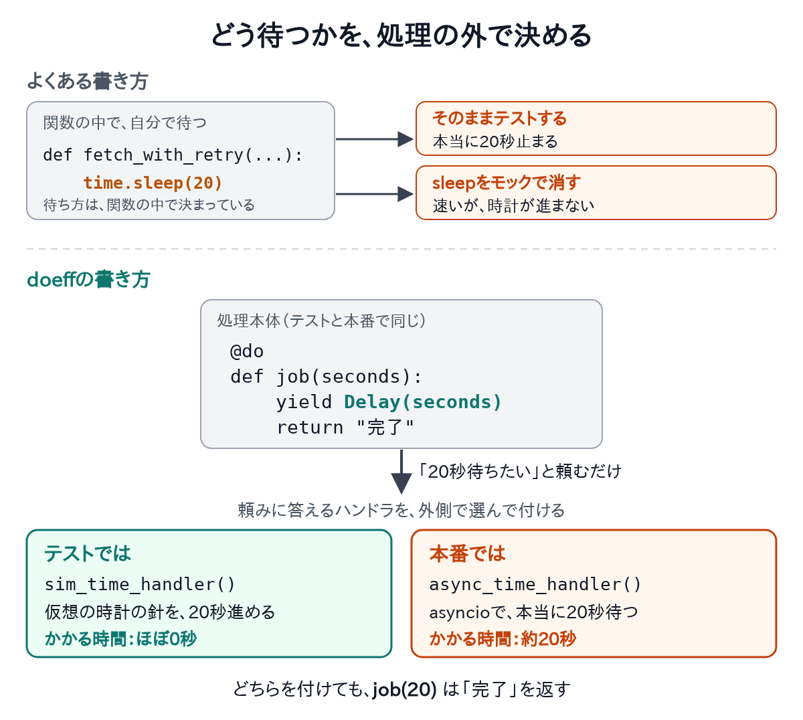
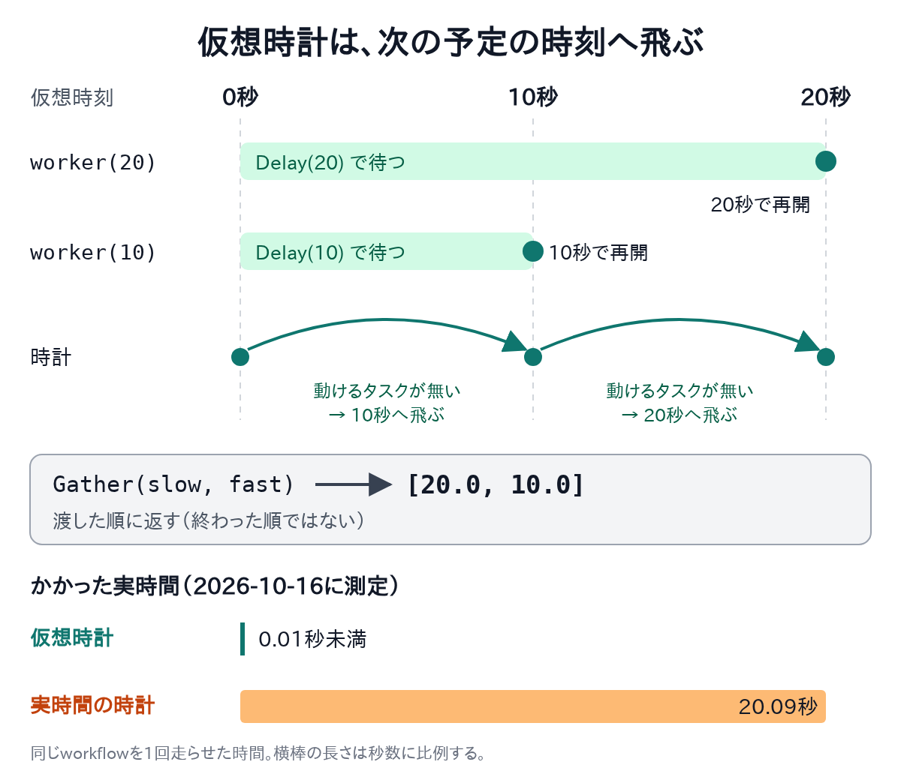

外部のAPIが混んでいて断られたら、20秒待ってから呼び直します。こうした処理は、よく書きます。困るのは、この処理のテストを書く時です。

再試行を1回試すテストは、本当に20秒かかります。2回目、3回目を試すテストを足すたびに、CIは20秒ずつ延びます。待ち時間を5分に延ばす変更が入れば、テストも5分止まります。

待たずに済ませようと、`time.sleep`をモックで消すこともあります。すると、今度は別の所で困ります。

- 時計が進まないので、「60秒を過ぎたら諦める」といった時刻の判定を試せません。
- 2つの待ちのどちらが先に終わるかも、試せません。
- 今の時刻を読む処理は、テストを走らせた時刻で結果が変わります。

この記事は、Pythonのライブラリdoeffを紹介する連載の3本目です。doeffでは、処理の中の「待つ」「読む」といった操作を、外側への依頼として書きます。依頼への答え方は、外側に付ける部品（ハンドラ）で選びます。前の2本では、次のことをしました。

- 1本目は[入門](doeff-main.md)です。同じ挨拶の処理に付けるハンドラを替え、「花子」にも「太郎」にも挨拶させました。
- 2本目は[Claude Codeを起動してテストするのをやめる](doeff-agents.md)です。AIエージェントの起動と結果待ちを依頼にし、テストでは本物を起こさずハンドラに答えさせました。

この3本目では、同じ考え方を「時間」に使います。待つことと時刻を読むことを依頼にし、テストでは仮想の時計に答えさせます。本番と同じ処理のまま、テストは20秒待たずに終わります。コードは[GitHub](https://github.com/proboscis/doeff)から読めます。

## よくある書き方：sleepで待ち、テストではモックで消す

まず、doeffを使わない普通の書き方を見ます。断られたら20秒待って呼び直す関数と、そのテストです。

```python
import time  # 処理の中で、実際に待つ。
from unittest.mock import patch  # テストで、time.sleepを差し替える。


def fetch_with_retry(call, wait_seconds=20, retries=3):  # 断られたら、待って呼び直す。
    for _ in range(retries):  # 最大3回まで試す。
        try:  # 呼んでみて、断られたかを見る。
            return call()  # 成功したら、その値を返す。
        except ConnectionError:  # 混んでいて断られた時だけ、
            time.sleep(wait_seconds)  # 20秒、処理を止めて待つ。
    raise ConnectionError("混雑が続いた")  # 3回とも断られたら諦める。


def test_retry_with_mocked_sleep():  # sleepを消して、待たずに試す。
    replies = iter([ConnectionError(), "成功"])  # 1回目は断られ、2回目で通る。

    def call():  # 本物のAPIの代わり。
        reply = next(replies)  # 決めた順に答える。
        if isinstance(reply, Exception):  # 断る番なら、
            raise reply  # 例外を投げる。
        return reply  # 通る番なら、値を返す。

    with patch("time.sleep") as sleep:  # この中では、sleepが何もしない。
        assert fetch_with_retry(call) == "成功"  # 待たずに、すぐ終わる。
    sleep.assert_called_once_with(20)  # 分かるのは「20秒待とうとした」ことだけ。
```

モックを使えば、テストは一瞬で終わります。ただし、時計はまったく進みません。待ちの後で`time.time()`を読む処理は、20秒が過ぎたことを知りません。

根にあるのは、「待つ」ことが関数の中に直に書かれている点です。テストで替えたいのは待ち方だけなのに、`time`モジュールごと差し替えるしかありません。

## doeffでは、「待つ」を外側への依頼にする

doeffでは、処理の中で自分では待ちません。「20秒待ちたい」と外側へ頼み、どう待つかは外側に付けたハンドラが決めます。再試行を省き、待つだけの処理で見ます。テストでは、仮想の時計を持つハンドラを付けます。

```python
from doeff import do, run  # 処理の定義と、その実行を使う。
from doeff_core_effects.scheduler import scheduled  # タスクの再開と時計の進行を管理する。
from doeff_time import Delay, sim_time_handler  # 待ちの依頼と、仮想時計のハンドラを使う。


@do  # 呼んだだけでは動かない処理（Program）にする。
def job(seconds: float):  # 待つ秒数だけを受け取る。
    yield Delay(seconds)  # 「seconds秒待ちたい」と外側へ依頼する。
    return "完了"  # 待ちが終わると、この文字列を返す。


def test_job_finishes_without_waiting():  # pytestが集めるテスト関数。
    program = sim_time_handler()(job(20))  # 仮想時計のハンドラを外側に付ける。
    assert run(scheduled(program)) == "完了"  # 20秒待たずに、すぐ終わる。
```

`job(20)`は「20秒待ちたい」と頼むだけで、自分では待ちません。テストでは仮想時計が答えるので、時計を20秒進めてすぐ続きを動かします。


*`time.sleep`を関数の中に書くと、テストは本当に待つか、時計の進まないモックになります。doeffでは処理本体が`Delay(20)`を頼むだけで、テストと本番でハンドラを替えます。*

## 依頼とハンドラ：コードに出てきた語

コードに出てきた語を、ここで整理します。

- `@do`を付けた関数は、呼んでもすぐには動きません。実行する手順を表す`Program`を返します。
- `yield Delay(20)`は、「20秒待ちたい」という依頼を外側へ渡します。
- このような依頼をエフェクト（effect）と呼びます。
- 依頼を受け、続きをいつ・どう動かすかを決める部品を、ハンドラ（handler）と呼びます。
- `run`は、ハンドラを付けた`Program`を最後まで動かします。
- `scheduled`は、待っているタスクの再開と、仮想時計の進行を受け持ちます。

`job`自身は、`time.sleep`も`asyncio.sleep`も呼びません。そのため、どの時計で待つかを外側で選べます。

| 処理の内側が書くこと | 外側のハンドラが決めること |
| --- | --- |
| 20秒待ちたい | 実際に待つか、仮想時計を進めるか |
| 今の時刻を知りたい | OSの時計を読むか、仮想時計を読むか |
| 別の処理を始め、結果を待ちたい | どのタスクを、いつ再開するか |

処理の手順と、その動かし方を分けるわけです。

### ハンドラの中身：待ちを飛ばすだけのハンドラ

ハンドラは自分でも書けます。次のハンドラは待ちの依頼を受けると、待たずにすぐ続きを動かします。ここからのコードは前のコードの続きで、`job`もそのまま使います。

```python
from doeff import Pass, Resume, handler, with_handlers  # 依頼の委譲・再開・取り付けを使う。
from doeff_time import DelayEffect  # Delay(...)が作る依頼の型。


@handler  # この関数を、Programに取り付けられるハンドラにする。
def skip_delay(effect, k):  # effectは届いた依頼、kは止まった処理の続き。
    if isinstance(effect, DelayEffect):  # 待ちの依頼だけを受け持つ。
        return (yield Resume(k, None))  # 待たずに、すぐ続きを再開する。
    return (yield Pass(effect, k))  # 担当外の依頼は、外側のハンドラへ渡す。


def test_job_with_own_handler():  # 自作のハンドラでも、同じjobが終わる。
    assert run(with_handlers([skip_delay], job(20))) == "完了"  # 時計なしで、すぐ終わる。
```

- `isinstance`で、届いた依頼が待ちかどうかを見分けます。
- 待ちの依頼は、頼まれた秒数を`effect.seconds`に持っています。
- `Resume(k, None)`は、止まっていた`job`へ`None`を渡して再開します。
- 待ち以外の依頼は、`Pass`で外側のハンドラへ渡します。
- `with_handlers`は、ハンドラを`Program`の外側に取り付けます。

ただし、このハンドラは時計を持ちません。待ちが2つあると、どちらが先に終わるかを試せません。ここからは、doeff-timeの仮想時計を使います。

## 見せ場：20秒と10秒の待ちを、仮想時間で並べて動かす

20秒待つ処理と10秒待つ処理を同時に始めます。それぞれが、開始から何秒後に再開したかを調べます。

```python
from datetime import datetime, timezone  # 仮想時計の開始日時をUTCで固定する。

from doeff_core_effects.scheduler import Gather, Spawn  # タスクを始め、結果を集める。
from doeff_time import GetTime  # 選んだ時計の、今の日時を読む。


@do  # 待ってから、再開した日時を返す。
def worker(seconds: float):  # 20または10を受け取る。
    yield Delay(seconds)  # 仮想時間なら、時計が指定秒数進むまで止まる。
    return (yield GetTime())  # 再開した時点の日時を返す。


@do  # 2つの待ちを、通常のyieldで組み立てる。
def workflow():  # 実時間でも仮想時間でも、同じ処理を使う。
    start = yield GetTime()  # 経過秒数の基準になる開始日時を読む。
    slow = yield Spawn(worker(20))  # 20秒待つ処理を始め、Taskを受け取る。
    fast = yield Spawn(worker(10))  # 10秒待つ処理も始める。
    finished = yield Gather(slow, fast)  # slow、fastの順で日時を受け取る。
    return [(t - start).total_seconds() for t in finished]  # 開始からの秒数へ直す。


def test_workflow_in_virtual_time():  # 20秒の流れを、待たずに確かめる。
    start = datetime(2026, 1, 1, tzinfo=timezone.utc)  # 時計の開始を00:00:00に固定する。
    program = sim_time_handler(start_time=start)(workflow())  # 仮想時計を取り付ける。
    assert run(scheduled(program)) == [20.0, 10.0]  # 20秒後と10秒後に再開した。
```

- `Spawn`は、処理を別のタスクとして始め、その`Task`を返します。
- `Gather`は、渡した順に結果を返します。終わった順ではありません。
- 開始日時を固定するので、`GetTime`の値は走らせる時刻によりません。


*2つのタスクが0秒で待ち始めます。時計は10秒、20秒の順に飛び、Gatherは`[20.0, 10.0]`を返します。*

仮想時計は、動けるタスクが無くなった時だけ、次の予定の時刻まで進みます。時計を進める係は、低い優先度のタスクとして動きます。動ける処理が残っている間に、時計だけが先へ進むことはありません。

**「何を返すか」に加えて、「いつ続きを動かすか」もハンドラが決めます。** 先ほどの自作のハンドラとの違いは、ここにあります。

2026年11月3日に、この記事のコードの枠を上から順に実行し、テスト関数4つを呼びました。4つとも通りました。4つの枠を実行した時間は、ライブラリの読み込みを含めて合わせて約0.4秒でした。

## 実時間で動かす時は、外側だけを替える

本番で実際に待つ時も、`worker`と`workflow`はそのまま使います。

```python
from doeff_core_effects.handlers import await_handler  # 非同期の待ちを、スケジューラへ繋ぐ。
from doeff_time import async_time_handler  # asyncioで実際に待つハンドラ。

program = async_time_handler()(workflow())  # 同じworkflowに、実時間の時計を付ける。
result = run(scheduled(await_handler()(program)))  # 今度は実際に約20秒待つ。
print(result)  # おおむね[20.0, 10.0]。起床の遅れで、わずかにずれる。
```

- `async_time_handler`は、内部で`asyncio`を使って実際に待ちます。
- `await_handler`は、その非同期の待ちをdoeffのスケジューラへ繋ぎます。

2026年10月16日に走らせると、表示は`[20.091931, 10.058906]`でした。全体で約20秒かかりました。

処理本体には、`async def`も`asyncio.sleep`もありません。`asyncio`をやめる話ではありません。**`asyncio`への依存を、ハンドラの側に寄せる**という話です。スレッドを止めて待つ`sync_time_handler`もあり、3つの時計から選べます。

## 指定時刻の処理と、優先度も同じ書き方で

決まった日時に処理を始めたい時も、同じ`yield`の依頼で書きます。

- `ScheduleAt(日時, 処理)`は、指定した日時に処理を始める予定を登録し、`Task`を返します。
- `WaitUntil(日時)`は、指定した日時になるまで待ちます。
- `Wait(task)`は、予定の処理が終わるのを待ち、その戻り値を受け取ります。

たとえば、8秒後の予定を登録してから3秒後まで待つ処理を、仮想時計で動かします。3秒の時点で一度戻り、8秒の時点で予定の値を受け取ります。どちらも実際には待ちません。コードは[完全な例](examples/scheduling.py)の`timeline`にあります。

予定の本文は、今の実装では時間ハンドラの外側で動きます。本文の中で`GetTime`を使うと、受け手のいない依頼になります。本文で時計が要る時は、ハンドラを付ける範囲を明示します。

仮想時計の日時は、`start_time`の引数か`SetTime`で決めます。`SetTime`を扱うのは仮想時計だけです。実時間のハンドラで、OSの時計を変えることはできません。

優先度も、タスクを始める時の引数で書きます。`Spawn(処理, priority=TaskPriority.HIGH)`のように渡すと、動ける時に先に選ばれます。動いているCPU処理を、途中で止める仕組みではありません。優先度の例は、[完全な例](examples/scheduling.py)に入れています。

## まとめ

- 「待つ」を`yield Delay(...)`の依頼にすると、どの時計で待つかを外側で選べます。
- テストでは仮想時計のハンドラを付け、20秒の流れを一瞬で確かめます。
- 開始日時を固定するので、時刻を読む処理も毎回同じ結果になります。
- 本番では実時間のハンドラに替えるだけで、処理本体は変えません。
- 指定時刻の処理と優先度も、同じ`yield`の書き方で書けます。

時間以外の依頼との組み合わせは、[ハンドラの合成](doeff-handlers.md)で扱います。`await`との違いは[coroutineとの違い](doeff-coroutines.md)、ゲームの進行と組み合わせる例は[カードゲームの記事](doeff-games.md)にあります。

[doeffとは？：メイン記事へ戻る](doeff-main.md)

## 参考

この記事のコードは、2026年10月17日に、PyPIのdoeff 0.6.0で確かめました。Pythonは3.12と3.14で試しました。GitHubにあるdoeffのmain（commit `9adc4f8`）でも、同じく動きました。`doeff`・`doeff-core-effects`・`doeff-time`の3つのパッケージが要ります。

doeff-timeはPyPIに無いので、GitHubから入れます。`--no-sources`を付けないと、doeff本体もGitHubから入り、Rustのビルドが要ります。完全な例を`scheduling.py`として保存し、次のコマンドで実行します。

```bash
uv run --no-sources --with "doeff==0.6.0" --with "doeff-time @ git+https://github.com/proboscis/doeff@9adc4f8#subdirectory=packages/doeff-time" python scheduling.py  # doeff本体はPyPI、doeff-timeだけGitHubから入れて、完全な例を実行する。
```

- [この記事のコードをまとめた完全な例](examples/scheduling.py)
- [doeff本体（この記事で確かめた版）](https://github.com/proboscis/doeff/tree/9adc4f8e657a552f5253d8a7b422363789c2608c)
- [実時間・仮想時間のハンドラ](https://github.com/proboscis/doeff/tree/9adc4f8e657a552f5253d8a7b422363789c2608c/packages/doeff-time)
- [タスクと優先度を扱うスケジューラ](https://github.com/proboscis/doeff/blob/9adc4f8e657a552f5253d8a7b422363789c2608c/packages/doeff-core-effects/doeff_core_effects/scheduler.py)
- [ハンドラの能力と関数の色の整理](https://github.com/proboscis/doeff/blob/9adc4f8e657a552f5253d8a7b422363789c2608c/docs/22-capability-classes.md)
- 前の回:[Claude Codeを起動してテストするのをやめる](doeff-agents.md)
- 次の回:[依存を引数で引き回すのをやめる](doeff-di.md)
